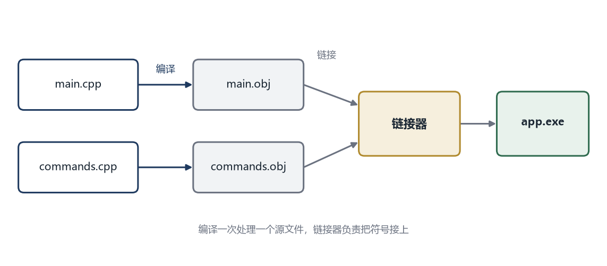
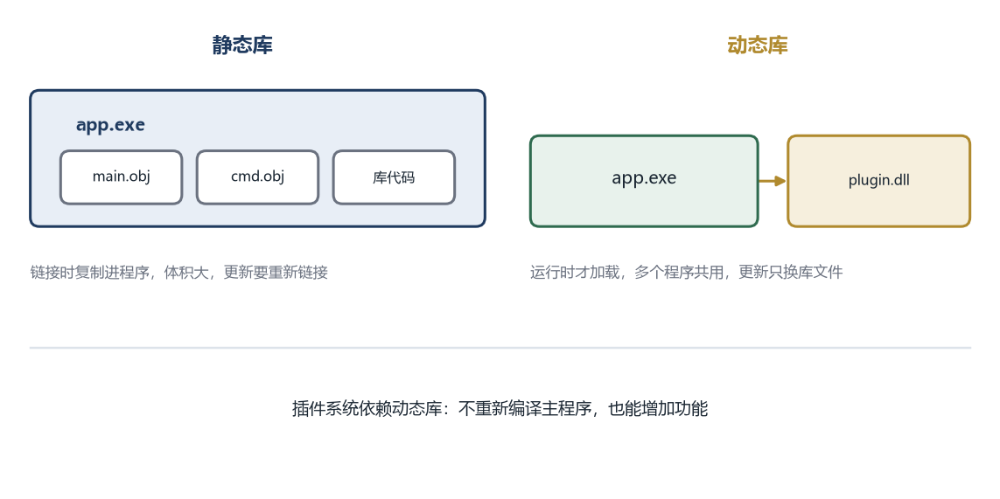

# 第 2 章 把代码拆开

本章的完整代码和编译说明在 `codes/ch02/`。

## 2.1 先把两段逻辑搬走

第 1 章的程序里，`hello` 和 `time` 的处理逻辑直接写在 `if` 链里。现在把它们搬出来，各变成一个函数。

```cpp
#include <iostream>
#include <string>

void cmd_hello() {
    std::cout << "你好，世界\n";
}

void cmd_time() {
    std::cout << "现在该干活了\n";
}

int main() {
    std::string line;
    while (true) {
        std::cout << "> ";
        if (!std::getline(std::cin, line)) break;
        if (line == "quit") break;
        if (line == "hello") {
            cmd_hello();
        } else if (line == "time") {
            cmd_time();
        } else {
            std::cout << "不认识的命令：" << line << "\n";
        }
    }
    return 0;
}
```

`void cmd_hello()` 里的 `void` 表示这个函数不返回任何值，`()` 表示它不接收参数。函数体就是大括号里的内容。

`main` 里原来的两段输出，变成了两次函数调用。程序的行为完全一样，但结构变了：处理逻辑有了名字，`main` 只负责“判断用户输入的是哪个命令，然后调用对应的函数”。

这一步看起来只是整理，但它带来了一个关键变化。函数有了名字，就可以被别的地方调用；能被别的地方调用，才有可能被搬到别的文件里。

## 2.2 声明和定义是两件事

把函数搬到另一个文件之前，要先分清两个概念。

**定义**是函数的完整实现，包括函数体：

```cpp
void cmd_hello() {
    std::cout << "你好，世界\n";
}
```

**声明**只告诉编译器“有这么个函数，它长这样”，不写函数体：

```cpp
void cmd_hello();
```

声明以分号结尾，没有大括号。它相当于一张名片：告诉你这个人叫什么、能接受什么、会返回什么，但不会告诉你他具体怎么干活。

为什么需要名片？因为 C++ 编译器是“从上往下、一个文件一个文件”处理的。当它在 `main` 里看到 `cmd_hello()` 时，必须已经知道这个名字是个函数、不接受参数、不返回值。如果函数定义写在后面，编译器读到调用时还没见过它，就会报“未声明的标识符”。

有两种解决办法。一种是把定义挪到调用前面，但函数一多，顺序就很难安排，A 调用 B、B 调用 A 时没法同时满足。另一种是把声明集中放在一个文件里，谁需要就把它拿过去。这个文件就是头文件。

## 2.3 头文件：把“能做什么”集中起来

新建一个文件 `commands.h`：

```cpp
#pragma once

void cmd_hello();
void cmd_time();
```

`#pragma once` 是一句给编译器的叮嘱：这个文件在一次编译里只读一遍。为什么需要它？因为一个头文件可能被多个文件引用，也可能被间接引用多次。没有这句话，同一个声明可能出现好几遍，编译器会抱怨“重复定义”。

严格说，重复声明同一个函数在 C++ 里是允许的，但头文件里往往还有类型、常量、宏，这些东西重复了就会出错。加上 `#pragma once` 是最省事的做法，主流编译器都支持。

现在建第二个文件 `commands.cpp`，把两个函数的定义放进去：

```cpp
#include <iostream>
#include "commands.h"

void cmd_hello() {
    std::cout << "你好，世界\n";
}

void cmd_time() {
    std::cout << "现在该干活了\n";
}
```

注意 `#include "commands.h"` 用的是双引号。双引号表示“先在我自己所在的目录找”，尖括号表示“去系统或者编译器配置的目录找”。自己写的头文件用双引号，标准库用尖括号。

`main.cpp` 也改成引用这个头文件：

```cpp
#include <iostream>
#include <string>
#include "commands.h"

int main() {
    std::string line;
    while (true) {
        std::cout << "> ";
        if (!std::getline(std::cin, line)) break;
        if (line == "quit") break;
        if (line == "hello") {
            cmd_hello();
        } else if (line == "time") {
            cmd_time();
        } else {
            std::cout << "不认识的命令：" << line << "\n";
        }
    }
    return 0;
}
```

现在 `main.cpp` 里没有 `cmd_hello` 的实现，只有它的名片。实现藏在 `commands.cpp` 里。这就是最初级的“接口与实现分离”：`main.cpp` 知道能做什么，不知道怎么做。

## 2.4 两个文件怎么变成一个程序

编译命令要同时列出两个源文件。

Visual Studio 的开发者命令行：

```bat
cl /EHsc /std:c++17 main.cpp commands.cpp
```

MinGW 或者 Linux：

```bash
g++ -std=c++17 main.cpp commands.cpp -o app
```

编译器其实做了两步。

第一步，把每个 `.cpp` 单独编译成一个中间文件。`main.cpp` 编译成 `main.obj`，`commands.cpp` 编译成 `commands.obj`。这一步只检查语法，不关心 `cmd_hello` 到底在哪里实现。编译器看到声明，就假设“别处一定有”，先放行。

第二步，链接器把两个 `.obj` 和标准库拼在一起。它发现 `main.obj` 里有一个对 `cmd_hello` 的调用，就去别的 `.obj` 里找这个名字。在 `commands.obj` 里找到了，就把调用地址填上。如果找不到，就报“无法解析的外部符号”。

这里有一个很重要的概念，叫**编译单元**。一个 `.cpp` 文件加上它 `#include` 进来的所有头文件，构成一个编译单元。编译器一次处理一个编译单元，处理完就忘掉，不会记住别的 `.cpp` 里有什么。

所以头文件的作用不是“共享代码”，而是“共享声明”。真正的代码仍然在各自的 `.cpp` 里，链接器负责把它们接起来。

可以用盖房子来理解。每个 `.cpp` 是一个施工队，各自按图纸施工，不需要知道别的队在干什么。头文件是图纸上的接口说明：这里要留一个门，尺寸多少。链接器是最后验收的人，检查每个门是不是都有人装上了。



## 2.5 函数名就是符号

链接器靠什么找函数？靠**符号**。编译器会把函数名变成一个符号，写进 `.obj` 文件里。

在 C 语言里，函数 `cmd_hello` 的符号就是 `cmd_hello`，很直白。C++ 支持函数重载，也就是同名函数可以有不同参数，所以编译器要把参数信息也编进符号里。`void cmd_hello()` 可能变成 `?cmd_hello@@YAXXZ` 这样的名字。这个过程叫**名字修饰**。

名字修饰保证了同名不同参数的函数能被区分开，但也带来一个问题：不同编译器修饰出来的名字可能不一样。C++ 标准没有规定具体的修饰规则，Visual Studio 和 GCC 就各用各的。这意味着用 Visual Studio 编译的 `.obj`，不一定能和 GCC 编译的 `.obj` 链接在一起。

普通项目里这不是问题，因为所有人用同一套工具链。但插件系统要面对“插件可能是别人用别的编译器做的”这种情况，所以需要一种稳定的、跨编译器的符号名。答案是用 `extern "C"`，下一章会用到。

## 2.6 静态库和动态库

现在有两个 `.obj`，可以每次编译都把它们列出来。文件多了之后，这样很麻烦。于是有了**库**。

**静态库**是把一堆 `.obj` 打包成一个文件。Windows 上是 `.lib`，Linux 上是 `.a`。链接的时候，链接器从这个包里挑出需要的 `.obj`，复制进最终的程序。

静态库的好处是简单，程序拿到就能跑，不依赖外部文件。坏处是每个用到它的程序都带着一份副本，体积变大；库更新了，程序必须重新链接才能用上新版本。

**动态库**是另一种打包方式。Windows 上是 `.dll`，Linux 上是 `.so`。它不复制进程序，而是在程序运行时才被加载。多个程序可以共用同一份动态库；库更新了，只要接口没变，程序不用重新编译。

动态库正是插件系统的基础。主程序可以在启动时扫描一个目录，把里面的动态库一个个加载进来，调用它们提供的函数。加一个新功能，只需要放一个新的动态库进去，主程序一行都不用改。

第 3 章就做这件事。



## 2.7 现在的结构还差什么

把代码拆成函数和文件之后，程序好读了一些，但三个问题只解决了一个半。

“加功能要改主程序”这个问题还在。加一个 `date` 命令，仍然要在 `commands.cpp` 里加一个函数，在 `commands.h` 里加一行声明，在 `main.cpp` 的 `if` 链里加一个分支，然后重新编译整个程序。

“所有代码在一个文件”解决了一半。逻辑分开了，但最终还是链接成同一个可执行文件，运行时仍然是一整块。

“一个错误带走整个程序”完全没解决。

要真正解决第一个问题，需要让主程序在运行时才发现新功能。这要求功能不在编译时链接进来，而是在运行时被加载。这就是动态库要做的事。
