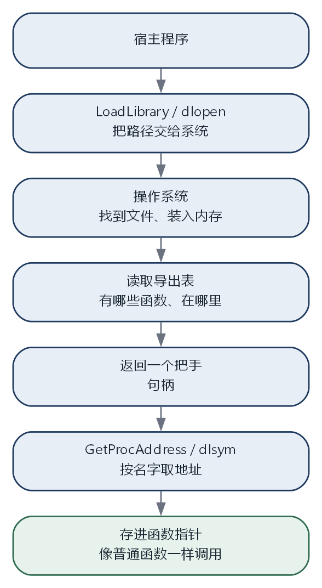

# 第 3 章 第一个插件

本章的完整代码和编译说明在 `codes/ch03/`。

## 3.1 目标：不加新代码也能多一个命令

现在的程序，每加一个命令都要改三个地方：`commands.h` 加声明，`commands.cpp` 加实现，`main.cpp` 的 `if` 链加分支，然后重新编译。

这次换一种做法。主程序只负责“找到插件、加载插件、调用插件”，具体有什么命令，由插件自己决定。加一个新命令，只需要往 `plugins` 目录里放一个新的动态库，主程序不动。

这一章会写出两个东西。一个是很小的插件，提供一个 `hello` 命令；一个是宿主，负责把插件目录里的动态库读进来。代码不长，但涉及几个新概念，每个都会解释。

## 3.2 动态库到底是什么

第 2 章说过，动态库在程序运行时才被加载。说得再具体一点。

一个 `.dll` 或者 `.so` 文件，本质上是一个装好了代码的盒子。盒子里有编译好的机器指令，还有一张**导出表**，写着“外面可以调用我这里的哪些函数，它们叫什么名字、在什么位置”。

宿主程序拿到这个盒子，先问操作系统要一个“把手”，然后通过把手去查导出表，找到某个函数的地址，把它存进一个函数指针，之后就能像调用普通函数一样调用它。

这个过程和去仓库取货很像。宿主不需要知道货放在哪个架子，只需要把货号报给仓库管理员，管理员把货递出来。动态库是仓库，操作系统是管理员，导出表是货号清单。

## 3.3 先定一个最小的协议

插件和宿主之间要有约定，否则宿主不知道插件里有什么函数、该怎么调用。这一章先用一个最小的约定，三个函数：

```cpp
// plugin_api.h
#pragma once

#ifdef _WIN32
#define PLUGIN_EXPORT __declspec(dllexport)
#else
#define PLUGIN_EXPORT __attribute__((visibility("default")))
#endif

extern "C" {
    PLUGIN_EXPORT const char* plugin_name();
    PLUGIN_EXPORT int plugin_init();
    PLUGIN_EXPORT void plugin_shutdown();
}
```

`plugin_name` 返回插件的名字，宿主用它来显示。`plugin_init` 在插件被加载后调用，插件可以在这里做初始化。`plugin_shutdown` 在卸载前调用，插件在这里清理自己占用的东西。

`PLUGIN_EXPORT` 是一个宏。在 Windows 上，它展开成 `__declspec(dllexport)`，意思是“这个函数要写进导出表，外面可以调用”。在 Linux 上，它展开成 `__attribute__((visibility("default")))`，意思类似：这个函数对外可见。

宏可以理解成“编译前的文本替换”。`#define` 定义一个名字和一段文本，编译器读到这个名字就换成那段文本。这里用它来抹平两个平台的写法差异，避免在代码里到处写 `#ifdef`。

## 3.4 为什么名字要按 C 的规则

第 2 章说过，C++ 会对函数名做修饰，把参数信息编进符号里。不同编译器修饰规则不同，甚至同一编译器的不同版本也可能不同。

插件是别人编译的，可能用 Visual Studio，也可能用 GCC。如果宿主按修饰后的名字去找函数，换个编译器就找不到了。所以插件接口要用 `extern "C"`，告诉编译器“这几个函数按 C 的规则来，名字不要修饰”。

`extern "C"` 只影响链接时的名字，不影响函数内部的写法。函数体里仍然可以写 C++，可以用类、模板、标准库。它只保证这个名字在外面看起来是稳定的。

生活里可以这样理解。C++ 的名字修饰像给每个人起了一个包含生日、籍贯、血型的长名字，确保不会重名，但外人很难记住。`extern "C"` 是说“这个人对外就用身份证上的名字”，简单、稳定、跨系统都能查。

## 3.5 函数指针：把函数当数据存起来

宿主从动态库里取出来的东西，不是一个能直接调用的函数，而是一个地址。要调用它，得先把地址存进**函数指针**。

函数指针的写法有点绕：

```cpp
const char* (*name_fn)();
```

从里往外读。`(*name_fn)` 表示 `name_fn` 是一个指针。右边的 `()` 表示它指向的函数不接受参数。左边的 `const char*` 表示那个函数返回一个字符串。合起来：`name_fn` 是一个指向“无参数、返回字符串”的函数的指针。

调用的时候写 `name_fn()`，和普通函数一样。编译器知道它是个指针，会跳到那个地址去执行。

这就像你把朋友的电话号码存进通讯录。号码本身不是朋友，但拨这个号码就能找到他。函数指针就是函数的号码。

## 3.6 写一个插件

新建 `hello_plugin.cpp`：

```cpp
#include "plugin_api.h"
#include <cstdio>

static int counter = 0;

extern "C" PLUGIN_EXPORT const char* plugin_name() {
    return "hello";
}

extern "C" PLUGIN_EXPORT int plugin_init() {
    std::printf("[hello] init\n");
    std::fflush(stdout);
    return 0;
}

extern "C" PLUGIN_EXPORT void plugin_shutdown() {
    std::printf("[hello] shutdown, counter=%d\n", counter);
    std::fflush(stdout);
}
```

`static int counter = 0;` 是插件自己的状态，记录这个插件被调用了多少次。`static` 放在全局变量前面，表示“这个变量只在本文件内可见”，别的文件看不到，也不会和别人的同名变量冲突。

`plugin_init` 返回 0 表示初始化成功，返回非零表示失败。宿主会根据这个返回值决定要不要继续使用这个插件。

`std::printf` 是 C 风格的输出，`std::fflush(stdout)` 把缓冲区里的内容立刻送到屏幕。为什么不用 `std::cout`？因为动态库和主程序可能各自持有一份输出缓冲，混用时顺序容易乱。`printf` 配合刷新更稳，代码也更短。

## 3.7 宿主：扫描、加载、调用

宿主需要做四件事：找到动态库、打开它、取出三个函数、按顺序调用。

```cpp
// main.cpp
#include <cstdio>
#include <filesystem>
#include <string>
#include <vector>

#ifdef _WIN32
#include <windows.h>
using LibHandle = HMODULE;
static LibHandle open_lib(const std::string& p) { return LoadLibraryA(p.c_str()); }
static void* get_sym(LibHandle h, const char* n) { return (void*)GetProcAddress(h, n); }
static void close_lib(LibHandle h) { FreeLibrary(h); }
#else
#include <dlfcn.h>
using LibHandle = void*;
static LibHandle open_lib(const std::string& p) { return dlopen(p.c_str(), RTLD_NOW); }
static void* get_sym(LibHandle h, const char* n) { return dlsym(h, n); }
static void close_lib(LibHandle h) { dlclose(h); }
#endif

int main() {
    std::vector<LibHandle> loaded;
    for (const auto& entry : std::filesystem::directory_iterator("plugins")) {
#ifdef _WIN32
        if (entry.path().extension() != ".dll") continue;
#else
        if (entry.path().extension() != ".so") continue;
#endif
        LibHandle h = open_lib(entry.path().string());
        if (!h) { std::printf("load failed: %s\n", entry.path().string().c_str()); continue; }

        auto name = (const char*(*)())get_sym(h, "plugin_name");
        auto init = (int(*)())get_sym(h, "plugin_init");
        if (!name || !init) { std::printf("missing symbols\n"); close_lib(h); continue; }

        std::printf("loaded %s\n", name());
        std::fflush(stdout);
        init();
        loaded.push_back(h);
    }

    for (auto h : loaded) {
        auto shut = (void(*)())get_sym(h, "plugin_shutdown");
        if (shut) shut();
        close_lib(h);
    }
    return 0;
}
```

一段一段看。

`using LibHandle = HMODULE;` 给类型起别名。Windows 上动态库的把手是 `HMODULE`，Linux 上是 `void*`。用同一个名字 `LibHandle`，后面的代码就不用到处写平台判断。

`open_lib` 打开动态库。Windows 用 `LoadLibraryA`，参数是文件路径；Linux 用 `dlopen`，第二个参数 `RTLD_NOW` 表示“现在就把需要的符号都解析好”。失败时返回空。

`get_sym` 按名字取函数地址。Windows 用 `GetProcAddress`，Linux 用 `dlsym`。返回值是 `void*`，需要强制转换成具体的函数指针类型。

`close_lib` 关闭动态库，释放它占用的资源。

`std::filesystem::directory_iterator("plugins")` 遍历 `plugins` 目录下的每一个条目。这是 C++17 标准库提供的文件系统功能，不需要额外装库。

`entry.path().extension()` 取文件扩展名。Windows 只处理 `.dll`，Linux 只处理 `.so`。

`auto name = (const char*(*)())get_sym(...)` 把取到的地址转换成函数指针。`auto` 表示“类型由右边推断”，省得手写一长串。

`if (!name || !init)` 检查必需的两个函数在不在。缺了就跳过这个库，并打印提示。注意这里没有检查 `plugin_shutdown`，因为它是可选的，卸载时再取一次就行。



## 3.8 编译和运行

Windows 的开发者命令行：

```bat
cl /EHsc /std:c++17 /LD hello_plugin.cpp /Fe:plugins\hello_plugin.dll
cl /EHsc /std:c++17 main.cpp /Fe:host.exe
host.exe
```

第一行编译插件。`/LD` 表示“生成动态库”，`/Fe:` 指定输出路径。运行后 `plugins` 目录里会多出 `hello_plugin.dll`，可能还会多一个 `.lib` 和一个 `.exp`，那是链接时的附带产物，可以忽略。

第二行编译宿主。第三行运行。

Linux 或者 MinGW：

```bash
mkdir -p plugins
g++ -std=c++17 -shared -fPIC hello_plugin.cpp -o plugins/hello_plugin.so
g++ -std=c++17 main.cpp -o host -ldl
./host
```

`-shared` 表示生成动态库，`-fPIC` 表示生成位置无关的代码，动态库需要这个选项。`-ldl` 表示链接动态加载相关的库。

运行后应该看到：

```text
loaded hello
[hello] init
[hello] shutdown, counter=0
```

三行分别来自宿主、插件的初始化、插件的清理。顺序说明宿主先拿到名字，再调用初始化，最后在退出前调用清理。

现在往 `plugins` 目录里再放一个动态库，宿主会把它也加载进来，主程序一行都不用改。这就是插件系统最核心的能力。

## 3.9 这一步解决了什么

回头看第 1 章提出的三个问题。

“加功能要改主程序”解决了一大半。新功能现在是一个独立的动态库，主程序只负责加载。虽然主程序里的 `if` 链还在，但它已经不需要认识具体命令了，因为它根本不知道插件里有什么命令。

“所有代码在一个文件”解决了。插件可以单独编译、单独发布，甚至可以由别人来写。

“一个错误带走整个程序”还没解决。插件和宿主在同一个进程里，插件里一个空指针照样能让整个程序崩溃。这个问题要到第 7 章。

## 3.10 还差什么

现在的插件协议很脆弱，有几个明显的问题。

**只有三个函数，插件没法注册命令。** 宿主加载了插件，但不知道插件能做什么。需要一个机制，让插件把自己的命令交给宿主。

**没有版本。** 宿主怎么知道这个插件是给哪个版本的接口写的？接口一改，旧插件可能直接崩溃。

**没有隔离。** 插件可以访问宿主的任何内存，也可以调用系统的任何功能。一个恶意插件可以为所欲为。

**没有清理。** 插件注册的东西，卸载时怎么撤销？现在的 `plugin_shutdown` 只是一个通知，宿主没有统一的登记表。

**加载顺序不确定。** 目录遍历的顺序不固定，如果插件之间有依赖，谁先谁后就成了问题。

接下来的三章，先把前两个问题解决：用注册表让插件交出命令，用契约把接口固定下来。隔离和清理放到第二篇和第三篇。
