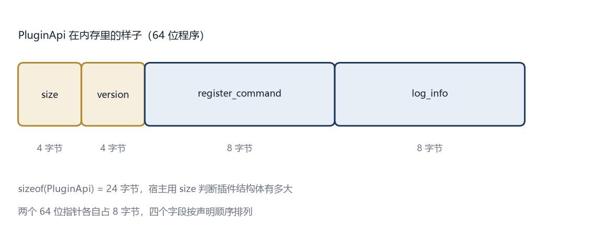

# 第 4 章 接口就是合同

## 4.1 三个函数不够用

第 3 章的插件只有 `plugin_name`、`plugin_init`、`plugin_shutdown` 三个函数。宿主知道插件的名字，也知道什么时候初始化，但不知道插件能做什么。

插件想提供一个 `hello` 命令，得告诉宿主：“我有一个命令，名字叫 hello，执行时调用这个函数。”宿主收到之后，存进一张表，等用户输入 `hello` 时再查表调用。

问题来了。插件和宿主是两个独立编译的动态库，它们之间怎么传“一个命令”这种东西？

可以直接传一个 C++ 的 `std::string` 和一个 `std::function` 吗？不行。`std::string` 的内部布局由标准库实现决定，Visual Studio 和 GCC 的实现不一样，甚至同一家的不同版本也可能不一样。插件里构造的 `std::string`，宿主按自己的理解去读，很可能读到一片乱码，然后崩溃。

所以跨动态库的接口，只能用最基础、最稳定的类型：整数、浮点数、指针、C 风格字符串、简单的结构体。这些东西的布局由编译器和操作系统共同遵守的规则决定，相对稳定。

这条规则可以总结成一句话：**接口上传的东西，越简单越安全。**

## 4.2 用结构体描述一个命令

先定义命令长什么样：

```cpp
typedef struct PluginCommand {
    const char* name;
    const char* help;
    void (*run)(const char* args);
} PluginCommand;
```

三个字段。`name` 是命令名，比如 `hello`。`help` 是一句说明，显示帮助时用。`run` 是执行命令的函数指针，接收一个参数串，不返回值。

`typedef struct` 是 C 的写法，把结构体定义和类型别名写在一起。`void (*run)(const char*)` 是一个函数指针，指向“接收一个字符串、不返回值”的函数。

这个结构体只包含指针，没有任何 C++ 对象。指针的大小在同一个平台上固定，字段顺序由声明决定，两个编译器看起来是一样的。这就是它能跨动态库传递的原因。

## 4.3 结构体的布局不是理所当然的

结构体在内存里怎么排，有一个规则叫**内存对齐**。

假设一个结构体有三个字段：`char`（1 字节）、`int`（4 字节）、`char`（1 字节）。直觉上它应该占 6 字节。但大多数编译器会让 `int` 从 4 的倍数地址开始，所以第一个 `char` 后面会空 3 字节，最后再补 3 字节，总共 12 字节。

为什么要浪费空间？因为处理器读内存时，按 4 字节或 8 字节一块读更快。让 `int` 对齐到 4 的倍数，读一次就能拿到；不对齐可能要读两次再拼起来。

对齐规则是平台和编译器约定好的，同一平台上的不同编译器通常一致。但如果你在结构体里放了 `double`、`long long`、指针，或者用了 `#pragma pack` 改变对齐，就可能出现两边理解不一致的情况。

插件接口的结构体要尽量简单，字段按大小从大到小排，不要用位域，不要手动改对齐。这些建议不是风格问题，而是“两边必须看到同一张内存图”的硬要求。



## 4.4 在结构体开头放一个尺码

即使字段一样，插件和宿主也可能是不同时间编译的。宿主升级了，结构体加了一个字段；旧插件还是老版本，它以为结构体只有三个字段。宿主按新布局去读旧插件传过来的结构体，就会读到边界之外。

解决办法是在结构体开头放一个字段，记录“我这个结构体有多大”。

```cpp
typedef struct PluginApi {
    uint32_t size;
    uint32_t version;
    void (*register_command)(const PluginCommand* cmd);
    void (*log_info)(const char* message);
} PluginApi;
```

`size` 是 `sizeof(PluginApi)`，`version` 是契约版本。宿主拿到插件传进来的指针，先读 `size`，和自己的 `sizeof(PluginApi)` 比。

如果插件的 `size` 比宿主的小，说明插件是旧版，后面的字段可能不存在。宿主可以只使用旧版有的字段，或者拒绝加载。如果插件的大，说明插件比宿主新，宿主不认识后面的字段，也可以拒绝。

这种做法在 Windows 的很多系统接口里都能见到，字段名通常叫 `cbSize`。它的作用像快递单上的“件数”：收到箱子先数一数，和单子上写的不一样，就说明中间出了问题。

## 4.5 契约版本

`size` 只能判断“结构体大小对不对”，不能判断“语义对不对”。有时候字段数量没变，但某个函数的行为变了，这时候需要版本号。

版本号用一个整数，比如 `1`、`2`、`3`。规则很简单：不兼容的改动加一，兼容的改动不加。

什么是兼容的改动？往结构体末尾加字段是兼容的，因为旧插件不读新字段，新宿主可以用 `size` 判断旧插件没有这个字段。给函数加一个可选参数、放宽参数范围，通常也算兼容。

什么是不兼容的改动？改变已有字段的含义、删除字段、改变函数签名、改变调用顺序。这些都要升版本。

宿主在 `plugin_init` 里检查版本：

```cpp
if (api->version != PLUGIN_API_VERSION) {
    // 版本不匹配，拒绝加载
}
```

真实系统可能支持多个版本，让旧插件走一条兼容路径。第 10 章会讲怎么演进。

## 4.6 只给能力，不给内部数据

设计接口时，最容易犯的错误是把宿主的内部结构直接暴露出去。

假设宿主有一个文档对象，里面有路径、内容、修改时间、撤销历史。如果接口直接把这个对象传给插件，插件就能读到所有字段，也能修改它们。宿主以后想改这个结构，所有插件都会坏。

正确的做法是只暴露插件真正需要的操作。插件想读文档内容，给它一个 `read_document` 函数；想改内容，给它一个 `write_document` 函数。它不需要知道文档对象长什么样。

这和第 2 章说的“头文件只放声明”是同一个道理，只是层次更高。头文件藏的是实现，接口藏的是数据结构。

可以借自动售货机理解。你投币、按按钮、拿饮料，不需要知道机器里的货道怎么排、弹簧怎么转。机器也不允许你伸手进去自己拿。按钮就是能力，货道就是内部数据。

## 4.7 完整的接口头文件

把上面的内容合起来，得到一个可以用的版本：

```cpp
// plugin_api.h
#pragma once

#include <cstdint>

#ifdef _WIN32
#define PLUGIN_EXPORT __declspec(dllexport)
#else
#define PLUGIN_EXPORT __attribute__((visibility("default")))
#endif

#define PLUGIN_API_VERSION 1

extern "C" {

typedef void (*CommandFn)(const char* args);

typedef struct PluginCommand {
    const char* name;
    const char* help;
    CommandFn run;
} PluginCommand;

typedef struct PluginApi {
    uint32_t size;
    uint32_t version;
    void (*register_command)(const PluginCommand* cmd);
    void (*log_info)(const char* message);
} PluginApi;

PLUGIN_EXPORT const char* plugin_name();
PLUGIN_EXPORT int plugin_init(const PluginApi* api);
PLUGIN_EXPORT void plugin_shutdown();

}
```

`#define PLUGIN_API_VERSION 1` 定义当前契约版本。插件和宿主都用这个宏，改的时候只改一处。

`uint32_t` 是固定 4 字节的无符号整数，来自 `<cstdint>`。用固定宽度的类型，不随平台变化，跨编译器更稳。

`register_command` 是宿主提供给插件的函数。插件在 `plugin_init` 里调用它，把自己的命令交上去。`log_info` 是日志能力，插件通过它输出信息，而不是直接打印到屏幕。这样宿主可以统一控制日志格式、写到文件、按插件过滤。

注意这两个都是函数指针，由宿主填好，通过 `PluginApi` 传给插件。插件只能调用宿主给的函数，不能反过来直接访问宿主的内部。

## 4.8 插件这边怎么写

插件的初始化变成这样：

```cpp
#include "plugin_api.h"
#include <cstdio>

static const PluginApi* g_api = nullptr;

static void run_hello(const char* args) {
    if (g_api && g_api->log_info) {
        g_api->log_info("hello 命令被执行");
    }
    std::printf("你好，世界\n");
    std::fflush(stdout);
}

static const PluginCommand kCommands[] = {
    { "hello", "打印一句问候", run_hello },
};

extern "C" PLUGIN_EXPORT const char* plugin_name() {
    return "hello";
}

extern "C" PLUGIN_EXPORT int plugin_init(const PluginApi* api) {
    if (!api) return 1;
    if (api->version != PLUGIN_API_VERSION) return 2;

    g_api = api;
    for (const auto& cmd : kCommands) {
        api->register_command(&cmd);
    }
    return 0;
}

extern "C" PLUGIN_EXPORT void plugin_shutdown() {
    g_api = nullptr;
}
```

`g_api` 保存宿主传进来的接口表。插件以后要调用宿主的能力，就通过它。`static` 让这个变量只在本文件可见。

`kCommands` 是一个数组，里面放了这个插件提供的所有命令。现在只有一个。以后加命令，只需要往数组里加一行，不用改别的。

`plugin_init` 先检查指针和版本，然后把接口表存下来，遍历数组，逐个注册。

注意这里没有动态分配内存，也没有复杂的数据结构。命令数组是静态的，生命周期和插件一样长。这样卸载时不需要额外清理，简单可靠。

## 4.9 宿主这边怎么写

宿主需要实现 `register_command` 和 `log_info`，把命令存进一张表。

```cpp
#include <cstdio>
#include <cstring>
#include <map>
#include <string>

struct CommandEntry {
    std::string name;
    std::string help;
    CommandFn run;
};

static std::map<std::string, CommandEntry> g_commands;

static void host_register_command(const PluginCommand* cmd) {
    if (!cmd || !cmd->name || !cmd->run) return;
    CommandEntry entry;
    entry.name = cmd->name;
    entry.help = cmd->help ? cmd->help : "";
    entry.run = cmd->run;
    g_commands[entry.name] = entry;
    std::printf("registered command: %s\n", cmd->name);
}

static void host_log_info(const char* message) {
    std::printf("[host] %s\n", message ? message : "");
}
```

`std::map` 是标准库的键值表，按名字存命令，查找很快。`g_commands[name] = entry` 表示“把这条命令放到这个名字下面”，如果已经有同名命令，会覆盖。

这里用 `std::string` 和 `std::map` 是安全的，因为它们只在宿主内部使用，不跨动态库传递。跨边界传的是 `const char*`，宿主收到之后自己复制一份。

组装接口表并传给插件：

```cpp
PluginApi api;
api.size = sizeof(PluginApi);
api.version = PLUGIN_API_VERSION;
api.register_command = host_register_command;
api.log_info = host_log_info;

auto init = (int(*)(const PluginApi*))get_sym(h, "plugin_init");
if (init(&api) != 0) {
    std::printf("plugin init failed\n");
    close_lib(h);
    continue;
}
```

## 4.10 这一章定下了什么

到这里，插件和宿主之间有了第一份真正的合同。合同内容包括：

- 插件必须导出三个函数，名字固定
- 函数用 `extern "C"`，避免名字修饰
- 宿主通过 `PluginApi` 提供能力，插件只能调用这些能力
- 结构体开头有大小和版本，双方可以检查
- 跨边界只传简单类型，不传 C++ 对象

这份合同还很粗糙。命令注册进去之后，怎么执行？用户输入 `hello`，宿主怎么从表里找到对应的函数？多个插件注册同名命令怎么办？插件卸载时，它注册的命令怎么撤掉？

下一章做注册表，把这些事处理掉。
