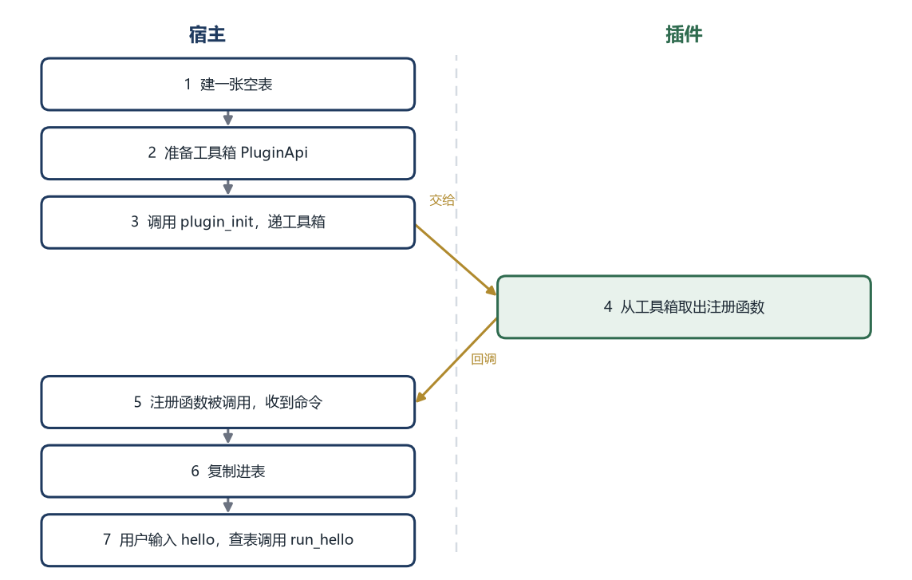
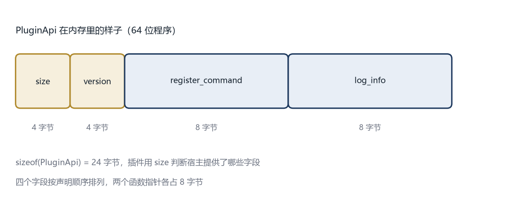

# 第 4 章 接口就是合同

本章的完整代码和编译说明在 `codes/ch04/`。

## 4.1 第 3 章的插件还不会做事

第 3 章的插件能被宿主找到、加载、初始化、卸载，但它什么也做不了。

宿主知道这个插件叫 `hello`，知道什么时候该调用 `plugin_init`，但不知道插件里有什么功能。用户输入 `hello` 时，宿主没有函数可调。

要让插件真正提供命令，得完成一次信息交接：插件把“我有一个命令，名字叫 hello，执行时调用这个函数”告诉宿主；宿主记下来，等用户输入时再查。

问题在于，“告诉”这个动作本身需要一个函数。宿主得调用插件里的某个函数，插件才能把命令交出去。可第 3 章的三个函数里，没有哪个是用来接收命令的。

所以这一章要连续解决三件事：

1. 插件用什么形式描述一个命令
2. 插件通过什么函数把命令交给宿主
3. 宿主怎样把那个函数递给插件

三件事环环相扣，少一件都接不上。

## 4.2 先看一次完整的交接

在写代码之前，先把整个过程在脑子里过一遍。假设宿主已经加载了 `hello.dll`。



这里有两次方向相反的传递。

第一次是宿主把**工具箱**递给插件。工具箱里装的不是数据，是函数地址。插件拿到之后，才能反过来调用宿主。

第二次是插件把**命令**递给宿主。命令里装的也是函数地址，指向插件自己的执行函数。

两次传递都只传“地址”和“简单的结构体”，不传 C++ 对象。为什么？下一节解释。

## 4.3 为什么不能直接传 C++ 对象

最自然的想法是：插件把一个 `std::string` 当命令名，把一个 `std::function` 当执行函数，打包成一个 C++ 类，交给宿主。

这个想法在同一个程序、同一套编译环境里通常没问题；一旦插件是别人用别的编译器做的，就会出事。

`std::string` 不是一个简单的字符数组。它内部通常有三个东西：一个指向字符数据的指针、一个表示长度的整数、一个表示容量的整数。不同标准库的实现，这三个东西的顺序、大小、甚至是否用“短字符串优化”都不一样。

Visual Studio 的 `std::string` 和 GCC 的 `std::string`，在内存里的样子不同。插件用 Visual Studio 编译，宿主用 GCC 编译，插件交过来一个 `std::string`，宿主按自己的理解去读，读到的长度可能是乱的，指针可能指向错误的位置。程序不会给你一个“类型不匹配”的提示，它会直接读到垃圾，然后崩溃。

`std::function` 更复杂。它内部可能存函数指针，也可能存一个对象，还可能有虚表。跨编译器传递，等于把两个不同世界的规则混在一起。

这就是跨动态库接口的第一条硬规则：

**只传两边布局完全一致的东西。**

哪些东西布局一致？整数、浮点数、指针、C 风格字符串（`const char*`）、只包含这些字段的结构体。它们的排列规则由平台和编译器共同遵守，Visual Studio 和 GCC 在同一个平台上通常一致。

所以命令不能用 C++ 类描述，要用一个“只有指针”的结构体描述。

## 4.4 用三个字段描述一个命令

```cpp
typedef void (*CommandFn)(const char* args);

typedef struct PluginCommand {
    const char* name;
    const char* help;
    CommandFn run;
} PluginCommand;
```

先看 `CommandFn`。它定义了一种函数类型：接收一个 `const char*`，不返回值。以后凡是“执行命令”的函数，都长这样。

`const char*` 是“指向一串字符的指针”，字符内容不能被修改。用 C 风格字符串而不是 `std::string`，就是因为它的内存布局最简单：一串字节，末尾一个 `\0` 表示结束。两个编译器看起来完全一样。

`PluginCommand` 有三个字段。

`name` 是命令名，比如 `hello`。`help` 是一句说明，显示帮助时用。`run` 是执行函数的地址，类型是 `CommandFn`。

`typedef struct` 是 C 的写法，把“定义结构体”和“起一个类型名”合并成一句。写成 `struct PluginCommand { ... };` 再 `typedef struct PluginCommand PluginCommand;` 效果一样，只是啰嗦。

这个结构体里没有任何 C++ 对象，只有三个指针。三个指针的大小在同一平台上固定，字段顺序由声明决定。插件和宿主看到的是同一张内存图，交接才安全。

有一点要注意：`name` 和 `help` 指向的字符内容在插件里。宿主拿到指针后，不能假设它永远有效。如果插件被卸载，那块内存就没了。所以宿主收到命令后，应该把字符串复制一份，而不是只存指针。这一点在 4.12 节的宿主代码里会看到。

## 4.5 把命令交出去的那个函数

现在有了命令的格式，还需要一个函数，让插件把命令递给宿主。

```cpp
typedef void (*RegisterCommandFn)(const PluginCommand* cmd);
```

读这种写法有个窍门：从名字往外读。

`(*RegisterCommandFn)` 表示 `RegisterCommandFn` 是一个指针。右边的 `(const PluginCommand*)` 表示它指向的函数接收一个参数，参数是指向 `PluginCommand` 的指针。左边的 `void` 表示那个函数不返回值。

合起来：`RegisterCommandFn` 是“指向一个注册函数”的指针，那个注册函数接收一条命令，不返回东西。

这个函数由宿主实现，插件调用。插件在自己的 `plugin_init` 里，把命令一条条传给它。

就像去银行办业务。窗口是银行开的，你走过去，把表格递进窗口。窗口不在你手里，但你能用它。注册函数就是那个窗口。

## 4.6 工具箱：PluginApi

宿主不能只递一个注册函数。以后可能还要提供日志、读文件、发通知。每加一项能力就改一次 `plugin_init` 的参数，签名会越来越长，旧插件也会全部失效。

更好的做法是把所有能力放进一个结构体，只传这个结构体的指针。以后加能力，往结构体末尾加字段就行。

```cpp
typedef struct PluginApi {
    uint32_t size;
    uint32_t version;
    RegisterCommandFn register_command;
    void (*log_info)(const char* message);
} PluginApi;
```

四个字段，分两类。

前两个是“说明书”。`size` 记录这个结构体有多大，`version` 记录契约版本。

后两个是“能力”。`register_command` 是刚才定义的注册函数；`log_info` 是日志函数，插件想输出信息时调用它，而不是直接往屏幕打印。这样宿主可以统一控制日志格式、写到文件、按插件过滤。

`uint32_t` 是固定 4 字节的无符号整数，来自 `<cstdint>`。用它而不是 `int`，是因为 `int` 的大小在不同平台上可能不同，而 `uint32_t` 永远是 4 字节。

这四个字段在内存里依次排列，宿主填好之后，把整个结构体的地址交给插件。



## 4.7 为什么结构体开头要放一个尺码

`size` 和 `version` 不是装饰。它们解决的是“插件和宿主不是同一天编译”的问题。

设想一个场景。宿主 1.0 发布时，`PluginApi` 只有三个字段：`size`、`version`、`register_command`。半年后契约升级到 1.1，在末尾加了 `log_info`。这时会出现两种组合。

第一种，新插件装在旧宿主上。插件按 1.1 写，想用 `log_info`。它拿到宿主给的 `PluginApi`，先读 `size`，发现只覆盖到 `register_command`，就知道“这个宿主没有日志能力”，于是走不用日志的路径，而不是硬读一个不存在的字段。

第二种，旧插件装在新宿主上。插件按 1.0 写，只认识前三个字段。宿主给的 `size` 更大，插件不关心后面多出来的内容，照常工作。

`size` 让双方都能安全地只使用自己认识的那一段。

宿主创建 `PluginApi` 时，把 `size` 填成 `sizeof(PluginApi)`，也就是“我这个结构体有多少字节”。插件拿到指针，先读 `size`，和自己的预期比一比：

- 如果 `size` 够大，说明宿主提供了自己要用的字段，可以用
- 如果 `size` 太小，说明宿主是旧版，没有这个字段，插件就退回旧路径

这个比较不需要知道对方的结构体具体长什么样，只需要知道“有没有这么多字节”。就像收快递先看箱子上的件数，数一数够不够，再决定拆不拆。

这就像搬家时箱子上的清单。清单上写着“共 12 件”，你打开箱子先数一遍，数出来只有 10 件，就知道少了两件，不会假装没看见继续往下搬。

`size` 只能保证“字段够不够”，不能保证“字段的意思没变”。所以还需要 `version`。

## 4.8 version 管的是意思有没有变

假设宿主没有加字段，但把 `register_command` 的行为改了：以前是“收到命令立刻复制一份”，现在改成“只记指针，等插件卸载时再复制”。字段数量没变，`size` 也一样，插件却会因此出问题。

这种变化，`size` 检测不出来，只能靠版本号。

规则很简单：不兼容的改动，版本号加一；兼容的改动，不加。

什么叫兼容？往结构体末尾加字段是兼容的，旧插件不读新字段，新宿主也能用旧插件。放宽参数范围、修正一个明显是 bug 的行为，通常也算兼容。

什么叫不兼容？改变已有字段的含义、删除字段、改变函数签名、改变调用顺序。这些都要升版本。

插件在初始化时检查：

```cpp
if (api->version != PLUGIN_API_VERSION) {
    return 2;  // 版本不匹配，拒绝加载
}
```

这里用“不相等就拒绝”，是最简单的策略。真实系统可能同时支持几个版本，让旧插件走一条兼容路径，第 10 章会讲。

## 4.9 只给能力，不给内部数据

`PluginApi` 里放的都是函数，没有一个字段是宿主内部的数据结构。这不是巧合，是刻意的设计。

假设宿主有一个文档对象，里面有路径、内容、修改时间、撤销历史。如果为了省事，把 `Document*` 直接放进 `PluginApi`，插件就能读到所有字段，也能改它们。宿主以后想调整这个结构，所有插件都会坏。

正确的做法是只暴露操作。插件想读内容，给它一个 `read_document` 函数；想改内容，给它一个 `write_document` 函数。它不需要知道文档对象长什么样。

自动售货机就是这个道理。你投币、按按钮、拿饮料，不需要知道机器里的货道怎么排、弹簧怎么转。机器也不允许你伸手进去自己拿。按钮是能力，货道是内部数据。

`PluginApi` 就是那排按钮。以后每加一项能力，就往结构体末尾加一个函数指针，而不是加一个数据指针。

## 4.10 完整的接口头文件

把前面的定义合起来，得到这一章的最终版本：

```cpp
// plugin_api.h
#pragma once

#include <cstdint>

#ifdef _WIN32
#define PLUGIN_EXPORT __declspec(dllexport)
#else
#define PLUGIN_EXPORT __attribute__((visibility("default")))
#endif

#define PLUGIN_API_VERSION 1

extern "C" {

typedef void (*CommandFn)(const char* args);

typedef struct PluginCommand {
    const char* name;
    const char* help;
    CommandFn run;
} PluginCommand;

typedef void (*RegisterCommandFn)(const PluginCommand* cmd);

typedef struct PluginApi {
    uint32_t size;
    uint32_t version;
    RegisterCommandFn register_command;
    void (*log_info)(const char* message);
} PluginApi;

PLUGIN_EXPORT const char* plugin_name();
PLUGIN_EXPORT int plugin_init(const PluginApi* api);
PLUGIN_EXPORT void plugin_shutdown();

}
```

`PLUGIN_EXPORT` 和第 3 章一样，Windows 上展开成导出标记，Linux 上展开成可见性标记。

`PLUGIN_API_VERSION` 是当前契约版本。插件和宿主都用这个宏，升级时只改一处。

`extern "C"` 让三个导出函数按 C 的规则命名，避免第 3 章说的名字修饰问题。结构体定义放在 `extern "C"` 里面，是为了让整份头文件在 C 和 C++ 编译器里都能用。

## 4.11 插件这边怎么写

插件要做三件事：定义执行函数、把它们放进一个静态数组、在初始化时逐条注册。

```cpp
#include "plugin_api.h"
#include <cstdio>

static const PluginApi* g_api = nullptr;

static void run_hello(const char* args) {
    if (g_api && g_api->log_info) {
        g_api->log_info("hello 命令被执行");
    }
    std::printf("你好，世界（参数：%s）\n", args ? args : "");
    std::fflush(stdout);
}

static const PluginCommand kCommands[] = {
    { "hello", "打印一句问候", run_hello },
};

extern "C" PLUGIN_EXPORT const char* plugin_name() {
    return "hello";
}

extern "C" PLUGIN_EXPORT int plugin_init(const PluginApi* api) {
    if (!api) return 1;
    if (api->version != PLUGIN_API_VERSION) return 2;

    g_api = api;
    for (const auto& cmd : kCommands) {
        api->register_command(&cmd);
    }
    return 0;
}

extern "C" PLUGIN_EXPORT void plugin_shutdown() {
    g_api = nullptr;
}
```

`g_api` 保存宿主递过来的工具箱。命令执行时如果需要日志，就通过它调用。`static` 让这个变量只在本文件可见，不会和别的插件重名。

`kCommands` 是一个静态数组，里面放这个插件提供的所有命令。现在只有一条。加命令时，往数组里加一行就行。

`kCommands` 和里面的字符串都是静态存储，生命周期和程序一样长，所以把指针交给宿主是安全的，不会因为函数返回就失效。

`plugin_init` 的顺序很重要：先检查指针，再检查版本，然后保存工具箱，最后注册命令。任何一步失败，都返回非零，宿主会跳过这个插件。

`plugin_shutdown` 把 `g_api` 清空，防止卸载后还有人通过它调用宿主。

## 4.12 宿主这边怎么写

宿主需要做四件事：建表、实现注册函数和日志函数、填好工具箱、调用插件的初始化。

先看表的实现：

```cpp
#include <cstdio>
#include <map>
#include <string>

struct CommandEntry {
    std::string name;
    std::string help;
    CommandFn run;
};

static std::map<std::string, CommandEntry> g_commands;

static void host_register_command(const PluginCommand* cmd) {
    if (!cmd || !cmd->name || !cmd->run) return;

    CommandEntry entry;
    entry.name = cmd->name;
    entry.help = cmd->help ? cmd->help : "";
    entry.run = cmd->run;
    g_commands[entry.name] = entry;

    std::printf("registered command: %s\n", cmd->name);
}

static void host_log_info(const char* message) {
    std::printf("[host] %s\n", message ? message : "");
}
```

`std::map` 是标准库的键值表，按名字存命令，查找很快。`g_commands[entry.name] = entry` 表示把这条命令放到这个名字下面。

注意 `entry.name = cmd->name` 这一行。它把 `const char*` 赋给 `std::string`，`std::string` 会自己复制一份字符内容。这样即使插件后来被卸载，宿主表里的名字仍然有效。

这里用 `std::string` 和 `std::map` 是安全的，因为它们只在宿主内部使用，不跨动态库传递。跨边界传的是 `const char*`，进了宿主之后才变成 `std::string`。

然后填工具箱并调用：

```cpp
PluginApi api{};
api.size = sizeof(PluginApi);
api.version = PLUGIN_API_VERSION;
api.register_command = host_register_command;
api.log_info = host_log_info;

auto init = (int(*)(const PluginApi*))get_sym(h, "plugin_init");
if (!init || init(&api) != 0) {
    std::printf("plugin init failed\n");
    close_lib(h);
    continue;
}
```

`PluginApi api{}` 把所有字段先清零，避免忘记赋值时留下垃圾。

`api.size = sizeof(PluginApi)` 填的是宿主这个结构体的大小。`api.version` 填契约版本。

两个函数指针分别指向宿主实现的注册函数和日志函数。插件拿到结构体后，调用 `api->register_command(&cmd)`，实际执行的是宿主的 `host_register_command`。

这就是 4.2 节那张图里“宿主把工具箱递过去，插件反过来调用宿主”的具体实现。

## 4.13 这一章定下了什么

到这里，插件和宿主之间有了一份真正的合同。合同包括五条：

- 插件导出三个固定名字的函数
- 函数用 `extern "C"`，避免名字修饰
- 命令用只含指针的结构体描述，不用 C++ 对象
- 宿主通过 `PluginApi` 提供能力，插件只能调用这些能力
- `PluginApi` 带 `size` 和 `version`，双方可以检查兼容性

这份合同还很粗糙。命令注册进去之后，怎么执行？用户输入 `hello`，宿主怎么从表里找到对应的函数？两个插件注册同名命令怎么办？插件卸载时，它注册的命令怎么撤掉？

下一章做注册表，把这些事一件件处理掉。
