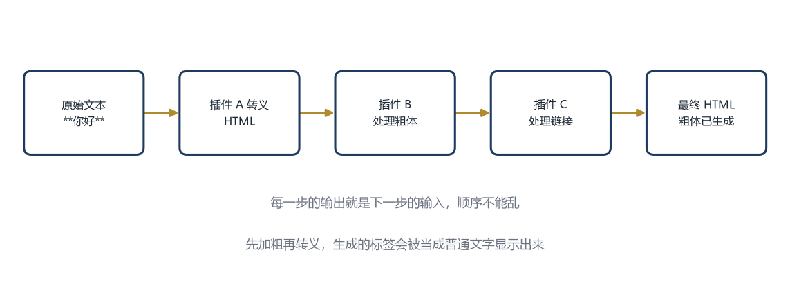
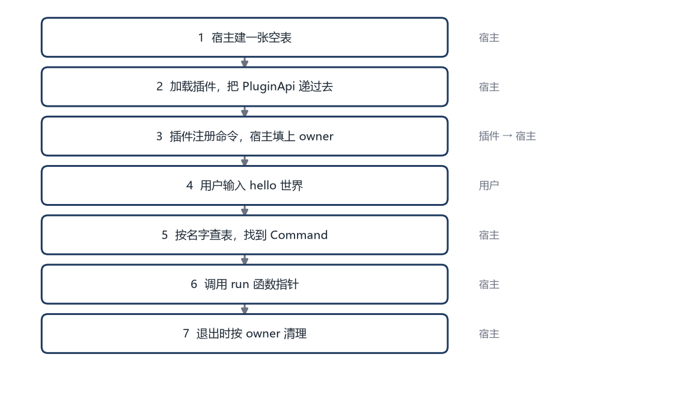

# 第 5 章 注册表与扩展点

本章的完整代码和编译说明在 `codes/ch05/`。

## 5.1 命令注册进去之后

第 4 章的宿主已经能把插件交上来的命令存进一张表，但还没有用它。这一章把表用起来，让用户输入 `hello` 时真的调用到插件里的函数。

先明确表要存什么。

```cpp
struct Command {
    std::string name;
    std::string help;
    CommandFn run;
    std::string owner;
};
```

前三个字段和第 4 章一样。第四个 `owner` 是新增的，记录这条命令是哪个插件注册的。为什么需要它？因为插件可能被卸载，卸载时要把它注册的东西全部撤掉。没有 `owner`，就不知道哪些条目属于它。

`owner` 就是插件名，来自 `plugin_name()`。宿主在调用 `plugin_init` 之前先拿到名字，注册命令时自动填进去。插件自己不需要传，也没法冒充别人。

宿主用一个文件级变量记录“当前在处理哪个插件”：

```cpp
static std::string g_current_plugin;
```

加载插件时，它是正在初始化的插件；执行命令时，它是命令的主人。注册命令和写日志都要用它。

## 5.2 一张能查、能删的表

用 `std::map` 存命令，键是命令名。

```cpp
class CommandTable {
public:
    bool add(const Command& cmd) {
        if (cmd.name.empty() || !cmd.run) return false;
        if (commands_.count(cmd.name) > 0) return false;
        commands_[cmd.name] = cmd;
        return true;
    }

    const Command* find(const std::string& name) const {
        auto it = commands_.find(name);
        if (it == commands_.end()) return nullptr;
        return &it->second;
    }

    void remove_owner(const std::string& owner) {
        for (auto it = commands_.begin(); it != commands_.end(); ) {
            if (it->second.owner == owner) {
                it = commands_.erase(it);
            } else {
                ++it;
            }
        }
    }

    void list() const {
        for (const auto& pair : commands_) {
            std::printf("  %-12s %s\n", pair.first.c_str(), pair.second.help.c_str());
        }
    }

private:
    std::map<std::string, Command> commands_;
};
```

`add` 做三件事：检查名字和执行函数不为空、检查有没有重名、存进表。重名时返回 `false`，由调用方决定怎么处理。

`find` 按名字查。找不到返回空指针。返回的是指针，不是副本，避免复制整个结构体。

`remove_owner` 遍历整张表，把属于某个插件的条目删掉。`erase` 会返回下一个位置，所以删除时用 `it = commands_.erase(it)`，不能直接 `++it`，否则迭代器失效。

`list` 打印所有命令，`%-12s` 表示左对齐、占 12 个字符宽度，让输出整齐。


## 5.3 执行一条命令

主循环拿到用户输入后，先按空格切开，第一个词是命令名，剩下的都是参数。

```cpp
static std::string trim(const std::string& s) {
    size_t begin = s.find_first_not_of(" \t\r\n");
    if (begin == std::string::npos) return "";
    size_t end = s.find_last_not_of(" \t\r\n");
    return s.substr(begin, end - begin + 1);
}

static void run_line(CommandTable& table, const std::string& line) {
    std::string text = trim(line);
    if (text.empty()) return;

    size_t space = text.find(' ');
    std::string name = (space == std::string::npos) ? text : text.substr(0, space);
    std::string args = (space == std::string::npos) ? "" : trim(text.substr(space + 1));

    const Command* cmd = table.find(name);
    if (!cmd) {
        std::printf("未知命令：%s（输入 help 查看）\n", name.c_str());
        return;
    }
    // 执行前把“当前插件”设成命令的主人。
    // 插件在命令里调用 log_info 时，日志才会带上正确的名字。
    g_current_plugin = cmd->owner;
    cmd->run(args.c_str());
    g_current_plugin.clear();
}
```

`find_first_not_of` 找第一个不是空白的位置，`find_last_not_of` 找最后一个不是空白的位置。两者一夹，就得到去掉首尾空白后的范围。`npos` 表示“没找到”。

`text.find(' ')` 找第一个空格。找不到说明整行都是命令名，参数为空；找到了就切成两段。

`args.c_str()` 把 `std::string` 转成 C 风格字符串，因为命令函数接收的是 `const char*`。这个指针只在 `run` 执行期间有效，插件不能把它存起来以后再用。

`g_current_plugin` 是宿主的一个全局变量，记录当前在处理哪个插件。加载阶段它保存正在初始化的插件，执行命令时它保存命令的 owner。插件通过 `log_info` 写日志时，宿主用它拼出 `[插件名]` 前缀。执行完命令要清空，避免下一次日志还挂着上一个插件的名字。

## 5.4 重名怎么办

两个插件都注册 `hello`，谁赢？

有三种常见策略。

**拒绝后来者。** 第一个注册成功，第二个失败。简单、可预测，但用户不知道为什么自己的插件没生效。

**覆盖前者。** 后来的替换先前的。方便调试，但容易让行为变得不可预测，尤其是加载顺序不固定的时候。

**报错并禁用。** 检测到冲突时，把两个插件都标记为冲突，提示用户处理。最安全，但对用户要求高。

这一章选第一种，并在日志里说清楚是谁和谁冲突。真实系统通常会允许插件在清单里声明优先级，高优先级的先注册。

```cpp
bool add(const Command& cmd) {
    auto it = commands_.find(cmd.name);
    if (it != commands_.end()) {
        std::printf("命令冲突：%s 已被 %s 注册，%s 注册失败\n",
                    cmd.name.c_str(), it->second.owner.c_str(), cmd.owner.c_str());
        return false;
    }
    commands_[cmd.name] = cmd;
    return true;
}
```

冲突信息里带上了双方的名字，用户一看就知道该禁用哪个。

## 5.5 卸载时清理

插件被禁用或者程序退出时，要把它注册的命令撤掉。

```cpp
void unload_plugin(const std::string& owner, CommandTable& table) {
    table.remove_owner(owner);
    std::printf("已卸载插件：%s\n", owner.c_str());
}
```

顺序很重要。先调用插件的 `plugin_shutdown`，让它自己清理内部状态；再把它注册的命令从表里删掉。反过来的话，插件在清理时可能还想访问自己的命令，却发现已经没了。

宿主加载每个插件时，会记下它的名字和 `plugin_shutdown` 的地址。用一个很小的结构体保存：

```cpp
struct LoadedPlugin {
    std::string name;     // 插件名，用来按 owner 清理
    void (*shutdown)();   // 指向插件导出的 plugin_shutdown
};
```

退出时按相反顺序逐个停用：

```cpp
void shutdown_all(std::vector<LoadedPlugin>& plugins, CommandTable& table) {
    for (auto it = plugins.rbegin(); it != plugins.rend(); ++it) {
        if (it->shutdown) it->shutdown();
        table.remove_owner(it->name);
    }
    plugins.clear();
}
```

`rbegin` 和 `rend` 是反向遍历，从最后一个插件开始卸载。为什么倒着来？因为后面的插件可能依赖前面的插件提供的服务，先卸载后面的更安全。

## 5.6 命令表不够用了

命令表解决了一个具体问题：插件怎么把“一条命令”交给宿主。但一个大型软件需要插件参与的地方远不止命令。

窗口顶部有菜单，菜单里有“文件”“编辑”“帮助”，每一项都可能由插件添加。工具栏上有一排按钮，每个按钮也可能来自插件。用户双击一个 `.md` 文件时，宿主需要问一圈“谁能打开这个文件”。设置界面里，每个插件可能想加一页自己的配置。

这些位置有一个共同点：宿主先留好一个“坑”，插件往坑里填东西，宿主在合适的时候把坑里的东西取出来用。

命令是一个坑，菜单项是另一个坑，文件处理器是第三个坑。它们的名字不同，数据结构不同，取用的时机也不同，但“留坑、填坑、取用”这个模式是一样的。

如果每类坑都从头写一遍增删查改，代码会重复得很难看，而且每一份都可能漏掉“卸载时清理”。把这些共性抽出来，就是**扩展点**。

## 5.7 扩展点的三个要素

光说“扩展点是一个坑”还不够。要让宿主和插件都能准确理解这个坑，需要三样东西。

### 第一样：一个稳定的名字

宿主先声明：“我这里有一个位置，叫 `menu.file`。”插件看到这个名字，就知道该往哪里填。

名字要稳定，因为插件会把它写进代码里。今天叫 `menu.file`，明天改成 `file_menu`，所有插件都得改。名字还要有层级，`menu.file` 表示“文件菜单”，`menu.edit` 表示“编辑菜单”，一眼能看出位置。

命令扩展点的名字是 `command`。它没有更细的层级，因为命令之间是平级的，靠命令名区分。

### 第二样：一份数据形状

光有名字，宿主不知道插件会填什么进来。所以还要约定填进来的东西长什么样。

命令的形状是：

```cpp
struct Command {
    std::string name;
    std::string help;
    CommandFn run;
    std::string owner;
};
```

菜单项的形状可能是：

```cpp
struct MenuItem {
    std::string title;
    std::string shortcut;
    void (*on_click)();
    std::string owner;
};
```

两者都有名字和执行函数，但菜单项还多了标题和快捷键。宿主拿到菜单项，知道怎么画；拿到命令，知道怎么执行。形状不对，宿主就没法用。

### 第三样：一个调用时机

有了名字和形状，还要说清楚“宿主什么时候把这些东西取出来”。

命令的时机是：用户输入一行文字，宿主按第一个词去表里查，查到就调用。

菜单项的时机是：用户点开某个菜单，宿主把这个菜单下所有项取出来，按顺序画在屏幕上。

文件处理器的时机是：用户打开一个宿主不认识的文件，宿主问每个处理器“你能处理 `.md` 吗”，第一个说能的就是它。

三样东西缺一不可。只有名字，宿主不知道填什么；只有形状，不知道往哪填；只有时机，不知道取出来的是什么。

可以用小区公告板来理解。物业说“三号楼门口有一块公告板”，这是名字；“只能贴 A4 纸，写上标题和联系方式”，这是形状；“每天早上八点统一收走”，这是时机。三者齐了，住户才知道该怎么做。

## 5.8 三种存法，各自的问题

命令和菜单项的形状不同，C++ 是强类型语言，一个 `std::map<std::string, Command>` 装不下 `MenuItem`。怎么把不同形状的东西放进同一套管理逻辑，有三种常见做法。

### 做法一：每种类型一张表

最直接的想法是给每类扩展点各写一张表：

```cpp
std::map<std::string, Command> commands;
std::map<std::string, MenuItem> menus;

bool add_command(const Command& cmd) { /* 检查重名、插入 */ }
bool add_menu(const MenuItem& item) { /* 检查重名、插入 */ }
```

优点是类型安全。往 `commands` 里塞一个 `MenuItem`，编译器立刻报错，不会等到运行时才出问题。

缺点是重复。`add_command` 和 `add_menu` 的逻辑一模一样，只是类型不同；`find`、`remove_owner`、`list` 也要各写两遍。扩展点增加到十种，就有十套几乎相同的代码。更麻烦的是，将来修一个 bug，比如“卸载时忘了清空”，要记得在十个地方都改一遍。

### 做法二：用 void* 装一切

`void*` 是“只知道地址、不知道类型”的指针。任何指针都能转成 `void*`，取出来时再转回去。

```cpp
struct Entry {
    std::string owner;
    void* value;
};

std::map<std::string, Entry> items;
```

存进去：

```cpp
Command cmd{ "hello", "打印问候", run_hello, "hello" };
items["hello"] = { "hello", &cmd };
```

取出来：

```cpp
auto* cmd = static_cast<Command*>(items["hello"].value);
cmd->run("");
```

看起来一张表就装下了所有类型，代码也不用重复。问题出在“转回去”这一步。

`static_cast` 不做运行时检查。如果你记错了类型，写成 `static_cast<MenuItem*>`，编译器不会拦你。程序会把一块 `Command` 的内存当成 `MenuItem` 来读，字段位置全错，读出来的标题可能是一个函数地址，调用时直接崩溃。

这种错误很难查，因为崩溃的地方和写错的地方可能隔着几百行。表越大、类型越多，记错的概率越高。

`void*` 还有第二个问题：它不知道对象该怎么销毁。表里存的是指针，清理时是 `delete`、`free`，还是什么都不做？不同类型的扩展可能需要不同的清理方式，一张 `void*` 表回答不了。

### 做法三：基类加虚函数

面向对象的标准做法是让所有扩展继承同一个基类：

```cpp
struct Extension {
    virtual ~Extension() = default;
};

struct Command : Extension {
    std::string name;
    CommandFn run;
};

struct MenuItem : Extension {
    std::string title;
    void (*on_click)();
};

std::map<std::string, std::unique_ptr<Extension>> items;
```

`std::unique_ptr<Extension>` 是一种会自动释放对象的指针，离开作用域时自动 `delete` 指向的对象，不用手写 `delete`。`<Extension>` 表示它指向的东西是一个 `Extension`。

基类里的 `virtual ~Extension() = default` 是虚析构函数，保证通过基类指针删除对象时，能调用到子类自己的析构函数。

存的时候，`Command` 和 `MenuItem` 都能转成 `Extension*`，一张表装得下。取的时候用 `dynamic_cast<Command*>` 转回具体类型，转错了会返回空指针，比 `void*` 安全。

但在插件系统里，这个方案有一个致命问题：**虚表不能跨编译器**。

带虚函数的对象，内存开头有一个指针，指向“这个类有哪些虚函数”的表，叫虚表。虚表的布局由编译器决定，Visual Studio 和 GCC 排法不同，同一编译器的不同版本也可能不同。插件里创建的对象，宿主按自己的理解去读虚表，调用的可能是错误的函数。

还有内存分配的问题。插件里 `new` 出来的对象，如果在宿主里 `delete`，两边的堆管理器可能不是同一个，轻则泄漏，重则崩溃。要解决，得约定“谁分配谁释放”，或者所有对象都由宿主分配，复杂度立刻上去了。

所以跨动态库的接口，通常避开虚函数和 C++ 对象，这也是第 4 章只传简单结构体的原因。

### 这一章的选择

三种做法比较下来：

| 做法 | 类型安全 | 代码重复 | 跨编译器 |
|---|---|---|---|
| 每种类型一张表 | 安全 | 多 | 安全 |
| void* 一张表 | 不安全 | 少 | 安全但易错 |
| 基类加虚函数 | 较安全 | 少 | 危险 |

这一章选第一种。类型安全和跨编译器安全比少写几行代码重要，尤其是插件可能来自不同编译器的时候。

重复的问题，用下一节的模板解决。

## 5.9 用模板消除重复

每种类型一张表，逻辑一样，只是类型不同。C++ 的**模板**就是为这种情况准备的。

模板的意思是“把类型当成参数”。写一个类，里面用到一个暂时不确定的类型 `T`，等真正使用时再填。

```cpp
template <typename T>
class ExtensionPoint {
public:
    bool add(const std::string& key, const std::string& owner, const T& value) {
        if (items_.count(key) > 0) return false;
        items_[key] = { owner, value };
        return true;
    }

    const T* find(const std::string& key) const {
        auto it = items_.find(key);
        return it == items_.end() ? nullptr : &it->second.value;
    }

    void remove_owner(const std::string& owner) {
        for (auto it = items_.begin(); it != items_.end(); ) {
            if (it->second.owner == owner) it = items_.erase(it);
            else ++it;
        }
    }

private:
    struct Entry {
        std::string owner;
        T value;
    };
    std::map<std::string, Entry> items_;
};
```

`template <typename T>` 声明了一个类型参数 `T`。类里面的 `T` 暂时是个占位符。

真正使用时这样写：

```cpp
ExtensionPoint<Command> commands;
ExtensionPoint<MenuItem> menus;
```

编译器看到第一行，用 `Command` 替换所有 `T`，生成一份“命令版”的类；看到第二行，用 `MenuItem` 替换，生成一份“菜单版”的类。两份代码逻辑一样，但类型各自独立，往 `ExtensionPoint<Command>` 里塞 `MenuItem` 照样会编译报错。

这就像同一个表格模板，打印一份“学生登记表”，再打印一份“图书登记表”。表格的格子布局一样，但一份填姓名学号，一份填书名编号，不能混着填。

模板只在编译时展开，不会跨动态库传递。插件通过 C 函数把 `PluginCommand` 交给宿主，宿主再存进自己的 `ExtensionPoint<Command>`。边界上仍然是第 4 章那些简单结构体，模板只在宿主内部使用。

## 5.10 三种扩展点形态

扩展点按“取出来之后怎么用”，可以分成三类。这三类的区别不在数据结构，而在调用方式。

### 列表型：各用各的

菜单项是典型的列表型。宿主打开“文件”菜单时，把这个位置下的所有菜单项取出来，按顺序画在屏幕上。第一项和第二项之间没有数据传递，各自独立。

工具栏按钮、设置页、状态栏文字，都属于这一类。宿主需要“全部”，顺序可能由优先级决定，但每一项的处理互不影响。

### 管道型：前一个的输出是后一个的输入

文本转换是典型的管道型。假设宿主支持 Markdown 预览，渲染过程分成几步：



每一步接收一段文本，返回一段文本。插件 B 拿到的输入，正是插件 A 的输出；插件 C 拿到的，又是插件 B 的输出。三个插件串成一条流水线，所以叫管道型。

图片滤镜也是同样的结构：

每个滤镜接收一张图，返回一张图。去噪的输出就是调色的输入，调色的输出再交给锐化，最后得到结果。

管道型的重点是**顺序**。上面三步如果换成“先处理粗体，再转义”，插件 B 生成的 `<b>` 会被插件 A 当成 HTML 标签转义成 `&lt;b&gt;`，页面上就会直接显示 `<b>` 这几个字符，而不是粗体。顺序错了，结果就错了。所以管道型扩展点必须把顺序写进契约，不能靠注册顺序碰运气。

管道型还要定义“某一环失败怎么办”。常见有两种：跳过这一环，把输入原样传给下一个；或者中止整个管道，返回错误。选哪种要看业务，但必须统一。

### 单点型：同一时间只能有一个

主题是典型的单点型。用户可以选浅色或深色，但同一时间只能生效一个。两个插件都提供主题时，宿主不能把两个都画上，必须选一个。

默认存储后端也是单点型。数据存在本地文件还是云端，只能选一条路。

单点型的冲突策略通常是“按优先级选一个”，或者“让用户在设置里选”。它和列表型的区别是：列表型可以共存，单点型必须互斥。

### 三类对比

| 形态 | 取出来怎么用 | 典型例子 | 冲突处理 |
|---|---|---|---|
| 列表型 | 全部取出，逐个展示或调用 | 菜单项、工具栏按钮 | 可以共存，按顺序 |
| 管道型 | 串成一条链，前一个输出给后一个 | 文本转换、图片滤镜 | 必须定义顺序 |
| 单点型 | 只取一个生效 | 主题、默认存储 | 互斥，按优先级或用户选 |

设计扩展点时，先想清楚属于哪一类，再决定数据结构、冲突策略和清理方式。命令表是列表型的一个特例：它按名字索引，每个名字一条，取出来执行一条。

## 5.11 把这一章串起来

这一章从“命令注册进去之后”讲到“扩展点怎么设计”，中间有七步。单独看每一节都懂，合起来容易乱，所以先把七步连成一条线：

1. 宿主建一张空表（5.2）
2. 插件加载时拿到 `PluginApi`（第 4 章）
3. 插件注册命令，宿主填上 `owner`（5.1）
4. 用户输入 `hello 世界`
5. 宿主按名字查表，找到 `Command`（5.3）
6. 调用 `run` 函数指针，执行插件的代码（5.3）
7. 退出时按 `owner` 把命令清理掉（5.5）



前六步是命令表的全部工作。第七步之后，把“命令”换成“菜单项”“文件处理器”，把表的类型换成对应的结构，就是 5.6 到 5.10 讲的扩展点。

把这些步骤写成代码，主程序大概是这样：

```cpp
static CommandTable g_table;

static void run_help(const char*) {
    g_table.list();
}

// 扫描 plugins 目录、加载动态库、调用 plugin_init
// 实现在 codes/ch05/host.cpp，对应第 3 章和 5.1 节
static void load_all_plugins();

// 调用 plugin_shutdown，再按 owner 清理命令，对应 5.5 节
static void unload_all_plugins();

int main() {
    // 创建宿主自己的 help 命令，并加入到命令表里
    Command help;
    help.name = "help";
    help.help = "列出所有命令";
    help.owner = "core";
    help.run = run_help;
    g_table.add(help);

    load_all_plugins();

    std::string line;
    while (true) {
        std::printf("> ");
        std::fflush(stdout);
        if (!std::getline(std::cin, line)) break;
        if (line == "quit") break;
        run_line(g_table, line);
    }

    unload_all_plugins();
    return 0;
}
```

对照前面的小节看：

- `g_table` 是 5.2 定义的那张命令表
- `run_help` 是宿主自己的命令，它需要通过 `g_table` 访问命令表，所以表放在文件级
- `load_all_plugins` 把第 3 章的“扫描目录、加载动态库、取符号”和第 4 章的“传 `PluginApi`、调用 `plugin_init`”合在一起，插件的命令就在这一步进表
- `run_line` 是 5.3 的“切分输入、查表、调用”
- `unload_all_plugins` 是 5.5 的“先调用 `plugin_shutdown`，再按 owner 删命令”

完整可编译的版本在 `codes/ch05/`，运行后输入 `help` 能看到命令列表，输入 `hello` 会调用插件的函数，输入 `quit` 退出。

这一章的主线可以压成一句话：**宿主留一张表，插件往里填，宿主按名字取用，卸载时按主人清理。** 扩展点是把“表”和“填的东西”抽象出来，让同一套逻辑服务菜单、文件处理器和设置页。

## 5.12 还差什么

命令能注册、能执行、能清理了。但插件之间还不能互相通知。

假设一个插件负责保存文件，另一个插件想在文件保存后更新索引。保存插件不知道索引插件的存在，索引插件也不知道保存插件什么时候保存。它们需要一个中间人。

这个中间人叫事件总线。下一章讲它，以及和它很像、但用途不同的钩子。
