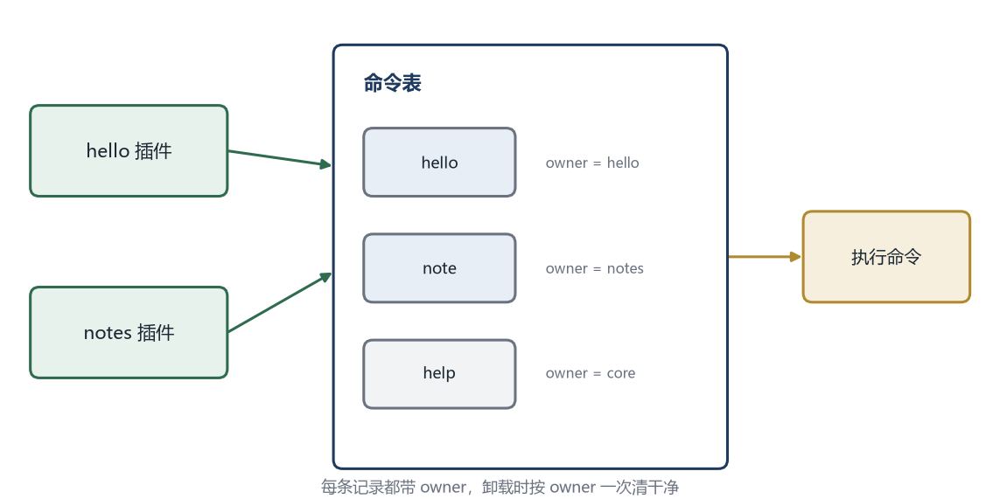

# 第 5 章 注册表与扩展点

本章的完整代码和编译说明在 `codes/ch05/`。

## 5.1 命令注册进去之后

第 4 章的宿主已经能把插件交上来的命令存进一张表，但还没有用它。这一章把表用起来，让用户输入 `hello` 时真的调用到插件里的函数。

先明确表要存什么。

```cpp
struct Command {
    std::string name;
    std::string help;
    CommandFn run;
    std::string owner;
};
```

前三个字段和第 4 章一样。第四个 `owner` 是新增的，记录这条命令是哪个插件注册的。为什么需要它？因为插件可能被卸载，卸载时要把它注册的东西全部撤掉。没有 `owner`，就不知道哪些条目属于它。

`owner` 就是插件名，来自 `plugin_name()`。宿主在调用 `plugin_init` 之前先拿到名字，注册命令时自动填进去。插件自己不需要传，也没法冒充别人。

## 5.2 一张能查、能删的表

用 `std::map` 存命令，键是命令名。

```cpp
class CommandTable {
public:
    bool add(const Command& cmd) {
        if (cmd.name.empty() || !cmd.run) return false;
        if (commands_.count(cmd.name) > 0) return false;
        commands_[cmd.name] = cmd;
        return true;
    }

    const Command* find(const std::string& name) const {
        auto it = commands_.find(name);
        if (it == commands_.end()) return nullptr;
        return &it->second;
    }

    void remove_owner(const std::string& owner) {
        for (auto it = commands_.begin(); it != commands_.end(); ) {
            if (it->second.owner == owner) {
                it = commands_.erase(it);
            } else {
                ++it;
            }
        }
    }

    void list() const {
        for (const auto& pair : commands_) {
            std::printf("  %-12s %s\n", pair.first.c_str(), pair.second.help.c_str());
        }
    }

private:
    std::map<std::string, Command> commands_;
};
```

`add` 做三件事：检查名字和执行函数不为空、检查有没有重名、存进表。重名时返回 `false`，由调用方决定怎么处理。

`find` 按名字查。找不到返回空指针。返回的是指针，不是副本，避免复制整个结构体。

`remove_owner` 遍历整张表，把属于某个插件的条目删掉。`erase` 会返回下一个位置，所以删除时用 `it = commands_.erase(it)`，不能直接 `++it`，否则迭代器失效。

`list` 打印所有命令，`%-12s` 表示左对齐、占 12 个字符宽度，让输出整齐。



## 5.3 执行一条命令

主循环拿到用户输入后，先按空格切开，第一个词是命令名，剩下的都是参数。

```cpp
static std::string trim(const std::string& s) {
    size_t begin = s.find_first_not_of(" \t\r\n");
    if (begin == std::string::npos) return "";
    size_t end = s.find_last_not_of(" \t\r\n");
    return s.substr(begin, end - begin + 1);
}

static void run_line(CommandTable& table, const std::string& line) {
    std::string text = trim(line);
    if (text.empty()) return;

    size_t space = text.find(' ');
    std::string name = (space == std::string::npos) ? text : text.substr(0, space);
    std::string args = (space == std::string::npos) ? "" : trim(text.substr(space + 1));

    const Command* cmd = table.find(name);
    if (!cmd) {
        std::printf("未知命令：%s（输入 help 查看）\n", name.c_str());
        return;
    }
    cmd->run(args.c_str());
}
```

`find_first_not_of` 找第一个不是空白的位置，`find_last_not_of` 找最后一个不是空白的位置。两者一夹，就得到去掉首尾空白后的范围。`npos` 表示“没找到”。

`text.find(' ')` 找第一个空格。找不到说明整行都是命令名，参数为空；找到了就切成两段。

`args.c_str()` 把 `std::string` 转成 C 风格字符串，因为命令函数接收的是 `const char*`。这个指针只在 `run` 执行期间有效，插件不能把它存起来以后再用。

## 5.4 重名怎么办

两个插件都注册 `hello`，谁赢？

有三种常见策略。

**拒绝后来者。** 第一个注册成功，第二个失败。简单、可预测，但用户不知道为什么自己的插件没生效。

**覆盖前者。** 后来的替换先前的。方便调试，但容易让行为变得不可预测，尤其是加载顺序不固定的时候。

**报错并禁用。** 检测到冲突时，把两个插件都标记为冲突，提示用户处理。最安全，但对用户要求高。

这一章选第一种，并在日志里说清楚是谁和谁冲突。真实系统通常会允许插件在清单里声明优先级，高优先级的先注册。

```cpp
bool add(const Command& cmd) {
    auto it = commands_.find(cmd.name);
    if (it != commands_.end()) {
        std::printf("命令冲突：%s 已被 %s 注册，%s 注册失败\n",
                    cmd.name.c_str(), it->second.owner.c_str(), cmd.owner.c_str());
        return false;
    }
    commands_[cmd.name] = cmd;
    return true;
}
```

冲突信息里带上了双方的名字，用户一看就知道该禁用哪个。

## 5.5 卸载时清理

插件被禁用或者程序退出时，要把它注册的命令撤掉。

```cpp
void unload_plugin(const std::string& owner, CommandTable& table) {
    table.remove_owner(owner);
    std::printf("已卸载插件：%s\n", owner.c_str());
}
```

顺序很重要。先调用插件的 `plugin_shutdown`，让它自己清理内部状态；再把它注册的命令从表里删掉。反过来的话，插件在清理时可能还想访问自己的命令，却发现已经没了。

```cpp
void shutdown_all(std::vector<LoadedPlugin>& plugins, CommandTable& table) {
    for (auto it = plugins.rbegin(); it != plugins.rend(); ++it) {
        if (it->shutdown) it->shutdown();
        table.remove_owner(it->name);
    }
    plugins.clear();
}
```

`rbegin` 和 `rend` 是反向遍历，从最后一个插件开始卸载。为什么倒着来？因为后面的插件可能依赖前面的插件提供的服务，先卸载后面的更安全。

## 5.6 从命令表到扩展点

命令表解决了一个具体问题：插件怎么把自己的命令交给宿主。但一个大型软件需要插件参与的地方远不止命令。

菜单项、工具栏按钮、右键菜单、文件类型处理器、设置页、状态栏文字、主题配色，每一类都需要一张表。如果每一类都单独写一个 `CommandTable`，代码会重复得很难看。

把这张表抽象一下，就得到**扩展点**。扩展点是宿主在某个位置留下的命名入口，插件向它提交一份实现，宿主在合适的时机调用。

扩展点有三个要素：

- 一个稳定的名字，比如 `command`、`menu.item`、`file.handler`
- 一份数据形状，说明提交的东西长什么样
- 一个调用时机，说明宿主什么时候使用这些提交

命令表其实是扩展点的一个特例，名字叫 `command`，数据形状是 `Command`，调用时机是“用户输入命令时”。

## 5.7 用同一张表装不同的扩展

不同扩展点的数据类型不一样，C++ 是强类型语言，没法把 `Command` 和 `MenuItem` 塞进同一个 `std::map`。有几种处理方式。

**每种类型一张表。** 简单直接，类型安全，但每加一种扩展点就要写一遍增删查改。

**用 `void*` 存。** 一张表装所有东西，取出来时再转回具体类型。灵活，但类型检查没了，转错了就崩溃。

**用基类和虚函数。** 定义一个 `Extension` 基类，具体扩展继承它。类型安全，但跨动态库传虚表很危险，不同编译器布局可能不同。

这一章选第一种。命令表、菜单表、文件处理器表各自独立，共享一套逻辑上的约定。类型安全比少写几行代码重要，尤其是在插件可能来自不同编译器的情况下。

```cpp
template <typename T>
class ExtensionPoint {
public:
    bool add(const std::string& key, const std::string& owner, const T& value) {
        if (items_.count(key) > 0) return false;
        items_[key] = { owner, value };
        return true;
    }

    const T* find(const std::string& key) const {
        auto it = items_.find(key);
        return it == items_.end() ? nullptr : &it->second.value;
    }

    void remove_owner(const std::string& owner) {
        for (auto it = items_.begin(); it != items_.end(); ) {
            if (it->second.owner == owner) it = items_.erase(it);
            else ++it;
        }
    }

private:
    struct Entry { std::string owner; T value; };
    std::map<std::string, Entry> items_;
};
```

`template <typename T>` 是模板，表示这个类可以套用不同的类型。`ExtensionPoint<Command>` 就是命令表，`ExtensionPoint<MenuItem>` 就是菜单表，逻辑完全一样。

模板只在编译期展开，不会跨动态库传递。宿主用自己的 `ExtensionPoint<Command>`，插件通过 C 函数把数据交过来，宿主再存进自己的模板实例。边界上仍然是简单类型，内部才用 C++ 的高级特性。

## 5.8 什么时候用单点，什么时候用列表

扩展点按使用方式可以分三类。

**列表型。** 收集一组实现，逐个展示或者调用。菜单项、工具栏按钮属于这一类。宿主需要全部，顺序可能由优先级决定。

**单点型。** 只允许一个实现，比如“当前主题”“默认存储后端”。多个插件同时注册时，要么拒绝，要么按优先级选一个。

**管道型。** 数据依次经过每个实现，前一个的输出是后一个的输入。文本转换、图片滤镜属于这一类。

命令表是列表型，但它的“列表”是按名字索引的，每个名字一条。菜单是典型的列表型，同一个位置可以挂很多项。主题是单点型。

设计扩展点时先想清楚属于哪一类，冲突策略和卸载逻辑都不一样。单点型要处理“当前是谁”，列表型要处理“顺序是什么”，管道型要处理“某一环失败了怎么办”。

## 5.9 一个可运行的骨架

把这一章的东西合起来，宿主的主循环大概是这样：

```cpp
int main() {
    CommandTable commands;

    Command help_cmd;
    help_cmd.name = "help";
    help_cmd.help = "列出所有命令";
    help_cmd.owner = "core";
    help_cmd.run = [](const char*) { /* 调用 commands.list() */ };
    commands.add(help_cmd);

    std::vector<LoadedPlugin> plugins;
    load_all_plugins("plugins", commands, plugins);

    std::string line;
    while (true) {
        std::printf("> ");
        std::fflush(stdout);
        if (!std::getline(std::cin, line)) break;
        if (line == "quit") break;
        run_line(commands, line);
    }

    shutdown_all(plugins, commands);
    return 0;
}
```

`help` 命令由宿主自己注册，`owner` 写成 `core`，表示它不属于任何插件。这样卸载插件时不会误删它。

`help_cmd.run` 用一个 lambda，也就是“临时写一个函数”。它捕获不了 `commands`，因为函数指针不能带捕获。真实实现里可以把它写成普通函数，用一个全局指针访问命令表。这里只是示意。

## 5.10 还差什么

命令能注册、能执行、能清理了。但插件之间还不能互相通知。

假设一个插件负责保存文件，另一个插件想在文件保存后更新索引。保存插件不知道索引插件的存在，索引插件也不知道保存插件什么时候保存。它们需要一个中间人。

这个中间人叫事件总线。下一章讲它，以及和它很像、但用途不同的钩子。
