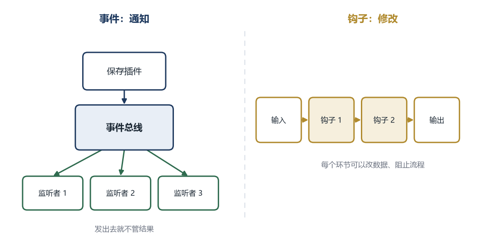
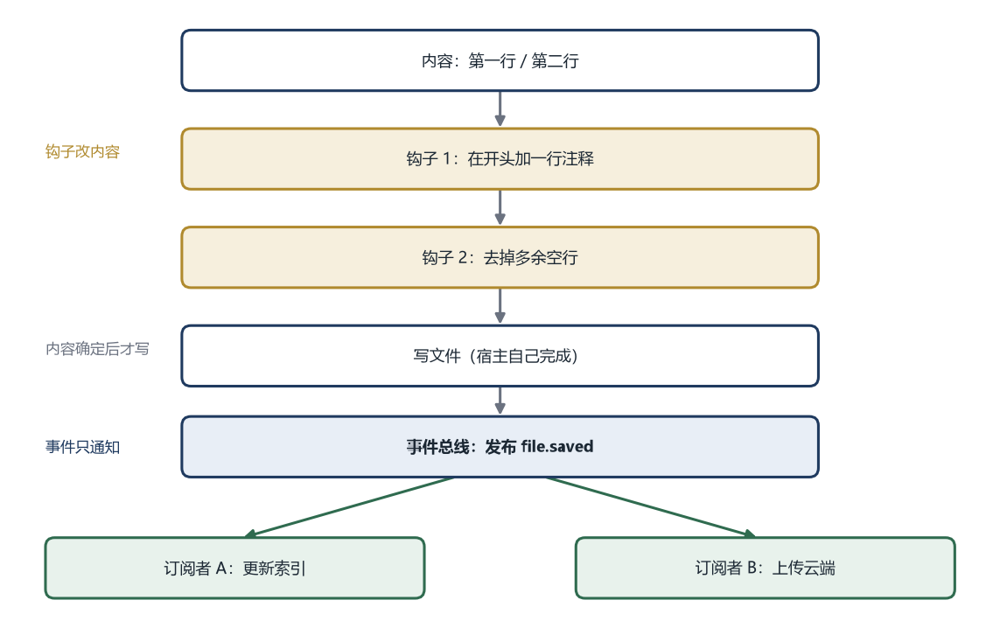

# 第 6 章 事件与钩子

本章的代码分两个阶段：

- `codes/ch06-1/`：命令表加事件总线，插件能订阅事件
- `codes/ch06-2/`：在 ch06-1 基础上加钩子，插件能往保存流程里挂函数

6.1 到 6.7 用 ch06-1，6.8 开始用 ch06-2。

## 6.1 第 5 章的插件还缺一种能力

第 5 章的插件能注册命令，用户输入命令名时，宿主查到对应的函数并调用。这是一种“你叫我，我才动”的模式。

但有些插件不需要注册命令，它们只想“知道发生了什么”。

假设有一个笔记应用。用户点保存，宿主要把文档写到磁盘。写完之后，有两件事要发生：索引插件更新搜索索引，云插件上传新版本。

这两个插件不提供命令，用户不会输入“更新索引”或“上传云端”。它们只是在等一个时机：保存完成。

第 5 章的接口给不了这个时机。`PluginApi` 里只有 `register_command` 和 `log_info`，插件没有办法告诉宿主“保存完成时叫我一声”。

所以要给 `PluginApi` 增加一种能力：订阅事件。

## 6.2 给 PluginApi 加一个字段

先看第 5 章的接口：

```cpp
typedef struct PluginApi {
    uint32_t size;
    uint32_t version;
    RegisterCommandFn register_command;
    void (*log_info)(const char* message);
} PluginApi;
```

第 6 章在末尾多了两个字段：

```cpp
typedef struct PluginApi {
    uint32_t size;
    uint32_t version;
    RegisterCommandFn register_command;
    void (*log_info)(const char* message);
    void (*on_event)(const char* type, EventFn fn);       // 新增：订阅事件
    int (*register_hook)(const char* name, HookFn fn);    // 新增：挂钩子
} PluginApi;
```

`on_event` 让插件订阅事件，`register_hook` 让插件往宿主的流程插槽上挂函数。两者都加在末尾，旧插件的字段偏移不变。

新增字段放在**末尾**，这个位置不是随手选的。

第 4 章讲过，`PluginApi` 开头有 `size`，记录结构体有多大。旧插件按第 5 章的布局只读前四个字段，它不关心后面还有什么。新宿主的结构体更大，旧插件读到 `size` 发现比自己的大，但它只用到前四个字段，所以照常工作。

如果把 `on_event` 插在 `log_info` 前面，`log_info` 的偏移就变了。旧插件按旧偏移去读 `log_info`，实际读到的是 `on_event` 的地址，一调用就跳到错误的函数。程序不会给你类型错误，它会直接崩溃。

所以跨版本的接口有一条规矩：**新字段加在末尾，已有字段的位置不动。**

版本号仍然是 `1`，因为这是一次兼容的添加。旧插件能跑，新插件能用新字段，不需要升主版本。第 4 章说的“往末尾加字段是兼容的”，在这里正好用上。

## 6.3 事件处理函数长什么样

`on_event` 的第二个参数是 `EventFn`。它是一个函数指针类型：

```cpp
typedef void (*EventFn)(const char* type, const char* payload);
```

从名字往外读：

- 最外层是 `void`，表示这个函数不返回任何值
- `(*EventFn)` 表示 `EventFn` 是一个指针
- 右边的 `(const char* type, const char* payload)` 表示它指向的函数接收两个字符串

合起来：`EventFn` 是“指向一个事件处理函数”的指针，那个函数接收类型和数据，不返回东西。

为什么返回 `void`？因为事件只负责通知，不负责回答。宿主说“文件保存了”，它不关心索引插件有没有更新成功。如果需要知道结果，那是请求，应该用函数调用或者服务接口，不该用事件。

为什么有两个参数？一个处理函数可能订阅多个事件，它需要知道这次是哪一个。比如同一个函数既处理 `file.saved` 也处理 `file.deleted`，靠第一个参数区分。

为什么用 `const char*` 而不是 `std::string`？第 4 章讲过，跨动态库不能传 C++ 对象。`const char*` 的布局最简单，两个编译器看起来一样。`const` 表示处理函数只能读，不能改这块内存。

`type` 和 `payload` 指向的字符内容由宿主提供，只在这次调用期间有效。处理函数如果想把内容留到以后用，必须自己复制一份。

这里要区分三个词，后面才不会乱。

**事件处理函数**是这类函数的正式名字，`EventFn` 指向的就是它。

**回调**是更通用的叫法：你把自己的函数交给别人，别人在合适的时机替你调用。事件处理函数是一种回调，钩子函数也是一种回调。本书在讲具体类型时用“事件处理函数”，在讲“把函数交给别人”这个动作时用“回调”。

**通知**说的是事件的行为，不是函数的名字。宿主发布事件，总线把消息送到处理函数手里，这个过程叫通知。通知是单向的，发完就结束。

## 6.4 宿主这边：把订阅接到总线上

插件调用 `on_event`，宿主不能把函数指针随便塞进一个变量。它要按事件类型分组，还要记住是谁订阅的，卸载时才能清理。

所以宿主需要一个专门的部件，叫**事件总线**。

```cpp
struct Listener {
    std::string owner;    // 哪个插件订阅的
    int priority;         // 数字小的先执行
    EventFn fn;           // 事件处理函数的地址
};

class EventBus {
public:
    void on(const std::string& type, const std::string& owner,
            EventFn fn, int priority = 100);

    void emit(const std::string& type, const std::string& payload);

    void remove_owner(const std::string& owner);

private:
    std::map<std::string, std::vector<Listener>> listeners_;
};
```

`listeners_` 是一个键值表。键是事件类型，比如 `file.saved`；值是一个数组，里面放着所有订阅了这个类型的插件。

一条 `Listener` 有三个字段。`owner` 是插件名，卸载时按它清理；`priority` 决定执行顺序；`fn` 是事件处理函数的地址。

插件不能直接调用 `EventBus`，它只认识 `PluginApi`。所以宿主要把 `api.on_event` 接到总线上：

```cpp
static void host_on_event(const char* type, EventFn fn) {
    g_events.on(type ? type : "", g_current_plugin, fn);
}
```

这个函数接收类型和函数指针，把当前插件名作为 `owner` 一起交给总线。

`g_current_plugin` 是宿主在调用 `plugin_init` 之前设置的。插件在 `init` 里订阅时，宿主知道当前是谁；插件自己不需要传名字，也没法冒充别人。

完整的调用链是这样的：

1. 插件在 `plugin_init` 里调用 `api->on_event("file.saved", on_saved)`
2. 这个指针指向宿主的 `host_on_event`
3. `host_on_event` 调用 `g_events.on(...)`，把当前插件名作为 `owner`
4. 总线把这条记录存进 `listeners_["file.saved"]`

每一步都只做一件事。插件只负责说“我要订阅”，宿主负责填归属，总线负责保存。

## 6.5 插件这边：订阅

插件在 `plugin_init` 里订阅：

```cpp
static void on_saved(const char* type, const char* payload) {
    std::printf("[hello] 收到事件 %s：%s\n", type, payload ? payload : "");
    std::fflush(stdout);
}

extern "C" PLUGIN_EXPORT int plugin_init(const PluginApi* api) {
    if (!api || api->version != PLUGIN_API_VERSION) return 1;

    // 注册命令（第 4、5 章的内容）
    for (const auto& cmd : kCommands) {
        api->register_command(&cmd);
    }

    // 用宿主提供的日志接口写一条。日志会自动带上插件名。
    if (api->log_info) {
        api->log_info("hello 插件已加载");
    }

    // 订阅事件
    api->on_event("file.saved", on_saved);

    return 0;
}
```

`on_saved` 的签名必须和 `EventFn` 一致：接收两个 `const char*`，不返回值。签名不一致，编译器会报错。

订阅发生在初始化阶段，只做一次。之后每次 `file.saved` 发生，总线都会调用这个函数。

hello 插件既注册 `hello` 命令，也订阅 `file.saved`；notes 插件只注册命令，保存时不会被通知。两者的区别可以在运行程序时看到。

代码里的 `log_info` 是第 4 章就有的能力，插件用它写日志，宿主会统一加上插件名。第 5 章的命令执行时，宿主也会把“当前插件”设成命令的 owner，所以插件在命令里调用 `log_info` 同样能打印出正确的名字。

## 6.6 发布：保存完成后通知

订阅是“登记”，发布是“真的发出去”。

宿主保存完文件后，调用 `emit`：

```cpp
void EventBus::emit(const std::string& type, const std::string& payload) {
    auto it = listeners_.find(type);
    if (it == listeners_.end()) return;

    auto snapshot = it->second;
    for (const auto& listener : snapshot) {
        listener.fn(type.c_str(), payload.c_str());
    }
}
```

第一步，按类型找到订阅者数组。找不到说明没人关心这个事件，直接返回。事件总线允许“发了但没人听”，这是正常情况。

第二步，把数组复制一份，叫 `snapshot`（快照）。

为什么要复制？因为处理函数执行时可能取消订阅。比如索引插件在处理 `file.saved` 时发现自己要退出，调用 `remove_owner` 把自己删了。如果直接遍历原数组，删除元素会让后面的元素前移，遍历的下标就会跳过一些订阅者。先复制一份，遍历的是稳定快照，删原数组不影响这一轮。

第三步，挨个调用。`type.c_str()` 和 `payload.c_str()` 把 `std::string` 转成 C 风格字符串，因为 `EventFn` 接收的是 `const char*`。这两个指针只在调用期间有效，处理函数不能保存它们。

`save` 是宿主注册到命令表里的命令，owner 是 `core`。命令循环查到它，就调用 `run_save`：

```cpp
static void run_save(const char*) {
    std::string content = "第一行\n第二行\n";

    // 1. 钩子可以改内容，也可以阻止
    for (auto& hook : g_before_save) {
        if (!hook(content)) {
            std::printf("保存被钩子阻止\n");
            return;
        }
    }

    // 2. 写文件
    std::printf("写入文件，内容如下：\n%s", content.c_str());

    // 3. 通知订阅者
    g_events.emit("file.saved", "path=/notes/a.md");
}
```

`emit` 一执行，所有订阅了 `file.saved` 的插件都会收到，顺序由优先级决定。

## 6.7 顺序：谁先谁后

顺序会直接影响结果。

假设两个插件都监听 `file.saved`。A 负责把文件内容同步到云端，B 负责在本地生成缩略图。谁先谁后通常不影响结果，因为它们做的事互不干扰。

换一个组合。A 负责压缩文件，B 负责计算文件哈希。B 先算，算的是压缩前的哈希；A 先算，算的是压缩后的哈希。两个结果完全不同，而用户看到的可能只是“哈希偶尔对不上”。

宿主不能假设插件之间没有顺序依赖。必须提供优先级，并且把“数字小的先执行”写进文档。

优先级数字怎么定？可以约定几个档位：`0` 到 `49` 留给系统内部，`50` 到 `99` 给需要抢先的插件，`100` 是默认值，`101` 以后表示“我希望晚一点”。

`on` 函数在加入订阅后按优先级排序：

```cpp
auto& list = listeners_[type];
list.push_back({ owner, priority, fn });
std::stable_sort(list.begin(), list.end(),
                 [](const Listener& a, const Listener& b) {
                     return a.priority < b.priority;
                 });
```

`std::stable_sort` 是稳定排序：优先级相同的订阅者，保持注册的先后顺序。如果用普通 `sort`，相同优先级的顺序可能被打乱，今天 A 先、明天 B 先，行为就不确定了。

## 6.8 钩子：在流程中间留一个插槽

从这一节开始，代码切换到 `codes/ch06-2`。它比 `ch06-1` 多三处：`PluginApi` 增加 `register_hook`、宿主增加钩子链、hello 插件增加一个 `before_save` 函数。事件部分没有改动。

事件只能通知，不能改变正在发生的事。宿主喊“我保存了”，这时候文件已经写完了，索引插件再想改内容也来不及。

但有些场景需要在事情发生之前插手。比如保存之前，插件想给 Markdown 补 front matter；保存之前，插件想检查内容里有没有密钥；保存之前，插件想先备份旧文件。

这些场景需要**钩子**。

**钩子是宿主在一条固定流程的某个位置预留的插槽。** 插件把自己的函数挂上去，流程走到那里，宿主自动调用它。

名字来自墙上的钩子。主人在门后钉一个钩子，客人可以把外套挂上去；主人不需要知道谁会挂、挂什么，只需要保证钩子在那里。软件里的钩子也是这个意思：宿主留位置，插件挂函数，到点调用。

一个钩子包含三样东西。

- **位置**：流程的哪一步，比如“保存之前”“绘制之后”。位置由宿主决定，插件不能自己造。
- **挂载**：插件把自己的函数登记到这个位置，通常发生在插件初始化时。
- **调用**：流程走到这个位置，宿主按顺序调用挂着的函数。

钩子和事件经常被混用，区别在时机和权限。

- 事件是“事情发生之后通知”，订阅者只能听，不能改。
- 钩子是“事情发生之前或之中插入”，挂上去的函数可以改数据，也可以用返回值阻止流程。

用生活里的例子：小区广播是事件，物业喊“停水了”，你只能听到；门禁是钩子，你刷卡时系统检查权限，有权才开门，没权就拦下。

回到保存流程。宿主在写文件之前留了一个插槽，叫 `before_save`。插件把函数挂上去；宿主拿到内容、还没落盘时，依次调用这些函数。函数可以改内容，也可以返回 `false` 说“别存”。

先澄清一个容易产生的误解。保存钩子不是为了“正常编辑内容”。正常编辑发生在用户敲键盘的时候，走的是命令和编辑接口，改的是宿主内存里的文档，会进入撤销栈，界面上能立刻看到。

保存钩子处理的是另一件事：**准备写出去的那份内容**。同一份文档，内存里是一回事，写到磁盘上可能是另一回事。

常见的三类用途。

**规范化和格式化。** 把 Windows 风格的换行统一成 Unix 风格（前者每行结尾两个字符，后者一个）、去掉行尾多余空格、给 Markdown 补 front matter、把 JSON 的键排序。这些操作如果每次按键都做，会打断输入、污染撤销栈；放在保存时做一次最合适。

**校验和阻止。** 检查内容里有没有未填的占位符、有没有泄露密钥、文件是不是超过大小限制。发现问题就返回 `false`，保存中止，用户得到提示。这类钩子不需要修改内容，只需要说“不许存”。

**附加信息和转换。** 在文件头加“最后修改时间”，保存时顺便生成一份备份，或者把内容加密、压缩后再写。写出去的是密文，内存里仍然是明文。

如果没有这些需求，钩子链可以是空的，保存就是直接写文件。钩子是“可选的处理步骤”，不是保存的必需环节。

下面用三个真实场景，看看钩子具体长什么样。它们都符合 `std::function<bool(std::string&)>` 这个签名：接收内容，返回“继续”或“阻止”。

**例一：给 Markdown 补 front matter。** 静态博客的编辑器通常会在文件开头补一段元信息，记录标题、日期、标签。用户不需要手写，保存时自动加：

```cpp
g_before_save.push_back([](std::string& content) {
    // 已经有 front matter 就不重复加
    if (content.rfind("---\n", 0) == 0) return true;

    content = "---\ntitle: 未命名\ndate: 2026-11-02\n---\n\n" + content;
    return true;
});
```

`rfind("---\n", 0) == 0` 是“以 `---` 加换行开头”的写法。`rfind` 从指定位置往前找，第二个参数传 0，就只在开头匹配。

这个钩子只改副本，用户编辑器里看到的仍然是原来的内容，磁盘上的文件多了元信息。

**例二：检查内容里有没有密钥。** 有些编辑器会在保存时扫一遍，防止用户把 API key 写进笔记又提交到仓库：

```cpp
g_before_save.push_back([](std::string& content) {
    if (content.find("sk-") != std::string::npos) {
        std::printf("内容里可能有密钥，保存已取消\n");
        return false;   // 阻止保存
    }
    return true;
});
```

`find` 返回第一次出现的位置，找不到返回 `npos`。这里只是演示，真实的密钥检测要用正则匹配更长的模式，还要排除示例文档里的假 key。

这个钩子不修改内容，只负责说“不许存”。返回 `false` 之后，后面的钩子不再执行，文件也不会写。

**例三：保存前备份旧版本。** 有些工具会在覆盖文件之前，把上一版复制成 `.bak`：

```cpp
g_before_save.push_back([](std::string&) {
    std::error_code ec;
    if (std::filesystem::exists("note.md")) {
        std::filesystem::copy_file(
            "note.md", "note.md.bak",
            std::filesystem::copy_options::overwrite_existing, ec);
    }
    return true;
});
```

这个钩子需要 `#include <filesystem>`。它不关心内容，参数写成 `std::string&` 但不使用。`std::error_code` 用来接住复制失败，避免抛异常。真实项目里路径由宿主传进来，这里用固定文件名只是为了简短。

三个例子对应三类用途：例一改内容，例二阻止，例三做副作用。

### 插件怎么挂钩子

上面三个例子都是宿主自己写的 lambda。如果钩子由插件提供，写法要换，因为要跨动态库。

插件不能传 `std::string`，只能用 `char*` 加长度：

```cpp
typedef int (*HookFn)(char* buffer, std::size_t size, const char* meta);
```

`buffer` 是宿主准备的可写内存，`size` 是总容量，`meta` 是附加信息。返回 `0` 表示继续，非 `0` 表示阻止。

插件把函数挂到插槽上：

```cpp
static int before_save(char* buffer, std::size_t size, const char* meta) {
    const char* tail = "\n<!-- saved by hello -->\n";
    std::size_t used = std::strlen(buffer);

    // 放不下就返回非 0，让宿主中止保存，而不是写出半截内容
    if (used + std::strlen(tail) + 1 > size) return 1;

    std::strcat(buffer, tail);
    return 0;
}

api->register_hook("before_save", before_save);
```

宿主执行时准备缓冲区，把内容复制进去，多留空间，然后逐个调用：

```cpp
std::vector<char> buffer(content.begin(), content.end());
buffer.resize(content.size() + 4096, '\0');

for (const auto& hook : g_hooks["before_save"]) {
    if (hook.fn(buffer.data(), buffer.size(), "path=/notes/a.md") != 0) {
        return;   // 插件阻止了保存
    }
}
content.assign(buffer.data());
```

运行 `save`，文件内容会同时有宿主加的注释（开头）和插件加的标记（末尾）：

```text
// 由宿主添加
第一行
第二行

<!-- saved by hello -->
```

这就是“插槽 + 挂载 + 调用”的完整样子。

钩子也有不该做的事。

**不要做耗时操作。** 比如上传云端、调用网络接口。保存是用户按一下就要完成的操作，钩子里等三秒，界面就卡三秒。这类事情应该放到 `file.saved` 事件之后，由订阅者异步处理。

**不要改文档对象。** 钩子拿到的是副本，改副本没问题；如果通过全局指针去改文档本身，用户会看到内容莫名其妙变化，撤销栈也会乱。

**不要吞掉错误。** 备份失败、格式化失败，应该返回 `false` 或者打印日志，不能假装成功。

## 6.9 钩子链：顺序、短路、数据



钩子按加入的顺序执行，形成一条链。链上有三个要点。

**顺序。** 第一个钩子加注释，第二个钩子去空行，结果和反过来不一样。加注释可能引入空行，去空行可能删掉注释里的换行。顺序要在文档里写清楚。

**短路。** 任何一个钩子返回 `false`，后面的钩子不再执行，保存中止。它适合“权限检查”“内容校验”这类场景：条件不满足，就没必要继续。

**数据。** 每个钩子接收的是同一个字符串的引用，前一个钩子改完，后一个钩子看到的就是改过的内容。这和管道型扩展点是同一个模型：前一个的输出是后一个的输入。

宿主执行钩子链的代码很短：

```cpp
for (auto& hook : g_before_save) {
    if (!hook(content)) {
        std::printf("保存被钩子阻止\n");
        return;
    }
}
write_file(path, content);
```

注意 `content` 是宿主在保存时临时复制的一份，不是文档对象本身。钩子改的是这份副本，改完直接写文件，不会回写文档。所以保存之后，编辑器里看不到多出来的那行注释，只有磁盘上的文件多了。

如果钩子要由插件提供，跨动态库传递，就不能用 `std::string&`，得换成第 4 章那种 C 风格的结构：一块 `char*` 缓冲区加一个长度，返回 `int` 表示成功失败。原理一样，只是数据的表示方式受边界限制。

## 6.10 三种钩子

按调用位置，钩子可以分三类。

**前置钩子。** 在操作执行前调用，可以修改输入、检查条件、阻止操作。保存前的注释、打开前的权限检查，都属于这一类。上面 `g_before_save` 就是前置钩子。

**后置钩子。** 在操作完成后调用，通常只做通知和清理，返回值被忽略。保存后的索引更新、上传完成后的通知，属于这一类。后置钩子不该抛异常，也不该阻止流程，因为事情已经做完了。

**环绕钩子。** 把原操作包在中间，可以在前后都做事，也可以决定要不要执行原操作。计时、重试、事务，属于这一类。

环绕钩子的写法稍微绕一点：

```cpp
using Operation = std::function<bool()>;

bool run_with_timing(const Operation& core) {
    auto start = std::chrono::steady_clock::now();

    bool ok = core();   // 执行真正的操作

    auto end = std::chrono::steady_clock::now();
    auto ms = std::chrono::duration_cast<std::chrono::milliseconds>(end - start).count();
    std::printf("保存耗时 %lld 毫秒\n", (long long)ms);
    return ok;
}
```

`Operation` 是“不接收参数、返回 bool 的函数”。`run_with_timing` 接收一个操作，先记时间，再调用它，最后打印耗时。原操作被夹在中间，所以叫环绕。

环绕钩子也可以选择不调用 `core()`，直接返回 `false`，这样原操作根本不会执行。权限检查、二次确认可以用这种方式。

## 6.11 异常不能穿过边界

C++ 有异常机制，`throw` 抛出，`try/catch` 捕获。但在插件系统里，异常穿过动态库边界非常危险。

原因在于异常的实现依赖运行库。Visual Studio 和 GCC 的异常结构不一样，甚至同一编译器不同版本的运行库也可能不兼容。插件里抛出的异常，宿主可能根本接不住，程序直接终止。

所以插件接口有一条硬规则：**异常不能穿过边界。** 插件里的函数要用返回值表示成功失败，内部该捕获的异常在内部捕获掉。

```cpp
extern "C" PLUGIN_EXPORT int plugin_init(const PluginApi* api) {
    try {
        // 可能抛异常的逻辑
        return 0;
    } catch (const std::exception& e) {
        std::printf("init failed: %s\n", e.what());
        return 1;
    } catch (...) {
        std::printf("init failed: unknown error\n");
        return 2;
    }
}
```

`catch (...)` 捕获所有类型的异常，包括那些不是 `std::exception` 的。它是最后一道防线，保证异常不会漏出去。

宿主调用插件的函数时也一样。事件处理函数和钩子函数都可能来自插件，宿主应该用 `try/catch` 包住，避免一个插件出错影响其他订阅者：

```cpp
for (const auto& listener : snapshot) {
    try {
        listener.fn(type.c_str(), payload.c_str());
    } catch (...) {
        std::printf("事件处理失败：%s\n", listener.owner.c_str());
    }
}
```

这段代码和 6.6 的 `emit` 相比，只多了一个 `try/catch`。但这几行很重要：一个订阅者写错了，不该让整条广播中断。

## 6.12 一次保存的完整流程

把前面几节拼起来，用户输入 `save` 后，宿主按这个顺序走：



1. 宿主收到 `save` 命令，取出要保存的内容
2. 宿主调用前置钩子，插件可以修改准备写出去的副本，也可以阻止保存
3. 内容确定后，宿主写文件
4. 宿主发布 `file.saved` 事件
5. 索引插件、云插件收到事件，各自处理

第 2 步用钩子，因为要“改”；第 4 步用事件，因为只要“通知”。

如果反过来，用事件去修改内容，会出问题：订阅者不知道自己的修改会不会被后面的人覆盖，也不知道事件是按什么顺序送的。事件的设计假设是“只读”，一旦有人往里写，整个模型就乱了。

判断标准很简单。插件只需要知道“发生了什么”，用事件；插件需要改变“正在发生的事”，用钩子。

## 6.13 一个容易忽略的问题：重入

假设保存钩子里，某个插件修改了文档内容。文档内容一变，又触发了一次“文档已修改”事件。宿主的自动保存定时器收到这个事件，又发起一次保存，保存又调用钩子。程序陷入循环。

这类问题叫**重入**：同一个流程还没结束，又被自己触发了一次。

最直接的解决办法是在流程里加一个标记：

```cpp
static bool g_saving = false;

bool save_document(const std::string& path, std::string& content) {
    if (g_saving) {
        std::printf("已经在保存，忽略这次请求\n");
        return false;
    }

    g_saving = true;
    bool ok = do_save(path, content);
    g_saving = false;
    return ok;
}
```

`g_saving` 是一个开关。进入保存时打开，结束时关闭。保存过程中再有人请求保存，直接拒绝。

这个写法很简单，但有一个漏洞：如果 `do_save` 中途抛异常，`g_saving` 就永远不会被关掉，之后所有保存都会被拒绝。第 11 章会讲用 RAII 解决这个问题：把开关包在一个对象里，对象析构时自动关闭，不管从哪条路径退出。

## 6.14 还差什么

事件和钩子让插件能协作，但所有东西仍然在同一个进程里。插件里一个数组越界，宿主跟着崩溃。插件里一个死循环，界面卡住，用户连禁用按钮都点不到。

下一章处理这个问题。先把“进程”讲清楚，再把插件放进独立进程，最后讨论通信、超时和权限。
