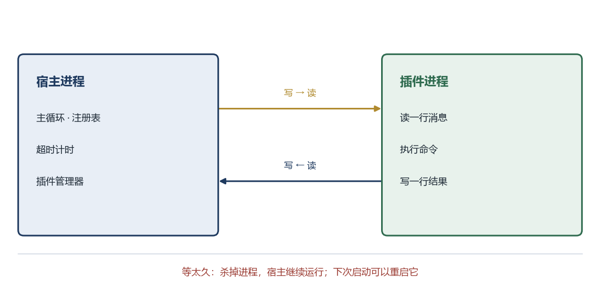

# 第 7 章 插件出错怎么办

本章的完整代码和编译说明在 `codes/ch07/`。

## 7.1 C++ 的崩溃为什么特别致命

前面几章的插件和宿主在同一个程序里。命令循环、命令表、事件都保留，改变的只是插件运行的位置：从同一个进程搬到独立进程。命令还是那些命令，只是执行的地方变了。

在同一个进程里，插件犯的错，宿主一起承担。

C++ 里有几类错误，后果特别严重。

**数组越界。** 你有一个长度为 10 的数组，却写了第 15 个位置。那 5 个位置可能属于别的变量。写进去之后，别的变量的值被悄悄改掉，程序在几分钟后以一个完全无关的地方崩溃。排查时看到的现场，和真正的错误地点隔着十万八千里。

**空指针。** 一个指针没有指向任何有效对象，你却通过它去读数据。轻则读到垃圾，重则直接触发操作系统的保护机制，程序立刻终止。

**释放后再使用。** 一块内存已经还给了系统，你手里还留着一个指向它的指针，又用它去读写。这块内存可能已经被分配给别的对象，你改的是别人的数据。

**栈溢出。** 函数递归太深，或者在一个函数里开了巨大的局部数组，把栈空间用完。程序同样立刻终止。

这些错误有一个共同点：它们不是“返回一个错误码”，而是直接让程序消失。C++ 的 `try/catch` 接不住它们，因为它们在语言层面之下，属于操作系统检测到的非法内存访问。

## 7.2 程序运行起来之后

要理解怎么隔离，先要理解程序运行起来之后是什么样子。

你写的 `.cpp` 文件躺在硬盘上，它是一个文件。双击它，操作系统会做几件事：在内存里划出一块地方，把程序的代码和数据装进去，创建一个执行环境，然后从 `main` 开始执行。这个“装进内存、正在运行的程序”，叫**进程**。

进程有自己的内存。这块内存里放着它的代码、全局变量、堆、栈。操作系统给每个进程分配独立的地址空间，一个进程不能直接读写另一个进程的内存。你去读，操作系统会拦住你，然后终止你的程序。

这就像一栋楼里的房间。每个进程是一间房，房里的东西别人进不来。你可以随便折腾自己房间，把墙砸了也行，但砸不到隔壁。

进程之间要交换东西，不能直接伸手，只能通过门缝递纸条。这个“递纸条”的通道，叫**管道**或者**套接字**，统称进程间通信。

## 7.3 同一个进程里的保护为什么不够

有人会问，既然有 `try/catch`，为什么不能在插件外面包一层，出错就捕获？

因为 `try/catch` 只能捕获“主动抛出”的异常。数组越界、空指针解引用这类错误，不会抛出异常，它们直接触发操作系统的内存保护。程序收到一个信号，默认行为是立刻终止，`catch` 根本没机会执行。

死循环也接不住。一个 `while (true)` 不带退出条件，会一直占着处理器。宿主和插件在同一个进程，插件的循环不结束，宿主的主循环也得不到执行，界面就卡死了。

要兜住这两类问题，只有一个办法：把插件放到另一个进程里。插件崩溃，只死它自己；插件死循环，宿主可以直接把它杀掉。

## 7.4 把插件做成一个独立程序

做法很直接。插件不再编译成动态库，而是编译成一个独立的可执行文件，比如 `plugin_host.exe`。这个程序启动后，等待宿主发消息，收到消息就执行，执行完把结果写回去。

宿主这边，启动这个程序，拿到它的输入输出通道，像对话一样一问一答。

结构变成这样：

```text
宿主进程
  ├── 加载插件清单
  ├── 启动 plugin_host.exe（每个插件一个）
  ├── 通过管道发消息
  └── 收结果、处理超时、必要时杀掉
插件进程
  ├── 读一行消息
  ├── 执行对应命令
  └── 写一行结果
```

插件进程里仍然可以加载动态库，也可以直接写死命令。关键是它和宿主之间隔着一道进程边界，崩溃不会传播。



## 7.5 两个程序怎么说话

进程之间传数据，最朴素的方式是管道。

管道是操作系统提供的一根“管子”，一头写，另一头读。写进去的是字节流，读出来的也是字节流。它不关心你写的是文字还是二进制，只负责搬运。

为了让两边都能理解，需要约定一种格式。最简单的是“一行一条消息”，每条消息是一段文本，用换行符分隔。

```text
宿主 -> 插件：  run hello world
插件 -> 宿主：  ok 你好，世界
插件 -> 宿主：  error 命令不存在
```

每行第一个词表示类型，后面是内容。解析时按第一个空格切开，和命令行参数的切法一样。

把内存里的数据变成可以传输的字节，这个过程叫**序列化**。反过来叫**反序列化**。文本协议是最简单的序列化，缺点是体积大、解析慢；二进制协议更紧凑，但调试时看不懂。插件系统的消息通常不多，文本协议够用。

## 7.6 超时与强制结束

插件进程可能卡住。宿主不能一直等。

每次发完消息，宿主启动一个计时器。比如等三秒，三秒还没收到回复，就认为插件挂了。

处理方式有两种。温和一点的是发一条“取消”消息，给插件一个自己退出的机会。强硬一点的是直接杀掉进程。

Windows 上杀进程用 `TerminateProcess`，Linux 上用 `kill` 发送 `SIGKILL` 信号。杀掉之后，进程占用的内存、打开的文件都会被系统回收，不会泄漏。

杀掉之后要不要重启？可以重启，但不能无限重启。第一次崩溃后立即重启，第二次等一秒，第三次等五秒，之后逐渐拉长。短时间内崩溃太多次，就标记为“反复崩溃”，提示用户禁用。

## 7.7 权限：只给该给的

隔离解决了“崩溃不扩散”，但没有解决“插件能做什么”。一个独立进程仍然可以读写用户的文件、访问网络。

权限控制的思路是“默认什么都不给，需要什么单独授予”。

具体到进程，可以限制它能访问的目录、能连接的网络地址、能使用的内存大小。Windows 上可以用作业对象（Job Object）限制内存和进程数；Linux 上可以用 `setrlimit` 限制资源，用命名空间隔离文件系统。

这些机制对初学者来说比较深，这里只需要知道原则：**插件进程应该以最小的权限运行，用到什么开什么，不用就关掉。**

一个具体的做法是，插件不直接接触文件路径，而是把请求发给宿主，宿主检查路径是否在允许的目录里，再代为读写。插件拿不到真实路径，也就没法越界。

## 7.8 一个最小的进程插件

下面这段代码先做最小验证：启动一个子程序，发一句 `ping`，读一句回复。它不完整，但包含了进程隔离的全部关键步骤。看完之后再把它接进命令循环，就回到第 5、6 章的结构了。

先看子程序 `plugin_host.cpp`：

```cpp
#include <cstdio>
#include <iostream>
#include <string>

int main() {
    std::string line;
    while (std::getline(std::cin, line)) {
        if (line == "ping") {
            std::printf("pong\n");
            std::fflush(stdout);
        } else if (line == "quit") {
            break;
        } else {
            std::printf("error unknown\n");
            std::fflush(stdout);
        }
    }
    return 0;
}
```

它从标准输入读一行，判断内容，往标准输出写一行。没有网络，没有复杂协议，就是对话。

宿主这边，Windows 的写法：

```cpp
#include <windows.h>
#include <cstdio>
#include <cstring>

int main() {
    SECURITY_ATTRIBUTES sa{};
    sa.nLength = sizeof(sa);
    sa.bInheritHandle = TRUE;

    HANDLE in_read = nullptr, in_write = nullptr;
    HANDLE out_read = nullptr, out_write = nullptr;
    CreatePipe(&in_read, &in_write, &sa, 0);
    CreatePipe(&out_read, &out_write, &sa, 0);

    STARTUPINFOA si{};
    si.cb = sizeof(si);
    si.dwFlags = STARTF_USESTDHANDLES;
    si.hStdInput = in_read;
    si.hStdOutput = out_write;
    si.hStdError = out_write;

    PROCESS_INFORMATION pi{};
    char cmd[] = "plugin_host.exe";
    if (!CreateProcessA(nullptr, cmd, nullptr, nullptr, TRUE, 0,
                        nullptr, nullptr, &si, &pi)) {
        std::printf("启动失败：%lu\n", GetLastError());
        return 1;
    }

    CloseHandle(in_read);
    CloseHandle(out_write);

    const char* msg = "ping\n";
    DWORD written = 0;
    WriteFile(in_write, msg, (DWORD)std::strlen(msg), &written, nullptr);

    char buffer[256]{};
    DWORD got = 0;
    ReadFile(out_read, buffer, sizeof(buffer) - 1, &got, nullptr);
    std::printf("子进程回复：%s", buffer);

    CloseHandle(in_write);
    WaitForSingleObject(pi.hProcess, 3000);
    TerminateProcess(pi.hProcess, 0);

    CloseHandle(pi.hProcess);
    CloseHandle(pi.hThread);
    CloseHandle(out_read);
    return 0;
}
```

这段代码有点长，但每一步都对应一个具体目的。

`SECURITY_ATTRIBUTES` 里的 `bInheritHandle = TRUE`，表示“这个管道的把手可以被子进程继承”。不设这个，子进程拿不到管道。

`CreatePipe` 创建两根管道。第一根给宿主写、子进程读，第二根给子进程写、宿主读。每根管道有两个把手，一头读一头写。

`STARTUPINFOA` 告诉系统：子进程的标准输入输出不要用控制台，用我指定的这两个把手。`STARTF_USESTDHANDLES` 是“使用自定义把手”的开关。

`CreateProcessA` 启动子进程。第五个参数 `TRUE` 表示“允许继承把手”。

启动之后，宿主把自己不需要的那两头关掉。`in_read` 是子进程读的那头，宿主不用；`out_write` 是子进程写的那头，宿主也不用。不关掉的话，管道永远有一端开着，读数据时会一直等，等不到结束。

`WriteFile` 写一句 `ping\n`。`ReadFile` 读回复。注意 `ReadFile` 是阻塞的，子进程不写，它就一直等。真实系统要用 `PeekNamedPipe` 轮询或者异步 IO 来配合超时。

最后 `WaitForSingleObject` 等子进程退出，最多等三秒。没退出就 `TerminateProcess` 强制结束。

真实宿主不会只发一次 `ping`。它像第 5、6 章那样有一个命令循环，把用户输入的命令转发给子进程：

```cpp
static std::string read_line(int timeout_ms) {
    // 用 PeekNamedPipe 轮询，最多等 timeout_ms 毫秒
    // ...
}

int main() {
    // ... 创建管道、启动 plugin_host.exe ...

    std::string line;
    while (true) {
        std::printf("> ");
        if (!std::getline(std::cin, line)) break;
        if (line == "quit") break;

        if (line != "hello" && line != "ping") {
            std::printf("未知命令：%s\n", line.c_str());
            continue;
        }

        write_line(line);                 // 命令发给子进程
        std::string reply = read_line(3000);
        if (reply.empty()) {              // 三秒没回复
            TerminateProcess(pi.hProcess, 1);
            break;
        }
        std::printf("%s", reply.c_str());
    }
}
```

`codes/ch07/host.cpp` 就是这一版。输入 `hello`，命令被发到子进程，回复打印回来；输入 `quit`，两边的程序都结束。第 5、6 章的命令循环没有变，变的是命令在哪里执行。

## 7.9 Linux 上对应的写法

Linux 的思路一样，函数名不同。

| 步骤 | Windows | Linux |
|---|---|---|
| 创建管道 | `CreatePipe` | `pipe` |
| 启动进程 | `CreateProcess` | `fork` + `execv` |
| 重定向输入输出 | `STARTUPINFO` | `dup2` |
| 读 | `ReadFile` | `read` |
| 写 | `WriteFile` | `write` |
| 等待 | `WaitForSingleObject` | `waitpid` |
| 强制结束 | `TerminateProcess` | `kill` + `SIGKILL` |

`fork` 会复制当前进程，`execv` 把复制出来的进程替换成另一个程序。`dup2` 把管道的两端接到标准输入输出上。这三步合起来，效果和 Windows 的 `CreateProcess` 加 `STARTUPINFO` 一样。

书里不展开 Linux 的完整代码，因为逻辑和 Windows 一一对应，读者理解了一个，另一个可以查文档写出来。

## 7.10 什么时候不该隔离

进程隔离不是免费的。启动一个进程要几十毫秒，每次通信要序列化，调试要同时看两个进程的日志。

下面这些情况，放在同一个进程里更合适。

插件完全由自己开发，代码经过审核，不会执行用户输入的任意代码。

操作频率极高，比如每一帧都要调用的绘制指令。跨进程的消息开销会直接吃掉性能预算。

插件需要共享大量内存中的对象，复制到另一个进程既慢又容易不一致。

插件生命周期很短，比如一次性的格式转换，启动进程的时间比干活还长。

一个折中的做法是分级。可信插件放在宿主进程，第三方插件各自独立，高风险操作再单独隔离。这样既能保证安全，又不会让所有插件都背上通信开销。

## 7.11 现在解决了什么

到这儿，第 1 章提出的三个问题都有了着落。

加功能不用改主程序，插件是独立的动态库或者独立程序。代码不在一个文件里，插件可以单独编译、单独发布。插件崩溃不会带走宿主，因为它在另一个进程里。

代价是复杂度上来了。要写加载器、注册表、事件总线、进程管理、通信协议、超时处理。这也是为什么大型软件的架构看起来那么复杂，它不是故意绕弯，而是每个零件都在解决一个具体问题。

接下来的第三篇，把这些零件变成可复制的工程。先解决一个很实际的问题：每写一个新插件，都要手动建目录、写清单、配构建，太麻烦。下一章用一条命令生成。
