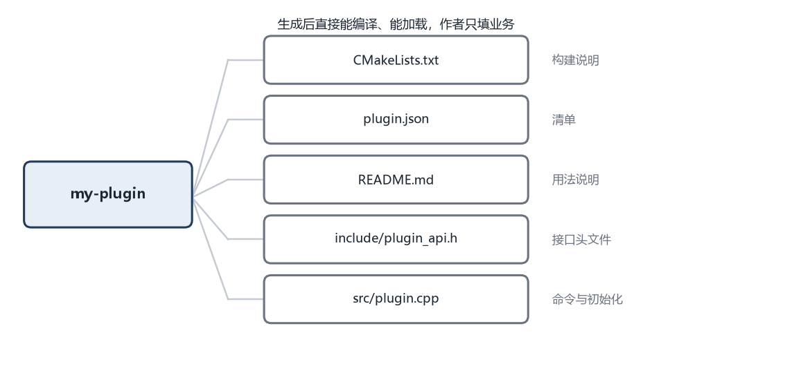

# 第 8 章 一条命令生成插件

本章的完整代码和编译说明在 `codes/ch08/`。

第 7 章把插件搬进了独立进程。这一章回到开发环节：用一条命令生成一个能注册命令的插件骨架，免得每次手写同样的文件。

## 8.1 每写一个插件都要重复一遍

做到现在，写一个新插件要手动做这些事：建目录、写 `plugin_api.h` 的引用、写三个导出函数、写命令数组、配编译命令、建 `plugins` 子目录。

这些事每次都一样，只有名字和命令内容不同。重复做十遍，迟早会漏一步。漏了 `extern "C"`，插件加载时找不到符号；忘了导出宏，动态库是空的；编译参数少一个，插件和宿主对不上。

解决办法是把这套结构做成模板，用一条命令生成。生成出来的东西能直接编译、能直接加载，作者只需要往里填业务。

## 8.2 模板里放什么

一个插件模板至少包含六样东西。

**接口头文件。** `plugin_api.h` 的副本，或者一个指向公共头文件目录的引用。插件作者需要它才能编译。

**插件源码。** 一个空的 `plugin.cpp`，已经写好三个导出函数和命令数组的骨架。

**构建配置。** CMake 文件，说明这是一个动态库、用 C++17、输出到哪里。

**清单文件。** 一个简单的文本或者 JSON，记录插件名字、版本、作者、依赖。第 10 章打包时会用到。

**说明文档。** 一个 `README.md`，写清楚这个插件做什么、怎么编译、怎么安装。

**一个最小示例。** 一个能跑的 `hello` 命令，作者可以照着改成自己的。

这六样东西不需要很复杂。模板的价值不在代码多，而在于“结构正确”。作者拿到就能编译，不用先研究怎么配置。

## 8.3 目录结构

```text
my-plugin/
  CMakeLists.txt
  plugin.json
  README.md
  include/
    plugin_api.h
  src/
    plugin.cpp
```

`include` 放公共头文件，`src` 放源码。`CMakeLists.txt` 是构建说明，`plugin.json` 是清单，`README.md` 是给人看的。

这个结构刻意保持扁平。层级越深，新作者越容易放错位置。等插件真的变大，再按功能拆子目录。



## 8.4 CMake 是什么

C++ 的编译命令可以很长，尤其是文件多了、要链接不同的库、要区分 Windows 和 Linux 的时候。每次都手写命令，既容易错，也没法跨平台。

CMake 是一个“生成构建文件”的工具。你写一份 `CMakeLists.txt`，描述“这个项目有哪些源文件、要生成什么、依赖什么”，CMake 根据当前平台生成对应的构建文件。Windows 上生成 Visual Studio 的工程，Linux 上生成 Makefile。

一个最小的插件构建文件：

```cmake
cmake_minimum_required(VERSION 3.16)
project(my_plugin LANGUAGES CXX)

set(CMAKE_CXX_STANDARD 17)
set(CMAKE_CXX_STANDARD_REQUIRED ON)

add_library(my_plugin SHARED src/plugin.cpp)
target_include_directories(my_plugin PRIVATE include)
```

`cmake_minimum_required` 声明需要的最低 CMake 版本。`project` 给项目起名字，`LANGUAGES CXX` 表示这是一个 C++ 项目。

`set(CMAKE_CXX_STANDARD 17)` 要求用 C++17 标准。`CMAKE_CXX_STANDARD_REQUIRED ON` 表示“如果编译器不支持，就直接报错”，而不是悄悄退回旧标准。

`add_library(... SHARED ...)` 表示生成动态库。`SHARED` 是关键，不写的话默认生成静态库。`target_include_directories` 把头文件目录加进搜索路径，这样源码里可以写 `#include "plugin_api.h"`。

使用的时候，在项目目录里执行：

```bash
cmake -B build
cmake --build build
```

第一行在 `build` 目录里生成构建文件，第二行真正编译。生成的动态库在 `build` 目录下，Windows 是 `my_plugin.dll`，Linux 是 `libmy_plugin.so`。

## 8.5 用脚本生成

生成器可以用任何语言写。这里用 Python，因为它做文件操作最短，而且 Windows 和 Linux 都自带或者容易安装。

先看完整脚本，再逐段解释：

```python
import os
import shutil
import sys

TEXT_EXT = (".cpp", ".h", ".txt", ".json", ".md")

def render(text, values):
    for key, value in values.items():
        text = text.replace("{{" + key + "}}", value)
    return text

def main():
    if len(sys.argv) < 2:
        print("用法: python new_plugin.py <name>")
        return

    name = sys.argv[1]
    target = os.path.join("plugins", name)

    if os.path.exists(target):
        print("目录已存在:", target)
        return

    shutil.copytree("templates/plugin", target)

    for root, dirs, files in os.walk(target):
        for filename in files:
            if not filename.endswith(TEXT_EXT):
                continue
            path = os.path.join(root, filename)
            with open(path, "r", encoding="utf-8") as f:
                text = f.read()
            with open(path, "w", encoding="utf-8") as f:
                f.write(render(text, {"name": name}))

    print("已创建", target)
    print("下一步: cd", target, "&& cmake -B build && cmake --build build")

if __name__ == "__main__":
    main()
```

`sys.argv` 是命令行参数列表。第一个是脚本名，第二个开始是用户输入。`len(sys.argv) < 2` 表示用户没给名字，打印用法后退出。

`os.path.join` 把目录和名字拼成路径。它会根据系统自动选斜杠，Windows 用反斜杠，Linux 用正斜杠。

`os.path.exists` 检查目录在不在。存在就报错，不覆盖。这个检查很重要，生成器最怕的就是手滑覆盖别人的代码。

`shutil.copytree` 复制整个模板目录。它会递归复制所有子目录和文件。

`os.walk` 遍历目录树，每次返回三个东西：当前目录、当前目录下的子目录列表、当前目录下的文件列表。

`filename.endswith(TEXT_EXT)` 检查文件扩展名是不是文本文件。图片、字体这类文件不能做文本替换，直接跳过。

`with open(...) as f` 是 Python 的文件写法，离开这个块时自动关闭文件，不用手动 `close`。

`render` 把文件里的 `{{name}}` 替换成实际名字。模板里的 `plugin.cpp` 可能写着 `return "{{name}}";`，生成后变成 `return "hello";`。

## 8.6 模板长什么样

`templates/plugin/src/plugin.cpp`：

```cpp
#include "plugin_api.h"
#include <cstdio>

static void run_{{name}}(const char* args) {
    std::printf("{{name}} 命令执行，参数：%s\n", args ? args : "");
    std::fflush(stdout);
}

static const PluginCommand kCommands[] = {
    { "{{name}}", "{{name}} 插件的示例命令", run_{{name}} },
};

extern "C" PLUGIN_EXPORT const char* plugin_name() {
    return "{{name}}";
}

extern "C" PLUGIN_EXPORT int plugin_init(const PluginApi* api) {
    if (!api || api->version != PLUGIN_API_VERSION) return 1;
    for (const auto& cmd : kCommands) {
        api->register_command(&cmd);
    }
    return 0;
}

extern "C" PLUGIN_EXPORT void plugin_shutdown() {
}
```

生成 `hello` 插件后，`{{name}}` 全部变成 `hello`，函数名变成 `run_hello`，命令名变成 `hello`。

注意函数名里用了占位符。如果两个插件都叫 `run_command`，虽然它们在各自的动态库里，不会冲突，但调试时容易看混。带上插件名更清楚。

## 8.7 生成之后的检查

生成命令结束时，最好自动做几件事。

**检查名字。** 只允许小写字母、数字和短横线，不能为空，不能和已有目录重名。

**编译一次。** 调用 CMake 构建，确认模板生成的代码能通过编译。这一步能发现占位符替换错误、头文件路径错误。

**检查产物。** 确认动态库真的生成了，而且里面有那三个导出符号。

**打印下一步。** 告诉用户怎么编译、怎么安装、怎么运行。命令结束时，用户应该知道接下来做什么。

这四项里，编译检查最重要。很多模板看起来完整，一编译就报错，作者还没开始写业务就先花半小时修模板。

## 8.8 模板也会过时

模板不是生成一次就结束。接口升级后，模板里的代码可能还在用旧写法。作者用旧模板生成插件，一开始就踩坑。

解决办法是给模板编版本，并在生成的插件清单里记下来。

```json
{
  "name": "hello",
  "version": "1.0.0",
  "template": "1.2.0",
  "api": 1
}
```

生成器可以检查这个字段，发现模板版本落后时提示升级。更进一步的工具可以提供 `upgrade` 命令，把旧结构迁移到新结构。

迁移通常分三步：比较版本、列出要改的文件、执行替换，最后编译测试。自动迁移不可能覆盖所有情况，遇到无法处理的改动时，应该生成一份说明，让作者手动完成。

## 8.9 模板不该做的事

模板很容易越做越大，最后变成一个框架。有几件事要克制。

不要预置业务逻辑。模板生成的是空壳加一个最小示例，不是半个产品。作者需要的是结构，不是一堆要删掉的代码。

不要绑定某一个构建工具。如果模板默认用 CMake，用别的工具的团队就要改。可以提供多个模板变体，但目录结构和清单必须一致。

不要在模板里写死版本号。接口版本、C++ 标准、依赖版本，都应该从一处配置读取，改的时候只改一个地方。

不要生成没有用的文件。每个文件都应该有明确用途，作者知道为什么需要它。为了“完整”塞进去的空目录、空配置，最后只会变成噪音。

下一章讨论插件怎样脱离主程序独立开发。模板给了它一个正确的开始，独立开发决定了它能不能持续演进。
