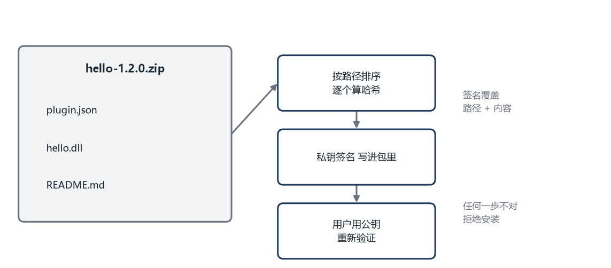

# 第 10 章 打包、分发与更新

## 10.1 一个插件包长什么样

开发目录里有源码、构建文件、测试，这些不能直接给用户。用户需要的是一个确定的、能检查的、放到指定位置就能用的东西。

一个插件包通常是一个压缩文件，里面包含三部分：

```text
hello-1.2.0.zip
  plugin.json        清单
  hello.dll          动态库（Linux 上是 hello.so）
  README.md          说明
```

清单放在最外层，宿主解压后先找它。动态库的名字不要求和插件名一样，清单里写清楚就行。说明文档给人看，不影响加载。

打包时要保证“同样的源码，每次打出来的包一样”。这叫确定性。影响确定性的东西包括文件顺序、时间戳、压缩参数。打包脚本应该按文件名排序，固定时间戳，不要每次都写入当前时间。这样两次构建的哈希才一致，缓存和差分更新才有意义。

## 10.2 哈希：给文件算一个指纹

**哈希**是一个函数，输入任意长度的数据，输出一段固定长度的数字。同样的输入永远得到同样的输出，输入改一个字节，输出就完全不同。

哈希的用途是校验。你下载一个文件，算一遍哈希，和作者公布的值比。一样，说明文件完整；不一样，说明路上被改了或者传坏了。

下面是一个简单的哈希实现，叫 FNV-1a：

```cpp
#include <cstdint>
#include <string>

std::uint64_t fnv1a(const std::string& data) {
    std::uint64_t hash = 1469598103934665603ULL;
    for (unsigned char byte : data) {
        hash ^= byte;
        hash *= 1099511628211ULL;
    }
    return hash;
}
```

`std::uint64_t` 是 64 位无符号整数，能表示很大的数。`ULL` 后缀表示这个字面量是无符号长整数。

`hash ^= byte` 是异或运算。异或的规则是“相同为 0，不同为 1”，它把当前字节混进哈希值里。`hash *= 1099511628211ULL` 是乘以一个质数，让结果散开。这两步重复，每个字节都会影响最终结果。

这个哈希不算安全。它容易被故意构造出碰撞，也就是两份不同的数据算出同一个值。它适合校验“文件有没有传坏”，不适合防篡改。防篡改要用 SHA-256 这类密码学哈希，标准库没有，需要引入 OpenSSL 之类的库。

书里用 FNV 是为了让读者看清哈希的基本形状。真实项目里，校验完整性用 SHA-256，签名用 Ed25519 或者 RSA。

## 10.3 签名：确认是谁做的

哈希只能说明“内容没变”，不能说明“是谁做的”。攻击者可以改内容，再改哈希，你比对不出来。

**签名**解决这个问题。作者有一对钥匙，私钥自己保存，公钥公开。作者用私钥对哈希做运算，得到一个签名，附在包里。用户用公钥验证签名，验证通过就说明“这个包确实由持有私钥的人签过，且内容没变”。

私钥和公钥是一对数学上配对的数。用私钥算出来的东西，只有对应的公钥能验通过；别人没有私钥，造不出能通过的签名。

生活里的类比是印章。你有一枚只有自己有的章，盖在文件上，别人可以对照你的印鉴确认真假。别人仿造不了你的章，也就伪造不了你的签名。

具体到插件包，流程是这样：

```text
作者：
  1. 把所有文件按名字排序
  2. 逐个算哈希，拼成一个总哈希
  3. 用私钥对总哈希签名
  4. 把签名写进 plugin.json 或者单独一个文件

用户：
  1. 解压后重新算总哈希
  2. 用内置的公钥验证签名
  3. 任何一步不对，拒绝加载
```

签名要覆盖“文件路径加内容”，不能只覆盖内容。否则攻击者可以把 `hello.dll` 改名成 `evil.dll`，内容没变，签名照样通过，但加载的东西变了。



## 10.4 安装、启用、禁用、卸载

这四个动作看起来简单，实际各有各的坑。

**安装**是把包解压到插件目录，检查清单和签名，确认依赖满足。解压时要防止路径穿越：包里如果有 `../../system/xxx` 这样的路径，解压后可能写到插件目录外面。防护方法是把每个条目的路径拼成完整路径，检查它是否还在目标目录内。

```cpp
#include <filesystem>

bool safe_target(const std::filesystem::path& root,
                 const std::filesystem::path& entry,
                 std::filesystem::path& out) {
    auto target = std::filesystem::weakly_canonical(root / entry);
    auto base = std::filesystem::weakly_canonical(root);
    auto text = target.string();
    auto prefix = base.string();
    if (text.rfind(prefix, 0) != 0) return false;
    out = target;
    return true;
}
```

`weakly_canonical` 把路径里的 `..` 和符号链接处理掉，得到一个规范路径。`rfind(prefix, 0) != 0` 检查目标路径是不是以根目录开头。不是，就说明跑出去了。

**启用**是把插件加入加载列表，创建运行环境，调用 `plugin_init`。启用可能失败，失败时要回滚，把已经注册的东西撤掉。

**禁用**是调用 `plugin_shutdown`，撤销注册，释放资源。禁用不等于删除，用户可能只是想临时关掉。

**卸载**是删除文件。卸载前要先禁用，否则动态库被占用，删不掉。Windows 上尤其明显。

这四个动作应该有统一的状态，而不是散落在各处的布尔变量。状态可以是：未安装、已安装未启用、运行中、停用中、卸载中、出错。每个操作只能从特定状态出发，比如“运行中不能直接卸载，必须先停用”。

## 10.5 更新的两种做法

更新插件，可以整包替换，也可以只传变化的部分。

整包替换简单可靠。下载新包，校验，解压到临时目录，切换过去，删掉旧版本。

**增量更新**只传差异。常见做法是内容寻址：把文件按哈希命名，客户端先问服务器“我有哪些块”，服务器只返回缺少的块。这种方式适合文件多、变化小的场景，但需要服务端配合。

无论哪种，最终都要做到“新旧版本能瞬间切换，失败不影响当前版本”。常见做法是版本目录加一个指针文件。

```text
plugins/
  hello/
    1.0.0/
      hello.dll
      plugin.json
    1.1.0/
      hello.dll
      plugin.json
    current.txt
```

`current.txt` 里写当前使用的版本号，比如 `1.1.0`。宿主启动时先读这个文件，再去对应目录加载。

切换版本时，先把新版本完整解压好，再改 `current.txt`。改一个几字节的文本文件很快，失败的概率很低。万一改到一半断电，文件可能损坏，所以更稳妥的做法是先写一个临时文件，再重命名覆盖。

重命名在同一磁盘内是原子操作：要么完成，要么没发生，不会出现半个文件。这是文件系统提供的保证，比自己写“先删再建”可靠得多。

回滚就是把 `current.txt` 改回旧版本号。旧目录还在，立刻生效，不需要重新下载。

## 10.6 热更新的边界

“热更新”经常被误解成“改完代码立刻生效”。实际能热更的东西比想象中少。

**可以热更的**：插件的业务逻辑、界面布局、资源文件、配置项。重新加载后可以恢复。

**很难热更的**：插件注册的命令、已经发出的监听、正在执行的长任务、持有的系统资源。这些东西和宿主的生命周期绑在一起，替换代码不会自动替换它们。

**不能热更的**：接口本身的变更、宿主内核的变更、数据格式的不兼容变化。这些需要重启应用，甚至需要迁移数据。

一个实用的策略是分级。资源文件变化，直接替换并通知界面重画。插件代码变化，先停用再启用，重新走一遍初始化。接口或者内核变化，提示用户重启。

热更新还要考虑状态。插件停用前可能有未保存的数据。宿主应该在停用前发一个 `before_unload` 事件，给插件一个保存的机会。超时之后再强制停用。

## 10.7 权限与安全

插件生态最大的风险不是插件写得差，而是插件被篡改，或者作者账号被盗。

几个基本措施。

**签名。** 每个包都签名，宿主内置可信公钥。私钥不能放在自动构建的明文配置里，应该用专门的密钥管理服务。

**哈希锁定。** 服务端记录每个版本的哈希，客户端下载后比对。即使下载服务器被劫持，内容对不上也会被发现。

**权限审查。** 安装时展示插件申请的权限，让用户知道它要读什么、写什么、访问哪些网络地址。更新时如果权限扩大，重新征求同意。

**依赖审计。** 插件的依赖里可能藏着有漏洞的库。构建时跑一次检查，发现高危漏洞就阻断发布。

**撤回机制。** 发现恶意版本时，服务端要能标记撤回，客户端在下次检查更新时禁用或者降级。撤回信息本身也要签名，防止被伪造。

这些措施不能保证绝对安全，但能把门槛提高很多。一个没有签名的插件系统，等于让用户运行任何下载到的代码。

## 10.8 分发的成本

分发不是把文件传到服务器就结束了。带宽、存储、审核、客服、撤回、版本兼容，都是长期成本。

插件越多，组合越多，测试矩阵越大。一个宿主版本加一百个插件，可能的交互数量远超人工能覆盖的范围。这时候需要自动化，需要灰度，需要能快速回滚。

如果团队还没准备好这些，可以先做小范围的分发，比如只对内部开放，或者只允许经过审核的插件上架。等流程跑顺了，再扩大范围。

下一章讨论插件运行起来之后的问题。崩溃、卡顿、内存泄漏、版本演进，这些不会因为架构设计得好就消失，只能靠工程手段控制。
