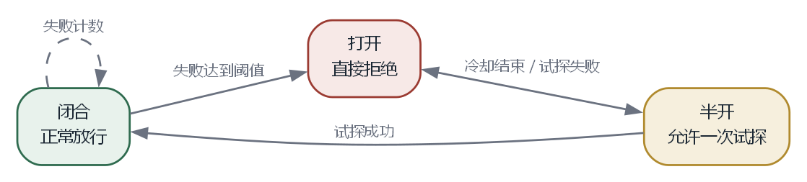

# 第 11 章 让它稳定运行

本章的完整代码和编译说明在 `codes/ch11/`。

第 10 章的插件能安装和更新了。这一章处理运行中的故障：崩溃、挂起、泄漏，以及命令执行超时。

## 11.1 四类故障

插件出问题，不一定都是崩溃。按表现可以分四类。

**崩溃。** 进程退出、数组越界、空指针、底层库出错。表现是突然中断，用户看到“插件已停止”。这类问题最好发现，也最容易隔离，因为进程已经没了。

**挂起。** 插件卡在死循环、等待一个永远不会返回的操作。表现是界面卡顿或者某个功能一直没有响应。进程还活着，但什么也不干。

**泄漏。** 内存、文件句柄、线程、网络连接只增不减。表现是运行几个小时后越来越慢，最后崩溃。泄漏在短时间内完全正常，测试很难覆盖。

**错误结果。** 插件没有崩溃，也没有卡住，但返回了错误的数据。表现是界面显示不对、文件被写坏、状态不一致。这类问题最难定位，因为系统本身在正常运行。

成熟的宿主会分别处理这四类。进程隔离解决崩溃，超时解决挂起，资源管理缓解泄漏，契约检查和测试减少错误结果。

## 11.2 超时

任何跨边界的调用都应该有超时。没有超时，一个挂起的插件可以让整个程序永远等下去。

超时的位置要选对。放在调用方，只能让调用方放弃等待，被调用方可能还在跑。放在被调用方，需要它能响应取消信号。两边都做，效果最好。

在 C++ 里，跨进程等待用系统接口，超时的写法因平台而异。Windows 上可以这样等一个进程：

```cpp
DWORD result = WaitForSingleObject(process, 3000);
if (result == WAIT_TIMEOUT) {
    TerminateProcess(process, 1);
}
```

`WaitForSingleObject` 最多等三秒。返回值是 `WAIT_TIMEOUT` 说明没等到，直接结束进程。`WAIT_OBJECT_0` 表示进程已经退出。

如果是同一个进程内的调用，C++ 标准库没有“带超时的函数调用”。可以用一个工作线程执行任务，主线程等结果；或者用条件变量配合超时。第 12 章会给一个简单的线程池示例。

超时时间不能拍脑袋。太短会误杀正常操作，太长会让用户等太久。先测量，统计每个接口的耗时，把超时设在正常值的几倍之外。

## 11.3 熔断与降级

一个插件反复超时，每次都等满超时时间，用户体验很差。熔断可以在连续失败后直接拒绝，过一段时间再试探。

这个词来自电路里的保险丝。电流过大时保险丝熔断，保护后面的电器；修好之后换一根，电路恢复。软件里的熔断器也是这个思路。

```cpp
enum class BreakerState { Closed, Open, HalfOpen };

class CircuitBreaker {
public:
    explicit CircuitBreaker(int threshold = 5, int cooldown_ms = 30000)
        : threshold_(threshold), cooldown_ms_(cooldown_ms) {}

    bool allow() {
        if (state_ == BreakerState::Open) {
            if (now_ms() - opened_at_ < cooldown_ms_) return false;
            state_ = BreakerState::HalfOpen;
        }
        return true;
    }

    void on_success() {
        state_ = BreakerState::Closed;
        failures_ = 0;
    }

    void on_failure() {
        ++failures_;
        if (state_ == BreakerState::HalfOpen || failures_ >= threshold_) {
            state_ = BreakerState::Open;
            opened_at_ = now_ms();
        }
    }

private:
    static long long now_ms() {
        using namespace std::chrono;
        return duration_cast<milliseconds>(
            steady_clock::now().time_since_epoch()).count();
    }

    int threshold_;
    int cooldown_ms_;
    int failures_ = 0;
    BreakerState state_ = BreakerState::Closed;
    long long opened_at_ = 0;
};
```

`Closed` 是正常状态，放行。`Open` 是断开状态，直接拒绝。`HalfOpen` 是半开，允许一次试探。

失败累计到阈值就打开；打开期间直接拒绝；冷却后进入半开；试探成功恢复，失败继续打开。

`steady_clock` 是一个单调递增的时钟，不受系统时间调整影响。计算时间间隔要用它，不要用墙上时钟。

熔断之后要有降级。降级是指主要功能不可用时，退而求其次。插件提供的功能不可用，宿主应该显示占位，或者回退到内置实现，而不是让整个界面空掉。



## 11.4 C++ 的资源管理

C++ 没有垃圾回收，资源要手动释放。手动释放容易漏，尤其是在有多个返回路径、可能抛异常的函数里。

C++ 的解决办法叫 **RAII**，意思是“资源获取即初始化”。说人话：把资源的生命周期绑在一个对象的生命周期上。对象创建时获取资源，对象销毁时自动释放。

```cpp
class FileHandle {
public:
    explicit FileHandle(const char* path)
        : file_(std::fopen(path, "rb")) {}

    ~FileHandle() {
        if (file_) std::fclose(file_);
    }

    FileHandle(const FileHandle&) = delete;
    FileHandle& operator=(const FileHandle&) = delete;

    std::FILE* get() const { return file_; }
    explicit operator bool() const { return file_ != nullptr; }

private:
    std::FILE* file_;
};
```

`explicit FileHandle(...)` 是构造函数，创建对象时调用。`std::fopen` 打开文件，把句柄存进 `file_`。

`~FileHandle()` 是析构函数，对象离开作用域时自动调用。如果文件打开了，就关掉。

`FileHandle(const FileHandle&) = delete` 禁止复制。为什么？如果两个对象持有同一个文件句柄，第一个销毁时关掉，第二个再关一次，会出错。禁止复制，就不会出现两个主人。

`operator bool` 让对象可以放在 `if` 里判断，比如 `if (!file) { ... }`。

使用起来：

```cpp
void read_config(const char* path) {
    FileHandle file(path);
    if (!file) {
        std::printf("打不开 %s\n", path);
        return;
    }
    // 用 file.get() 读
} // 离开这里，file 自动关闭，不管从哪条路径返回
```

不管函数从哪个 `return` 退出，哪怕中间抛了异常，析构函数都会被调用。这就是 RAII 的价值：把“记得释放”变成“编译器保证释放”。

标准库里的 `std::string`、`std::vector`、`std::unique_ptr` 都是 RAII。你用了这么多年，可能一直没注意。

## 11.5 内存泄漏

内存泄漏是指程序申请了内存，用完没有归还。短时间看不出来，运行久了内存越占越多，最后分配失败或者被系统杀掉。

C++ 里最常见的泄漏原因是 `new` 之后忘了 `delete`，或者 `malloc` 之后忘了 `free`。有几种避免方式。

**用栈对象。** 能在栈上分配就不要用 `new`。栈对象离开作用域自动销毁。

**用 `std::unique_ptr`。** 需要堆对象时，用智能指针管理。它在析构时自动 `delete`，而且不能复制，只能移动，所有权很清楚。

```cpp
#include <memory>

void use_widget() {
    auto widget = std::make_unique<Widget>();
    widget->do_something();
} // 自动 delete
```

`std::make_unique<Widget>()` 创建一个 `Widget`，返回一个 `unique_ptr`。`widget->` 像普通指针一样用。离开作用域，`unique_ptr` 析构，自动释放。

**用 `std::vector` 代替裸数组。** `vector` 自己管理内存，扩容、缩容、析构都处理好了。

**用检测工具。** Linux 上有 Valgrind，Windows 上可以用 Visual Studio 的诊断工具或者 AddressSanitizer。它们能在程序退出时报告哪些内存没有释放。

泄漏不一定只在堆上。文件句柄、线程、锁、数据库连接，忘了释放同样是泄漏。RAII 对所有这些资源都适用。

## 11.6 日志与诊断

插件系统出问题时，最难回答的是“这是谁的问题”。

要回答它，需要三样东西。

**日志。** 每条日志带插件名、时间、级别。宿主自己的日志和插件的日志分开存，但能在同一个界面里按时间线合并查看。

**计数。** 每个插件的加载时间、初始化成功次数、命令调用次数、错误次数。数字不需要很细，但这几项能覆盖大多数问题。

**追踪编号。** 一次用户操作可能经过宿主和多个插件。给这次操作分配一个编号，沿途传递，最后能把整条链路串起来。跨进程时，编号放在消息里。

错误归属可以用简单规则。插件进程里的错误归插件，宿主调用插件超时归插件，宿主自己的参数检查错误归宿主，网络错误看是谁发起的请求。规则写进文档，避免互相推诿。

## 11.7 版本演进

接口一定会变。问题不是怎样避免变化，而是怎样让变化可控。

**先加后删。** 新字段先以可选形式加入，旧字段保留一段时间。等插件都迁移完，再删旧字段。删除时升主版本。

**提供适配层。** 旧接口的调用转成新接口的实现。适配层放在宿主里，插件不用改。这像电源转换插头，旧电器不用换，中间加一个转换器。

**标记弃用。** 弃用的接口在文档里标出来，运行时打一条警告，告诉插件作者哪个版本会移除。警告不要太多，否则日志会被淹没。

**给出迁移指南。** 说明改了什么、为什么改、旧代码怎么改。最好提供自动转换脚本，处理常见模式。

弃用期要多长，取决于生态规模。插件少，一个版本就够；插件多、作者分散，可能需要一年以上。不能今天宣布、明天删除。

## 11.8 兼容性测试

手工测试覆盖不了插件和宿主的组合。需要自动化。

一个可行的矩阵是：宿主取最近三个版本，插件取最近三个版本，两两组合跑冒烟测试。冒烟测试不需要覆盖所有功能，只要确认能安装、能加载、能执行一个代表性操作、能卸载。

再加上平台矩阵。Windows、Linux 各跑一次。路径分隔符、动态库扩展名、文件权限的问题，只有在对应平台上才会暴露。

测试环境要尽量接近真实。用打包后的产物，不要用源码；用真实的清单，不要用简化版；用和用户一样的数据目录结构。差异越大，测试通过但用户失败的概率越高。

## 11.9 故障之后

每次故障都应该留下记录。不是追责，而是避免重复。

记录内容包括：发生了什么、影响范围、根本原因、临时措施、长期修复、怎样防止再次发生。格式可以简单，但要认真写。

插件系统的故障往往不是单点问题。一个插件崩溃，可能暴露了宿主的超时没设、隔离没做、日志不够。修插件只是治标，修宿主才是治本。

下一章把前面的内容合成一个最小工程。不追求功能完整，但要求每个部分都能跑起来，能加载一个真实插件，能走完生成、开发、打包、加载的完整路径。
