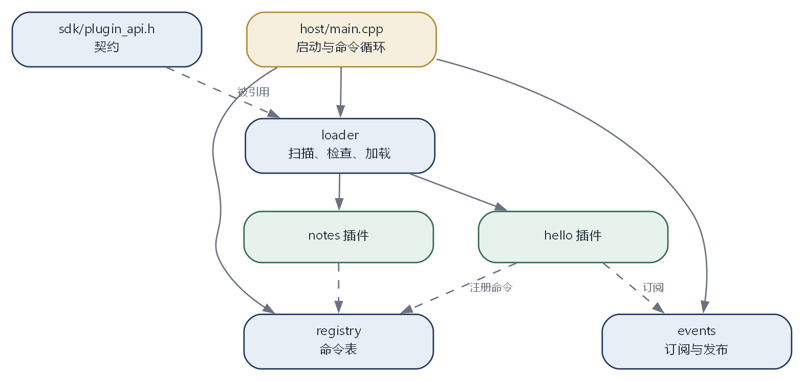

# 第 12 章 把整个系统跑起来

## 12.1 目标

前面十一章分别做了零件。这一章把它们装到一起，形成一个能编译、能运行、能加载插件的小系统。

它不追求功能完整，但要求：

- 一条命令能构建宿主和所有插件
- 宿主能扫描插件目录、检查清单、按依赖顺序加载
- 插件能注册命令，用户能执行
- 插件能订阅事件，能在保存前修改内容
- 某个插件初始化失败时，其他插件不受影响
- 插件能被卸载，注册的东西被清理干净

这些要求对应前面各章的知识点。这一章不再重复解释每个概念，只给出结构和拼装方法。

## 12.2 最终目录

```text
mini-shell/
  CMakeLists.txt
  sdk/
    include/
      plugin_api.h
  host/
    main.cpp
    loader.cpp
    loader.h
    registry.cpp
    registry.h
    events.cpp
    events.h
  plugins/
    hello/
      CMakeLists.txt
      plugin.json
      src/plugin.cpp
    notes/
      CMakeLists.txt
      plugin.json
      src/plugin.cpp
  templates/
    plugin/
  tools/
    new_plugin.py
```

`sdk` 是双方共用的合同。`host` 是宿主。

`plugins` 下每个子目录是一个插件。每个插件有自己的 `CMakeLists.txt` 和清单。

`templates` 和 `tools` 是生成器。

## 12.3 每个文件负责什么

**`sdk/include/plugin_api.h`** 定义接口版本、命令结构、宿主能力表、三个导出函数。它被宿主和所有插件引用，是唯一一份。

**`host/main.cpp`** 负责启动：解析命令行参数、创建注册表和事件总线、调用加载器、进入命令循环、退出时卸载。

**`host/loader.cpp`** 负责扫描目录、读清单、检查版本和依赖、加载动态库、取符号、调用初始化。失败时记录原因并跳过。

**`host/registry.cpp`** 负责命令表：添加、查找、按插件清理、列出全部。处理重名冲突。

**`host/events.cpp`** 负责事件总线：订阅、发布、按插件清理。按优先级排序。

**`plugins/hello/src/plugin.cpp`** 提供 `hello` 命令，注册一个 `file.before_save` 钩子，在保存前往内容里加一行注释。

**`plugins/notes/src/plugin.cpp`** 提供 `note` 命令，演示插件之间的状态保存。

**`CMakeLists.txt`（顶层）** 负责找到所有子目录、设置 C++ 标准、把 `sdk` 加进头文件路径、按顺序构建。



## 12.4 顶层构建文件

```cmake
cmake_minimum_required(VERSION 3.16)
project(mini_shell LANGUAGES CXX)

set(CMAKE_CXX_STANDARD 17)
set(CMAKE_CXX_STANDARD_REQUIRED ON)

add_subdirectory(host)
add_subdirectory(plugins/hello)
add_subdirectory(plugins/notes)

# 把插件产物统一放到 plugins/bin，方便宿主扫描
set(PLUGIN_OUTPUT_DIR ${CMAKE_BINARY_DIR}/plugins)
set_target_properties(hello notes PROPERTIES
    LIBRARY_OUTPUT_DIRECTORY ${PLUGIN_OUTPUT_DIR}
    RUNTIME_OUTPUT_DIRECTORY ${PLUGIN_OUTPUT_DIR})
```

`add_subdirectory` 把子目录的构建文件也加进来。每个子目录有自己的 `CMakeLists.txt`。

`set_target_properties` 修改目标的输出位置。`LIBRARY_OUTPUT_DIRECTORY` 管 Linux 的 `.so`，`RUNTIME_OUTPUT_DIRECTORY` 管 Windows 的 `.dll`。两个都设，跨平台才不会把产物放到不同地方。

宿主的 `CMakeLists.txt`：

```cmake
add_executable(host main.cpp loader.cpp registry.cpp events.cpp)
target_include_directories(host PRIVATE ${CMAKE_SOURCE_DIR}/sdk/include)
```

插件的 `CMakeLists.txt`：

```cmake
add_library(hello SHARED src/plugin.cpp)
target_include_directories(hello PRIVATE ${CMAKE_SOURCE_DIR}/sdk/include)
```

`SHARED` 表示动态库。头文件路径指向 `sdk`，插件不需要复制头文件。

## 12.5 构建与运行

在项目根目录：

```bash
cmake -B build -DCMAKE_BUILD_TYPE=Release
cmake --build build
```

构建完成后，产物在 `build` 下面。宿主的可执行文件在 `build/host/`，插件在 `build/plugins/`。

运行：

```bash
./build/host/host --plugin-dir ./build/plugins
```

Windows 上：

```bat
build\host\Release\host.exe --plugin-dir build\plugins
```

启动后应该看到：

```text
加载插件: hello (1.0.0)
  注册命令: hello
  订阅事件: file.before_save
加载插件: notes (1.0.0)
  注册命令: note
> 
```

输入 `hello`，执行插件的命令。输入 `help`，列出所有命令。输入 `quit`，卸载所有插件并退出。

## 12.6 加一个新插件

用生成器：

```bash
python tools/new_plugin.py weather
```

它复制模板到 `plugins/weather/`，把 `{{name}}` 替换成 `weather`。然后手动做两件事：在顶层 `CMakeLists.txt` 加一行 `add_subdirectory(plugins/weather)`，在 `set_target_properties` 的目标列表里加上 `weather`。

重新构建，新插件就出现了。宿主一行代码都没改。

这就是整个系统存在的意义。加功能不需要动宿主，不需要重新发布整个软件，只需要放一个新的动态库进去。

## 12.7 故意制造错误

系统能不能扛住错误，要主动试。

**初始化失败。** 把某个插件的 `plugin_init` 改成返回 1。重新构建，启动。宿主应该打印“初始化失败”，跳过这个插件，其他插件照常加载。

**缺少符号。** 把插件的 `plugin_name` 改个名字，重新构建。宿主取符号时应该失败，打印“缺少 plugin_name”，跳过。

**版本不匹配。** 把插件的 `PLUGIN_API_VERSION` 改成 2。宿主应该拒绝加载，提示版本不兼容。

**运行中崩溃。** 在命令里写一个空指针解引用。如果插件在宿主进程里，整个程序会崩溃；如果插件在独立进程里，只有插件进程退出。这个对比能让你直观看到隔离的价值。

**死循环。** 在命令里写 `while (true) {}`。同进程时界面卡死；独立进程时宿主可以超时杀掉。

每次注入错误，都记录宿主的表现。表现不对，说明某个保护没做，回去补。

## 12.8 继续演进

这个最小系统还缺很多东西。按优先级列一份清单。

**独立进程。** 把插件放进单独进程，加超时和强制结束。这是最重要的一步。

**权限。** 把文件、网络包装成能力对象，清单里声明需要什么，加载时授予。不要让插件直接拿路径。

**签名。** 打包时签名，加载时验证。内网可以先跳过，对外分发必须有。

**增量更新。** 版本目录加指针切换，保留旧版本，支持回滚。

**日志系统。** 统一的日志格式、按插件过滤、写到文件、出问题时能导出。

**诊断面板。** 列出已安装插件、版本、状态、最近错误、加载耗时、资源占用。

**接口版本管理。** 建立弃用流程、迁移指南、兼容性矩阵。

**测试。** 给注册表、加载器、事件总线写单元测试，给插件写假宿主测试，给打包流程写端到端测试。

**文档。** 插件作者需要接口参考、模板说明、常见问题。文档和代码一起版本化。

**生态规则。** 命名规范、审核标准、撤回机制、举报入口。这些不是代码，但决定生态能不能健康发展。

## 12.9 最后

回到最开始那段二十行的程序。

它有一个循环、一张写死的命令表、一个输出通道。现在这个系统也有这三样东西，只是命令表变成了注册表，输出通道变成了宿主提供的能力，循环变成了加载、分发、卸载的完整生命周期。

中间多出来的东西，不是为了让架构看起来高级，而是每一样都在解决一个具体问题。函数和文件解决代码组织，动态库解决运行时加载，契约解决跨编译器通信，注册表解决命令管理，事件解决插件协作，进程解决故障隔离，模板解决重复劳动，打包和签名解决分发信任。

这些问题不会一次性全部出现。一个只有三个人的小项目，可能只需要函数和文件；一个允许第三方扩展的软件，才需要后面那些。判断标准始终是同一句话：**变化的速度是否不同，出错的影响是否可控。**

如果这本书只能留下一句话，希望是这一句：先让它跑起来，再让它稳下来，最后才谈扩展。
