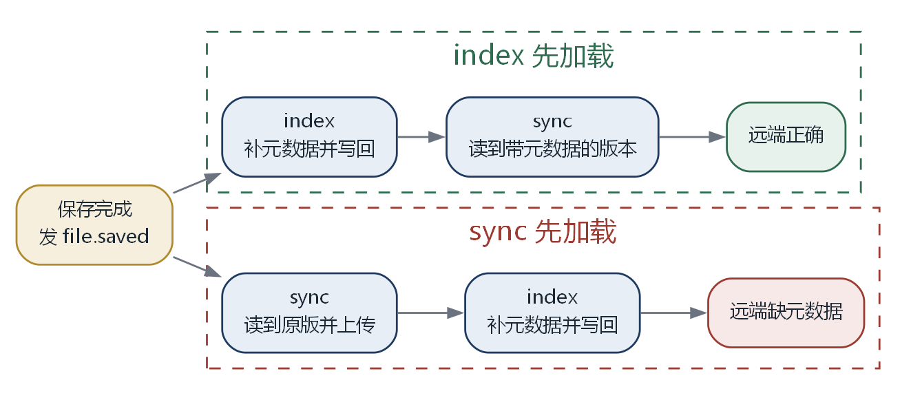
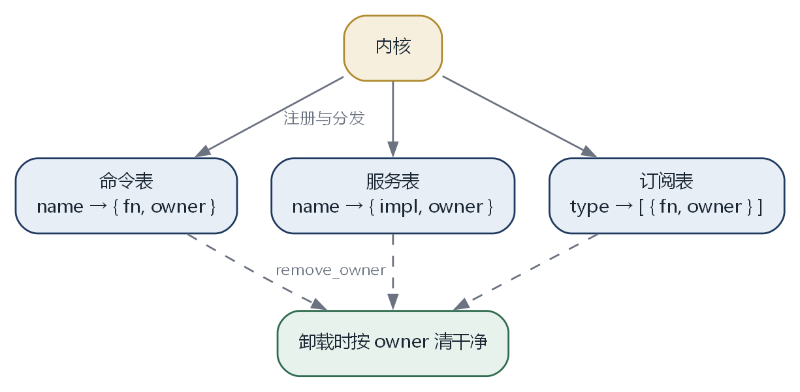

# 第 1 章 插件变多之后

## 1.1 一个能跑的系统和十个插件

一个只有三个插件的小系统，一切正常。

`hello` 插件注册一条命令，`notes` 插件注册一条命令，`sync` 插件订阅保存事件。命令表能查，事件总线能发，某个插件初始化失败时跳过它，卸载时按名字清干净。

现在把插件数量加到十个，问题开始冒出来。

两个插件都注册了 `save`。第一个注册成功了，第二个被拒绝，但用户看到的是“保存没反应”，不知道是被谁占了名字。

一个插件在保存钩子里抛了异常。宿主没包 `try/catch`，异常穿出来，整个保存流程中断，另外九个插件的钩子都没执行。

一个插件要调用另一个插件的能力。没有服务注册表，它只能通过事件去“问”，发一个请求事件，等对方回一个响应事件，代码绕了一圈，还容易死锁。

契约从 1 版升到 2 版，加了一个字段。旧插件是按 1 版写的，宿主用 2 版的结构体去读，读到了新字段的垃圾值。

界面刷新时，十二个插件都要往屏幕上画东西。谁先谁后没有约定，有时候 A 画的被 B 盖住，重启一次顺序又变了。

这五种问题对应五个不同的结构缺失。它们在只有三个插件时都不算错，因为那时，冲突、异常、服务、版本、绘制顺序都还没有暴露出来。

这套系统的插件列表，两个月后长成这样。

- `hello` 和 `notes` 两个示例插件
- `sync` 在保存后把文件推到远端
- `index` 维护全文搜索索引
- `export-pdf` 提供导出命令
- `theme-dark` 换一套配色
- `markdown-preview` 接管预览渲染
- `git-sync` 每次保存后自动提交
- `ai-complete` 在输入时补全句子
- `telemetry` 记录命令使用次数
- `snippet` 提供代码片段
- `lsp-client` 连接语言服务器

十二个插件里，六个订阅了 `file.saved`，其中三个在回调里做耗时操作。`index` 和 `telemetry` 都用了 `index` 这个词做前缀。

问题不是一起爆的，是一个接一个冒出来的。

第一个报告来自一位写长篇的作者。他说保存一次要等两三秒，光标一直转圈。开发者在自己机器上复现不了，因为他没装 `git-sync`。

第二个报告来自客服。用户说菜单里有两个“格式化”，点哪个都不是想要的。开发者怀疑是 `snippet` 和 `markdown-preview` 撞了名字，但查不出来，因为宿主在冲突时只返回 `false`，两个插件都把返回值丢了。

第三个报告最麻烦。用户禁用 `telemetry` 之后，应用启动就崩。开发者复现了，但只在装了 `lsp-client` 的机器上崩。再细看，装了 `lsp-client` 又禁掉 `telemetry` 就崩，两个都装或者两个都不装都正常。

这三个现象的共同点在于，单看任何一个插件都没问题，问题出在插件之间。

排查的过程本身也很说明问题。开发者先按目录名二分禁用插件，四次启动就把范围缩到几个，然后又发现把 `index` 也禁掉就不崩了。他以为是 `lsp-client` 写错了，读了半天代码，最后发现 `lsp-client` 在初始化时把 `telemetry` 注册的服务指针存了下来，`telemetry` 被禁用后服务表里没有这一项，它拿到的是空指针，而且没检查。

为什么在他机器上不崩。因为他机器上的目录遍历顺序让 `telemetry` 先于 `lsp-client` 加载，服务表里有这一项。CI 机器上的顺序反过来，所以每次回归测试都能跑出崩溃，本地却复现不了。这类问题通常被叫作“在我机器上是好的”，本质是宿主把加载顺序当成了不受约束的东西。

## 1.2 数量的变化会改变结构

有一个常见的误解：架构是为“大项目”准备的，小项目不需要。

更准确的说法是，架构是应对“变化幅度”的，而插件数量是变化幅度最直接的来源。

三个插件时，冲突可以靠人工避免，异常可以靠自觉捕获，插件之间不需要互相调用，版本可以一起升级，绘制顺序无所谓。

十个插件时，人工协调的成本开始超过写代码的成本。这时候还在靠约定，就会出现“某次改动之后，某个插件突然不工作了，谁也不知道为什么”。

数量带来的不只是线性增长。三个插件的组合是三种两两关系，十个插件是四十五种。每多一个插件，需要协调的关系就多一组。这就是为什么很多系统在小规模时看起来很干净，一扩展就乱。

把关系数量算出来，会更直观。

| 插件数 | 两两关系 | 可能的加载顺序 |
|---|---|---|
| 3 | 3 | 6 |
| 5 | 10 | 120 |
| 10 | 45 | 约 360 万 |
| 20 | 190 | 大到没有实际意义 |

加载顺序那一列值得多看一会儿。十个插件有三百六十万种加载顺序，只要某个行为依赖顺序，就有一大半的组合是你没测过的。这不是说要把所有顺序都测一遍，而是说“我在自己机器上试过了”这句话几乎没有信息量。

## 1.3 五种失控

把 1.1 里的五种情况拆开看，每一种都对应一个具体的结构缺失。

**命名冲突。** 两个插件想用同一个名字。没有命名空间，没有优先级，只能先到先得。用户看到的是功能失效，看不到原因。

**故障扩散。** 一个插件出错，影响其他插件。没有隔离，没有异常边界，错误会顺着调用链传播。

**协作缺失。** 插件之间无法互相发现。没有服务注册表，只能靠约定的事件名互相喊话。

**版本断裂。** 契约变化之后，旧插件失效。没有版本协商，没有兼容策略。

**顺序混乱。** 多个插件对同一件事做出反应时，结果依赖执行顺序。没有优先级约定。

把这五种情况摆在一起，就能看出它们在三个插件时为什么都被容忍了。

| 失控 | 三个插件时为什么不算错 | 十个插件时怎么爆 |
|---|---|---|
| 命名冲突 | 名字是三个人口头分好的 | 两个人各加一条同名命令，用户只看到没反应 |
| 故障扩散 | 每个回调都自己记得包 try | 有人忘了包，异常穿出整条保存链 |
| 协作缺失 | 插件之间不需要互相调用 | 要查索引只能发请求事件等响应事件 |
| 版本断裂 | 契约一直没变 | 加了一个字段，旧插件读到错位的数据 |
| 顺序混乱 | 只有一个插件往界面上画 | 谁先谁后决定最终画面，每次启动还不一样 |

这五种问题的共同点是：**它们都不是某一行代码写错了，而是缺少一层结构。**

加一行 `try/catch` 能挡住一次异常，但挡不住“所有回调都该包 try/catch”这个要求。加一个 `if` 能避开一次重名，但避不开“所有名字都该有归属”这个规则。

结构的作用，是让正确的做法成为默认路径。写插件的人不需要记住十条规矩，他按模板写，自然就避开了这些坑。

## 1.4 一次真实的失控

前面那个 `sync` 与 `index` 的组合值得单独拆开看，因为它没有崩溃、没有报错，只是数据慢慢变得不对。

两个插件都订阅 `file.saved`，各自做了看起来都合理的事。

```cpp
// sync 插件
static void on_saved(const char* type, const char* payload) {
    std::string path = payload;
    std::string body = read_file(path);
    upload(path, body);          // 上传磁盘上此刻的内容
}

// index 插件
static void on_saved(const char* type, const char* payload) {
    std::string path = payload;
    std::string body = read_file(path);
    body = add_frontmatter(body);   // 补一段元数据
    write_file(path, body);         // 写回磁盘
}
```

如果 `index` 先执行，`sync` 上传的是补过元数据的版本。如果 `sync` 先执行，上传的是补元数据之前的版本。同一台机器上两种都可能出现，取决于目录遍历先返回谁。

运维在远端仓库里看到一半文件没有元数据，先怀疑网络问题，又怀疑权限，最后才怀疑到插件顺序，中间隔了两天。搜索索引里也没有元数据字段，因为 `index` 写回文件之后没有再读一遍，它认为索引已经建好了。



当时为什么看起来合理。两个插件各自都有单元测试，测试里只有一个订阅者，所以永远过。集成测试只跑一次，恰好那次是 `index` 在前。代码评审的时候，两个插件是两个人分别提的，评审看到的是“保存后补元数据”和“保存后上传”，都符合直觉。

真正的问题不是顺序，而是**两个插件都在改同一份磁盘数据，而且都假设自己是唯一在改的人**。顺序只是把这个假设暴露出来的方式。修法有两条。一条是把补元数据移进宿主的保存流程，让它成为保存的一部分，而不是保存之后的副作用。另一条是让 `index` 只写自己的索引库，不碰原文件。

第一条更彻底，因为它清掉了一个隐含前提，也就是“保存完成之后文件不会再有变化”。这个前提一旦成立，所有订阅者都可以放心读文件，不用管谁先谁后。

复盘能提出四条要求，四条都不是针对这两个插件的。

- 订阅者读到的数据必须是稳定快照，不能是还在被别人改的磁盘文件
- 每个订阅者的耗时要有上限，超过就记一条警告
- 事件分发要按插件名记日志，出问题时能看出是谁改了什么
- 契约里要写清楚“收到 `file.saved` 时文件已经定稿”，这条写进文档，插件作者才不会各自发明副作用

这四条落到代码上就是后面几章的内容。这里只需要记住一件事，顺序问题往往不是顺序造成的，而是有人偷偷改了共享数据。

## 1.5 一条注册路径要经过几步

结构缺失只有在变成具体代码之后才好讨论。以注册一条命令为例，从插件里的 `plugin_init` 到用户能输入它，中间要经过五步。

```cpp
static bool host_register_command(const PluginCommand* cmd) {
    if (!cmd || !cmd->name || !cmd->run) return false;      // 参数不完整
    if (g_current_plugin.empty()) return false;             // 不在初始化期间
    if (!g_plugins.alive(g_current_plugin)) return false;   // 插件已经判失败

    Command entry;
    entry.name  = cmd->name;
    entry.help  = cmd->help ? cmd->help : "";
    entry.run   = cmd->run;
    entry.owner = g_current_plugin;      // 归属由宿主填，插件填不了

    if (!g_commands.add(entry)) {
        g_api.log_info(("命令重名，已拒绝 " + entry.name).c_str());
        return false;
    }
    g_plugins.add_owned(g_current_plugin, entry.name);      // 记账，卸载时用
    return true;
}
```

五步各自防的东西不一样。

1. 空指针检查，防插件递交半个结构体。
2. 初始化期间检查，防插件在卸载之后、或者在自己的命令回调里偷偷注册。
3. 存活检查，防一个已经被判失败的插件继续往表里塞东西。
4. 归属填充，让 `remove_owner` 有依据，插件没法冒充别人。
5. 记账，保证“注册了什么”和“卸载时撤什么”是同一份数据。

第三步最容易被漏掉。宿主发现某个插件初始化返回非零，会把它标记成失败，但如果失败之前它已经注册了三条命令，这三条就留在表里，用户能输入，一执行就跳进一个已经卸掉的模块。

失败分支整理成一张表，会看得更清楚。

| 失败点 | 返回 | 谁处理 | 用户看到 |
|---|---|---|---|
| 参数为空 | false | 插件作者 | 命令不存在 |
| 不在初始化期间 | false | 插件作者 | 命令不存在 |
| 插件已卸载 | false | 宿主，写日志 | 命令不存在 |
| 名字重名 | false | 双方，插件应降级改名 | 只有先注册的那条能用 |
| 表内存不足 | false | 宿主，建议禁用新插件 | 部分命令缺失 |

关键是最后一列。五条分支里有四条对用户是同一种表现，所以日志必须写清楚走的是哪一条，否则排查只能靠猜。



命令表、服务表、订阅表长得差不多，都是“名字到实现”的映射，差别只在值是一份还是多份。它们共同的要求是每条记录都记住自己属于谁。这一点做到了，插件卸载才不会留下悬空的东西。

## 1.6 结构从哪里来

结构不是设计出来的，是长出来的。

先有一个能跑的最小系统，然后在真实使用中发现问题，针对问题补一层结构，再跑，再发现问题。每补一层，系统能承载的规模就大一点。

这个过程有两个陷阱。

**过早抽象。** 三个插件的时候就设计一套支持一千个插件的框架，结果是每个概念都要考虑它还不存在的场景，代码里充满了 `if (unlikely_case)`。等真正的需求来了，发现当初的抽象方向是错的。

**拒绝演进。** 十个插件了还在用三个插件时的结构，靠文档和口头约定维持。短期能撑，长期一定崩，而且崩的时候往往是在用户那里。

比较稳妥的做法是：当前规模需要什么就补什么，同时留一个明确的“下一步”。比如现在用命令表，就在注释里写清“超过二十条命令时需要引入命名空间”；现在同进程加载，就写清“第三方插件需要独立进程”。

## 1.7 规模的代价

补结构有成本，成本要能说清，不然每次讨论都会变成“感觉不需要”。几个可以数的东西。

| 项目 | 三个插件 | 十二个插件 | 变化形态 |
|---|---|---|---|
| 启动加载 | 十几毫秒 | 一百毫秒上下 | 与插件数近似线性 |
| 一次保存 | 几毫秒 | 几十到几百毫秒 | 取决于订阅者里有没有 IO |
| 常驻内存 | 几十兆 | 一百多兆 | 每个插件映射几兆到几十兆 |
| 定位一个问题 | 直接读代码 | 二分加复现环境 | 从分钟级到小时级 |

延迟的那一行要拆开看。事件分发本身的成本很低，一次查表加一次函数调用，微秒量级，几十个订阅者也还是微秒量级，可以忽略。真正让保存变慢的是订阅者里有人在干重活，写文件、发网络请求、跑一次正则。所以耗时不是分发造成的，是有人把 IO 放进了同步回调。

内存那一行也不是虚数。一个同进程动态库有自己的映射开销，几兆起步，链接了界面框架或者模型库的能到几十兆。十二个插件一百多兆很正常，插件生态丰富的应用到三四百兆也不稀奇。

排查成本最难量化，但有一件事可以数。定位是哪个插件出的问题，二分法大约需要 log2(n) 次重启。十二个插件是四次，五十个插件是六次，看着不多，但前提是能稳定复现。1.1 里那个只在 CI 上崩的例子，二分法直接失效，因为它依赖加载顺序。

这几项加起来，指向同一个结论。插件的数量上去之后，主要成本不在功能开发，在“出问题时能不能定位”。结构值不值得补，就看它能不能把这一项压下来。

## 1.8 一份可以照着做的清单

前面几节讲的都是道理，真正干活时需要一张能对着勾的表。下面六条，每条都有一个可以直接观察的不合格信号。

| 检查项 | 不合格的信号 | 该补什么 |
|---|---|---|
| 每个注册项都有归属 | 卸载后还能输入某条命令 | 表里加 owner，卸载时按它清 |
| 回调有异常边界 | 一个插件出错，整条链都断 | 按类型分组的 try/catch |
| 插件之间靠服务互相调用 | 出现成对的请求事件和响应事件 | 服务注册表 |
| 契约改动有版本号 | 加字段后旧插件读到垃圾值 | size 加 version，再加范围协商 |
| 顺序要么声明要么无关 | 重启一次画面或结果就变了 | 优先级加显式依赖 |
| 回调里不做 IO | 保存耗时随插件数明显增长 | 队列或异步，加耗时预算 |

用法很简单，每加一个插件之前过一遍。如果六条里有三条不合格，说明现在应该停下来补结构，而不是继续加功能。补结构的那几天看起来没有产出，但它决定了后面还能加多少个插件。

## 1.9 本书要解决的问题

前一个问题回答“怎么把功能拆出去”，本书回答“拆出去之后怎么让它们共存”。

四个层面的问题。

**内核层面。** 内核应该保留哪些机制，哪些应该交给插件。内核越大越难改，越小越容易让每个插件重复造轮子。

**契约层面。** 接口怎么定，版本怎么升，旧插件怎么继续工作。

**协作层面。** 插件之间怎么找到对方，怎么通知，怎么避免互相干扰。

**隔离层面。** 插件跑在哪里，出错时影响多大范围，资源怎么分配和回收。

后面的章节按这四个层面展开。每一章都会给出可运行的代码，也会说明这个方案在什么情况下不适用。

## 1.10 一个判断标准

在进入具体设计之前，先给一个贯穿全书的判断标准。

**边界应该跟着变化走。**

变化频率不同的部分，分成两块。界面一周改三次，存储格式一年改一次，硬绑在一起就会互相拖累。

责任归属不同的部分，分成两块。官方维护的核心功能和第三方插件，出问题时排查路径不同，混在一起就很难定位。

故障影响范围不同的部分，分成两块。一个解析器崩溃不该带走整个应用，一个渲染插件卡住不该让界面失去响应。

这三条不冲突时可以同时满足，冲突时按影响面排序：先保证故障不扩散，再保证变化不互相拖累，最后考虑责任归属。

如果某两部分的这三条都差不多，那就不要拆。拆开要付出通信、版本、文档的代价，收益不够就不划算。

下一章从内核开始，看这个判断标准怎么落到具体代码上。
