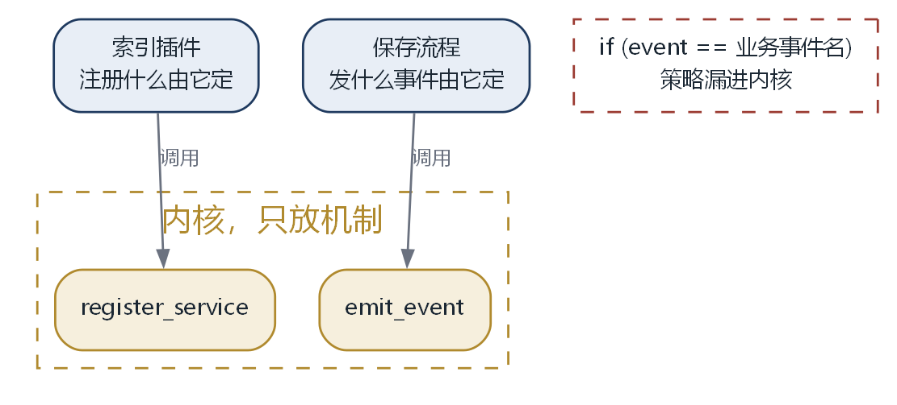
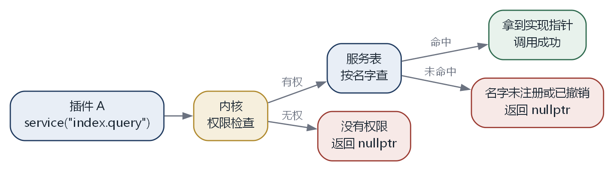

# 第 2 章 内核的边界

## 2.1 内核为什么会越写越大

最初的宿主只有一个 `main.cpp`，加载插件、存命令、执行命令，全在里面。

插件多起来之后，这段代码开始吸引各种东西。有人要日志，加一个 `log` 函数；有人要配置，加一个 `read_config`；有人要发网络请求，加一个 `http_get`；有人要读写文件，加一个 `save_file`。

每一项单独看都合理。但一年之后，`main.cpp` 变成了三千行，里面有日志、配置、网络、文件、线程池、定时器、加密。

问题不在于代码多，而在于**每次加功能都要改这个文件**。改的人越来越多，冲突越来越频繁，而且没有人能说清这个文件到底负责什么。

这是内核膨胀的典型路径：**每一个“顺手放这里”的需求，都在把内核往应用层推。**

这个文件后来被人翻出来数过一次，三千行里大概一千二百行是各种小工具，字符串处理、路径拼接、HTTP 封装、文件读写、时间格式化。真正的调度逻辑不到四百行。

有个细节能说明问题。`http_get` 刚进去的时候只是“能把一个 URL 变成字符串”，半年后它有了超时参数、重试次数、代理配置、证书校验开关、进度回调。每一项都是某个插件提的，每一项单看都合理。等到有插件抱怨请求莫名超时，大家才发现这个函数的超时时间是一个全局变量，谁后设置谁生效。插件 A 设了三十秒，插件 B 设了一秒，之后 A 的所有请求都在一秒后失败。

真正压垮这个文件的是三件事叠加。每次改动都要碰同一个文件，两个人同时改，一个加日志格式，一个加配置项，合并冲突；改完要跑一遍全量构建，十几分钟；改坏一次，所有插件一起坏。

## 2.2 内核应该保留什么

判断标准只有三条。

**第一，几乎每个插件都要用。** 日志、配置读取、资源分配，这些是公共设施，让每个插件自己实现是浪费。

**第二，插件自己实现不了。** 服务注册表、事件分发、权限检查，这些需要全局视角，单个插件做不到。

**第三，必须比插件更早存在。** 进程管理、GPU 设备初始化、窗口创建，这些在插件加载之前就完成了。

三条只要满足一条，就有理由放进内核。

反过来，只要一条都不满足，就应该拿出去。图像格式解析、语法高亮、主题配色、快捷键方案，这些都可以由插件提供，而且不是所有插件都依赖。

拿一个具体例子。最初的 `log_info` 在内核里，因为每个插件都需要写日志，而且日志要统一格式、统一落盘。但“日志要不要按天切分”“要不要上传到服务器”，这是策略，不该由内核决定，可以由一个日志插件去做。

把几个常见能力放进这三条标准里过一遍，结论会很一致。

| 候选能力 | 几乎都用 | 插件做不了 | 必须先于插件 | 结论 |
|---|---|---|---|---|
| 日志接口 | 是 | 否，但格式要统一 | 是，初始化就要用 | 内核 |
| 服务注册表 | 是 | 是 | 是 | 内核 |
| 事件分发 | 是 | 是 | 是 | 内核 |
| 设备初始化 | 否 | 是 | 是 | 内核 |
| HTTP 封装 | 部分 | 否 | 否 | 内核旁的静态库，不进内核 |
| 语法高亮 | 否 | 否 | 否 | 插件 |
| 快捷键方案 | 否 | 否 | 否 | 插件 |
| 自动更新 | 否 | 是 | 否 | 宿主外壳，不进插件内核 |

HTTP 那一行值得停一下。它三列都不满足，却又是几乎所有插件都想要的东西。这类能力的归宿不是内核，是内核旁边的一个库，插件链接它，内核不认识它。一旦它进了内核，内核就得跟着它的发布节奏走，而它的维护者往往不是内核的维护者。

自动更新那一行是另一种情况。它确实插件做不了，但它也不需要插件视角，它是宿主自己的事，放在插件系统之外更干净。

## 2.3 机制与策略

这是内核设计里最重要的一组区分。

**机制**回答“怎样做”：怎样注册一个服务，怎样发布一个事件，怎样申请一块显存。

**策略**回答“做什么”：注册什么服务，什么时候发布事件，显存用来画什么。

内核只提供机制，策略留给插件。

一个具体的对比。内核提供 `emit_event("file.saved", payload)`，这是机制。至于“保存完成之后要不要发这个事件”“payload 里放哪些字段”，这是策略，由保存流程的实现决定。

如果内核里出现 `if (event == "file.saved") { ... }`，就说明策略泄漏进内核了。内核不应该认识任何具体的业务事件名。

把机制和策略并排放在一起，差别就很明显。

| | 机制 | 策略 |
|---|---|---|
| 回答的问题 | 怎样做 | 做什么 |
| 谁来实现 | 内核 | 插件 |
| 变化频率 | 一年几次 | 一周几次 |
| 放错位置的症状 | 内核里出现业务名词 | 插件开始管理全局状态 |

有一个不用读完全部代码就能做的检查。把内核头文件里的函数名从头到尾读一遍。`register_service`、`emit_event`、`alloc_buffer`、`schedule_timer` 这类名字是干净的，它们描述动作，不描述对象。一旦出现 `update_search_index`、`load_project`、`apply_theme`，就说明某个插件的事情被搬进了内核。



## 2.4 一次内核膨胀的复盘

前面讲的都是原则，落到真实的提交记录上往往看不出来。有一个做文档同步的内核，三年里每次改动都只有几十行，最后内核里长出了一个完整的小型账号系统。

起点是一件很小的事。远端同步需要一份凭据，插件不该自己管，于是内核加了两个函数，`host_set_token(const char* t)` 和 `host_get_token()`。这一步看起来完全正确，凭据就该由内核保管。

第二个月，凭据会过期，用户在同步时收到 401。于是内核加了一段刷新逻辑，在 `http_get` 见到 401 时调一次刷新接口。到这一步，内核已经知道认证协议长什么样了。

第三个月，刷新是异步的，需要一个定时器，内核里多了一个定时器列表和每帧一次的 tick，然后它开始需要知道“什么时候算空闲”。

第六个月，企业版要支持多账号，内核里出现了 `current_account` 和一个账号数组。此时内核头文件里已经能读到 `Account`、`Token`、`refresh_at` 这些词。

事故出在一个看起来很普通的版本里。导出插件在后台线程用 `host_get_token()` 拿凭据去拉模板，正好赶上主线程完成了账号切换，`current_account` 被换成另一个账号，导出拿着 B 账号的凭据去访问 A 账号的文档，返回 403。用户看到的是“导出失败，无权限”，而他的账号明明是那个对的。

排查花了三个人两天。最后定位到那行代码只有一句 `const char* t = api->get_token();`，它本身没有任何错，错在“这一行到底代表哪个账号”这个语义从来没被定义过。

复盘时列了几条，值得抄下来。

**每一次改动都是局部最优。** 加凭据、加刷新、加定时器、加多账号，每一步都是对当时那个具体问题的正确回应，没有人做错事。问题在于没人在中途问一句这个内核现在认识哪些业务概念。

**判断标准被用歪了。** “几乎每个插件都用”这条被读成了“有两个插件要用”或者“以后每个插件都会用”。两条都不成立，凭据只有跟远端打交道的插件需要。

**发布节奏被绑住了。** 认证方案一换，内核要发版，内核发版要重新走一遍全平台的回归。第三方插件只能等，等的期间先用旧版本。

**正确的位置是服务。** 一个认证插件提供 `auth.token` 服务，内核只提供两样机制，`register_service` 和 `schedule_timer`。认证插件自己管刷新，导出插件通过服务拿凭据，拿的时候能明确说出要哪个账号的凭据。

最后一条要仔细看。内核仍然需要定时器能力，否则认证插件没法做刷新。机制留在内核，业务挪进插件，这个切法才能同时满足“内核稳定”和“功能可替换”。

## 2.5 内核里那几张表

内核要做四件事，就得有四份状态。这几份状态的数据结构，决定了后面能加什么、加不进去什么。

先看插件注册表，它记录“现在有哪些插件、各自什么状态”。

```cpp
enum class PluginState { Loaded, Failed, Unloaded };

struct PluginRecord {
    std::string name;
    void*       handle      = nullptr;   // 动态库句柄
    PluginState state       = PluginState::Loaded;
    uint32_t    api_version = 0;
    int64_t     load_order  = 0;         // 递增序号，卸载时逆序用
};
```

`load_order` 这一列经常被省掉，省掉的代价在退出时体现。用户点退出，内核要按加载的相反顺序通知插件，后加载的先关。没有序号就只能按名字排，而名字顺序和依赖顺序无关，先关掉的可能是别人还在用的那个。

再看服务表。

```cpp
struct ServiceEntry {
    void*       impl;      // 实现指针，插件卸载后就不能再用
    std::string owner;     // 谁注册的
    uint32_t    api;       // 注册时声明的能力级别
    bool        revoked;   // 撤销标记，不立刻删
};

class ServiceTable {
public:
    bool add(const std::string& name, ServiceEntry e) {
        if (name.empty() || !e.impl) return false;
        auto it = services_.find(name);
        if (it != services_.end() && !it->second.revoked) return false;
        services_[name] = std::move(e);
        return true;
    }

    void* find(const std::string& name) {
        auto it = services_.find(name);
        if (it == services_.end() || it->second.revoked) return nullptr;
        return it->second.impl;
    }

    void revoke_owner(const std::string& owner) {
        for (auto& kv : services_)
            if (kv.second.owner == owner) kv.second.revoked = true;
    }

private:
    std::map<std::string, ServiceEntry> services_;
};
```

`revoked` 这一位是为一种很窄的时间窗准备的。插件 A 正在调用插件 B 的服务，B 被用户禁用，此时 A 的调用还在栈上。如果立刻把 B 的代码从内存里卸掉，A 返回时会跳进一片已经释放的地址。把条目改成“撤销但不删”，A 的调用能正常返回，下一次查询才拿到空指针。

这个做法只解决在途调用，不解决“调用过程中 B 的数据被释放”。要彻底解决，得让卸载等一轮，或者把插件放到独立进程里。

这几张表的结构清楚了，一次服务调用要经过的三段路径也就清楚了。



三段路径对应五种失败，处理方式各不相同。

| 情形 | 检测点 | 内核处理 | 调用方该做什么 |
|---|---|---|---|
| 插件没这项权限 | 权限检查 | 拒绝并记日志 | 降级，不重试 |
| 名字没注册 | 查表 | 返回 nullptr | 判空，走备用路径 |
| 服务已撤销 | 查表的 revoked 位 | 返回 nullptr | 判空，下次启动时重查 |
| 插件 init 返回非零 | plugin_init 返回值 | 状态置 Failed，回滚已注册项 | 无感，宿主负责 |
| 插件 init 里崩溃 | 同进程拦不住 | 整个进程退出 | 无感，用户重启 |

最后一行是这套结构的天花板。同进程内内核能拦住“返回错误”，拦不住段错误。所有靠返回值做的回滚设计，在崩溃面前都不成立。这不是设计上疏忽了，而是执行单元划定的边界，要跨过去只能换执行单元。

## 2.6 一个反例

看一段真实项目里常见的代码。

```cpp
void host_on_event(const char* type, const char* payload) {
    if (std::strcmp(type, "file.saved") == 0) {
        // 更新索引
        rebuild_index(payload);
    } else if (std::strcmp(type, "file.deleted") == 0) {
        remove_from_index(payload);
    } else if (std::strcmp(type, "project.opened") == 0) {
        load_project_index(payload);
    }
}
```

这段代码把“索引”这个业务逻辑写进了宿主的事件处理函数。

后果有三个。

一是内核知道了索引的存在。哪天要做“索引插件”，发现内核已经占了位置。

二是每加一个事件，都要改内核。事件从三种变成三十种，这个函数变成一堵墙。

三是这段逻辑没法被替换。用户想换一种索引方式，只能改内核重新编译。

正确做法是把索引做成一个插件，它自己订阅这三个事件。

```cpp
// 索引插件里
api->on_event("file.saved", on_saved);
api->on_event("file.deleted", on_deleted);
api->on_event("project.opened", on_project_opened);
```

内核一行都不用改。

## 2.7 内核的四个职责

去掉业务之后，内核剩下四件事。

**生命周期。** 决定插件什么时候加载、什么时候卸载、失败时怎么回滚。用户点退出时，内核要按相反顺序通知插件保存状态、释放资源。

**服务注册。** 维护一张“名字到实现”的表。插件提供能力时登记，使用能力时查询。这张表本身是机制，表里有什么是策略。

**事件分发。** 把事件送到订阅者手里，处理顺序、异常、超时。内核不理解事件含义，只负责传递。

**资源与权限。** 分配和回收有限资源，检查插件有没有权限使用某项能力。

这四件事有一个共同点：它们都需要全局视角，单个插件做不了。

## 2.8 内核的稳定性

内核的价值不在功能多，而在**足够稳定**。

一个三千行的内核，如果两年没改过，它是稳定的。一个两百行的内核，如果每周都在加分支，它是不稳定的。

稳定性可以量化：看内核代码的修改频率。如果内核每周都被改，说明有东西在不断渗进来。

保持稳定的几个做法。

**接口只增不改。** 内核对外暴露的函数，只加不删，只放宽不收紧。

**能力用注册表。** 内核提供“注册服务”的机制，具体服务由插件注册。这样加新能力不需要改内核。

**配置外置。** 超时时间、日志级别、资源上限，都从配置文件读，不写死在代码里。

**策略可替换。** 冲突处理、调度顺序、降级方案，都做成可插拔的策略对象，默认实现放在内核，需要时由插件替换。

稳定性的数字可以自己统计，三个指标就够。

| 指标 | 怎么算 | 健康的量级 |
|---|---|---|
| 内核文件月改动次数 | 版本库里按月统计 | 每月不超过一次 |
| 单次改动行数 | 同一个提交的增删行 | 几十行以内 |
| 插件接口的变更频率 | `PluginApi` 结构体的改动次数 | 一年一两次 |

第二个指标容易被忽略。内核一次改三百行，即使功能是对的，也说明这次改动动了不该动的地方。稳定的内核改动应该像外科手术，切开一小块，缝上，其他部分不受影响。

还有一个更隐性的指标，数一下内核里的条件分支。分支多说明内核在对很多具体情况做判断，而这些情况往往来自某个插件的具体需求。一个两百行的内核里如果有四十个 `if`，它已经不算稳定内核了，它只是小。

## 2.9 内核的代价

内核越大越难改，这句话要具体到能算的东西上，讨论才有意义。

| 内核规模 | 单次全量编译 | 一次改动牵扯的位置 | 新插件作者要读的头文件 |
|---|---|---|---|
| 两百行 | 几秒 | 一两处 | 一个 |
| 一千行 | 十几秒 | 十几处 | 三个左右 |
| 三千行 | 半分钟到一分钟 | 几十处 | 需要人带着看 |

编译时间只是最表面的成本，更贵的是二进制接口。

`PluginApi` 是跨动态库传递的结构体，它的内存布局必须双方一致。内核头文件里给某个结构体加一个字段、调一下字段顺序、改一个类型宽度，所有插件都得重新编译。四十个插件的构建跑一遍二十分钟，这二十分钟会出现在每一次内核改动后面。

所以 `PluginApi` 的规矩比普通代码严得多。只在末尾加字段，不放数据指针，不放 C++ 类型，不改已有字段的含义。这几条在别的代码里只是建议，在这里是硬约束，违反一次就意味着整个生态重编。

内存这一项反而是小头。内核多一万行代码，常驻内存增加的量级是几百 KB 到几 MB，和插件映射的动态库比起来不算什么。真正吃内存的永远是插件拉进来的框架和模型。

复杂度这一项没法直接量，但可以看一个信号。新人要改一个插件，需不需要读内核代码。需要，就说明内核和插件的边界没划清，插件作者被迫理解内核的实现细节。

## 2.10 什么时候内核该长大

有时候内核确实需要加东西。判断标准是：这件事能不能由插件安全地完成。

如果插件能做到，而且做错了不会影响其他插件，那就让插件做。

如果插件做错了会影响全局，那就必须由内核做。比如“分配显存”必须在内核，因为一个插件乱分配会让所有插件都拿不到资源。

还有一种情况：这件事需要跨插件协调。比如“谁先执行”这种顺序决定，插件之间无法自行协商，只能由内核统一调度。

除此之外，都应该让插件去做。内核每长大一点，稳定性就下降一点。

## 2.11 一个可检查的边界

抽象的原则不容易执行，可以把它变成一份检查清单。

改动内核之前，问五个问题。

1. 这段代码是不是几乎所有插件都要用？
2. 插件自己实现会不会出错，而且出错会影响别人？
3. 它是不是必须在插件加载之前完成？
4. 它里面有没有出现具体的业务名字（事件名、命令名、插件名）？
5. 如果把它做成插件，会不会需要插件之间互相协调？

前三个问题有一个答“是”，就有理由放进内核。第四个答“是”，说明策略泄漏了，需要拆出去。第五个答“是”，说明协调成本大于收益，也放内核。

这份清单不能覆盖所有情况，但能挡住大部分“顺手放这里”的冲动。

下一章讨论内核留出的那些位置，也就是扩展点，具体该怎么设计。
