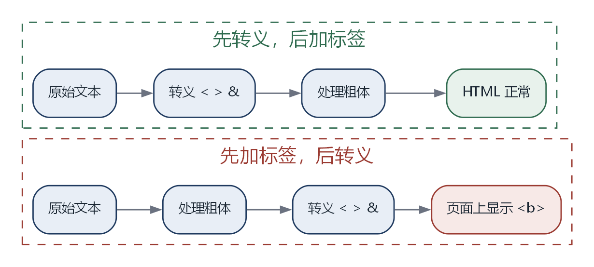
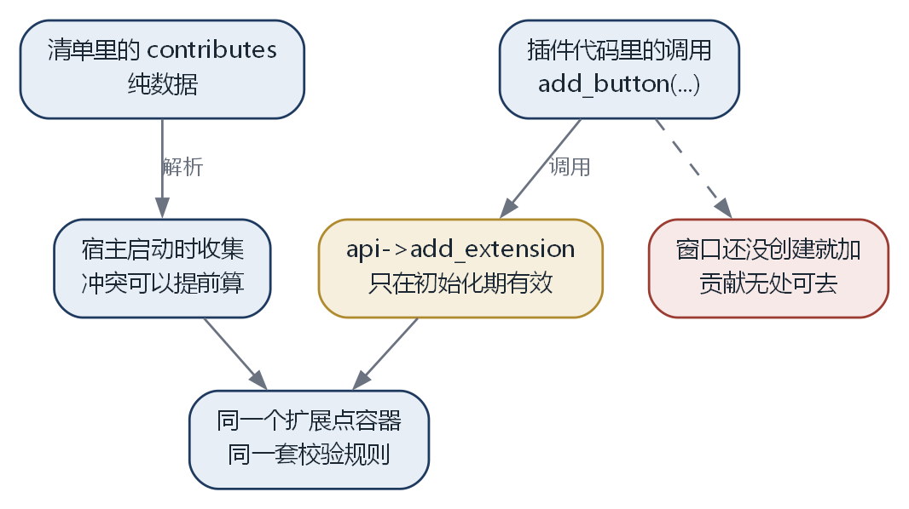

# 第 3 章 扩展点的三种形态

## 3.1 同样是“留一个位置”

最初的扩展点只有一种，就是命令表。插件往表里塞一条命令，用户输入名字时执行。

真实系统里的扩展点要多得多。菜单项、工具栏按钮、右键菜单、设置页、状态栏、文件处理器、主题、语法高亮规则、代码片段。这些位置看起来都是“留一个坑给插件填”，但填进去的东西怎么用，差别很大。

差别集中在一点：**宿主取出来之后，是逐个用、串起来用，还是只挑一个用。**

按这一点分，扩展点有三种形态。

先看一个具体的排查场景，它把三种形态混在了一起。用户报告三件事。右键菜单里有三个“格式化”，点哪个都不确定；每次重启之后工具栏图标的顺序不一样；导出 PDF 的字体总是默认值，换了主题也不变。

第一件是列表型的冲突，三个插件都往同一个位置加了项。第二件也是列表型的问题，顺序靠注册顺序决定，而注册顺序受目录遍历影响。第三件看起来像主题的问题，实际上是单点型的回退没写对，字体设置跟着当前主题走，而当前主题是一个第三方插件提供的，插件被禁用后回退到了一个不带字体定义的默认值。

同一个应用里三种形态并存，每种都有自己的一套出错方式，这就是需要分清楚它们的原因。

## 3.2 列表型

宿主把某个位置下的所有实现取出来，逐个展示或者逐个调用。

菜单项是最典型的。用户点开“文件”菜单，宿主把注册在这个位置下的所有项取出来，按顺序画出来。第一项和第二项之间没有数据传递，各自独立。

工具栏按钮、设置页、状态栏文字、右键菜单，都属于这一类。

列表型的关键设计点有三个。

**顺序。** 谁在前谁在后。常见做法是给每个贡献一个优先级数字，小的在前。相同优先级按注册顺序，这一点要写进文档。

**冲突。** 两个插件想加同名菜单项。可以拒绝后来者，可以覆盖，可以都显示但加前缀。选一种，别让结果依赖加载顺序。

**可见性。** 有些项只在特定条件下显示。比如“格式化”只在选中文字时出现。这需要一个条件表达式，而不是让插件自己在回调里判断。

这三点的实现方式能看出一个宿主成熟不成熟。容器里存的东西大概是这个样子。

```cpp
struct MenuItem {
    std::string id;        // 稳定标识，插件卸载时按它撤
    std::string owner;
    std::string title;
    int         priority;  // 小的在前
    int64_t     seq;       // 同一优先级的注册序号
    std::string when;      // 可见性条件
};
```

`seq` 是必需的，没有它，同一优先级的项在两次启动中顺序可能不同，因为底层容器可能是哈希表，也可能是遍历顺序不定的结构。用户看到菜单项每次启动都换位置，这种小事非常影响信任感。

列表型最容易出的问题不是顺序，是移除。插件被禁用，它的菜单项要撤掉。如果界面上缓存了下标，撤掉一个元素之后所有下标都错位，轻则点错项，重则越界崩溃。正确做法是让界面持有 `id`，每次重绘按 `id` 取数据。

可见性条件 `when` 应该在宿主这一侧求值，而不是把条件函数交给插件。原因有两个。一是宿主可以在求值前就知道要算哪些条件，能一次批量算完；二是插件写的条件函数如果抛异常，宿主在处理绘制菜单这种位置很难接住它。

## 3.3 管道型

宿主把数据依次交给每个实现，前一个的输出是后一个的输入。

文本转换是最典型的例子。假设宿主要把 Markdown 渲染成 HTML，中间可以插几步。

原文本先过“转义特殊字符”，再过“处理粗体”，再过“处理链接”，最后得到 HTML。

每一步都是“接收一段文本，返回一段文本”。第二步拿到的输入，正是第一步的输出。

图片滤镜也是同一结构。原图进去，去噪、调色、锐化三步串起来，每步接收一张图、返回一张图。

管道型的关键设计点是**顺序**。上面三步如果换成“先处理粗体，再转义”，那么第二步生成的 `<b>` 标签会被第一步转义成 `&lt;b&gt;`，页面上直接显示出标签符号，而不是粗体。顺序错了，结果就错了。

所以管道型必须把顺序写进契约，不能靠注册顺序碰运气。

另一个设计点是**失败处理**。某一环出错时，是跳过它继续，还是中止整条管道。两种都合理，但要让插件知道，否则插件没法处理。

管道型最难的地方不是排序，是每一步的输入输出到底是什么类型。

最省事的做法是统一成一段文本或一块二进制。宿主定好一段文本进、一段文本出，所有处理器都按这个签名写。好处是任何处理器都能接在任何处理器后面，代价是每一步都要解析和重新序列化。

另一种做法是按阶段分类型。渲染管道第一阶段处理源码文本，第二阶段处理语法树，第三阶段处理 HTML 字符串。每段内部的处理器签名一致，跨段不兼容。这种设计表达力强，但插件作者必须知道自己在哪一段。

```cpp
using TextStage   = std::function<std::string(std::string)>;
using RenderStage = std::function<std::string(const Ast&)>;
```

还有一种折中，用一份带类型的中间结构，每步声明自己读什么、写什么，宿主在装配时检查能不能接上。这种做法灵活，但装配期的检查逻辑会变成一个新的负担，通常只在步骤很多、来源很杂的系统里值得。

无论哪种，数据归谁要写清楚。上一步返回的字符串，下一步能不能改，改坏了会不会影响别人，这些必须进契约。默认约定应该是每步拿到自己的副本、返回新的对象，虽然多一次拷贝，但省掉了一整类共享写坏的问题。真要省拷贝，再单独开一个就地修改的接口，让插件显式选择。

## 3.4 单点型

宿主只需要一个实现，同一时间只有一个生效。

主题是最典型的。用户可以选浅色或深色，但同一时刻只能有一个主题在起作用。两个插件都提供主题时，宿主必须选一个。

默认存储后端也是单点型。数据存在本地文件还是云端，只能选一条路。

单点型的冲突策略通常是“按优先级选一个”，或者“让用户在设置里选”。它和列表型的根本区别是：列表型可以共存，单点型必须互斥。

单点型有一个列表型没有的问题，当前生效的那个实现被禁用之后怎么办。

假设用户在设置里选了深色主题，而深色主题来自一个第三方插件。用户把这个插件禁用了，设置里那个值还指向它。宿主必须有一个兜底实现，而且要保证兜底实现永远可用。

```cpp
const Theme* resolve_theme() {
    auto want = settings_.theme_id();              // 用户选的
    if (auto* t = themes_.find(want)) return t;
    if (auto* t = themes_.find("builtin.default")) return t;
    return builtin_theme();                        // 编译进宿主的最后一道
}
```

三个分支的顺序有讲究。用户选的排在最前，内置默认在中间，编译进宿主的实现在最后。前两个都可能因为插件被禁用而缺失，第三个不会。

单点型还要决定切换时要不要回滚。如果新选中的实现在初始化时失败，宿主应该退回上一个能用的，而不是留在一个半初始化的状态。这意味着宿主得记住“上一个能用的实现”，而不是只记住用户的选择。

## 3.5 三种形态的对比

| 形态 | 取出来怎么用 | 典型例子 | 冲突处理 |
|---|---|---|---|
| 列表型 | 全部取出，逐个展示或调用 | 菜单项、工具栏按钮 | 可以共存，按顺序 |
| 管道型 | 串成一条链，前一个输出给后一个 | 文本转换、图片滤镜 | 必须定义顺序 |
| 单点型 | 只取一个生效 | 主题、默认存储 | 互斥，按优先级或用户选 |

设计扩展点时，先判断属于哪一类，再决定数据结构、冲突策略和清理方式。

命令表其实是列表型的一个特例。它按名字索引，每个名字一条，取出来执行一条。之所以看起来不像列表，是因为用户一次只输入一个命令。

三种形态在实现上的差别，比使用上的差别更影响维护成本。

| 形态 | 容器结构 | 谁决定顺序 | 清理时做什么 | 典型故障 |
|---|---|---|---|---|
| 列表型 | 一组成员的数组 | 宿主按优先级排 | 撤成员，界面按 id 重取 | 移除后下标错位 |
| 管道型 | 一条有序链 | 契约规定，不能靠注册顺序 | 断开链，前后重新接上 | 顺序错导致结果错 |
| 单点型 | 一个当前指针 | 优先级或用户设置 | 回退到兜底实现 | 当前实现在被禁用后悬空 |

清理那一列最容易漏。列表型的清理看起来简单，实际要同时处理界面缓存；管道型的清理要保证链不断裂；单点型的清理如果只把指针置空，下一次重绘就会崩。

## 3.6 一次顺序事故

有一个 Markdown 预览插件，渲染管道是三步，转义、粗体、链接。它安稳跑了一年多，因为三步都写在这一个插件的代码里，顺序是写死的。

后来链接预览被拆成独立插件，图片相册也被拆成第二个，管道变成可扩展的。装配逻辑按注册顺序串，先注册的排前面。预览插件在加载时注册自己的步骤，相册插件也是，谁先加载取决于目录顺序。

出问题的是这段普通文本。

```text
价格 < 100 且 > 50
```

正确顺序下，尖括号先被转义成 `&lt;` 和 `&gt;`，页面上显示原样。某次顺序反了，粗体处理先跑，它把 `**` 换成 `<b>`，然后转义步骤跑，把所有小于号都转义，包括粗体生成的标签。页面上直接显示出 `<b>` 这几个字符。用户看到的是满屏标签，以为文档坏了。

更麻烦的是另一个方向。转义在最后还会把实体里的 `&` 再转义一次，`&lt;` 变成 `&amp;lt;`，页面上显示 `&lt;`。两个错误同时出现，一部分文字显示标签，一部分显示实体，看起来像是编码问题，排查方向全错。

当时为什么看起来合理。装配逻辑“按注册顺序串”是最省事的写法，代码只有几行，评审时看着很清楚。三个步骤各自都有测试，每个测试只测自己那一步的输入输出，都过。管道的整体测试只测了一个普通段落，那段文本里没有尖括号，也没有加粗。



修法不是把顺序写回代码里，那是退回单插件。修法是给每个步骤声明阶段号，装配时按阶段号排，同一阶段内再按注册顺序。

```cpp
struct PipeStep {
    std::string id;
    std::string owner;
    int         stage;      // 阶段号，小的先跑
    TransformFn fn;
};
```

阶段号是契约的一部分，写进文档，也写进插件的清单。转义永远是 10，加标签永远是 20，链接处理是 30。新插件要插进来，得先想清楚自己在哪一段，这个约束本身就能挡住大部分顺序错误。

复盘里有一条值得单独说。顺序错的时候，没有报错，没有日志，没有异常，只是页面输出不对。这类错误只能靠输出对比发现，也就是拿同一份输入在旧版本和新版本上各跑一次比对结果。管道型扩展点值得为它准备一组固定输入和期望输出，每次装配完成跑一遍。

## 3.7 声明式与命令式

扩展点的提交方式有两种。

**命令式**是插件主动调用宿主的函数，比如 `toolbar.add_button(...)`。

这种方式直观，适合简单场景。但插件必须在正确的时机执行：窗口还没创建时加按钮，按钮会加到无处可去的地方。

**声明式**是插件在清单里写明自己要贡献什么，宿主在启动时统一收集。

```json
{
  "contributes": {
    "commands": [
      { "command": "example.format", "title": "格式化文档" }
    ],
    "menus": {
      "editor/context": [
        { "command": "example.format", "when": "editorHasSelection" }
      ]
    }
  }
}
```

声明式的好处是宿主在插件代码运行之前就知道它会贡献什么。这样可以提前检查冲突、审核权限、排序菜单，也可以在插件被禁用时立刻撤掉它的贡献。

代价是表达能力受限。清单只能描述数据，不能描述逻辑。需要运行时计算的东西，仍然要在代码里注册。

一个实用的组合是：**能用数据描述的用声明式，需要运行时计算用命令式，两者共用同一套标识和校验规则。**

声明式带来一个额外好处，冲突可以在插件跑起来之前就算出来。宿主读到两份清单，就知道同一个位置上有两个同 id 的贡献。

```cpp
std::vector<Conflict> check_manifest(const Manifest& m) {
    std::vector<Conflict> out;
    for (const auto& c : m.contributions()) {
        if (g_extensions.contains(c.slot, c.id))
            out.push_back({c.slot, c.id, g_extensions.owner_of(c.slot, c.id)});
    }
    return out;
}
```

这个检查在安装阶段就能跑，用户看到的是“这个插件和已装的某个插件都想占用同一个位置”，而不是装完之后功能莫名失效。



声明式还有一个代价容易被低估。清单是数据，数据就要有解析器和版本。清单格式本身会演进，加字段、改语义、换默认值，这些都要用和接口一样的方式管起来。一个只有二十行的清单格式，两年后可能长成一个需要文档的小语言。

## 3.8 扩展点的标识

不管哪种形态，都需要一个稳定的名字。

名字要满足几个条件。

**唯一。** 整个生态里不重复。通常用“命名空间.位置”的形式，比如 `editor.toolbar.button`、`file.handler.markdown`。

**有层级。** 从名字能看出它挂在哪里。`menu.file` 和 `menu.edit` 明显是同一个菜单下的两个位置。

**稳定。** 插件会把它写进代码和清单里。改名意味着所有插件都要改。

**不暴露实现。** 名字描述的是位置，不是实现方式。叫 `toolbar.button` 比叫 `toolbar.qt_pushbutton` 好，因为后者把界面框架写死了。

把命名要求写成表，评审时可以直接对着看。

| 要求 | 好的写法 | 不好的写法 | 理由 |
|---|---|---|---|
| 带命名空间 | `editor.context.format` | `format` | 保证全局唯一 |
| 描述位置 | `editor.toolbar` | `editor.qt_toolbar` | 不绑定界面框架 |
| 层级稳定 | `menu.file.export` | `menu.export2` | 改名要所有插件跟着改 |
| 不含版本号 | `file.handler.markdown` | `file.handler.markdown.v2` | 版本由能力协商管 |

命名还有一个隐藏的好处。名字里带层级，扩展点的查找可以按前缀做，`menu.file` 下一共多少项一次就能取出来，不用把所有位置遍历一遍。插件多了之后，这个能力在构建菜单、做权限分组、统计贡献时都能用上。

## 3.9 一个通用的扩展点容器

最初的命令表是专门为命令写的。要支持多种扩展点，需要一个更通用的容器。

```cpp
template <typename T>
class ExtensionPoint {
public:
    bool add(const std::string& key, const std::string& owner, const T& value) {
        if (items_.count(key) > 0) return false;
        items_[key] = { owner, value };
        return true;
    }

    const T* find(const std::string& key) const {
        auto it = items_.find(key);
        return it == items_.end() ? nullptr : &it->second.value;
    }

    void remove_owner(const std::string& owner) {
        for (auto it = items_.begin(); it != items_.end(); ) {
            if (it->second.owner == owner) it = items_.erase(it);
            else ++it;
        }
    }

    std::vector<T> all() const {
        std::vector<T> result;
        for (const auto& pair : items_) result.push_back(pair.second.value);
        return result;
    }

private:
    struct Entry { std::string owner; T value; };
    std::map<std::string, Entry> items_;
};
```

用的时候：

```cpp
ExtensionPoint<Command> commands;
ExtensionPoint<MenuItem> menu_items;
ExtensionPoint<Theme> themes;
```

每个类型一份实例，逻辑相同，类型各自独立。往 `ExtensionPoint<Command>` 里塞 `MenuItem` 会编译报错，这是模板的好处。

`all()` 用于列表型，`find()` 用于单点型。管道型需要按顺序遍历，可以在 `Entry` 里加一个 `priority` 字段，`all()` 按优先级排序返回。

这个容器够用，但有几处细节在插件多了之后会露出问题。

`all()` 每次调用都复制一遍所有元素。菜单每次重绘调一次，五十个菜单项就是五十次字符串拷贝。数量不大时无所谓，热路径上不能这么写。可以让它返回常量引用，由容器自己维护一份按优先级排好的缓存，注册变化时重建。

`std::map` 的遍历顺序是按 key 排的，不是按优先级。用未排序的 `all()` 拿到的顺序看起来稳定，其实是字母序，和优先级无关。这个错觉很危险，因为“看起来稳定”会让人以为顺序已经被管住了，直到某个插件改了个名字，顺序全变。

迭代器失效是另一处。`remove_owner` 在遍历中删除元素，写法错了就会跳过一个或者崩。用 `it = items_.erase(it)` 是对的，写成先 `erase` 再 `++it` 就是未定义行为，而且在小数据量下往往表现为“偶尔少删一个”。

管道型的排序要单独处理，因为优先级相同的两步之间必须有确定顺序。稳定的排序算法加上序号字段就能做到，缺一个都不行。

还有一个常见需求是临时禁用某一项，而不是删掉它。比如用户关掉了一个插件的某项贡献，但还想保留配置。给条目加一个 `enabled` 标志比反复删除再增更安全，因为删除会让界面重建，重建过频会丢焦点。

## 3.10 扩展点的开销

扩展点不是免费的，代价可以量出来。

| 访问方式 | 单次开销 | 适用频率 | 备注 |
|---|---|---|---|
| 直接函数调用 | 纳秒级 | 任意 | 编译期绑定 |
| 函数指针或虚函数 | 几纳秒 | 每帧几十次 | 多一次间接跳转 |
| 容器里按名字查表 | 几十到几百纳秒 | 每次交互 | 字符串比较加哈希 |
| 跨进程扩展点 | 几十微秒起 | 每秒几次 | 见后面的章节 |

按名字查表看起来快，但它是唯一一项会随规模增长的。表里五十个条目、名字二十个字符，一次查询要做几十次字符比较加上一次内存跳转，几百纳秒很正常。用户点一次菜单无所谓，一帧里查两百次就有问题。

常见的做法是在初始化阶段把扩展点“编译”成数组。启动时按优先级把菜单项取出来，存成一个连续数组，绘制时直接遍历，不再查表。插件增删时重建一次，重建的成本是毫秒级，但只发生在用户改设置的时候。

内存这一项很小。一个扩展点条目通常是几十到几百字节，五十个插件贡献五百个条目，总容量在几十 KB 量级。真正占内存的是条目里指向的东西，图标、缩略图、预编译的语法规则，这些不该放在条目里，而是放在插件自己的缓存里，条目只存一个 id。

维护成本才是主要成本。每个扩展点都要有命名规范、冲突策略、清理逻辑、文档。加到第十五种扩展点时，宿主里会有十五份几乎一样但不完全一样的代码。这时候该做的是把公共部分收进容器、把差异写成策略，而不是再复制一份。

## 3.11 什么时候不加扩展点

不是所有可配置的东西都该做成扩展点。

**只有一种实现的。** 如果某个位置永远只有一个实现，做成扩展点只是多一层间接。

**不会由第三方提供的。** 如果这个功能只可能由官方团队实现，直接写死更简单。

**性能敏感的。** 每一帧都要调用的绘制指令，走扩展点会多一次间接调用和一次查表。可以在初始化阶段取出来存成数组，热路径上直接用。

**语义不稳定的。** 还在频繁变化的接口，做成扩展点之后每次改动都是破坏性的。

判断标准和内核那一章一样：这件事的变化频率、责任归属、故障影响是否和别的部分不同。都差不多，就别拆。

下一章处理扩展点最难的部分：契约变化之后，旧插件怎么办。
