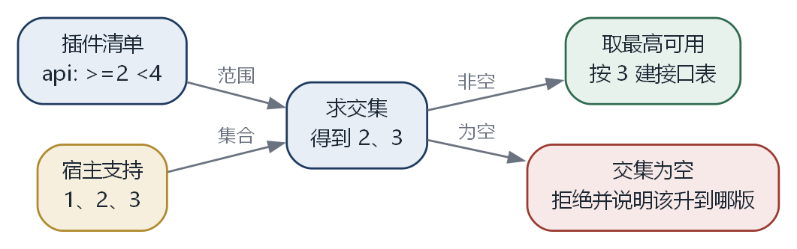
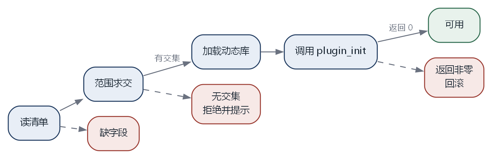

# 第 4 章 契约的版本

## 4.1 为什么版本是难题

最初的 `PluginApi` 只有四个字段，加一个 `on_event` 就是一次契约变化。当时说过“新字段加在末尾，旧插件不受影响”。

这句话对了一半。字段加在末尾确实不破坏旧插件，但它没有回答另外几个问题。

旧插件怎么知道宿主有没有这个新字段。宿主怎么知道插件是按哪一版写的。契约从 1 升到 2 时，按 1 写的插件还能不能装。插件要求宿主 3.0 以上，装在了 2.8 上，宿主怎么拒绝。

这些都归版本管。

有一个真实的发布记录可以把这些问题的代价说清楚。产品从 2.9 直接跳到 3.0，契约版本从 2 升到 3，原因是渲染接口里一个字段的类型从 `int` 改成了 `int64_t`。改动本身只有一行，发布说明里也写了，但生态里三十多个插件，只有一个作者当天更新了。

接下来两周的工单大约分三类。装不上的，宿主拒绝加载旧插件，提示“不兼容”，用户不知道该怎么办。装上了但功能不对的，宿主保留了旧接口的兼容层，但转换只做了一部分，某个字段在边界情况下变成零。最难查的是第三类，插件没崩，宿主也没报错，只是某个面板的数据一直是空的，因为插件注册的扩展点在新版本里换了名字，插件往旧名字里塞东西，没人在意。

第三类值得单独记住，因为它是版本管理里唯一完全静默的一类。前两类至少有提示或崩溃，第三类只表现为“功能少了一块”，用户往往以为是自己没用对。

## 4.2 两种版本

插件系统里至少有三种版本在同时流动，容易混。

**产品版本。** 用户看到的那个号，比如应用是 1.8.2。它跟界面相关，跟插件没关系。

**宿主版本。** 宿主自己的版本号，比如 3.1.0。它决定宿主支持哪些契约版本。

**契约版本。** 插件和宿主之间那份接口的版本，比如 2。它只在接口变化时加一。

三者的关系是：宿主版本一定范围内支持某几个契约版本。

```json
{
  "host": "3.1.0",
  "supported_api": ["1", "2"],
  "current_api": "2"
}
```

这个宿主支持契约 1 和 2，新插件应该按 2 写。按 1 写的旧插件仍然能装。

把契约版本和产品版本分开编址，好处是产品可以每天发版，契约可能一年才升一次。插件作者只需要关心契约版本，不用追产品的每一次更新。

标题里的两种，指的是需要各自编址的两个号，产品版本和契约版本。宿主版本夹在中间，它的作用是说明“这个宿主支持哪几个契约版本”。

| 号 | 变化诱因 | 变更频率 | 谁关心 |
|---|---|---|---|
| 产品版本 | 界面调整、功能上线 | 每周甚至每天 | 用户、支持团队 |
| 宿主版本 | 内核改动、依赖升级 | 每月 | 运维、插件作者 |
| 契约版本 | 接口形状或语义变化 | 每年一两次 | 插件作者 |

把三者混成一个号，最常见的后果是插件声明“需要 3.1 以上”，而 3.1 只是一个界面版本号，和接口毫无关系。半年后宿主发 3.2，接口没变，插件作者以为要跟着改，白忙一天。

## 4.3 什么改动兼容

契约改动分三类。

**兼容的添加。** 往结构体末尾加字段，加新的扩展点，加新的可选函数。旧插件不读新字段，照常工作；新插件用新字段，但要有降级路径。

**兼容的行为调整。** 修正一个明显是 bug 的行为，放宽参数范围，增加一种被接受的输入格式。旧插件不需要改，但行为可能和以前略有不同。

**不兼容的修改。** 改变已有字段的含义，删除字段，改变函数签名，改变调用顺序，收紧参数范围。

前两类不升版本，后一类必须升。

这里有一个容易忽略的地方：**结构的兼容和行为的不兼容可以同时发生。** 比如字段没变，但 `register_command` 从“收到命令立刻复制”改成了“只记指针”。结构上完全一样，行为上却让所有插件都必须改。

所以判断兼容性不能只看结构，还要看语义。

把常见的改动排成一张表，评审时对着看。

| 改动 | 结构变了吗 | 行为变了吗 | 要升契约版本 | 旧插件要不要改 |
|---|---|---|---|---|
| 末尾加字段 | 是 | 否 | 不用 | 不用 |
| 加新扩展点 | 否 | 否 | 不用 | 不用 |
| 修一个明显的 bug | 否 | 是 | 不用，但写进变更说明 | 一般不用 |
| 放宽参数范围 | 否 | 是 | 不用 | 不用 |
| 字段含义变了 | 否 | 是 | 必须 | 必须 |
| 函数签名变了 | 是 | 是 | 必须 | 必须 |
| 调用顺序变了 | 否 | 是 | 必须 | 必须 |

第三行最容易被当成“不需要协调”。修 bug 确实不破坏结构，但如果三个插件早就绕着这个 bug 写了绕过逻辑，修完之后它们反而出错。所以修 bug 也要写进变更说明，并且提前告知。

## 4.4 一次结构体错位

有一个宿主在契约 1.1 里给 `PluginApi` 末尾加了 `register_hook`。按规矩这是兼容改动，插件不需要改。三个月后有人报了一个只在某个平台上出现的崩溃，调用栈落在插件的 `plugin_init` 里，地址完全不对。

原因是插件在自己的工程里复制了一份 `PluginApi` 定义，而不是包含宿主发布的头文件。这份副本是 1.0 时代的，只有四个字段。插件拿到宿主给的指针，按自己的定义去读，前四个字段的偏移刚好一致，第五个字段读到的是宿主结构体紧跟着的内存，那里恰好是一个空闲链表的指针。

调用它的时候，程序跳进一片不属于代码段的地址。

最值得记的是它当时为什么看起来合理。插件作者复制头文件，是因为不想依赖宿主的接口头，也不想跟着宿主升级重新编译。这份副本在当时是准确的，代码也跑通了。只要宿主不加字段，它就永远准确。

防这件事靠的是 `size` 字段，而且必须两边都检查。

```cpp
// 宿主侧
PluginApi api{};
api.size    = sizeof(PluginApi);
api.version = PLUGIN_API_VERSION;

// 插件侧
if (api->size < offsetof(PluginApi, register_command) + sizeof(api->register_command))
    return 1;   // 宿主太旧，连最基础的函数都没有
if (api->size < offsetof(PluginApi, register_hook) + sizeof(api->register_hook))
    has_hook = false;   // 宿主没这个能力，走降级路径
```

`offsetof` 比数字段个数可靠。字段宽度会变，平台的填充规则会变，只有偏移量是确定的。

这套检查有个前提，插件的头文件必须和宿主一致。如果插件用的是自己复制的副本，`offsetof` 算出来的是副本的偏移，检查就失效了。所以接口头文件要么由宿主发布、插件直接引用，要么由构建系统在编译时校验一份哈希。两份副本各自演进，迟早错位。

## 4.5 版本协商

插件在清单里声明自己能接受的契约范围。

```json
{
  "engine": {
    "api": ">=2 <3"
  }
}
```

宿主加载时检查这个范围和自己支持的版本有没有交集。没有交集就拒绝，并给出清晰的提示。

```cpp
bool check_api(const std::string& range, const std::vector<std::string>& supported) {
    // 简化处理：只支持形如 ">=2 <3" 的写法
    for (const auto& v : supported) {
        int major = std::stoi(v);
        if (major >= 2 && major < 3) return true;
    }
    return false;
}
```

真实实现会用完整的语义化版本库，支持 `^`、`~`、`||` 等写法。原理一样：判断两个范围有没有交集。

拒绝时的提示要具体。只说“版本不兼容”，用户不知道该装哪个版本；说“这个插件需要契约 3，当前宿主支持 1 和 2，请升级宿主到 4.0 以上”，用户知道该做什么。

交集这个概念画出来看更清楚。



还差一个方向。上面只讲了“宿主拒绝插件”，实际上插件也要检查宿主。插件在初始化时拿到的接口表里有 `version` 和 `size`，它应该先确认这两个值在自己能处理的范围内，而不是直接开始调用。多写三行，能避开一类“插件在新宿主上行为怪异”的问题。

## 4.6 三种演进策略

契约从 2 升到 3 时，旧插件怎么办。

**直接破坏。** 只支持 3，按 2 写的插件全部失效。适合早期产品，用户少、插件少、迁移成本低。

**并行支持。** 宿主同时实现 2 和 3 两套接口，旧插件走 2，新插件走 3。成本高，但迁移平滑。

**自动迁移。** 宿主提供转换工具，把旧插件的清单和调用改写成新形式。适合变化有规律的情况，比如“字段改名”“函数参数顺序调整”。

并行支持的具体做法是：保留旧的接口表，新增一张新的接口表，加载时按插件声明的版本选择。

```cpp
if (manifest.api == "2") {
    plugin_init_v2(make_api_v2());
} else if (manifest.api == "3") {
    plugin_init_v3(make_api_v3());
}
```

两套接口内部可以共享实现，只是结构体不同。维护成本在于：每次改一处逻辑，要确认两套都改对了。

三种策略的成本差别很大，选之前最好有个量级概念。

| 策略 | 宿主侧工作量 | 生态侧工作量 | 过渡期 | 适合的场景 |
|---|---|---|---|---|
| 直接破坏 | 一次接口替换 | 每个插件都要改 | 没有 | 早期产品，插件少于十个 |
| 并行支持 | 两套接口加一层转换 | 可以不动 | 一到两个大版本 | 插件多，作者分散 |
| 自动迁移 | 转换工具加校验 | 跑一遍工具 | 一个版本 | 变化有规律 |

并行支持的成本主要在“两套都要对”。每修一个逻辑 bug，要确认两套实现都修了，两套的测试都要跑。插件到五十个以上时，这个成本反而比直接破坏低，因为一次性把所有插件推着改一遍根本推不动。

## 4.7 弃用流程

即使决定并行支持，也不能永远支持下去。需要一条明确的弃用路径。

**标记。** 旧接口在文档里标注“将在契约 4 中移除”，在运行时打一条警告。警告要能关掉，否则日志会被淹没。

**统计。** 记录还有多少插件在用旧接口。数字降到很低，才有理由移除。

**迁移指南。** 说明改了什么、为什么改、旧代码怎么改、新代码长什么样。最好提供一个自动转换脚本。

**过渡期。** 至少一个大版本。插件作者可能是兼职的，三个月就宣布移除，等于逼他们放弃。

顺序不能反。先标记，再等，最后移除。跳过标记直接移除，会让插件作者在用户那里发现问题。

时间表的量级可以这样定。

| 阶段 | 时长 | 退出条件 |
|---|---|---|
| 标记 | 立即 | 文档和运行日志都出现弃用提示 |
| 统计 | 一到两个版本 | 使用旧接口的插件占比降到很低 |
| 提醒 | 每个版本一次 | 直接联系还没迁移的作者 |
| 移除 | 下一个大版本 | 只剩官方自己维护的插件 |

时长不是硬指标，退出条件才是。占比没降下来就移除，等于把成本转给用户。统计那一步尤其容易省略，因为“我心里大概知道还有几个在用”听起来和“我有一张表”差不多，实际上差很远。

## 4.8 一个具体的版本演进

假设契约从 1 到 2，要做三件事。

**第一，加一个可选字段。**

```cpp
typedef struct PluginApi {
    uint32_t size;
    uint32_t version;
    // ... 已有字段
    int (*register_hook)(const char* name, HookFn fn);   // 新增
} PluginApi;
```

`size` 保证了旧插件只读自己认识的字段，新字段在末尾不影响它。

**第二，新增一个扩展点。**

扩展点是运行时注册的，不涉及结构体。旧插件不知道新扩展点，只是不往那里贡献，不影响其他部分。

**第三，改变一个函数的行为。**

这一条最麻烦。假设 `register_command` 以前收到命令就复制一份，现在改成只记指针。结构没变，但旧插件会以为自己可以释放命令结构。

安全的做法是：不改变已有函数的行为，另加一个新函数。旧函数保持原样，新函数用新名字。

```cpp
void (*register_command)(const PluginCommand* cmd);       // 保持旧行为
void (*register_command_v2)(const PluginCommand* cmd);    // 新行为
```

这样旧插件照常工作，新插件用新函数。等旧插件都迁移完，再移除旧函数。

## 4.9 版本之外：能力协商

版本号有一个局限：它假设所有人按同一套规则编号。

多个团队、多个编译器、多个平台时，这个假设不成立。更细的做法是按能力协商。

插件不声明“我要契约 2”，而是声明“我需要纹理数组这个能力”。

```cpp
if (api->supports("render.texture.array")) {
    // 用纹理数组，减少绘制批次
} else {
    // 退回多张独立纹理
}
```

宿主在 `PluginApi` 里提供一个 `supports` 函数，插件查询自己需要的能力在不在。

这种写法比版本号更细。宿主可以在不升版本的情况下增加新能力，旧插件不受影响；插件也明确知道自己依赖什么，而不是笼统地要求“2.0 以上”。

能力协商和版本号可以同时用。版本号管整体兼容，能力协商管具体特性。前者粗，后者细。

## 4.10 加载时的版本检查

把版本相关的检查按发生顺序排一遍，能看清每一步该拦什么。

```cpp
LoadResult load_plugin(const std::string& path) {
    Manifest m = read_manifest(path);
    if (m.name.empty())             return {Fail, "清单缺少名字"};
    if (m.api_range.empty())        return {Fail, "清单缺少契约版本范围"};
    if (!api_range_ok(m.api_range)) return {Fail, describe_range_hint(m.api_range)};

    void* h = open_library(path);
    if (!h)                         return {Fail, "动态库加载失败"};

    auto init = (int(*)(const PluginApi*))get_sym(h, "plugin_init");
    if (!init)                      return {Fail, "缺少 plugin_init 导出"};

    PluginApi api = make_api(m.api_selected());   // 按协商结果选接口表
    int rc = init(&api);
    if (rc != 0) {
        revoke_all(m.name);        // 回滚它已经注册的东西
        close_library(h);
        return {Fail, "插件初始化返回 " + std::to_string(rc)};
    }
    return {Ok, ""};
}
```

这条路径上有六处会失败，每处的提示要写到能指导用户动手。



一个容易漏的点是回滚。插件初始化返回非零，它可能已经注册了三条命令、订阅了两个事件。不回滚，这些东西就留在表里，用户能触发它们，一执行就跳进已经卸载的模块。回滚要靠三张表都记住 owner，也就是前面讲的结构。

参数校验的顺序也有讲究。清单检查必须在加载动态库之前，因为加载一个来源不对的动态库本身就有风险，而且慢。契约范围检查必须在调用 `plugin_init` 之前，因为插件在初始化里会按自己理解的契约读字段，读到错位的内存就晚了。

最后一步可以考虑加超时。插件初始化里做什么都有可能，一次卡住的网络请求能让整个应用的启动停在那里。同进程内很难中断一个卡住的调用，能做的是把初始化放到后台线程加一个上限，超时就标记为失败。真正的强制中断还得靠独立进程。

## 4.11 契约文档

版本管理不只是代码，还有文档。

一份契约文档至少要写清四件事。

**每个字段的含义。** 不只是类型，还有取值范围、什么时候有效、谁负责填充。

**每个函数的约定。** 参数能不能为空、返回值代表什么、会不会抛异常、是不是线程安全。

**版本历史。** 每个版本改了什么，为什么改，影响了谁。

**弃用清单。** 哪些接口已经标记弃用，计划在哪个版本移除。

文档要和代码一起版本化。接口改了文档不改，比没有文档更糟，因为读者会按文档写，然后发现不工作。

下一章换一个维度，从单个扩展点跳到插件之间的协作，讨论事件总线和钩子在真实规模下的表现。
