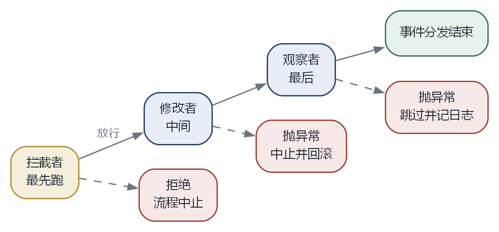
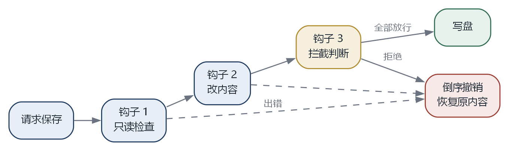

# 第 5 章 事件变多之后

## 5.1 三种插件同时存在

最初的事件总线只有两个订阅者，一个改内容，一个做通知。运行起来顺序清楚，出错也好查。

插件变成十个之后，同一个事件上可能挂着三种不同的插件。

**观察者。** 只想记录，不改变任何东西，比如统计、日志、埋点。它出错不该影响别人。

**修改者。** 要改数据，比如给保存的内容加头注释、给渲染的画面加滤镜。它改了，后面的人看到的是改后的结果。

**拦截者。** 要阻止流程，比如权限检查、内容校验。它说不行，后面的都不该执行。

这三种插件对“出错怎么办”的期望完全不同。观察者出错，跳过它；修改者出错，可能该中止；拦截者出错，一定要中止。

最初的事件总线把所有回调都当成同一种处理，用一个 `try/catch` 兜住全部。这份简化在三个插件时能用，十个插件时就会出问题：一个统计插件抛异常，被静默吞掉，用户永远不知道统计已经坏了三个月。

有一个笔记应用的事件总线，三个月里报上来四个问题，每一个都能归到同一类原因上。

第一条来自运营，后台报表里的日活比实际低很多。查下来是统计插件在一个事件处理里访问了宿主已回收的临时目录，抛了异常，异常被总线的 `try/catch` 吞了，只留下一行警告。统计插件从那之后就没再记录过任何数据，但它的界面一切正常，菜单也在，用户和开发者都没发现。

第二条来自客服，保存偶尔会失败，提示是“内容校验未通过”。查下来是校验插件在检查一段合法文本时抛了空指针，异常被抛到了保存流程，保存中止。校验插件只提供“提示”性质的功能，它挂了不该让保存失败。

第三条更隐蔽，索引插件和同步插件都改了内容，顺序颠倒之后，同步上去的版本里多了一段索引插件加的标注，作者在另一台机器上看到自己的正文变了。

第四条是性能，用户拖动一下滚动条，一次重绘发出上百个事件，每个事件五六个订阅者，帧率掉到二十。

四个问题里有三个不是某个插件写错了，而是总线把三种不同意图的订阅者当成了同一种东西。

## 5.2 把订阅者分类

解决办法是让插件在订阅时声明自己是哪一类。

```cpp
enum class ListenerKind {
    Observer,    // 只读，出错跳过
    Modifier,    // 改数据，出错中止
    Guard        // 决定是否继续，出错中止
};
```

总线按类型决定异常处理。

```cpp
void EventBus::emit(const std::string& type, const std::string& payload) {
    auto snapshot = listeners_[type];
    for (const auto& l : snapshot) {
        try {
            l.fn(type.c_str(), payload.c_str());
        } catch (const std::exception& e) {
            if (l.kind == ListenerKind::Observer) {
                log_warn("observer failed: " + l.owner + " " + e.what());
                continue;                      // 跳过，继续下一个
            }
            throw;                             // 其余类型，中止
        }
    }
}
```

`Observer` 出错只记日志，`Modifier` 和 `Guard` 出错抛出，让调用方能处理。

这套分类也影响顺序。`Guard` 应该排在最前面，因为它决定后面要不要执行。`Modifier` 排在中间，`Observer` 排最后，因为它在数据确定之后才有意义。

顺序不能靠插件自觉声明优先级，总线需要按类型自动分组。

三类订阅者在四个维度上的期望不一样，把这四个维度列出来，分类的必要性就很清楚。

| | 改不改数据 | 能不能阻止后续 | 出错时 | 排在位置 |
|---|---|---|---|---|
| 观察者 | 不改 | 不能 | 跳过并记日志 | 最后 |
| 修改者 | 改 | 一般不能 | 中止并回滚 | 中间 |
| 拦截者 | 不改 | 能 | 中止 | 最前 |



分类靠插件自己声明，这里就有一个误分类的风险。最常见的一种是把拦截者声明成观察者。插件作者的想法是“我只是一段检查逻辑，出错了就跳过吧”，但检查逻辑出错意味着它没法判断该不该放行，跳过它等于默认放行。安全相关的分支永远应该选“出错就拦”。

反过来也有风险。一个只想记录耗时数据的统计插件把自己声明成拦截者，于是它的一次磁盘写入失败会让整个保存中止。声明得太重比太轻容易发现，因为它会马上把功能搞坏，太轻的往往静默运行很久。

一个实用的兜底是给默认值。不声明类型的插件按观察者处理，同时在加载时记一条提示。这样既不会因为漏声明而搞坏主流程，又能把漏声明的插件找出来。

## 5.3 顺序的三种来源

插件多了之后，顺序来源会变得混乱。

**注册顺序。** 谁先加载谁先执行。问题在于加载顺序受目录遍历影响，不同机器上可能不同。

**优先级数字。** 每个插件声明一个数字，小的先执行。问题在于数字没有统一标准，A 插件声明 50，B 插件声明 51，纯属巧合，但它们之间可能真的有依赖。

**显式依赖。** 插件声明“我必须在某个插件之后”。这种方式最准确，但需要宿主解析依赖关系。

实际系统往往三者混用：默认按优先级，相同优先级按注册顺序，显式依赖覆盖前两者。

显式依赖的写法可以是这样。

```json
{
  "name": "index",
  "hooks": {
    "before_save": {
      "after": ["markdown-frontmatter"],
      "priority": 100
    }
  }
}
```

`after` 表示“必须在这个插件之后”，`priority` 是没冲突时的默认顺序。宿主在加载时构建一张依赖图，做拓扑排序。

如果出现循环依赖，说明两个插件本该合并，或者应该抽出第三个插件。宿主应该报错并列出环路，而不是随便选一个顺序。

拓扑排序的代码不长，环节检测只需要看排完之后的元素数对不对。

```cpp
bool order_listeners(std::vector<Listener>& ls) {
    std::map<std::string, int> indeg;
    std::map<std::string, std::vector<int>> out;
    for (int i = 0; i < (int)ls.size(); ++i) indeg[ls[i].owner] = 0;

    for (int i = 0; i < (int)ls.size(); ++i) {
        for (const auto& before : ls[i].after) {
            if (!indeg.count(before)) continue;   // 依赖的插件没装
            out[before].push_back(i);
            ++indeg[ls[i].owner];
        }
    }

    std::vector<Listener> result;
    std::vector<int> ready;
    for (int i = 0; i < (int)ls.size(); ++i)
        if (indeg[ls[i].owner] == 0) ready.push_back(i);

    while (!ready.empty()) {
        int i = ready.front();
        ready.erase(ready.begin());
        result.push_back(ls[i]);
        for (int j : out[ls[i].owner])
            if (--indeg[ls[j].owner] == 0) ready.push_back(j);
    }
    if (result.size() != ls.size()) return false;   // 剩下的都在环里
    ls = std::move(result);
    return true;
}
```

“依赖的插件没装”那一行看起来是容错，其实是隐患。插件声明必须在某个插件之后，而那个插件没装，它跑到哪里都无所谓。但如果它隐含地假设了对方会先做好某件事，就会读到没准备好的数据。更稳的做法是让插件区分两种声明，“必须在对方之后”和“如果对方存在，必须在它之后”。前者没装就报错，后者没装就放行。

## 5.4 一次循环依赖的启动失败

插件市场里有两个插件经常被一起安装，一个是引用补全，一个是文献索引。引用补全声明自己必须在文献索引之后，因为补全需要索引先建好。文献索引在半年前为了修一个顺序问题，声明自己必须在引用补全之后，因为引用补全会在自己的初始化里把一份文献列表交给它。

两个声明各自都解决了一个真实问题，单独看都对。用户把两个都装上，应用启动直接失败。日志里一行 `cycle detected: cite-helper -> bib-index -> cite-helper`，然后是一个空窗口。

这份日志已经算写得好的，很多系统的日志只有“拓扑排序失败”，连是哪两个插件都看不出来。但即使有这行日志，用户能做的也只有逐个禁用插件试，因为他不知道这两个插件本来就要一起用。

三个地方需要改，重要性依次下降。

**环不应该阻断启动。** 一个事件的两个订阅者排不出顺序，最坏的结果是它们的执行顺序不确定，而不是整个应用打不开。合理的做法是退化成按优先级排，记一条错误日志，继续启动。启动阶段任何“局部问题导致全局失败”的设计都值得重新考虑。

**界面要先于插件创建。** 空窗口是最糟糕的失败形式，因为用户连禁用插件的按钮都点不到。宿主应该先把窗口建好，再在后台加载插件，加载失败时在界面里给出一个可操作的列表。

**依赖图要在安装时算。** 如果依赖声明写在清单里，安装时就能发现环，用户看到的是“这两个插件不能同时使用”，而不是装完重启后一个空窗口。这也是声明式清单的一个具体好处。

复盘时还发现一件事。两个声明的背后其实是同一个需求，两个插件都想知道文献列表现在是哪一版。如果这份信息由一个服务提供，两边都不需要关心对方什么时候初始化，只需在用到时查一次。循环依赖往往不是排序算法的问题，而是两个插件在抢同一份数据的所有权。

## 5.5 事件风暴

插件多了之后，容易出现另一种问题：事件太多。

一个保存操作可能发出这些事件。

```text
file.before_save
file.save_started
file.content_written
file.metadata_updated
file.index_queued
file.save_finished
```

每个事件又有五六个订阅者，一次保存触发三十几次回调。出问题时，日志里全是事件名，看不出真正做了什么。

这份复杂度的来源是把“实现步骤”暴露成了事件。`content_written` 是宿主内部的一个动作，不该出现在公共事件里。

判断一个事件该不该公开，问一句：**插件真的需要知道这件事，还是只是宿主内部的一步。**

`file.saved` 该公开，因为插件要更新索引、上传云端。`content_written` 不该公开，因为那是宿主的实现细节。

限制事件数量的几个做法。

**按语义分层。** 业务事件（`document.saved`）公开，实现事件（`buffer.flushed`）内部用。

**合并高频事件。** 内容每改一次就发一个 `document.changed`，输入一段话能发几百个。可以合并成“一帧内最多发一次”。

**用服务代替事件。** 插件想查询状态，用服务接口，不要发一个请求事件等响应事件。

把开销算一下，就更能说清该不该合并。一次保存发六个事件，每个事件平均五个订阅者，总共三十次回调。每次取数据、解析一遍 payload、做一次判断，几十微秒，加起来一两毫秒，还能接受。但编辑器每改一个字就发一个事件，一段话几百个字，几百个事件乘上五六个订阅者，一次输入就是几千次回调，几十毫秒，输入开始卡。

合并高频事件的实现很简单。

```cpp
class Coalescer {
public:
    void mark_dirty() { dirty_ = true; }
    void tick() {                      // 每帧一次
        if (!dirty_) return;
        dirty_ = false;
        bus_.emit("document.changed", snapshot());
    }
private:
    bool dirty_ = false;
};
```

合并也有代价。订阅者看到的不是每一次变化，而是每帧一次的最终状态。凡是要“每一次变化都算数”的订阅者，比如撤销栈、协同编辑的操作序列，不能订阅合并后的事件，得走同步的钩子。这个区别要写进事件文档，否则订阅者会默默地丢数据。

## 5.6 钩子链的短路

钩子和事件的一个关键区别是能短路。

前面的钩子返回“停止”，后面的钩子不再执行，流程中止。

短路的实现很直接。

```cpp
for (auto& hook : chain) {
    if (!hook(content)) {
        return false;
    }
}
```

但短路带来两个问题。

**第一，已经执行的钩子做了一半的事怎么办。** 有的钩子已经改了内容，有的已经写了临时文件。中止之后，这些改动要不要撤销。

**第二，怎么知道是谁短路的。** 用户看到“保存失败”，但不知道是哪个插件拦下的。

第一个问题需要“回滚钩子”机制，或者要求钩子本身幂等、可重入。第二个问题简单，在短路时记录插件名。

```cpp
if (!hook(content)) {
    log_info("保存被 " + hook.owner + " 阻止");
    return false;
}
```

多写一行日志，用户和开发者都能少排查半小时。

短路之后要撤销已经发生的事，可以分三层做。

第一层最简单，把钩子分成只读和可写两类。只读的钩子永远不需要回滚，它们排在前面，出问题直接中止，代价为零。可写的钩子排在后面，数量少，回滚逻辑也好写。

第二层是给可写钩子一个反函数。钩子改了内容，就返回一个撤销函数，宿主在短路时倒序调用。

```cpp
struct EditResult {
    bool ok;
    std::string content;
    std::function<void()> undo;   // 可能为空
};

std::vector<std::function<void()>> done;
for (auto& h : write_stage) {
    auto r = h.apply(content);
    if (!r.ok) {
        for (auto it = done.rbegin(); it != done.rend(); ++it)
            if (*it) (*it)();          // 倒序撤销
        return false;
    }
    content = std::move(r.content);
    done.push_back(std::move(r.undo));
}
```

反函数写起来麻烦，很多插件写不对，而且容易漏。所以第三层兜底很重要，宿主在流程开始前把原内容存一份，短路时整份恢复。这比让每个插件写反函数可靠，代价是一次内存拷贝，几百 KB 的文档完全能接受。



还有一条容易被忽略的规则。撤销只应该撤自己改的东西，不应该撤别人改的。如果钩子 B 在钩子 A 的基础上改了内容，B 的撤销函数必须把内容恢复成 A 改完的样子，而不是恢复成原文。要求插件作者做到这一点很勉强，所以更常见的做法是宿主统一接管，每次钩子返回新内容，宿主自己存一份快照，回滚时直接回到最近一个快照。

## 5.7 重入

钩子修改了数据，数据变化又触发同一个流程，形成递归。

最初的版本用一个布尔开关挡住重入。插件多了之后，这个开关不够用。

假设有两个流程：保存和自动保存。保存时修改内容，触发“内容已修改”事件，自动保存定时器收到后发起一次自动保存，自动保存又触发钩子。

如果开关只挡“保存”，挡不住“自动保存”。如果两个流程共用一个开关，保存过程中的自动保存被拒绝，但用户期望的是“等这次保存完成后再自动保存”，而不是“丢弃”。

更稳的做法是排队，而不是拒绝。

```cpp
class SaveQueue {
public:
    void request() {
        if (running_) {
            pending_ = true;
            return;
        }
        running_ = true;
        do {
            pending_ = false;
            do_save();
        } while (pending_);
        running_ = false;
    }
};
```

流程进行中又有请求，标记一下，当前流程结束后再跑一次。这样既不重入，也不丢请求。

队列的写法比布尔开关多一点代码，但状态是清楚的。可以把它看成一个三态机。

| 当前状态 | 收到什么请求 | 处理 |
|---|---|---|
| 空闲 | 外部请求 | 立刻开始，状态转运行 |
| 运行中 | 外部请求 | 标记待办，状态保持运行 |
| 运行中 | 流程自己发出的请求 | 直接拒绝，记一条警告 |

第三行是关键的补充。排队解决了“外部请求被丢弃”的问题，但解决不了“流程自己触发自己”。一个保存钩子如果自己又调了一次保存，排队会让它无限循环。区分内部请求和外部请求，靠的是一个流程标记或者线程标记，不能靠时间窗口。

这里有过一个真实的坑。有一个插件的保存钩子会在写完文件后调一次重新加载，重新加载触发“内容已变更”，内容已变更又请求保存。排队逻辑把它排成了跑不完的循环，用户看到保存图标一直在转，一个核吃满。修法是给重新加载加一个“不触发变更事件”的选项，而不是在队列上加更多的状态。

## 5.8 事件总线的内存与生命周期

插件多了之后，还有一个隐蔽的问题：被销毁的插件仍留在订阅表里。

订阅时传的是函数指针，指向插件里的代码。插件被卸载后，那段代码已经不在内存里了。下一次发事件，总线仍然调用这个指针，直接崩溃。

最初的版本靠卸载时调 `remove_owner` 解决。但插件多了之后，“卸载时记得清理”很难保证每次都做到。

两种兜底方式。

**卸载前强制清理。** 宿主卸载插件时，自动遍历所有总线，删掉属于这个插件的订阅。插件自己不需要写清理代码。

**定期检查。** 总线维护一张“活跃插件”列表，发事件前过滤掉不活跃的订阅者。

第一种更可靠，因为它不依赖插件自觉。代价是宿主需要知道所有总线的存在。

可以在内核里维护一个“总线注册表”，每个总线在创建时登记，卸载插件时统一清理。

```cpp
class EventBusRegistry {
public:
    void add(EventBus* bus) { buses_.push_back(bus); }
    void remove_owner(const std::string& owner) {
        for (auto* bus : buses_) bus->remove_owner(owner);
    }
private:
    std::vector<EventBus*> buses_;
};
```

这段代码不长，但能避免一类很难查的崩溃。

有一次很典型的复现。一个语法高亮插件被用户禁用，禁用后应用还能正常用几个小时，然后在他切到一个特定文件类型时崩。崩溃报告里的地址落在一个已经卸载的模块里，符号解析不出来，看起来像随机崩溃，开发先怀疑了内存碎片和显卡驱动。

原因是这个插件除了订阅事件，还通过一个不太规范的接口把自己的函数指针存进了一张全局表，卸载时没清。宿主只在卸载时清了自己认识的那几张表，那张全局表不在其中。

这类崩溃的共同点是时间差。插件禁用时不崩，因为那一刻没有事件；几个小时后某个事件触发，才调到一个野指针。排查者容易从“刚才做了什么”入手，而真正的起因在几个小时前。日志里能看到的只有崩溃地址，而且那个地址在每次运行中都不同。

除了卸载时统一清，还有一层很便宜的保险，给每条订阅记一个加载代号。

```cpp
struct Listener {
    std::string owner;
    uint32_t    generation;   // 插件第几次被加载
    EventFn     fn;
};
```

发事件前拿 `owner` 去插件注册表里比对 `generation`，不一致就跳过并顺手删掉这条订阅。这个做法能挡住“清了但没清干净”，挡不住“内存已释放但地址还没被复用”，所以它是保险，不是替代品。真正的主手段仍然是卸载时统一清。

## 5.9 一个事件契约要写清什么

事件名和 payload 也是契约，也需要规范和版本，但大多数系统里它们是随手起的。

| 要写清的 | 例子 | 不写会怎样 |
|---|---|---|
| 命名层级 | `document.saved` | 同一个意思出现三种前缀 |
| 用过去时 | `document.saved` 而不是 `save_document` | 订阅者分不清是通知还是命令 |
| payload 字段 | `{path, size, mtime}` | 每个插件按自己的猜测解析 |
| 字段可选性 | `mtime` 可能缺失 | 空指针或者读到垃圾 |
| 触发时机 | 磁盘写完之后 | 订阅者读到旧内容 |
| 会不会重入 | 不会 | 订阅者自己触发自己 |
| payload 寿命 | 只在回调期间有效 | 插件存了指针，回调返回后崩 |

最后一行最容易出事，因为它在单次测试里完全看不出来。插件把 payload 里的字符串指针存进成员变量，回调返回后宿主释放了那块内存，下次用就是野指针，而且往往在几十秒后才崩。

稳定的做法是 payload 用一份自描述的键值结构，不用裸指针传结构体。宿主序列化一份，插件按名字取值，取不到就用默认值。这样一份 payload 的字段可以随版本增加，旧插件取不到新字段也不受影响。

事件名的版本可以用同一套思路，不升事件版本号，而是允许字段增加。只有当字段含义变了才需要新名字，比如 `document.saved` 旁边再出一个 `document.saved_v2`。两个名字并存一段时间，比在一个名字上偷偷改含义安全得多。

## 5.10 什么时候不用事件

事件很灵活，但不是所有通信都该用它。

**需要返回值的时候。** 插件想查询一个状态，用事件要发两个（请求和响应），还要处理超时和匹配。用服务接口一次调用就够。

**需要确定顺序的时候。** 事件的顺序由总线决定，调用方控制不了。如果 A 必须在 B 之后，用直接调用或管道型扩展点。

**需要事务性的时候。** 事件是即发即忘，无法回滚。要保证“要么都成功要么都失败”，需要显式的流程控制。

**调用频率很高的时候。** 每一帧发几百个事件，总线的遍历和异常处理开销会很明显。

事件适合“一件事发生了，可能有很多人不关心，关心的人各自处理”的场景。超出这个范围，换别的机制更合适。

下一章讨论更根本的问题：这些插件到底跑在哪里。
