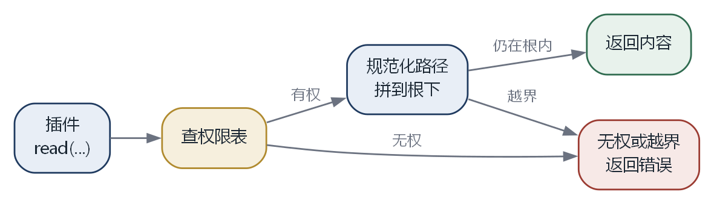

# 第 6 章 插件跑在哪里

## 6.1 同进程方案到了极限

最初的方案让插件跑在宿主进程里，靠管道加载动态库。三个插件的时候，这个方案没有问题。

十个插件之后，三个新问题出现。

**崩溃会扩散。** 一个插件的数组越界，整个应用退出。用户可能正在别的地方工作，数据一起丢。

**卡死会扩散。** 一个插件在回调里写死循环，主线程被占住，界面失去响应，用户连“禁用插件”的按钮都点不到。

**权限无法限制。** 插件在同一个进程里，可以读写宿主的任何内存，也可以调用系统接口。一个来源不明的插件可以对用户为所欲为。

这三个问题的解法都指向同一个方向：把插件放到别的地方。

有一个真实的崩溃可以作为起点。用户在用导出功能导一份两百页的文档，导到一半，插件里的一个数组越界，进程直接没了。应用没来得及弹崩溃对话框，因为崩溃发生在渲染线程，主线程也跟着没了，系统只留了一份转储文件。

用户丢的是两小时的正文，因为自动保存间隔设的是三十分钟，最后一次保存在一小时前。更糟的是临时文件还在，锁文件没清，下次启动时应用以为文档还被另一个窗口占用，拒绝打开。用户手动删了锁文件，又发现临时文件内容不完整，恢复之后少了几段。

这件事之后团队做了三件事。把自动保存间隔改短，加一套崩溃恢复，然后开始讨论要不要把第三方插件搬到独立进程。前两件一周就做完了，第三件讨论了三个月。拖这么久的不是技术难度，是代价，通信要重写，调试变复杂，几十个插件作者要跟着改。

## 6.2 四种执行单元

“别的地方”有几种选择，隔离程度和成本各不相同。

| 方式 | 隔离什么 | 崩溃影响 | 通信成本 | 适用场景 |
|---|---|---|---|---|
| 同进程同线程 | 只有命名空间 | 全部崩溃 | 函数调用 | 可信插件、热路径 |
| 同进程多线程 | 调用栈，不隔离内存 | 进程崩溃 | 共享内存 | 计算密集、可信代码 |
| 独立进程 | 内存、崩溃、权限 | 只损失该进程 | 跨进程消息 | 第三方插件 |
| WebAssembly | 线性内存、系统调用 | 只损失实例 | 内存复制 | 不可信算法 |

线程解决不了崩溃隔离。同一个进程的线程共享地址空间，一个线程写错指针，另一个线程的数据也会被改坏。线程适合把计算挪出主线程，不适合当安全边界。

WebAssembly 适合执行不可信的算法代码，比如用户上传的脚本、从网络下载的规则。它跑在受限的内存里，不能直接调系统接口。但它不适合需要完整系统能力的插件，比如读写文件、创建窗口。

独立进程是桌面应用里最常用的折中。

线程那一行值得展开。很多人的第一反应是“插件在后台线程里跑就不会拖垮界面了”，这句话只对了一半。

线程能解决的是占住 CPU，解决不了写坏内存。同一个进程里的两个线程共享地址空间，插件在自己的线程里对一个已经释放的缓冲区多写了一个字节，被写坏的可能是主线程正在用的对象。崩溃时的调用栈往往指向受害者而不是肇事者，这种问题能查一周。

线程能挡住的只有一种情况，插件自己的代码在栈上出错，比如访问空指针。进程仍然会退出。所以线程适合把计算挪出主线程，不适合把不可信代码关进去。

## 6.3 一次崩溃的传播路径

同进程方案出问题时，崩溃怎么扩散，值得逐步看一遍。

第一步，插件代码访问了非法地址，操作系统给整个进程发一个段错误信号。

第二步，宿主如果装了信号处理器，能拿到一份调用栈，然后通常做两件事，写崩溃日志，提示用户重启。它做不了第三件事，也就是只终止这个插件。操作系统没有提供“杀掉进程里的一个模块”这种能力。

第三步，如果信号处理器返回，进程继续执行那条非法指令，再次崩溃。如果不返回而是直接退出，注册的清理函数不会跑，临时文件、锁文件、未写入磁盘的缓冲全部留在原地。

第四步，用户重新打开应用，可能看到“文档正在被其他窗口使用”这种莫名其妙的提示，因为锁文件还在。

| 阶段 | 谁在动作 | 能做什么 | 做不了什么 |
|---|---|---|---|
| 非法访问 | 插件代码 | 无 | 自救 |
| 信号送达 | 系统内核 | 中断整个进程 | 只终止一个模块 |
| 信号处理 | 宿主 | 写日志、提示重启 | 保住其他插件的状态 |
| 进程退出 | 系统 | 回收内存 | 跑清理函数，如果直接退出 |
| 下次启动 | 宿主 | 检测残留文件 | 恢复未保存的内容 |

这五步里没有一步能保住其他插件的状态。把自动保存改短、加崩溃恢复，都只能减少损失，不能阻止扩散。这就是同进程方案的天花板。

## 6.4 故障域怎么划

隔离方式的选择，本质上是在划故障域。

**故障域**是指一个地方出错时，最多影响多大范围。

全在一个进程，故障域是整个应用。每个插件一个进程，故障域是单个插件。多个插件共享一个进程，故障域是这一组。

故障域不是越小越好。每个进程有内存开销和启动时间，几十个插件各起一个进程，启动要几秒，内存翻倍。

常见的做法是按信任级别分组。

官方插件和审核通过的插件留在宿主进程里，第三方按组各占一个插件宿主进程，A 组一个、B 组一个。进程数量和第三方组数量对齐，不按插件个数算。

组内插件仍然会互相影响，所以组内应该是互相熟悉、通过审核的。不能把随机插件塞进同一个进程然后指望相安无事。

分组还要考虑资源。一个插件进程加载十个插件，其中一个吃满内存，另外九个一起被系统杀掉。这种情况下每组插件数应该少一些。

分组的粒度可以算一下。一个插件宿主进程的固定开销在几十兆量级，加上插件自己的内存。

| 组大小 | 装三十个插件时的进程数 | 固定内存开销 | 单个插件出事的连带损失 |
|---|---|---|---|
| 一插件一进程 | 30 | 一到两 GB | 无 |
| 五插件一进程 | 6 | 两三百兆 | 同组四个 |
| 全在同一进程 | 1 | 几十兆 | 全部 |

一插件一进程在桌面上通常跑不动，光固定开销就超过了应用自己。五个一组是比较常见的折中，但同组插件要按用途分开，别把两个都会吃满 CPU 的放一起。也要避免把互相依赖的两个插件分到不同组，否则它们每次交互都要跨一次进程。

## 6.5 跨进程通信长什么样

把插件搬出去之后，“调用一个函数”变成“发一条消息”，中间多了一套东西。

消息本身长这样。

```cpp
struct FrameHeader {
    uint32_t length;      // 整帧长度
    uint16_t type;        // 请求 / 响应 / 事件 / 心跳
    uint16_t flags;
    uint64_t seq;         // 请求序号，用于配对响应
    uint32_t timeout_ms;
};
```

头里最重要的是 `seq` 和 `timeout_ms`。`seq` 让请求和响应能配对，因为一个连接上可以同时有多个在途请求。`timeout_ms` 是给对端的提示，真正的超时由发起方计时，因为对端可能已经卡住，指望它自己计时没意义。

一次调用要走五步。

1. 宿主把参数序列化成一帧，分配一个 `seq`，记进在途表
2. 写进管道或者本地套接字，唤醒对方的事件循环
3. 插件读帧，反序列化，调用真正的函数
4. 结果序列化，带同一个 `seq` 发回
5. 宿主收到，按 `seq` 找到等待的回调，交付结果

失败分支比同进程多得多。管道断了、对端退出、响应超时、`seq` 找不到对应的请求、序列化格式不匹配，每一条都要有明确处理。默认处理是“调用失败并且报告”，而不是重试，因为重试一个不幂等的操作可能造成重复写入。


还有一个细节，宿主必须能发现对端死了。靠读取返回零或者连接错误是基本手段，但对方如果卡在死循环里而不退出，连接还活着，请求就是没有响应。所以要有心跳和超时，超时到了就杀掉那个进程，把它的插件标记为不可用，界面里给一个“该插件已停止响应”的提示。

序列化方式的选择决定了通信成本。

| 方式 | 典型延迟 | 适合的数据量 | 代价 |
|---|---|---|---|
| 文本格式 | 几十微秒 | 几 KB | 好调试，字段自描述 |
| 二进制格式 | 十几微秒 | 几 KB 到几 MB | 要自己管版本 |
| 共享内存 | 微秒级 | 大块图像、音频 | 要自己管同步 |

前两种适合控制消息，第三种适合大数据。图像、音频这种每帧几十 MB 的数据不适合消息传递，更适合共享内存加一个“写完了”的信号。不过共享内存又把“写坏对方内存”的风险带回来了，只是范围限定在那块内存里，所以用到它时要接受这个前提。

## 6.6 跨进程的代价

独立进程不是免费的。有三项开销要算清楚。

**启动开销。** 创建一个进程要几十毫秒，加载插件代码、初始化运行时还要更多。如果插件是“用户点一下才用到”的，可以懒加载，第一次用到时再启动。

**通信开销。** 每次调用都要序列化、传输、反序列化。小数据几十微秒，大数据几毫秒。高频调用会明显拖慢。

**调试开销。** 断点要设在正确的进程，日志要在两个进程间对照，崩溃要看是哪个进程退出。

这三项加起来，决定了“哪些插件值得隔离”。

写一个判断流程。

1. 插件来源可信吗？可信，考虑同进程；不可信，必须独立进程。
2. 调用频率高吗？每帧调用，同进程；偶尔调用，可以跨进程。
3. 崩溃后果严重吗？数据丢失、界面卡死，独立进程；只是功能失效，同进程也能接受。

三个问题的答案往往指向同一个结论。答案冲突时，以“不可信”为最高优先级。

把三项开销按调用频率换算一下，就能看出哪类插件值得隔离。

| 调用频率 | 跨进程单次 | 每秒额外开销 | 能不能接受 |
|---|---|---|---|
| 每秒几次 | 几十微秒 | 不到一毫秒 | 完全可以 |
| 每秒几十次 | 几十微秒 | 一到几毫秒 | 高频路径要小心 |
| 每帧一次，六十帧 | 几十微秒 | 几毫秒 | 吃掉一个帧预算 |
| 每秒上千次 | 几十微秒 | 几十毫秒 | 不行，改成本地 |

最后一行的意思不是这种插件不能隔离，而是它的热路径不适合做成跨进程调用。可以在初始化时把需要的数据一次取回本地，之后用本地副本，变化时靠事件同步。这把“每次调用”换成了“一次拉取加增量通知”，代价从频率相关变成了数据量相关。

## 6.7 一个混合方案

真实系统很少“全同进程”或“全独立进程”，而是混合。

宿主进程负责界面、命令循环、事件总线。插件按信任级别分两类。

**内置插件**编译进宿主，或者作为同进程动态库加载。它们由官方团队维护，代码经过审核。

**第三方插件**各自一个独立进程。它们通过管道和宿主通信，宿主可以对它们做超时、权限、资源限制。

加载器的代码大致是这样。

```cpp
void load_plugin(const Manifest& m) {
    if (m.trust == Trust::Builtin) {
        load_in_process(m);
    } else {
        load_out_of_process(m);
    }
}
```

两条路径的接口相同，都是“注册命令、订阅事件、提供服务”。插件作者不需要知道自己的插件跑在哪里，宿主决定。

这个设计的价值在于：可信插件不付通信代价，不可信插件有隔离保护。两边都不吃亏。

两条路径的接口相同，有一个地方必须小心。同进程插件招出的 C++ 异常会穿过边界传到宿主，进程外插件招的异常会变成一条错误响应。插件作者如果依赖异常来传递业务错误，两条路径的行为不一样。

解决办法是把异常也当成一种返回值对待，接口里带上错误码，异常只用来表示程序错误。这样切换部署方式不需要改插件代码，也让“哪些错误值得重试”这种判断有依据。

## 6.8 隔离开销的度量

判断隔离值不值得，最好有数据。

几个可以量的指标。

**启动时间。** 从发出加载请求到插件可用的时间。同进程通常几毫秒，独立进程几十到几百毫秒。

**调用延迟。** 一次命令调用的往返时间。小数据同进程是纳秒级，独立进程是几十微秒。

**内存占用。** 每个进程的固定开销，通常在几十兆。加上插件自己的内存。

**崩溃影响面。** 不是数字，但可以统计“一次崩溃影响多少用户操作”。

把这些数字记下来，再决定哪些插件值得隔离。没有数据的判断，往往是在猜。

量的时候要注意量什么。启动时间要量到“可用”而不是“进程存在”，因为一个进程起来之后还要加载插件、建连接、同步初始数据。调用延迟要在真实数据量下量，拿一条空消息测出来的数字没有意义。

| 指标 | 同进程量级 | 独立进程量级 | 怎么测 |
|---|---|---|---|
| 加载到可用 | 几毫秒 | 几十到几百毫秒 | 启动日志两端打时间戳 |
| 一次调用往返 | 纳秒到微秒 | 几十微秒 | 循环一万次取平均 |
| 固定内存开销 | 无 | 几十兆 | 看进程峰值 |
| 崩溃影响面 | 整个应用 | 一个进程 | 崩溃报表里看影响的操作数 |

第三行经常被低估。一个空插件进程也有运行时、堆、栈、消息缓冲区，桌面上几十兆是常态。五个组就是一两百兆，这个数字要提前告诉产品，否则上线后被当成内存泄露查。

## 6.9 权限模型

隔离解决“崩溃不扩散”，但不解决“插件能做什么”。独立进程仍然可以读写用户的文件。

权限模型的思路是“默认什么都不给，需要什么单独授予”。

```cpp
struct PluginPermissions {
    bool read_workspace = false;
    bool write_workspace = false;
    std::vector<std::string> network_domains;
    bool spawn_process = false;
};
```

插件在清单里声明需要的权限，用户在安装时看到，宿主在运行时检查。

检查点放在能力对象里，而不是插件代码里。

```cpp
class FileCapability {
public:
    FileCapability(std::string root) : root_(std::move(root)) {}

    std::string read(const std::string& rel) {
        auto full = safe_join(root_, rel);
        if (!full) throw std::runtime_error("路径越界");
        return read_file(*full);
    }

private:
    std::string root_;
};
```

插件拿到的是 `FileCapability` 对象，只能访问 `root_` 下面的文件。它不知道真实的根目录是什么，也无法绕过检查。

这套模型比“检查插件有没有调用某个函数”可靠得多，因为插件根本拿不到越界的途径。

权限检查放在能力对象里，一次调用要过三步。



第二步的路径规范化经常被写错。直接拼字符串再加一个“包含两个点就拒绝”的检查是不够的，因为符号链接可以指向外面，短文件名和大小写也能绕过。稳的做法是先规范化路径，再比较前缀，比较时把大小写和分隔符统一。更好的是用系统提供的句柄式接口，打开一次目录，之后只能用相对句柄访问。

## 6.10 权限的粒度

权限太粗，插件要的太多；太细，用户看不懂。

一个折中的分法。

**按资源类型。** 文件、网络、进程、设备。用户能理解“这个插件要访问网络”。

**按范围。** 文件限定在某个目录，网络限定在某几个域名。范围要在安装时展示。

**按操作。** 读和写分开。只读的插件比读写的插件风险低。

**按时间。** 有些权限可以临时授予，比如“这次操作允许访问剪贴板”。

不要做“全有或全无”的权限。一个只读文件的插件被迫申请“完全文件访问”，用户看到的提示会变得没有意义。

权限展示上还有一个反直觉的结论。权限越多不等于越不安全，权限描述越模糊才越不安全。“允许读写工作区”是清楚的，“允许访问存储”是模糊的，后者用户只能选同意。粒度设计的目标是让每一个权限都能用一句用户能听懂的话说完。

## 6.11 一次权限检查被绕过

有一款应用的文件权限做得很仔细，有清单声明，有安装展示，有运行时检查。上线半年后有人发现一个插件能把文件写到工作区外面。

问题出在两个地方。一是能力对象里还留了一个 `absolute(path)` 的辅助函数，本意是给插件显示“这个文件在哪里”，实现是直接返回拼好的绝对路径。插件拿到绝对路径之后，调了宿主提供的另一项能力，打开一个“最近的文档”，那个接口接受绝对路径。两个接口单独看都没问题，合起来就绕过了检查。

二是路径检查用了字符串前缀比较，`/work/project` 和 `/work/project-backup` 前缀相同，检查通过。插件只要把文件写到同级的备用目录就能出去，不需要任何攻击手段，一次普通的“导出到旁边目录”就够了。

复盘的四条。

**能力对象不要暴露绝对路径。** 要显示路径就给一个显示用的字符串，和真正能用来打开文件的凭据分开。

**接受路径的接口要统一走同一套规范化。** 一个接口做检查另一个不做，等于没做。新增接口时先问一句它能不能被用来绕过旧的检查。

**前缀比较要带分隔符。** 比较时把结尾的分隔符一起算进去，就不会把同级的兄弟目录当成子目录。

**越界的尝试要记日志。** 正常情况下没有插件会去尝试，一旦出现就是信号，可能是恶意，也可能是插件作者的 bug，两种情况都值得知道。

这四条里最难执行的是第二条，因为它靠的是人记住。更可靠的办法是让所有路径都经过同一个类型，这个类型只能由规范化函数创建，其他接口只接受这个类型。把“别忘了检查”变成“不检查就编译不过”。

## 6.12 什么时候不隔离

隔离不是默认选项。下面这些情况，同进程更合适。

**插件由自己开发。** 代码经过审核，不会执行用户输入的任意代码。

**调用频率极高。** 每帧几百次调用，跨进程的开销会吃掉性能预算。

**需要共享大量内存对象。** 编辑器的语法树、游戏的场景图，复制到另一个进程既慢又容易不一致。

**插件生命周期很短。** 一次性的格式转换，启动进程的时间比干活还长。

判断标准回到第 1 章那句话：**故障影响范围不同的部分才值得隔离。** 如果插件的错误只影响它自己的功能，而且用户可以接受“这个功能暂时不可用”，同进程就够了。

下一章讨论插件之间怎么找到对方，也就是服务注册表。
