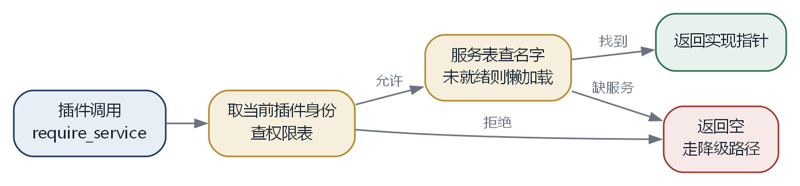
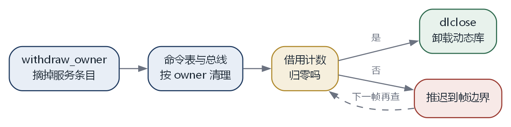

# 第 7 章 服务注册表

## 7.1 插件 A 想用插件 B

最初的插件之间只能通过事件通信。A 发一个事件，B 收到后处理。

这种方式适合“通知”，不适合“调用”。

假设 A 是一个“云同步”插件，它需要知道当前文档的路径。路径由 B（文档插件）管理。A 没有办法直接问 B，只能发一个 `document.get_path` 事件，然后等 B 回一个 `document.path` 事件。

这样做有三个问题。

一是代码绕。A 要维护一个“等待响应”的状态机，还要处理超时。

二是名字耦合。A 必须知道 B 用的事件名，这等于知道了 B 的存在。

三是多个 B 的情况无法处理。如果两个插件都能提供路径，A 收到两个响应不知道用哪个。

正确的做法是让 A 问宿主：“有没有谁提供 `document.path` 这个服务？”宿主查表，把 B 的实现交给 A。

这就是**服务注册表**。

## 7.2 一次保存，三个 bug

一个编辑器，三个插件。`docs` 管文档，`sync` 管云同步，`preview` 管预览。三个插件只通过事件说话，分工看起来很清楚。

`sync` 需要在保存时知道文件路径，于是定了一条约定。它发 `document.get_path`，谁手里有路径就回 `document.path`。

```cpp
class SyncPlugin {
public:
    void on_save() {
        waiting_ = true;
        deadline_ = now_ms() + 500;
        api->emit("document.get_path", nullptr);
    }

    void on_event(const Event& e) {
        if (e.type != "document.path" || !waiting_) return;
        path_ = e.payload;      // 谁先答就用谁
        waiting_ = false;
        upload(path_);
    }

private:
    bool waiting_ = false;
    int64_t deadline_ = 0;
    std::string path_;
};
```

上线两周，三个 bug 依次冒出来。

**同步到了错误的文件。** `preview` 为了加快预览，自己也缓存了上次打开的路径，收到 `document.get_path` 时顺手回了一个。它手里是上一个文件，比 `docs` 早到了几十毫秒。`sync` 用了先到的那个，把新内容写进了旧文件。这类问题极难查，因为两个插件单独看都没有错。

**提示路径未知。** 文档放在慢盘上，`docs` 算路径要读一个索引文件，偶尔超过 500 毫秒。`sync` 已经放弃等待，回包才到，被 `waiting_` 挡掉了。

**保存变慢。** 用户觉得预览没用，把 `docs` 禁用了。`sync` 还在等一个永远不会来的回包，每次保存白等半秒。

三个 bug 的根是同一个，把“调用”当成了“广播”。广播适合说“这件事发生了”，不适合问“这个值是多少”。问句需要一个确定的回答者，而事件机制里没有“确定的回答者”这个概念，它只保证“订阅过的人都会收到”。

确定了回答者之后，还要能说清“为什么是它”。这就是注册表要解决的第二件事。

## 7.3 服务和扩展点的区别

服务注册表和扩展点都是“按名字找东西”，容易混。

**扩展点**是宿主留的位置，插件往里填，宿主取出来用。方向是“宿主调用插件”。

**服务**是插件提供的能力，别的插件来调用。方向是“插件调用插件”。

两者的数据结构也相反。扩展点通常是一对多，一个位置下挂很多实现；服务通常是一对一，一个名字一个实现。

命令表是扩展点，因为用户输入命令时是宿主在执行。日志服务是服务，因为别的插件主动调用它写日志。

## 7.4 一次 require 走的路

宿主侧的 `require_service` 不只是一次表查找。中间要过四道关。

1. 插件在 `plugin_init` 里调 `api->require_service("example.storage")`
2. 宿主 SDK 拿到调用，取出“当前正在初始化的是谁”
3. 权限表判断这个插件能不能碰这个名字
4. 服务表查名字，条目是懒加载的先把提供方拉起来

任何一关不过，都返回空指针，不抛异常。插件初始化期间抛异常会让整个加载流程中断，一个可选依赖缺失不该有这个后果。



第 2 步最容易做错。调用者的身份必须是宿主自己认定的，不能让插件当作参数传进来。

```cpp
// 错误，插件可以传别人的名字
void* require_service(const char* name, const char* caller);

// 正确，身份由宿主从当前上下文取
void* require_service(const char* name);
```

第一种签名看起来更“解耦”，实际把权限检查变成了摆设。攻击成本只是改一个字符串。

宿主侧的实现大致是这样。

```cpp
void* Host::require_service(const char* name) {
    if (!name) return nullptr;
    const std::string caller = current_plugin_;   // 宿主记录的当前插件
    if (caller.empty()) return nullptr;           // 不在插件上下文里，拒绝

    if (!acl_.allow(caller, name)) {
        log_warn(caller + " 无权使用 " + name);
        return nullptr;
    }

    auto it = services_.find(name);
    if (it == services_.end()) return nullptr;    // 没人提供

    if (it->second.state == Entry::Lazy) {
        if (!load_plugin(it->second.owner)) return nullptr;
        it = services_.find(name);                // 表可能变了，重新查
        if (it == services_.end()) return nullptr;
    }
    return it->second.impl;
}
```

重新查表那一行不是冗余。懒加载期间会执行提供方的 `plugin_init`，它可能注册别的东西、也可能因为失败把整张表回滚。拿着旧迭代器继续用，读到的是已经失效的条目。

返回值是空指针时，调用方有四种合理的反应，别混用。

| 情形 | 调用方的处理 |
|---|---|
| 必需依赖缺失 | 让 `plugin_init` 返回失败，宿主跳过这个插件 |
| 可选依赖缺失 | 走降级路径，功能少一块但继续跑 |
| 权限被拒 | 记一条错误日志，不要静默降级 |
| 提供方崩溃 | 按跨进程失败处理，超时加提示 |

第三行值得单独说。权限被拒和“没人提供”返回值一样，含义完全不同。前者是配置问题，需要人去看；后者是正常的可降级情况。两者都写成 `if (!svc) return;`，线上排查时会白找很久。

## 7.5 服务注册表的结构

最简的实现是一张表，按名字索引。

```cpp
class ServiceRegistry {
public:
    bool provide(const std::string& name, const std::string& owner, void* impl) {
        if (services_.count(name) > 0) return false;
        services_[name] = { owner, impl };
        return true;
    }

    void* require(const std::string& name) const {
        auto it = services_.find(name);
        if (it == services_.end()) return nullptr;
        return it->second.impl;
    }

    void remove_owner(const std::string& owner) {
        for (auto it = services_.begin(); it != services_.end(); ) {
            if (it->second.owner == owner) it = services_.erase(it);
            else ++it;
        }
    }

private:
    struct Entry { std::string owner; void* impl; };
    std::map<std::string, Entry> services_;
};
```

`provide` 登记一个服务，同时记下提供者。`require` 按名字取。`remove_owner` 在插件卸载时清掉它提供的服务。

用 `void*` 是因为服务类型各不相同。取出来时由调用方转成正确类型。

```cpp
auto* logger = static_cast<LoggerService*>(registry.require("core.logger"));
if (logger) logger->info("hello");
```

`void*` 不安全，转错类型会崩溃。但在宿主内部使用，注册和取出都在同一套代码里，风险可控。

## 7.6 注册表用什么装

服务表有三个特点，写少读多、条目少、读发生在任意线程。这三点决定容器怎么选。

`std::map` 查找要做对数次比较，条目几十个时差别在纳秒级，可以忽略。它真正的好处是指针稳定，插入不会让已有条目搬家。

`std::unordered_map` 查找略快，但 rehash 会让所有迭代器和指针失效。哪个插件顺手存了 `&it->second`，下一次注册就可能把它变成野指针。

第三种做法更省事，注册阶段一次性建表，之后整表冻结。运行期只读，读侧不用加锁。

```cpp
class ServiceTable {
public:
    void publish(std::map<std::string, Entry> next) {
        auto snap = std::make_shared<const std::map<std::string, Entry>>(std::move(next));
        table_.store(snap);
    }

    std::shared_ptr<const std::map<std::string, Entry>> snapshot() const {
        return table_.load();
    }

private:
    std::atomic<std::shared_ptr<const std::map<std::string, Entry>>> table_;
};
```

读的一方必须把快照留在手里。

```cpp
void ping(const ServiceTable& t) {
    auto snap = t.snapshot();          // 旧表在这期间不会被销毁
    auto it = snap->find("core.logger");
    if (it != snap->end()) it->second.impl->info("ping");
}
```

只返回 `&it->second` 而不留住 `snap`，另一个线程发布新表之后，旧表的引用计数归零被销毁，指针指向已释放的内存。这种 bug 在压测里跑一万次都不出现，上线后在高并发下偶发崩溃。

写入侧也有约束。发布新快照必须是“改一份副本再换指针”，不能在原表上直接改。后者会让正在读的线程看到半新半旧的表，其中一半条目指向已经销毁的实现。

容器本身的选择其实不关键，量级差别可以忽略。真正的风险在“读的时候表会不会消失”，用快照和不可变表把这一点锁死，剩下随意。

## 7.7 服务的生命周期

服务有生命周期，需要定义清楚。

**注册时机。** 插件在 `plugin_init` 里注册服务。此时它自己的依赖可能还没就绪，所以服务实现要能忍受“暂时不可用”。

**使用时机。** 别的插件可能在初始化时就 `require`。这时候提供方可能还没加载。

这两个时机冲突，有两种解法。

**延迟解析。** 插件先拿到一个“服务代理”，真正调用时才去查表。提供方晚上线也没关系。

**两阶段初始化。** 第一阶段所有插件注册服务，第二阶段所有插件开始使用。宿主控制两阶段的边界。

第一种更灵活，第二种更简单。规模小的时候用第二种，规模大了用第一种。

延迟代理的写法。

```cpp
template <typename T>
class ServiceProxy {
public:
    ServiceProxy(ServiceRegistry* reg, std::string name)
        : reg_(reg), name_(std::move(name)) {}

    T* get() const {
        return static_cast<T*>(reg_->require(name_));
    }

    T* operator->() const { return get(); }
    explicit operator bool() const { return get() != nullptr; }

private:
    ServiceRegistry* reg_;
    std::string name_;
};
```

插件拿到 `ServiceProxy<Logger>`，每次调用时查一次表。提供方被替换或卸载，代理自动失效。

## 7.8 提供方在调用途中消失

插件可以卸载，也可以热更新。提供方消失时，还在用它的人怎么办。

三种写法，安全性一次比一次复杂。

**每次查表。** 调用方只存服务名，每次调用前查一次。提供方没了就查到空，走降级路径。代价是每次调用多一次查找，纳秒级，绝大多数场景感觉不到。

**缓存裸指针。** 初始化时查一次，把 `T*` 存成成员变量。省了查找，但提供方卸载后指针悬空。下一次调用读虚表，读到已经还给系统的内存。

**持有强引用。** 条目里存 `shared_ptr`，调用方拿到一份拷贝，对象在调用期间不会被销毁。这解决了一半问题，对象活着不代表它的代码还在。

第三种情况值得多说一句。插件卸载时如果调用了卸载动态库的操作，这个库里所有类的虚函数指针都不再有效。对象还占着内存，调用跳过去落到空洞里。所以卸载要分三步走完才算干净。



```cpp
void Host::unload_plugin(const std::string& id) {
    services_.withdraw_owner(id);     // 1. 摘条目，新的 require 拿不到
    bus_.remove_owner(id);
    registry_.remove_owner(id);
    deferred_.push_back(id);          // 2. 交给帧边界处理
}

void Host::flush_deferred() {
    for (auto it = deferred_.begin(); it != deferred_.end(); ) {
        if (borrow_count(*it) > 0) { ++it; continue; }   // 3. 还有人用，下一帧再试
        dlclose(handle_of(*it));
        it = deferred_.erase(it);
    }
}
```

一次真实的崩溃是这样。`sync` 在 `plugin_init` 里把 `core.logger` 的指针存成成员，用户在插件管理页点了“刷新”，日志插件被卸载又重新加载。`sync` 下一次写日志，跳进悬空的虚表，堆栈停在 `Logger::info` 的第一行。看起来像日志插件的问题，实际是调用方缓存了不该缓存的东西。

修复不难，把缓存的指针换成代理。

```cpp
class LoggerRef {
public:
    explicit LoggerRef(ServiceRegistry* reg) : reg_(reg) {}

    void info(const std::string& msg) {
        if (auto* l = static_cast<Logger*>(reg_->require("core.logger"))) l->info(msg);
        else fprintf(stderr, "%s\n", msg.c_str());    // 降级到标准错误
    }

private:
    ServiceRegistry* reg_;
};
```

代理的代价是每次调用一次查找。日志这种每秒几十次的位置完全无所谓，每帧几万次的位置就不该这么写，那里应该由宿主直接持有实现，干脆不给插件卸载的机会。

这条线的两端要自己判断。判断的依据是调用频率，不是“代理看起来更干净”。

## 7.9 命名与冲突

服务名要有命名空间。

```text
core.logger        宿主提供
core.storage       宿主提供
example.sync       插件提供
example.sync.auth  插件内部的子服务
```

`core.*` 保留给宿主。插件只能注册自己命名空间下的服务。

宿主在 `provide` 时检查前缀，不匹配就拒绝。

```cpp
bool provide(const std::string& name, const std::string& owner, void* impl) {
    if (name.rfind("core.", 0) == 0 && owner != "core") {
        return false;   // 插件不能注册 core 命名空间
    }
    // ...
}
```

这条检查挡住两类问题：插件冒充宿主提供核心服务，插件之间因为重名而互相覆盖。

## 7.10 可选依赖

插件对服务有两种依赖。

**必需依赖。** 没有这个服务，插件无法工作。清单里声明，宿主加载时检查，缺失就拒绝加载。

**可选依赖。** 有这个服务更好，没有也能降级。插件在运行时检查。

```json
{
  "requires": {
    "services": ["core.storage"],
    "optional": ["core.render"]
  }
}
```

可选依赖的检查写在代码里。

```cpp
if (auto render = ctx.services.optional<RenderService>("core.render")) {
    render->draw_icon("icon.png");
} else {
    log_info("渲染服务不可用，跳过图标");
}
```

`optional` 返回空指针而不是抛异常，让降级路径写起来自然。

## 7.11 服务的版本

服务也会变。`core.storage` 从 1 版到 2 版，接口可能改。

处理方式有两种。

**服务名带版本。** `core.storage.v1`、`core.storage.v2`。两个版本可以并存，旧插件用 v1，新插件用 v2。

**服务内带版本。** 服务接口里有一个 `version()` 函数，调用方检查。

第一种清楚，但服务名会变长。第二种省事，但所有调用方都要写检查。

规模小的系统用第二种，规模大的用第一种。

版本并存时要注意：两个版本可能操作同一份数据。v1 的写入和 v2 的读取要不冲突，否则并存的代价比迁移还大。

## 7.12 服务与进程边界

插件在独立进程时，服务不能直接传对象。

同进程的服务是一根指针，跨进程的服务是一组消息。

```text
A 进程                   宿主                     B 进程
  |                       |                       |
  | require("storage") -> |                       |
  | <- proxy(id=7)        |                       |
  |                       |                       |
  | read(id=7, "a.txt") ->| -> read("a.txt") ---> |
  |                       | <---- 内容 ---------- |
  | <---- 内容 ---------- |                       |
```

A 拿到的“服务”其实是一个代理，每次调用都发一条消息给宿主，宿主转发给 B，B 返回结果。

对 A 来说，调用形式和同进程一样。差别在于：每次调用可能失败（超时、B 崩溃），需要处理。

跨进程服务的接口应该显式标出这一点。

```cpp
class RemoteStorage {
public:
    std::optional<std::string> read(const std::string& key, int timeout_ms = 3000);
};
```

返回 `std::optional` 而不是直接返回字符串，让调用方必须考虑失败。

## 7.13 六条自查

服务注册表出问题，症状往往不像“注册表”三个字，表现出来是别的样子。

| 现象 | 真实原因 | 处理 |
|---|---|---|
| 插件初始化时服务总是空，单独跑就正常 | 依赖顺序没保证 | 两阶段初始化，或者改用代理 |
| 同一个服务名有两个实现，行为时好时坏 | 缺冲突策略，后来者被静默拒绝 | 注册返回失败时让插件显式处理 |
| 卸载某个插件后偶发崩溃 | 调用方缓存了裸指针 | 换代理，卸载延迟到帧边界 |
| 服务名里有业务语义，比如 `doc.current.path` | 契约太宽，等于把内部模型暴露出去了 | 收窄成能力，路径由文档插件自己的接口给出 |
| 插件之间互相 require，谁先启动都失败 | 依赖成环 | 抽一个更底层的基础服务 |
| 服务调用偶发慢几百毫秒 | 走到了跨进程转发 | 热路径改同进程，或者批量提交 |

第三行最贵。它不一定当场崩，可能几小时后在用户现场崩，堆栈还指向提供方。

自查表只覆盖已知的坑。新系统上线前，还有一件事值得做，把所有服务名和依赖关系画成一张图。有环、有孤岛、有一个名字被五个插件争抢，图上看得比代码里清楚。

## 7.14 服务注册表的边界

不是所有东西都该做成服务。

**内部对象不要暴露。** 宿主的文档对象、渲染上下文，包装成服务之后就成了契约，要长期维护。

**服务之间不要形成环。** A 依赖 B，B 依赖 A，启动顺序无解。服务依赖应该是单向的，必要时抽出一个更底层的基础服务。

**热路径不要跨进程。** 每帧调用的服务，同进程；偶尔调用的，可以跨进程。

**不要用服务代替配置。** 一个插件想让用户改设置，用配置接口，不要注册一个“设置服务”让别的插件来读。

下一章以渲染服务为例，看一个真实的服务怎么设计。
