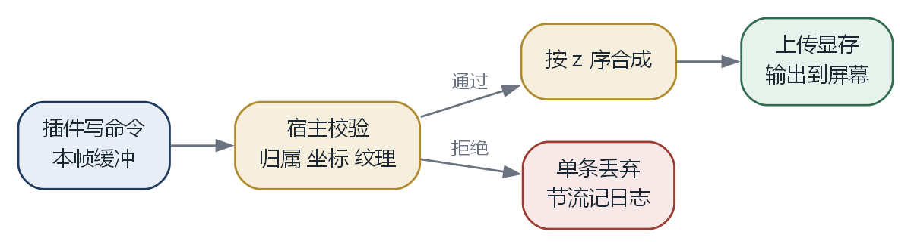
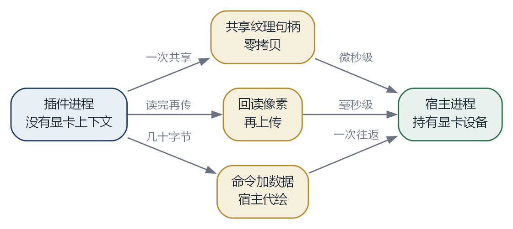

# 第 8 章 渲染服务的取舍

## 8.1 为什么渲染值得单独讲

外壳提供给插件的能力很多。文件读写、网络、配置、日志、剪贴板，这些都能用简单函数封装。

渲染不一样。它同时涉及速度、显存回收、跨进程传输和版本兼容，几乎把前面所有章节的问题都撞了一遍。

先把几个词说清楚。

屏幕上的画面不是画一次就永久不动。显示器每秒刷新几十次，每次都要拿到新画面。这个速度叫**帧率**，每一张画面叫一帧。算出这一帧的循环，叫**渲染循环**。

真正画画面的是**显卡**，也叫 GPU。它擅长同时处理成千上万个简单计算，比如给一百万个像素各算一个颜色。显卡有自己的内存，叫**显存**。放在显存里的图片叫**纹理**。

插件想在界面上画东西，最直接的想法是给它一个画布对象。这在同一个进程里可行，跨进程立刻失效，因为画布对象不能打包寄走。

## 8.2 一次图标绘制要经过什么

插件想在状态栏右侧画一个云朵图标，表示同步完成。从插件到屏幕，中间要过五道手。

1. 插件启动时把 PNG 读进内存，调 `create_texture` 交给宿主，得到一个整数编号
2. 每帧回调里，插件往命令缓冲写一条 `Image` 命令，压进自己的图层
3. 帧结束时宿主把命令收上来，逐条校验
4. 合成器按 z 序把各图层合到一块画布
5. 画布上传给显卡，显卡输出到屏幕

插件侧只需要写两段代码。

```cpp
static int g_icon = 0;

void plugin_init(Api* api) {
    int w = 0, h = 0;
    const void* px = load_png("icon.png", &w, &h);
    if (!px) return;                                   // 图标缺失就降级，不要崩
    g_icon = api->render->create_texture(w, h, px);
}

void on_frame(Api* api) {
    if (g_icon <= 0) return;                           // 没纹理就不画
    Command c{};
    c.kind = Command::Image;
    c.texture = g_icon;
    c.x = 8; c.y = 24; c.w = 16; c.h = 16;
    api->render->submit(&c, 1);
}
```

`submit` 不返回成败。它只是把命令放进队列，真正的校验在帧结束才发生。这是命令模式绕不开的代价，错误晚于调用。补偿办法是提供一个 `last_error()` 之类的查询，或者一个错误回调，插件在下一帧开头看一眼。

```cpp
void on_frame(Api* api) {
    if (const char* err = api->render->last_error()) {
        api->log_warn(std::string("渲染命令被拒：") + err);
    }
    // ...
}
```

失败分支比想象的多。纹理创建可能因显存不够或图太大失败，编号可能不属于自己，图层可能被用户隐藏，插件某一帧可能压根没提交。每一条都要有明确的行为，不能只靠“应该不会”。



分工的关键在第 3 步。校验放在宿主，插件就无法绕过；命令是纯数据，就无法携带指针或回调偷渡。这两条决定了渲染能安全地开放给第三方。

## 8.3 三种给插件画笔的方式

**传对象。** 直接给插件真实的绘制对象，插件调用它的方法。

这种方式最灵活，速度最好，因为没有任何打包。代价是插件和宿主的内部实现绑死，宿主换绘制方式时插件全部失效。插件还能调用对象上的任何方法，包括不该公开的。

**传句柄。** 宿主创建资源，给插件一个编号。插件用编号申请操作，宿主找到真实对象执行。

插件不知道资源内部结构，也不能绕过宿主。跨进程时编号只是一个数字，传输成本极低。

**传命令。** 插件不直接调用绘制函数，而是构造一组描述操作的命令，交给宿主批量执行。

命令是纯数据，可以打包、合并、延迟到一帧结束时提交。这种方式最适合跨进程和高频绘制。

举一个具体的例子。插件想画三个矩形和一个图标。

传对象的方式是插件直接调用四次绘制函数。传命令的方式是插件写一个数组，四条记录，每条写明“画矩形，位置多少，颜色什么”，一次性交给宿主。宿主收到后可以合并、排序、剔除看不见的部分，再交给显卡。

实际系统往往三者混用。创建资源用句柄，提交绘制用命令，查询状态用返回值。

## 8.4 句柄与引用计数

句柄的核心是一张表。

```cpp
class TextureTable {
public:
    int create(int width, int height) {
        int id = next_id_++;
        items_[id] = { new Texture(width, height), 1 };
        return id;
    }

    Texture* acquire(int id) {
        auto it = items_.find(id);
        if (it == items_.end()) return nullptr;
        it->second.refs++;
        return it->second.tex;
    }

    void release(int id) {
        auto it = items_.find(id);
        if (it == items_.end()) return;
        if (--it->second.refs == 0) {
            delete it->second.tex;
            items_.erase(it);
        }
    }

private:
    struct Entry { Texture* tex; int refs; };
    std::map<int, Entry> items_;
    int next_id_ = 1;
};
```

引用计数解决的问题是：同一个纹理可能被多个插件使用，也可能被宿主的多个图层使用。谁都不能单方面销毁，必须等所有使用者都释放。

引用计数要求每个 `acquire` 都有对应的 `release`，漏一次就泄漏。为了减少漏的可能，宿主可以在插件卸载时统一清理：插件创建资源时登记到自己的上下文，卸载时遍历登记表强制释放。

## 8.5 一次漏释放是怎么拖垮帧率的

句柄的语义是“资源在宿主那里，你手里只有一个号”。只要有一个号没人还，资源就一直占着。

一个真实的例子。预览插件每次打开文档都生成一张缩略图纹理。写入路径是这样的，创建之后先做两个检查，检查不过就提前返回。

```cpp
void PreviewPlugin::update_thumb(const Doc& doc) {
    int id = api->render->create_texture(128, 128, sample_rgba);
    if (doc.pages.empty()) return;              // 提前返回，纹理漏了
    if (!api->config->get_bool("preview.enabled")) return;   // 又漏一次
    draw_thumb(id, doc);
    api->render->release_texture(id);           // 只有一条路径会走到这里
}
```

当时看起来完全合理。创建、检查、画、释放，四个步骤排得很顺，两个提前返回也合理。测试的时候也看不出问题，因为每次重新启动应用，纹理表就清空了。

用户开到第五十个文档时开始卡。表现是帧率从流畅慢慢变到发澁，最后显卡驱动重置，画面黑一下又恢复。显存涨到两个 G 左右，任务管理器里看不出来，因为占的是显卡内存，不是主内存。

定位靠一行日志，每帧打印纹理表的条目数和估算字节数。开二十个文档，条目数单调上升，一次都没降过。

修法不是把那两行提前返回补上，而是让“创建”这个动作自己负责收尾。

```cpp
class TextureRef {
public:
    TextureRef(RenderApi* r, int id) : r_(r), id_(id) {}
    ~TextureRef() { if (id_ > 0) r_->release_texture(id_); }

    TextureRef(const TextureRef&) = delete;              // 句柄不共享
    TextureRef& operator=(const TextureRef&) = delete;
    TextureRef(TextureRef&& o) noexcept : r_(o.r_), id_(o.id_) { o.id_ = 0; }

    int id() const { return id_; }

private:
    RenderApi* r_;
    int id_;
};
```

`id_` 置成 0 的移动构造不是辞噪。不回滚的话，两个对象析构会释放两次，引用计数被减成负数。

第二道保障在宿主侧。每个资源登记时记下 owner，插件卸载时遍历强制回收，不管插件有没有主动释放。再配一条阈值告警，单个插件名下资源数超过上限时记一条日志。两道加起来，泄漏会变成一条日志，而不是一次黑屏。

这里有个前提很容易被忽略。句柄能支持“按 owner 回收”，前提是所有资源都登记了 owner。如果某个接口为了图方便只返回裸的显卡对象，不经过资源表，那道保障就是一个洞。开放新接口时，这一条比性能重要。

## 8.6 命令缓冲

插件每帧可能要画几百个矩形、文字、图片。每个操作都走一次跨进程消息，光消息开销就受不了。

把这些操作收集成数组，一次传过去，成本会低很多。

```cpp
struct DrawCommand {
    enum Kind { Rect, Text, Image } kind;
    int layer;
    float x, y, w, h;
    uint32_t color;
    int texture_id;
    const char* text;
};
```

命令是纯数据，可以打包。宿主要对命令做校验：坐标是否越界、纹理是否存在、图层是否属于这个插件。不能假设插件传来的数据一定合法。

命令的另一个好处是可以批处理。同一个图层的连续矩形可以合并成一次绘制调用，明显减少显卡的负担。

## 8.7 宿主怎么校验一条命令

命令是插件交上来的数据，合法性不能假定。

要校验的项至少五类。

**坐标。** NaN 和无穷大最危险，GPU 遇到它们可能整批丢弃，也可能输出全屏杂物，不同显卡行为不一样。宽高为零或超过上限也要拦。

**归属。** 图层和纹理必须属于提交者，或者被显式声明为共享。不查这一条，一个插件就能盖掉别人的界面，或者拿到别人的截图。

**文本。** 指针可能无效，长度可能离谱。要求以 0 结尾，并且限一个上限。

**数量。** 一次提交一百万条命令，宿主的内存先爆。

**枚举值。** `kind` 只允许三个值，其他一律拒绝。类型字段不做校验，后面就是任意内存读。

```cpp
bool Composite::validate(const Command& c, const std::string& owner) {
    if (!std::isfinite(c.x) || !std::isfinite(c.y)) return false;
    if (!std::isfinite(c.w) || !std::isfinite(c.h)) return false;
    if (c.w <= 0 || c.h <= 0 || c.w > 16384) return false;
    if (!layers_.owned_by(c.layer, owner)) return false;

    if (c.kind == Command::Image) {
        if (!textures_.usable_by(c.texture, owner)) return false;
    } else if (c.kind == Command::Text) {
        if (!c.text || strlen(c.text) > 4096) return false;
    } else if (c.kind != Command::Rect) {
        return false;
    }
    return true;
}
```

校验失败之后的处理方式比校验本身更重要。

早期版本的做法是整批丢弃。插件写错一个坐标，整个图层黑掉，用户以为插件坏了，卸了重装也无效。改成单条丢弃之后，坏命令只是少画一个图形，其余正常。

配合单条丢弃的是一条节流日志。同一条坏命令每帧都报，日志一秒能写几万行。做法是每个 owner 每分钟最多报三条，连续超限时直接禁用这个插件的渲染，并告知用户。

## 8.8 图层的概念

插件不该直接往主画布上画。

如果都往同一块画布画，A 可能覆盖 B，B 也可能覆盖 A。谁先谁后取决于调用顺序，而调用顺序不确定。

宿主给每个插件分配一个图层。图层有自己的层级和透明设置，插件只在自己的图层里画。

```cpp
class LayerManager {
public:
    int create_layer(const std::string& owner, int z_index, bool transparent) {
        int id = next_id_++;
        layers_[id] = { owner, z_index, transparent, {} };
        return id;
    }

    void composite(Canvas& canvas) {
        std::vector<Layer*> ordered;
        for (auto& pair : layers_) ordered.push_back(&pair.second);
        std::sort(ordered.begin(), ordered.end(),
                  [](Layer* a, Layer* b) { return a->z_index < b->z_index; });
        for (auto* layer : ordered) {
            layer->draw(canvas);
        }
    }

private:
    struct Layer { std::string owner; int z_index; bool transparent; std::vector<DrawCommand> cmds; };
    std::map<int, Layer> layers_;
};
```

插件在自己的图层里随便画，不会影响别人。宿主按 `z_index` 顺序合成，顺序可预测。

## 8.9 一帧的时间预算

渲染服务所有设计最终都要落在一件事上，一帧只有十几毫秒。

按六十帧算，每帧 16.7 毫秒。这十几毫秒要分给输入处理、插件逻辑、命令收集、合成、上传五段。开的插件多了，每段都在争。

合成是大头，具体花多少看图层数和画布面积。一张全高清画布、十个左右的图层，毫秒级。图层数翻一倍，合成时间大致也翻倍，因为每个图层都要过一遍像素。

上传是第二个大头。把一张全高清画布从内存传到显存，一次要搬两兆多字节，几十微秒到几毫秒不等，看总线。

分给插件的那一段最不可控。宿主给的是“帧回调”，插件在里面做什么管不到。常见的失控有两种。

一种是插件在帧回调里做阻塞操作。读文件、发网络请求、等锁，任何一项都可能卡几十毫秒，整帧就掉了。掉帧的表现是鼠标拖动一顿一顿，用户会归因于“这个插件装了之后很卡”。

另一种是插件画太多。一个高亮插件给每个字符画一个矩形，一篇长文档几千个字符，命令上万条。每条不贵，加起来就超越预算。

对待两种失控的手段不一样。阻塞要做监控，统计每个插件帧回调的耗时，超过阈值记一条日志，让插件作者自己看得见。命令太多要做合并，同一图层的连续矩形合成一个大矩形，减少的不只是绘制调用，也减少校验和排序的时间。

还有一条底线。宿主自己的合成分不能无限让位于插件。总预算过半时，插件图层可以降低刷新频率，但不能让整个界面停止响应。降帧比卡死好，用户在界面上还能操作，不会认为应用挂了。

## 8.10 跨进程渲染

显卡设备通常绑定在创建它的进程和线程上。把纹理从插件进程传到宿主进程，不能直接共享显存。

三种方案。

**共享纹理句柄。** 操作系统和图形接口提供跨进程共享资源的机制。速度最好，但平台相关，实现复杂，还要处理同步。

**回读像素再上传。** 插件在自己的显卡环境里画，把结果读回内存，通过消息传给宿主，宿主再上传成纹理。通用，但带宽消耗大，只适合低频更新。

**绘制发生在宿主进程。** 插件只提交命令和数据，所有显卡操作由宿主执行。最简单，也最可控。

大多数插件系统选择第三种。它牺牲了一部分灵活性，换来统一的资源回收、统一的性能分析和统一的安全边界。

只有确实需要自定义绘制的插件，才值得开放第一种，而且应该作为高权限能力单独审核。

## 8.11 三种跨进程方案的对照

三种方案的差别不只是快慢，还有出问题时能不能查。



| 维度 | 共享纹理句柄 | 回读像素上传 | 宿主代绘 |
|---|---|---|---|
| 每帧带宽 | 几乎为零 | 宽×高×4×帧率 | 命令量级，几 K |
| 延迟 | 微秒级 | 毫秒级 | 一次往返，几十微秒 |
| 平台依赖 | 强，各系统接口不同 | 无 | 无 |
| 资源回收 | 难点，两个进程共享一个对象 | 容易 | 容易 |
| 安全边界 | 弱，插件能直接操作共享资源 | 强 | 强 |
| 适合的场景 | 视频帧、三维预览 | 低频缩略图 | 绝大多数界面元素 |

带宽那一行值得自己算一遍。全高清一帧 1920×1080×4，大约是八兆字节。每秒三十帧就是两百多兆字节的拷贝，而且这还只是单个插件的开销。在小图上无所谓，在大画布上很快就能压满总线。

平台依赖那一行决定维护成本。共享纹理在三个系统上三套写法，每一套都有自己的同步规则。出错时表现为偶发花屏或黑帧，很难复现。

所以默认选宿主代绘，只给确实需要自绘的插件开共享纹理，并且单独审核。这个优先级不是保守，是成本排序。界面元素的数量级用不上共享纹理带来的那点带宽优势，而它带来的排查成本会在之后几年里持续收租。

## 8.12 资源的生命周期

渲染资源比其他资源容易泄漏，因为它们占的是显存，任务管理器里不一定看得出来。表现是帧率慢慢下降，最后显卡崩溃。

完整的资源生命周期有四个阶段。

**创建。** 记录谁创建、参数是什么、属于哪个插件。

**使用。** 每次通过句柄查找，宿主在这里做权限检查。

**释放。** 插件主动释放，或宿主在卸载时强制释放。释放后句柄失效，再使用会报错。

**回收。** 真正的销毁可能延后到当前帧结束，因为显卡可能还在用它。宿主维护一个延迟销毁队列。

还有一类资源插件无法主动释放，比如宿主分配的默认图层、默认字体、共享着色器。这些由宿主统一管理，插件只是借用。借用和拥有的区别要写进文档，否则插件会误以为自己可以销毁。

## 8.13 能力协商

渲染接口的演进比其他接口频繁。新特性、新像素格式、新混合模式，都会带来变化。

每次升主版本会打断生态，比较可行的做法是把接口拆成稳定的核心和可选的扩展。

核心只包含最基础的矩形、文字、图片绘制，以及纹理和图层管理。

扩展按特性命名，比如 `render.blend.advanced`、`render.texture.array`、`render.shader.custom`。插件在清单里声明需要哪些扩展，宿主加载时检查。

```cpp
if (render.supports("render.texture.array")) {
    // 用纹理数组，减少绘制批次
} else {
    // 退回多张独立纹理
}
```

这种写法比版本号更细。宿主可以在不升主版本的情况下增加特性，旧插件不受影响。

## 8.14 探测漏掉之后

特性探测写成布尔值很自然，也很容易错。

一个插件想画批量矩形，用纹理数组把多次绘制合成一次。它查到宿主支持 `render.texture.array`，就用上了。结果在旧宿主的机器上闪退，因为宿主那边对应函数指针是空的，插件调用了一个空地址。

更隐蔽的一种。宿主说支持纹理数组，但只支持两层，插件要四层。探测返回真，调用失败，插件拿到一个空纹理继续画，屏幕上什么都没有，也没有错误。

两种情形都说明同一个问题，布尔值回答不了“支持到什么程度”。

```cpp
struct TexArrayCaps {
    int max_layers;
    bool mipmaps;
};

if (auto caps = render.caps_tex_array()) {
    int layers = std::min(4, caps->max_layers);   // 按实际能力退让
    if (layers >= 2) draw_batched(layers);
    else draw_one_by_one();                       // 退不了就不批量
}
```

还有一层容易忘。能力不是常量。笔记本从独立显卡切到集成显卡、远程桌面接管、驱动重启，都会让某些能力消失。宿主应该在这些事件之后重新探测，并把结果推给插件。插件如果只在初始化时查一次，那之后就一直按旧答案走。

一个具体的例子。用户在外接显示器上开着应用，拔掉显示器之后系统把窗口交给集成显卡渲染，纹理数组层数从四层降到两层。插件还在按四层提交，每帧都有一半命令被拒，界面上少一角。宿主如果重新探测并广播一次 `render.caps_changed`，插件就有机会重排。

## 8.15 其他公共能力

渲染之外，外壳通常还要提供这些。

**存储。** 每个插件一个隔离目录，按插件编号分配，插件不能写别人的目录。

**日志。** 统一格式、统一落盘、按插件过滤。

**网络。** 限定了域名的客户端，请求经过宿主代理，可以统一处理超时和证书。

**设置。** 插件声明自己要哪些设置项，宿主负责渲染界面、校验类型、保存同步。

**通知。** 插件通过宿主弹提示，宿主控制位置、时长、是否静音。

这些服务的共同模式是：**插件声明意图，宿主执行动作。** 插件不持有系统资源，只持有能力对象。

## 8.16 七条检查清单

渲染服务写完之后，用这几条过一遍。

1. 每个 `create` 都有配对的释放，或者被 RAII 包装，提前返回的路径也照顾到
2. 所有资源登记了 owner，插件卸载时强制回收
3. 命令校验盖住 NaN、越界、跨插件 id、枚举越界、文本长度
4. 校验失败是丢弃单条而不是整批，日志有节流
5. 每帧能打出一行资源账，条目数和估算字节数都记
6. 能力探测返回程度而不是布尔，设备变化后重新探测
7. 插件帧回调有耗时监控，超时有记录

第三条和第五条最容易被跳过。前者在开发阶段看不出问题，因为插件自己不会传非法数据；后者在功能验收时看不出问题，因为泄漏需要累积。两条都是“上线之后才发作”的类型。

## 8.17 公共服务的边界

不是所有内部对象都该包装成服务。

服务是契约，一旦开放就要长期维护。只在宿主内部使用的对象，不该出现在服务表里。

服务之间不要形成复杂的依赖网。A 依赖 B，B 依赖 C，C 又依赖 A，启动顺序无解。服务依赖应该单向，必要时抽出一个更底层的基础服务。

速度敏感的接口不要跨进程。每帧调用几千次的接口，同进程，或者设计成批量命令。

下一篇离开结构，讨论怎样把这些设计变成可以交付的工程。
