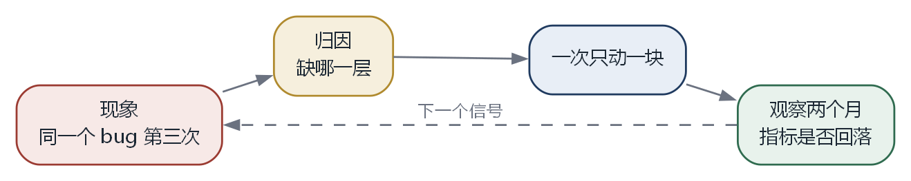
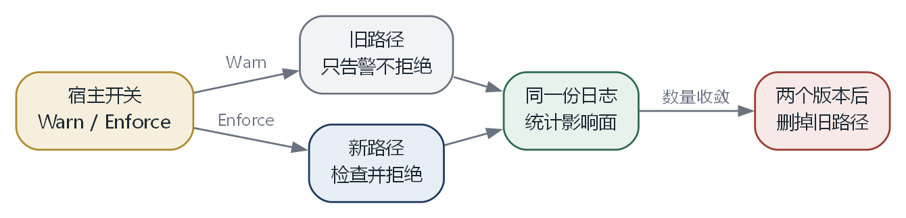

# 第 11 章 什么时候继续演进

## 11.1 演进的信号

结构该不该继续加，有几个明确的信号。

**同类问题反复出现。** 同一个 bug 修了三次，每次在不同插件里，说明缺一层结构。

**新人上手慢。** 新同事要花两周才能写出第一个插件，说明接口或文档有问题。

**故障排查困难。** 出问题时要在五个地方找日志，说明可观测性不够。

**用户抱怨加载慢。** 启动要十几秒，说明加载策略需要调整。

**插件互相干扰。** 装了 A 之后 B 不工作，说明隔离或顺序有问题。

这些信号出现一个，就值得考虑加结构。出现三个以上，说明已经在失控。

## 11.2 看哪几个数字

上一节的信号靠感觉，感觉容易迟到。把它们换成能看的数字，判断会早半年。

**插件数量与来源构成。** 总数决定规模，第三方占比决定隔离强度。全是内部团队时，一个口头约定能顶一份文档；一旦有第三方，所有约定都要变成代码里的检查。

**每千次启动的崩溃数。** 不看绝对数量，看比例。同时要能按插件归因，否则只知道“变差了”而不知道“谁”。归因数据里第三方占大头，说明隔离不够；全是自家插件，说明测试不够。

**启动时间的 P95。** 中位数会掩盖问题。多数用户机器干净、启动一秒；少数机器装了几十个插件、启动十几秒。中位数看起来正常，P95 已经不可接受。分位数调高到 95 才能看到尾巴。

**每次版本升级后失效的插件数。** 这是契约健康的直接读数。一次小版本升级挂掉五六个插件，说明废弃策略太急或者版本检查太粗。

**首次上手时间。** 从拿到文档到第一个插件跑起来。人不多的时候一个月测一次，取个中位就行。这个数字涨得比代码量快，因为它包含文档、示例、错误提示三样东西。

五个数字里，前两个回答“要不要加”，后三个回答“哪里最缺”。



指标得先能归因，再谈阈值。一个没有插件维度的崩溃率，除了让人焦虑没有别的用处。加归因不难，崩溃时记下当前插件名就够了，而当前插件名本来就应该在上下文里。

阈值不要抄别人的数字，从自己的历史里取。把过去一年的五个数字画成一条线，最平的那一段就是你的正常水平。连续两个版本超出这段范围，才算一个信号；一次尖刺可能只是一个坏版本，过了就没了。

## 11.3 看哪几类日志

指标回答“有没有变差”，日志回答“是什么”。有四类日志值得单独埋点，它们几乎是免费的早期预警。

**加载失败，并且分了类。** 缺依赖、缺服务、权限拒绝、契约版本太高、初始化返回错误，五类分开统计。缺服务类上升，说明插件之间的依赖在变复杂；版本类上升，说明发布节奏和插件作者对不上。

**未知命令与未知事件名。** 用户输入了宿主没有的命令，或者插件发了一个没人订阅的事件。前者几乎总意味着版本不匹配，用户装了旧插件或新插件配旧宿主。这条日志的价值在于它不需要任何额外设计，只要在查表失败时记一行。

**服务请求被拒。** 权限拒绝和“无人提供”要分开记。前者是配置错误，后者是降级路径。混在一起写，排查时分不清是插件写错了还是用户没装。

**跨进程超时与重启。** 一周内插件进程重启超过几十次，说明那个插件在特定环境里不稳定，隔离在顶着。隔离在顶着不是好事，它只是把故障变成了可忍受。

一个真实的例子。某个版本发布一周后，`未知命令` 的日志涨了三倍，命令名都是 `doc.export` 的旧名字。查下去发现三个插件还在用旧名，而宿主在这次发布里把旧名删了，只留了新名。修复不是把旧名加回去，而是定下一条规则，命令改名后旧名至少保留两个大版本，并在调用时记一条废弃警告。

日志能回答问题的前提是能搜。每条日志带插件名、命令名或服务名、一个请求 ID，三者齐了，一条命令就能把一次调用串起来。没有这三个字段，日志越多越难查。

还有一条，这四类预警日志不要采样。它们本来量就小，一天几百条顶天，全部留下才能看出趋势。要做采样的是高频的性能日志，不是这些。四类加起来一天写不了多少行，却能顶半个监控系统，投入产出比在整个插件体系里排得很靠前。

这四类日志还有一个共同点，都是“失败才写一行”。成功路径不写日志，量就永远可控。反过来说，如果某一类日志突然写不动了，那也说明它已经被成功路径污染了，该拆分。

## 11.4 不该演进的信号

反过来，有些信号说明应该停下来。

**结构比功能还多。** 代码里一半是框架，一半是业务，说明抽象过度。

**每个需求都要改接口。** 说明接口设计跟不上需求变化，可能是抽象方向错了。

**插件作者抱怨难写。** 文档再全也写不出插件，说明接口太复杂。

**性能持续下降。** 每加一层结构，性能掉一截，用户能感觉到。

**没人用新特性。** 引入了服务注册表，但所有插件还是用事件，说明这个结构没有解决真问题。

## 11.5 一次结构改动的复盘

一个编辑器，三年里从八个插件长到四十多个。下面四个时间点是真实顺序，每一件都推着结构往前走了一步。

**第十四周，同一类 bug 修了三次。** 三个不同插件都把命令注册成了 `export`，互相覆盖，用户看到的行为取决于加载顺序。当时修法是改名字，第三次之后才意识到，改名字能解决这一次，解决不了下一次。于是加了 `owner` 字段和重名拒绝，注册失败时插件能拿到明确的错误码。

**第八个月，一次小版本升级挂了八个插件。** 宿主改了一个结构体字段的顺序，所有依赖旧布局的插件读到错位的数据。用户看到一个能启动、但功能全错的应用，比直接崩更坏。这次之后加了 `size` 字段和版本号，加载时先比对。

**第二十六个月，第一次收到数据丢失投诉。** 一个解析插件的空指针崩了整个应用，用户三小时的编辑内容没保存。这次之后才开始做隔离，但只把解析外部文件的那几个插件拆成独立进程，其余仍然同进程。

**第三十二个月，第三方插件开始变多。** 文档不够用，作者在论坛里问同一类问题。这次加了组件模板和一份最小示例，不是加结构，是降认知成本。

四次决定的共同点是没有一次是“重新设计架构”。每次只动一块，动完观察两个月，确认指标回落再动下一块。

代价也实实在在。隔离做完，启动时间从不到一秒变成一秒多，内存多了将近两百兆，低端机器上能感觉到。同期崩溃投诉降到接近零。对一个用户内容很重要的编辑器，这笔交易划得来；对一个启动即用、用完即关的小工具，同样的交易可能划不来。

复盘里最值得记下的是第八个月那一次。它不是崩溃、不是丢数据，只是“功能全错”。这种故障最难被监控发现，也最容易被用户当成自己操作错了。结构上对应的解法反而是最便宜的一条，加一个 `size` 比对。

## 11.6 结构之外还剩什么

本书讲的是结构，也就是“系统长什么样”。

结构定下来之后，还有一半工作在等着：怎样让插件持续产出，怎样让它们安全地到达用户，怎样在出问题之后快速恢复。

这些属于工程，不在本书的范围内。列在这里，是为了让你知道边界在哪。

**组件模板与生成器。** 一条命令生成插件骨架，把结构固定下来，作者只需要填业务。

**独立开发与测试。** 插件脱离宿主开发，用假宿主和断言测试验证。

**打包与签名。** 把插件打成确定的包，用签名保证来源和完整性。

**分发与灰度。** 多渠道分发、灰度发布、回滚。

**可观测性。** 日志、指标、追踪，让问题能被定位。

**故障恢复。** 超时、熔断、降级、崩溃重启。

清晰的结构是这些工作的前提。没有稳定的契约，模板生成不出正确的东西；没有隔离，签名也保护不了宿主。

## 11.7 一个演进路径的例子

假设从一个只有三个插件的小系统出发，逐步演进到一个有生态的产品。可能的路径是这样。

**第一阶段（1 到 3 个插件）。** 命令表加简单事件。所有插件同进程，靠文档约定顺序。

**第二阶段（10 个左右）。** 加契约版本，加 `owner`，加基本权限检查。第三方插件开始出现，需要独立进程。

**第三阶段（50 个以上）。** 加服务注册表，加扩展点的三种形态，加渲染服务。需要组件模板和分发渠道。

**第四阶段（公开生态）。** 加签名、审核、撤回、灰度。需要可观测性和故障恢复体系。

每个阶段的结构，都是被上一阶段的问题逼出来的，不是提前设计的。

跳过阶段会出问题。第一阶段就设计第四阶段的结构，代码里全是为不存在场景准备的判断。第四阶段才补第二阶段的结构，会发现大量插件已经依赖了错误的接口。

## 11.8 迁移的中间态

知道下一阶段该加什么，不等于能直接加。结构改动都要经过一个中间态，中间态设计得好不好，决定了这次改动能不能回退。



拿“加契约版本检查”当例子。直接改成严格检查，当天就会有一批插件被拒，用户看到的是功能消失。四步走完比较稳。

1. 宿主开始记录每个插件声明的版本，只记不查。一周后能看到分布，哪些插件早就该更新。
2. 检查打开但只警告，不拒绝。日志里开始出现“版本高于支持”的记录，同时给插件作者发通知。
3. 警告持续两周且数量收敛后，才切到拒绝。切换时保留一个命令行开关，可以临时回到警告模式。
4. 两个大版本之后，才把兼容层删掉。

第二步到第三步之间是最关键的窗口。这段时间里，宿主同时在跑两套行为，看起来冗余，但它把“发现问题”和“拒绝用户”分开了。没有这个窗口，所有问题会在切换当天集中爆发，而你手上没有任何数据判断影响面。

开关的写法要简单到能在发版前手动改。

```cpp
enum class ContractMode { Warn, Enforce };

bool Host::check_contract(const Manifest& m) {
    if (m.api_version <= kSupportedMax) return true;
    log_warn("插件契约版本高于宿主 " + m.id + " v" + std::to_string(m.api_version));
    return mode_ == ContractMode::Warn;      // 宽松模式下放行
}
```

拆进程也适用同一套思路。先选一个最不稳定的插件拆，不要一次全拆。它在独立进程里跑一周，看崩溃率、看延迟、看内存，三个数字都能接受再拆第二个。影子模式也可以用在渲染命令上，新路径的命令照常生成但不提交，只比对校验结果，成本低而且不影响用户。

中间态的成本是代码里同时存在两套逻辑，一段时间内两边都要维护。这个成本要用时间盒控制，定一个截止日期，到期就删旧路径，否则中间态会变成永久态，两套逻辑一直养着。

回退开关要演练。写在代码里但从没拉过的开关，和没有开关一样。上线前把开关拉一次，看功能是否真的回到旧行为，记下从决定到生效的时间。超过几分钟的回退，实际现场用不出来。

回退演练还会暴露一类奇怪问题，开关只关了一半。比如服务请求回到了旧路径，但资源还是走新路径注册的，两边记账不一致。这种问题只有在真正拉开关的时候才看得到。

## 11.9 判断当前在哪个阶段

三个指标可以帮判断。

**插件数量。** 少于 5 个，第一阶段；5 到 20 个，第二阶段；20 到 100 个，第三阶段；超过 100 个，第四阶段。

**插件来源。** 全是自己团队，可以晚一点；出现第三方，需要提前。

**故障代价。** 插件崩了只损失一个功能，可以晚一点；崩了会丢用户数据，必须提前。

三个指标取最保守的那个。比如只有 3 个插件，但其中一个会处理用户的财务数据，那就要按第二阶段甚至第三阶段来做。

## 11.10 每个季度做一次体检

演进判断靠平时观察，但平时容易漏。每个季度花一个小时做一次体检，就能把上一节那些数字串成一条线。

五项检查，每项都只需要一条命令或一个页面。

| 检查 | 取什么数 | 什么结果算通过 |
|---|---|---|
| 插件构成 | 总数、第三方数、本季度新增 | 第三方开始出现时，契约和文档已经就位 |
| 崩溃归因 | 每千次启动的崩溃数，按插件分 | 没有单个插件占比过半 |
| 启动分位 | P50 和 P95 | 两者差距不超过一倍 |
| 升级影响 | 上个版本后反馈失效的插件数 | 个位数，且都有明确原因 |
| 上手 | 最近一个新人跑通第一个插件的时间 | 与上一季度相比没有变长 |

通过不通过不是重点，趋势才是。单次的数字会受到版本、季节、用户构成影响，三个季度连起来看才看得出方向。把每次的结果存成一行，五行之后你自己就能看出哪个指标在慢慢变坏。

体检还顺带回答另一个问题，这一季度到底该不该动结构。五项里超过两项在变坏，就该动手；只有一项变坏，先查原因再动；全部平稳，就把精力放回功能。

一个容易忽略的检查项是最后一项。上手时间变长往往是最早的信号，比崩溃率早半年，因为它对新接口的反应最快。没人测的时候，也至少让每个新版本的人自己试一次，把卡住的地方记下来。

体检完把结论写成一句话，放在下个季度的同一份文件里。一句话比一张表更容易被下一次的自己看懂。

## 11.11 什么时候可以往回减

演进不是单向的。有些结构加上去之后发现没用，或者问题消失了，就该减掉。

下面四种情况可以减。

**某个扩展点两年没有被任何人使用。** 它每次启动都要初始化，每次发布都要兼容，成本一直在付。先标为废弃，两个版本后删除。

**隔离之后崩溃率没有下降。** 拆了进程，崩的还是那些插件，只是不带走应用。这时候要问的是那些插件为什么崩，而不是继续加隔离。

**事件总线被当成了服务用。** 大量“发一个事件、等一个回包”的代码，说明服务注册表没被用起来，或者太难用。要么改服务接口，要么把总线上的请求应答模式做成正式能力，别让两边都不顺手。

**文档里一半的章节在讲历史。** 讲旧版本接口、讲兼容层、讲已废弃的扩展点。新作者读得越多越糊涂，这些内容该进单独的迁移指南，正文只留当前接口。

往回减比往前加难，因为减掉的东西总有人还在用。所以减的第一步不是删代码，而是找到还在用的人。在入口处加一条废弃警告日志，跑一个月，日志里没人了就可以删。有人的话，先帮他改。

判断标准还是那个问题，这一层解决的具体问题现在还存在吗。不存在了就减，不要去维护一个已经没人需要的东西来证明设计完整。

## 11.12 停下来的条件

有些项目不需要一直演进。

**插件数量稳定。** 一直是那五个，没有增长，说明生态没有扩大的需求。

**用户规模稳定。** 一直是那几百个用户，故障影响可控。

**团队规模稳定。** 只有两三个人维护，没有精力做生态。

**产品方向稳定。** 不再加新功能，只修 bug。

这几种情况下，现在的结构够用，继续加只会增加维护成本。

判断标准是：**当前结构能不能支撑未来一年的需求。** 能，就停；不能，就只补最缺的那一块。

## 11.13 一个收尾

入门时记住的那句话是“先让它能跑，再让它稳住，最后才谈扩展”。

走到结构这一层，可以补一句：**扩展不是目的，能撑住才是。**

一个有三个插件、结构简单、但从不崩溃的系统，比一个有五十个插件、结构复杂、每周出故障的系统更有价值。

结构的每一层都应该能回答一个问题：它解决的具体问题是什么，不解决会怎样。答不上来的层，大概率是不需要的。

本书到这里结束。
