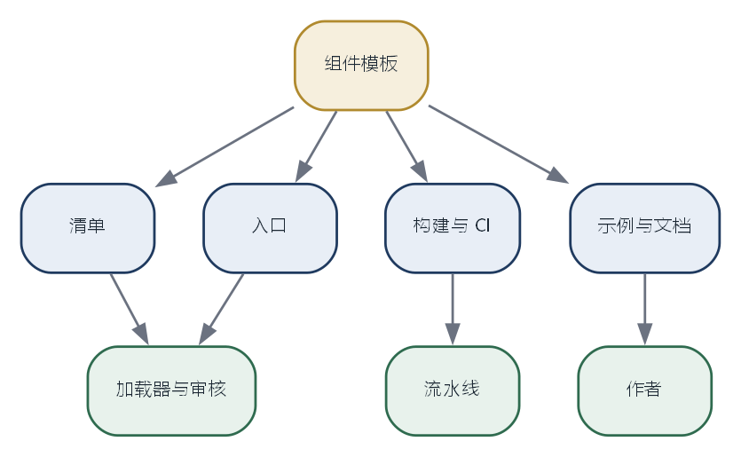

# 第 1 章 模板解决的不是省事

## 1.1 一个新插件的门槛

第一次写插件的人，要在一天里做十几个决定。

目录叫什么名字。清单放在哪。入口文件叫什么。用什么构建系统。要不要写测试。许可证选哪个。README 写几段。

这些决定单独看都不难。合在一起就是一道门槛。

门槛的后果不只是慢。更麻烦的是每个人跨过门槛的方式不同。有人把清单放在根目录，有人放在 `src` 下；有人用 CMake，有人手写编译命令；有人写测试，有人不写。插件越多，结构越乱，后面做工具的人就要为每一种写法都准备一套逻辑。

## 1.2 模板把决定变成默认值

模板的作用是把这些决定提前做掉。

作者拿到一个能编译、能加载的骨架，只需要填业务。他不需要知道清单该放哪，因为模板已经放好了；不需要纠结构建系统，因为模板已经配好了。

宿主也受益。它可以假设所有插件都有清单、都有入口、都能被同一条命令构建。审核、加载、打包、更新这些环节都能按统一规则处理。

一份 2021 年的实证研究分析了 CurseForge 上两千多个模组，发现流行的模组更倾向于有高质量的说明文档和活跃的社区参与。这句话反过来说也成立：说明文档靠自觉很难保证，靠模板才能稳定产出。

## 1.3 四十个插件之后

有个八人团队维护一套桌面软件的插件生态。两年下来，插件目录里躺着四十一个组件，其中二十多个对外发布过。节奏不算快，每季度新增六个左右，宿主每年出两个大版本。

第一年没人觉得有问题。各人按自己的习惯建目录，评审时看一眼能编译、能加载就签了。第二年开始出事故。

宿主 4.0 把清单里的入口字段从 `entry` 改名成 `main`，理由是另外两个平台的叫法都是 `main`。通知发下去，四十一个插件改了十九个，剩下二十二个没动。加载器为了不让生态一下子崩掉，两个字段都认，谁有就用谁。

兼容代码活了半年。有天一个插件两个字段都写了，`entry` 里留着一个早就删掉的文件名，`main` 是新值。加载器先读 `entry`，拿到一个不存在的路径，加载失败。这个失败又被当成“可选组件缺失”处理，界面上插件仍显示已安装，只是点下去没有任何反应。用户报了三周，才有人想到去翻清单。

四十一个组件，同一个决定最多能有几种写法，可以列出来看。

| 决定 | 一种写法 | 另一种写法 | 谁为差异付代价 |
|---|---|---|---|
| 清单放哪 | 根目录 `plugin.json` | `src/manifest.json` | 加载器、打包脚本 |
| 入口叫什么 | `plugin_init` | `create_plugin` | 加载器 |
| 用哪个构建系统 | CMake | 手写 Makefile | 做工具的人 |
| 版本号写哪 | 清单里 | 构建文件里的宏 | 发布脚本、审核工具 |
| 要不要测试 | 有 `tests/` 目录 | 没有 | 宿主维护者，回归时 |
| 许可证 | 每个仓库一份 | 只在 README 里提一句 | 法务审核 |

表里没有一项是“错”的。每一种写法在自己那个仓库里都说得通。代价不在单个仓库，在所有仓库加起来之后：工具要为每种写法准备分支，审核要看两种情况，迁移要写两套脚本。

模板做的事，就是把这些格子填成同一个值。

## 1.4 模板里应该有什么

一个可用的组件模板，至少包含七部分。

**清单。** 组件的编号、版本、宿主版本范围、入口、权限、贡献点。清单是宿主认识组件的唯一依据，必须放在固定位置，字段必须能被检查。

**入口。** 一个导出 `plugin_init` 和 `plugin_shutdown` 的源文件。宿主加载时调用前者，卸载时调用后者。入口应该尽量薄，只做注册和清理，业务逻辑放别的文件。

**构建配置。** 告诉构建工具用哪个语言版本、输出到哪、要不要压缩。产物要能被宿主直接加载，不能要求用户再跑一遍编译。

**测试。** 至少一个能跑的单元测试，加一个用假宿主跑的集成测试。测试命令要写进构建脚本，CI 能直接调用。

**示例。** 最小可用的示例，最好是“生成后立刻能看到效果”的那种。示例比文档更有说服力，也更容易被复制。

**文档。** README 包含用途、安装、配置、权限说明、已知限制。CHANGELOG 按版本记录改动。LICENSE 明确使用条件。

**持续集成配置。** 一份配置文件，让服务器在每次提交时自动编译、测试、打包。

这七部分每一个都有“最低配”和“做全了”两种形态，模板一开始只需要落在左边那列。

| 部分 | 最低配 | 做全了的样子 |
|---|---|---|
| 清单 | 编号、版本、入口 | 再加上权限、贡献点、宿主版本范围、文件列表 |
| 入口 | 导出两个函数 | 版本检查、能力探测、错误码映射 |
| 构建 | 一条命令出产物 | 多平台、Debug 与 Release、安装规则 |
| 测试 | 一个断言文件 | 单元测试、假宿主测试、覆盖率统计 |
| 示例 | 一个能跑的最小配置 | 三五个覆盖主要贡献点的例子 |
| 文档 | README 一页 | 加上 CHANGELOG、结构说明、迁移指南 |
| CI | 编译加测试 | 多平台矩阵、静态分析、产物归档 |

这七部分不需要都很复杂。测试可以只有一个，CI 可以只有三步。关键是有，而且和模板一起生成。



## 1.5 目录结构

一个不过度设计的结构。

```text
my-plugin/
  CMakeLists.txt
  plugin.json
  README.md
  CHANGELOG.md
  LICENSE
  include/
    plugin_api.h
  src/
    plugin.cpp
  tests/
    test_plugin.cpp
  examples/
    minimal/
  .github/
    workflows/
      ci.yml
```

`include` 放公共头文件，`src` 放源码，`tests` 放测试，`examples` 放示例。

这个结构刻意保持扁平。层级越深，新作者越容易放错位置。等插件真的变大，再按功能拆子目录，不要一开始就建十个空文件夹。

上面是生成结果。模板仓库本身通常多一层，因为要支持不同类型的组件，而不同类型的差异集中在少数几个文件上。

```text
templates/
  base/
    README.md
    CHANGELOG.md
    LICENSE
    .gitignore
    .github/workflows/ci.yml
  command/
    CMakeLists.txt
    plugin.json
    src/command.cpp
    tests/test_command.cpp
  service/
    CMakeLists.txt
    plugin.json
    src/service.cpp
    tests/test_service.cpp
  theme/
    CMakeLists.txt
    plugin.json
    resources/theme.css
```

生成时先铺 `base`，再铺选中的类型目录，同名文件后者覆盖前者。加一种新类型只是加一个目录，不用改生成器代码；改 CI 只改 `base` 里那一份，所有组件下次生成都带上了。

覆盖顺序要固定并写进文档。`base` 在前、类型目录在后，作者手写的文件永远不参与覆盖。

## 1.6 清单的两种放法

清单可以独立成文件，也可以写在构建文件里。

**独立文件。** `plugin.json` 放在根目录，构建时原样复制到产物里。

```json
{
  "id": "com.example.tools",
  "version": "1.0.0",
  "api": 1,
  "main": "toolbox",
  "permissions": ["workspace.read"],
  "contributes": {
    "commands": [
      { "name": "format", "help": "格式化当前文档" }
    ]
  }
}
```

**写进构建文件。** 比如 CMake 里自定义一个字段，或者用一份单独的 `manifest.cmake`。

第一种清楚，一眼能看到。第二种少一个文件，但清单散落在构建脚本里，做工具时不好解析。

还有第三种，构建时生成清单，版本号从构建变量或 Git 标签取。省掉手写，但排查问题时清单在源码目录里找不到，只能去构建产物里翻。两处版本号不一致的情况也常见，`project(VERSION 1.2.0)` 和清单里的 `1.1.3` 相差两个月，没人发现，直到用户看到“关于”窗口里的版本和下载页对不上。

建议用第一种。清单是契约的一部分，应该能被独立读取和校验，不该埋在构建逻辑里。

## 1.7 命名规则

组件编号是整个生态的主键，必须有严格规则。

推荐用反向域名风格，比如 `com.example.tools`，或者用点分隔的小写标识，比如 `example.tools`。

约束可以是这样。

- 长度 3 到 64 个字符
- 只允许小写字母、数字、点、短横线
- 不能以点开头或结尾
- 不能有连续的点

```cpp
bool valid_id(const std::string& id) {
    if (id.size() < 3 || id.size() > 64) return false;
    if (id.front() == '.' || id.back() == '.') return false;
    if (id.find("..") != std::string::npos) return false;
    for (char c : id) {
        if (!(std::islower(c) || std::isdigit(c) || c == '.' || c == '-')) return false;
    }
    return true;
}
```

保留字也要挡掉。`core`、`host`、`system` 这类前缀不能给第三方用，否则会和内核的服务名冲突。

命名还有几个容易忘的边界。

大小写。编号是主键，Linux 上 `com.Example.Tools` 和 `com.example.tools` 是两个不同的目录，Windows 上是同一个。规则里只允许小写，就绕过了这个坑。人眼也分不清 `l` 和 `1`、`rn` 和 `m`，编号里混进形近字符的组件，在日志里几乎不可能一眼认出来。

文件名保留字。Windows 上 `con`、`prn`、`aux`、`nul` 不能做文件名。如果编号的某一段会变成目录名，这些词要一起挡掉。有个组件叫 `example.aux`，Linux 上一切正常，Windows 用户装上去之后连插件目录都创建失败。

改名是最后一道门槛。编号一旦发布就不要再改。用户配置按编号存，权限按编号授予，签名也绑在编号上。改名等于换了一个组件，老配置全部失效。真要改，就得在加载器里留一张旧编号到新编号的映射表，那张表会一直活着。

校验要在两个地方做。生成时检查一次，避免创建不合法的组件；加载时再检查一次，防止有人手动改清单绕过。两处用同一份规则，最好抽成一个共享函数。

## 1.8 模板也会过时

模板不是生成一次就结束。宿主升级后，模板里的依赖版本、清单字段、接口用法都可能过时。

解决办法是给模板编版本，并在生成的组件里记下来。

```json
{
  "template": {
    "name": "example-plugin",
    "version": "3.2.0"
  }
}
```

宿主或工具可以检查这个字段，发现组件用的是旧模板时给出提示。更进一步可以提供 `upgrade` 命令，把旧结构迁移到新结构。

迁移通常分三步：比较版本，列出要改的文件；执行替换，比如更新依赖版本、补充新字段；编译测试，确认没有破坏。

这三步里的第一步值得做成一个能看见的输出。

```text
$ plugin-tool upgrade --dry-run
模板 example-plugin 3.2.0 → 4.0.0
将要修改：
  plugin.json     增加 host_range 字段，api 从 1 改成 2
  CMakeLists.txt  find_package 版本从 2 改成 3
  src/plugin.cpp  plugin_init 多一个参数
无法自动处理：
  src/render.cpp  用到已删除的 api->draw_text，请改用 draw_text_ex
```

先干跑一遍，看清楚要动哪些文件再执行。无法自动处理的项必须列出来，否则作者升级完编译不过，还得回头猜漏了哪里。

自动迁移不可能覆盖所有情况。遇到无法自动处理的改动，应该生成一份说明，让作者手动完成。

这里有个反面的教训。有团队用正则全局替换版本号，把注释和 CHANGELOG 里的历史记录也改了。CHANGELOG 记的是“3.2.0 那版做了哪些改动”，被改成 4.0.0 之后，历史变成了假的，后来查一个老 bug 的引入点，翻到的全是错误信息。迁移脚本只该动结构化字段，文本替换要限定在清单和构建文件的具体行上。

## 1.9 模板、脚手架、框架

三个词经常混着用，边界值得说清。

| | 模板 | 脚手架 | 框架 |
|---|---|---|---|
| 交付什么 | 一堆文件 | 一条可执行的命令 | 一套运行时约定 |
| 生成之后还管吗 | 不管，文件归作者 | 不再管，但可以再生成 | 一直管，代码要调用框架 |
| 升级方式 | 对比差异、手工合并 | 重新生成再合并 | 换依赖版本 |
| 作者的自主度 | 高 | 高 | 低 |
| 出了问题找谁 | 自己 | 自己 | 框架维护者 |

模板最轻，它只决定“起手是什么样”，起手之后的事与它无关。脚手架多一层，把模板和参数解析、自检、干跑打包成一条命令。框架最重，它要求作者的代码按它的规则写，升级要跟着它的节奏走。

三者不是互相替代的关系，通常是一套东西的两个面：模板是数据，脚手架是操作数据的那双手。

滑向框架的代价来得慢。有个项目走到第三年，模板里已经塞进了配置读取、日志封装、热重载、状态管理。作者新建一个组件，第一件事是理解两千行“框架代码”，然后删掉用不上的部分。四十个仓库里有十二个永远停在 3.1 版模板，因为升级一次要改十二个仓库里长得一模一样的框架代码，没人愿意排这个期。

每加一个功能都有一句当时说得通的理由，“让作者少写点代码”。一年加四五次，三年十几层，到某个点，模板的维护成本超过了它省下的成本。

判断有没有滑过去，有个很简单的信号：作者生成完组件，第一件事是删代码还是写代码。删得越多，越像框架。

## 1.10 什么时候该改模板

模板不是做完就锁死的，改得太勤和改得太懒都麻烦。几个值得动手的信号。

- 连续三个新组件，在同一个地方改了同样的东西。说明默认值不对。
- 新组件从生成到跑起来要半天以上。说明自检或示例跟不上趟。
- 评审里第三次指出同一类结构问题。这条该写进模板，不该靠人盯。
- 宿主接口变了，模板还在用旧签名。这时候每生成一个组件就欠一笔债。
- 模板里的依赖落后一个主版本。安全更新拖着不跟，早晚要集中还。

反向的信号同样存在。只出现过一次的需求不该进模板。某个组件需要的东西，别的组件大概率不需要，塞进去就是给所有人加负担。判断方法是问一句“下一个组件会不会也想要”，答不上来就先不加。

还有一条容易漏：改模板的当天要跑一遍生成加自检。模板改了但生成失败，比不改更糟，新组件从第一天就是坏的。

## 1.11 模板不该做的事

模板容易越做越大，最后变成一个框架。

**不要预置业务逻辑。** 模板生成的是空壳加一个最小示例，不是半个产品。作者需要的是结构，不是一堆要删的代码。

**不要绑定某一个构建工具。** 如果模板默认用某一个工具，用别的工具的团队就要改很多。可以提供多个变体，但目录结构和清单必须一致。

**不要在模板里写死版本号。** 版本范围应该由生成时的参数决定，或者从一处配置读取。

**不要生成没有用的文件。** 每个文件都应该有明确用途。为了“完整”塞进去的空目录、空配置，最后只会变成噪音。

**不要替作者做决定。** 模板可以给默认值，但要留下改的余地。作者想做别的选择时，不该被模板绑死。

下一章把模板变成一条命令。
