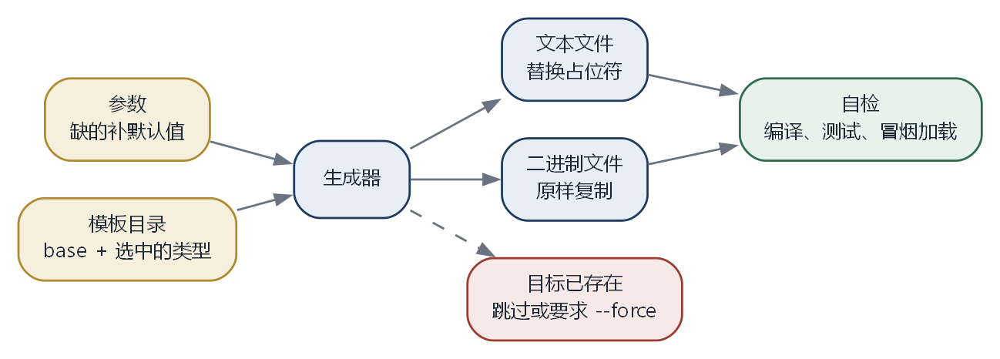

# 第 2 章 一条命令生成组件

## 2.1 生成器的四条要求

一个生成器好不好用，作者第一次用就知道。

好的生成器满足四条。

**能交互，也能一次传参。** 新手希望一步步问，老手希望一条命令搞定。两种方式都要支持，交互只是参数缺失时的兜底。

**有默认值。** 组件名、目录名、许可证、宿主版本范围，都应该有合理的默认值。一路回车能得出一个能跑的组件。

**能预演。** `--dry-run` 打印将要创建的文件和将要执行的命令，不实际写入。在脚本里和不确定的时候很有用。

**幂等。** 目标目录已存在时不要直接覆盖。要么报错，要么要求 `--force`，并且明确告诉用户会覆盖哪些文件。

## 2.2 交互流程

一次完整的交互大概是这样。

```text
$ new-plugin

? 组件编号  com.example.tools
? 显示名称  Example Tools
? 组件类型  [命令 / 服务 / 主题 / 渲染]
? 需要哪些权限  [读取工作区, 写入插件目录]
? 是否创建示例  Yes

创建 plugins/example-tools/
  CMakeLists.txt
  plugin.json
  src/plugin.cpp
  ...
安装依赖 ... 完成
编译检查 ... 通过
测试 ... 通过

下一步：
  cd plugins/example-tools
  cmake -B build && cmake --build build
```

最后两行很重要。命令结束时，用户应该知道接下来做什么，而不是回文档里找。

交互只在必填项缺失时启动。`--id` 给了就直接生成，一个问号都不出现。CI 里调用生成器时要多一层保护，标准输入不是终端就直接报错退出，否则流水线会卡在一个等不到输入的提示上，四十分钟后超时。

## 2.3 参数表与默认值

一条命令能跑起来，靠的是一张写得清楚的参数表。

| 参数 | 默认值 | 映射到的模板变量 | 说明 |
|---|---|---|---|
| `--id` | 无，必填 | `{{id}}` | 组件编号 |
| `--short` | 取 id 末段 | `{{short}}` | 文件名和标识符用的短名 |
| `--name` | 从 short 推导 | `{{name}}` | 显示名称 |
| `--type` | `command` | 决定叠加哪个类型目录 | 命令、服务、主题 |
| `--license` | `MIT` | `{{license}}` | 写进 LICENSE 和清单 |
| `--host-range` | `>=4.0 <5` | `{{host_range}}` | 宿主版本范围 |
| `--example` | 开 | 控制示例目录 | `--no-example` 关掉 |
| `--dir` | `plugins/<short>` | 无 | 输出位置 |
| `--force` | 关 | 无 | 覆盖已有文件 |
| `--dry-run` | 关 | 无 | 只打印计划 |

默认值要有出处。`--host-range` 的默认值最好在生成时问一次本机装的宿主，问不到再用配置里的兜底值。这样模板里的版本范围不会随时间漂走，也不会一生成就过时。

参数解析写成一个小结构体就够了。

```cpp
struct Options {
    std::string id;
    std::string short_name;
    std::string name;
    std::string type = "command";
    std::string license = "MIT";
    std::string host_range = ">=4.0 <5";
    std::string dir;
    bool example = true;
    bool force = false;
    bool dry_run = false;
};
```

解析时遇到不认识的参数要报错，不要静默忽略。有人把 `--no-example` 拼成 `--no-amples`，生成器一声不响地把示例也生成了（因为默认就是开），作者删掉示例目录的时间比重新生成一次还长。未知参数直接失败，成本比这种悄悄错小得多。

## 2.4 模板目录长什么样

模板里的文件名也可以带占位符，这样生成的源文件和组件名能对上。

```text
templates/
  base/
    README.md
    LICENSE
    .gitignore
    .github/workflows/ci.yml
  command/
    CMakeLists.txt
    plugin.json
    include/{{short}}.h
    src/{{short}}.cpp
    tests/test_{{short}}.cpp
    examples/minimal/plugin.json
  service/
    CMakeLists.txt
    plugin.json
    include/{{short}}.h
    src/{{short}}.cpp
    tests/test_{{short}}.cpp
```

用 `{{short}}` 而不是 `{{id}}` 做文件名，是因为编号里有点。`com.example.tools` 直接当文件名，要么被拆成三层目录，要么被转义成难看的 `com_example_tools`。短名只保留末段 `tools`，文件名干净，代码里的类名、日志前缀也能直接用。

清单文件名固定是 `plugin.json`，不带占位符。加载器靠固定路径找它，名字一变就找不到。



## 2.5 模板的文本替换

模板文件里写占位符，生成时替换。

```cpp
// src/plugin.cpp
extern "C" PLUGIN_EXPORT const char* plugin_name() {
    return "{{id}}";
}
```

生成 `com.example.tools` 之后，变成 `return "com.example.tools";`。

替换函数只有几行。

```cpp
std::string render(const std::string& tpl, const std::map<std::string, std::string>& vars) {
    std::string out;
    size_t pos = 0;

    while (true) {
        size_t begin = tpl.find("{{", pos);
        if (begin == std::string::npos) {
            out.append(tpl, pos, std::string::npos);
            break;
        }
        out.append(tpl, pos, begin - pos);

        size_t end = tpl.find("}}", begin);
        if (end == std::string::npos) {
            out.append(tpl, begin, std::string::npos);
            break;
        }

        std::string key = tpl.substr(begin + 2, end - begin - 2);
        auto it = vars.find(key);
        if (it == vars.end()) {
            throw std::runtime_error("缺少模板变量：" + key);
        }
        out += it->second;
        pos = end + 2;
    }
    return out;
}
```

遇到没有提供的变量时直接报错，不要留空。早报错比晚出错好。

变量写进 JSON 时还要转义。组件名叫 `Example "Tools"`，直接替换会得到一份语法错误的清单，而错误提示是“第 7 行解析失败”，作者根本想不到问题出在自己的显示名称上。转义函数只有几行。

```cpp
std::string json_escape(const std::string& s) {
    std::string out;
    for (char c : s) {
        switch (c) {
            case '"': out += "\\\""; break;
            case '\\': out += "\\\\"; break;
            case '\n': out += "\\n"; break;
            default:   out += c;
        }
    }
    return out;
}
```

决定哪个变量用哪份值，最好写在一处。清单里的 `name` 要转义，README 里的标题不用转，源码注释里的名字可以原样放。如果每个文件各自决定，改一次规则就要翻一遍模板。

用 `sed` 一行搞定替换看起来很诱人。

```bash
sed -i "s/{{id}}/$ID/g" src/*.cpp
```

三个坑同时存在。`ID` 里带斜杠时 `sed` 会把斜杠当分隔符，命令直接报错；带 `&` 时会被当成“整个匹配”，生成一个古怪的结果；`-i` 在 GNU 和 BSD 两个实现里的参数格式不同，作者的 Mac 上跑出来的东西和 CI 里不一样。这些坑每一个都要花半小时才能看懂。

## 2.6 二进制文件不能替换

图片、字体、压缩包这类文件不能按文本处理。

做法是按扩展名分流。

```cpp
bool is_text(const std::string& path) {
    static const std::set<std::string> exts = {
        ".cpp", ".h", ".json", ".md", ".txt", ".yml", ".cmake"
    };
    auto dot = path.rfind('.');
    if (dot == std::string::npos) return false;
    return exts.count(path.substr(dot)) > 0;
}
```

文本文件读进内存、替换、写回。其他文件直接用文件系统复制，一个字节都不碰。

白名单是可行的，前提是漏掉的新扩展名有人补。`.svg` 就是那种很容易漏的：它是文本，图片编辑器里看着和 `.png` 一样。模板里放一个带占位符的图标，白名单没列 `.svg`，它就被当成二进制原样复制，`{{short}}` 留在文件里，生成出来的界面显示一个缺省的方块。不报错，也没人翻源码，只有用户截图时才发现图标名字不对。

一种更稳的做法是白名单加内容探测。白名单命中就当文本处理；没命中但前几百字节里没有 NUL 字节、且能按 UTF-8 解开的，也当文本处理；剩下的当二进制。这样新扩展名默认走安全的那一边，最坏情况是把一个文本文件当二进制复制，占位符不替换，和原来一样。

## 2.7 目录复制

遍历模板目录，遇到子目录递归，遇到文件按文本或二进制处理。

```cpp
void copy_tree(const fs::path& src, const fs::path& dst,
               const std::map<std::string, std::string>& vars) {
    fs::create_directories(dst);

    for (const auto& entry : fs::directory_iterator(src)) {
        fs::path from = entry.path();
        std::string name = from.filename().string();

        // 文件名里的占位符也要替换
        std::string new_name = replace_all(name, "{{id}}", vars.at("id"));
        fs::path to = dst / new_name;

        if (entry.is_directory()) {
            copy_tree(from, to, vars);
        } else if (is_text(from.string())) {
            std::ifstream in(from, std::ios::binary);
            std::string content((std::istreambuf_iterator<char>(in)),
                                std::istreambuf_iterator<char>());
            std::string rendered = render(content, vars);
            std::ofstream out(to, std::ios::binary);
            out << rendered;
        } else {
            fs::copy_file(from, to);
        }
    }
}
```

文件名里的占位符也替换，这样模板里可以有 `{{id}}.cpp` 这样的文件名。

`std::filesystem` 是 C++17 提供的文件系统库，`directory_iterator` 遍历目录，`copy_file` 复制文件。需要链接 `-lstdc++fs`（GCC 8 及更早版本），新版本不需要。

遍历时要显式排掉几类东西。模板仓库自己就是一个 Git 仓库，`.git` 目录、CI 的缓存、作者本地编译出来的 `build` 目录都可能躺着，不加排除规则生成一次就带进几十兆垃圾。

```cpp
static bool skip_dir(const std::string& name) {
    return name == ".git" || name == "build" || name == ".cache"
        || name == "node_modules" || name == "__pycache__";
}
```

符号链接也不要跟。`directory_iterator` 默认不跟随链接，但 `entry.is_directory()` 对链接会返回假，于是一个指向目录的链接会被当成文件交给 `copy_file`，在 Windows 上直接失败。模板里本来不该有链接，遇到就报出来，别猜。

## 2.8 生成后的自检

生成命令结束时，最好自动做几件事。

**编译检查。** 调用构建系统编译一次，确认模板生成的代码能通过编译。这一步能发现占位符替换错误、头文件路径错误。

**单元测试。** 跑一遍模板自带的测试，确认测试环境配置正确。

**冒烟加载。** 用假宿主加载产物，确认 `plugin_init` 能执行、贡献能注册。

这三项都通过，作者拿到的是一个确实能跑的组件，而不是看起来完整、实际缺依赖的骨架。

三步的耗时差得很远。

| 步骤 | 大概耗时 | 失败通常意味着 |
|---|---|---|
| 配置构建 | 几百毫秒 | 模板里的路径没替换对，或契约包找不到 |
| 编译 | 几秒 | 头文件缺失、条件编译开关没开 |
| 单元测试 | 一秒内 | 测试框架没接上，或入口符号名写错 |
| 冒烟加载 | 一两秒 | 清单字段名和加载器不一致 |

失败时命令应该以非零状态退出，并打印具体是哪一步失败。

## 2.9 干跑

`--dry-run` 只打印计划，不写文件。

```cpp
void plan(const fs::path& src, const fs::path& dst,
          const std::map<std::string, std::string>& vars, bool dry) {
    for (const auto& entry : fs::directory_iterator(src)) {
        fs::path from = entry.path();
        fs::path to = dst / from.filename().string();

        if (dry) {
            std::cout << "would create " << to << "\n";
        } else {
            // 真的创建
        }

        if (entry.is_directory()) {
            plan(from, to, vars, dry);
        }
    }
}
```

干跑的价值在于“不确定的时候先看一眼”。特别是目标目录已经有东西时，能提前发现冲突。

输出要能当清单用，而不是一句“将创建若干文件”。

```text
$ new-plugin --id com.example.tools --dry-run
将创建 plugins/tools/
  CMakeLists.txt
  plugin.json
  include/tools.h
  src/tools.cpp
  tests/test_tools.cpp
  .github/workflows/ci.yml
共 6 个文件，0 个冲突
```

冲突计数单独占一行。作者瞄一眼就知道这次生成会不会盖掉手写的东西，比翻一堆文件列表快。

## 2.10 一次生成花在哪里

生成器本身不慢。一次完整生成从敲下命令到自检通过，十秒左右，其中大部分时间花在编译上。

| 环节 | 大概耗时 | 备注 |
|---|---|---|
| 交互问答 | 半分钟 | 人在打字，不是程序在算 |
| 写文件 | 几十毫秒 | 几十个文件，磁盘再慢也到这个量级 |
| 配置构建 | 几百毫秒 | 第一次要探测编译器 |
| 编译 | 三到五秒 | 带示例和测试时更长 |
| 测试加冒烟加载 | 一两秒 | 只跑一个用例 |

知道时间花在哪里，才知道哪一步可以关。批量生成十几个组件做迁移时，自检要能关掉，否则每次多等五秒，几十次就是几分钟纯等待。关掉之前要明白代价，自检过的组件和没自检过的组件，在作者心里是两种东西。

同样的表反过来就是排查线索。

| 现象 | 常见原因 |
|---|---|
| 报“目录非空” | 上一次生成失败，留下半个目录 |
| 编译报找不到 `plugin_api.h` | 契约包路径没传给构建系统 |
| 冒烟加载报“清单不合法” | 变量写进 JSON 时没转义 |
| 生成结果里还有 `{{...}}` | 变量名拼错，或该文件被当成二进制复制了 |
| 自检全过但真宿主加载失败 | 假宿主覆盖的行为比真宿主宽 |

## 2.11 生成器自身的维护

生成器也是代码，也会过时。

几个维护要点。

**模板和生成器一起版本化。** 模板改了，生成器可能也要改；生成器的参数变了，模板里的占位符要对上。

**生成器要能自测。** 用一份固定的输入跑一遍，比对输出和预期。这样改生成器时不会意外破坏已有模板。

比对要用一个入库的基准目录，而不是“看起来差不多”。

```bash
new-plugin --id test.sample --dir /tmp/golden --no-example
new-plugin --id test.sample --dir /tmp/golden2 --no-example
diff -r /tmp/golden /tmp/golden2
```

更严格的做法是把其中一份提交进仓库，CI 每次重新生成再和它比。`diff` 会把每一处分歧都列出来，改模板时能立刻看到“我只想改 README，怎么 CMakeLists 也变了”。

这份基准有个维护成本，模板一改就要同步更新基准。有人嫌麻烦，把基准删了，于是生成器半年没有任何回归保护。半年里的一次小改动把 LICENSE 里的年份写死成了 1970，发出去的十二个组件全带着这个年份。这种错误编译不报、测试不报，只有人去看才有机会发现。

**错误信息要具体。** 模板变量缺失时，说清是哪个文件、哪个变量，不要只说“渲染失败”。

**不要过度设计。** 生成器的功能越少越稳定。加一个“自定义模板”功能，就要考虑路径、变量、错误处理，复杂度翻好几倍。

下一章把契约抽成独立的包，让组件不依赖宿主源码也能编译。
