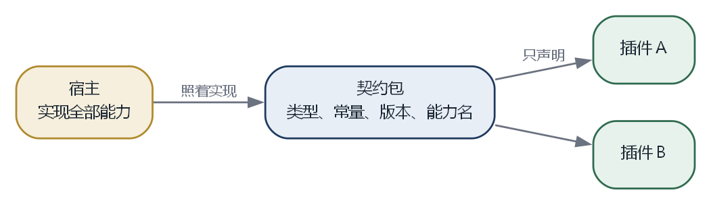

# 第 3 章 契约包

## 3.1 头文件不该长在宿主里

最常见的做法是把 `plugin_api.h` 放在宿主项目里。插件要引用它，得把宿主整个克隆下来，或者把路径写死。

两种做法都有问题。克隆宿主意味着插件作者要理解一个和自己无关的大型项目。写死路径意味着换一台电脑就编译不过。

更好的做法是把头文件抽成独立的小包。

```text
sdk/
  include/
    plugin_api.h
  VERSION
  README.md
```

宿主和插件都引用这个目录。宿主编译时加 `-I../sdk/include`，插件也加同样的路径。

## 3.2 一次全线编译失败

有个八人团队维护宿主，外面三个团队做插件，一共七个组件在维护。某天宿主主干做了一次重构，把 `PluginEvent` 改名叫 `Event`，顺手把注册事件的两个函数合成了一个。

插件那边第二天全红了。三个团队各自克隆宿主仓库编译，一个克隆的是三个月前的标签，编出来的行为和主干不一致；一个新人照着 README 里那句“先 clone 宿主”拉了主干，编不过，试了三次去问人，半天没了。

事故的根子不在改名，在依赖的形状。编译一个插件真正需要的东西是几十个头文件，实际拿到的却是一个带着资源、测试数据、第三方库和几年提交历史的仓库。仓库两百多兆，拉一次两分钟，流水线里每个插件任务都要拉一次，三个平台就是六分钟纯等待。

依赖越重，越容易在别人手里坏掉。头文件抽出去之后，插件作者拿到的是一百多 KB 的东西，三秒拉完，版本也固定了。

## 3.3 契约包里放什么

**类型定义。** 结构体、枚举、函数指针类型。这些是双方都要用的。

**常量。** 版本号、错误码、事件名、扩展点名。写死在代码里容易两边不一致，放在契约包里统一。

**校验函数。** 清单格式检查、版本范围检查。这些函数只在头文件里实现，或者编成一个小库。

**不包含实现。** 契约包里不应该有具体的服务实现、渲染代码、业务逻辑。它只描述“双方约定什么”。

这条边界很重要。契约包一旦包含实现，就会有人往里加东西，慢慢变成第二个宿主。

## 3.4 一份最小可用的契约

契约包小到什么程度算够，可以看这份骨架。

```c
/* plugin_api.h */
#define PLUGIN_API_VERSION 3

#if defined(_WIN32)
#define PLUGIN_EXPORT __declspec(dllexport)
#else
#define PLUGIN_EXPORT __attribute__((visibility("default")))
#endif

typedef struct PluginApi PluginApi;

struct PluginApi {
    unsigned size;      /* 这个结构体多大，由宿主填写 */
    unsigned version;   /* 契约版本 */
    void (*log_info)(const char* msg);
    int  (*register_command)(const char* name, const char* help,
                             void (*run)(const char* args));
    int  (*host_supports)(const char* capability);
};

PLUGIN_EXPORT int  plugin_init(const PluginApi* api);
PLUGIN_EXPORT void plugin_shutdown(void);
```

`size` 放在第一个字段不是为了好看。插件可能用 3.2 的头文件编译，宿主还是 3.0 的运行时，两边的结构体长度不同。插件拿到的 `api` 指针指向宿主给的内存，读到 `size` 之后就不该再往后多读一个字节。想用某个字段，先问一句。

```c
static int api_has(const PluginApi* api, size_t offset, size_t width) {
    return api->size >= offset + width;
}
```

调用时写成这样，字段不在旧宿主里就走降级分支，而不是踩到别人的内存。

```c
if (api_has(api, offsetof(PluginApi, host_supports), sizeof(api->host_supports))
    && api->host_supports) {
    if (api->host_supports("render.texture.array")) {
        use_texture_array();
    }
}
```

十几行头文件，把“谁提供什么、怎么检查、怎么降级”讲完了。契约包剩下的内容，基本都是这两件事的扩展。



## 3.5 版本独立

契约包有自己的版本号，和宿主、插件的版本分开。

```json
{
  "name": "example-plugin-api",
  "version": "3.1.0",
  "min_host": "4.0.0"
}
```

宿主可以每天发版，契约包只在接口变化时升级。插件作者只需要关心契约版本，不用追宿主的每一次发布。

版本关系可以这样理解：宿主版本包含契约版本，契约版本包含能力。一个宿主 4.2 的版本，可能支持契约 2 和 3，支持能力 `render.texture.array` 但不支持 `render.shader.custom`。

## 3.6 什么改动升哪个版本

升哪个数字不需要每次都开会讨论，照一张表走就行。判断的核心是一句话，旧插件在新宿主上能不能按原来的方式工作。

| 改动 | 例子 | 版本怎么升 |
|---|---|---|
| 结构体末尾加字段 | 新增 `register_hook` | 次版本 |
| 新增能力名 | `render.texture.array` | 次版本 |
| 新增错误码 | `PLUGIN_ERR_BUSY` | 次版本，插件要能忽略未知码 |
| 改字段类型或顺序 | `unsigned` 改成 `size_t` | 主版本 |
| 删字段或函数 | 去掉 `on_event` | 主版本 |
| 改函数签名 | 参数多一个 | 主版本 |
| 只改注释和文档 | 无 | 修订号 |

表里最容易含混的是新增错误码。它是次版本，但插件如果对未知错误码直接崩掉，主版本也救不了。契约里要写清一条规则，未知错误码按“失败但可重试”处理，插件不认识的码不要当成功。

## 3.7 能力查询

版本号不够用，因为同一版本的宿主在不同平台上能做的事情不一样。桌面版支持自定义着色器，移动版不支持；同一次发版里，某个平台可能因为驱动问题把纹理数组关掉了。

用字符串能力名查询，比用版本号判断具体。

```c
int ok = api->host_supports("render.texture.array");
```

能力名要有命名规则，三段式，全小写，不带版本号。`render.texture.array` 好过 `render.texture.array.v2`，要表达新语义就换个名字，比如 `render.texture.array.sparse`。能力名是字符串，拼错了不会在编译时报错，只会在运行时得到零，所以最好把它们集中定义在头文件里。

```c
#define PLUGIN_CAP_TEXTURE_ARRAY "render.texture.array"
#define PLUGIN_CAP_CUSTOM_SHADER "render.shader.custom"
```

插件写 `api->host_supports(PLUGIN_CAP_TEXTURE_ARRAY)`，拼错就是编译错误。

## 3.8 依赖声明

插件在构建文件里把契约包声明为“由宿主提供”，而不是自己带一份。

CMake 里对应的是 `find_package` 加 `target_link_libraries`。

```cmake
find_package(example_plugin_api 3 REQUIRED)
target_link_libraries(my-plugin PRIVATE example_plugin_api::headers)
```

CMake 的 `find_package` 会去找一个 `example_plugin_apiConfig.cmake` 文件，里面记录了头文件路径和版本。

```cmake
# example_plugin_apiConfig.cmake
set(example_plugin_api_VERSION 3.1.0)
add_library(example_plugin_api::headers INTERFACE IMPORTED)
set_target_properties(example_plugin_api::headers PROPERTIES
    INTERFACE_INCLUDE_DIRECTORIES "${CMAKE_CURRENT_LIST_DIR}/include")
```

这样插件不需要知道契约包放在哪，只要 `find_package` 能找到。

不用 CMake 的项目可以退一步：约定一个环境变量 `PLUGIN_SDK_DIR`，构建脚本从那里找头文件。简单，够用。

版本参数别写得太死。`find_package(example_plugin_api 3 EXACT REQUIRED)` 看起来最安全，实际上宿主只要升一个次版本，插件就找不到包。插件真正需要的只是“主版本是 3”，写成 `3 REQUIRED` 就够了，次版本差异用能力查询处理。版本范围收紧到每一位数字，等于把每次集成都变成一次升级谈判。

## 3.9 头文件与实现的分离

契约包通常只有头文件。但如果里面有非内联函数，就需要编译成库。

两种情况。

**纯头文件。** 所有函数都是 `inline` 或者模板，使用方自己编译。简单，但每次编译都要重新编译这些代码。

**编译成静态库。** 公共函数编成一个 `.a` / `.lib`，使用方链接。编译快，但要保证二进制兼容。

契约包建议纯头文件。它通常很小，编译开销可以忽略，也避免了二进制兼容的问题。

## 3.10 一份完整的契约包

```text
sdk/
  CMakeLists.txt
  include/
    plugin_api.h
    plugin_events.h
    plugin_services.h
  VERSION
```

`plugin_api.h` 放主接口和三个导出函数。`plugin_events.h` 放事件名常量。`plugin_services.h` 放服务接口。

分成三个文件，是因为它们的变化频率不同。主接口很少变，事件名经常加，服务接口介于两者之间。

分开之后，改事件名不会让整个包看起来“全变了”，插件作者也更容易看出这次改了什么。

版本号只存在一份。`VERSION` 文件里写 `3.1.0`，CMake 读它，生成一份头文件，宏和包版本永远一致。

```cmake
file(STRINGS "${CMAKE_CURRENT_SOURCE_DIR}/VERSION" SDK_VERSION)
configure_file(include/plugin_version.h.in
               ${CMAKE_CURRENT_BINARY_DIR}/include/plugin_version.h @ONLY)
```

```c
/* plugin_version.h.in */
#define PLUGIN_API_VERSION_STR "@SDK_VERSION@"
```

两处手写的版本号早晚会不一样，生成出来的那一份不会。

## 3.11 契约包的测试

契约包自己也要测试。

**编译测试。** 用一个最小的 C 文件和一个最小的 C++ 文件分别包含头文件，确认在两种语言下都能编译。这条检查能挡住“在头文件里用了 C++ 特性”的错误。

**版本测试。** 检查 `PLUGIN_API_VERSION` 宏和包的版本号一致。

**结构体布局测试。** 用 `static_assert` 检查关键结构体的大小和字段偏移。

```cpp
static_assert(sizeof(PluginApi) == 48, "PluginApi 布局变了");
static_assert(offsetof(PluginApi, on_event) == 32, "on_event 偏移变了");
```

这几行能在编译时就发现“不小心改了字段顺序”这类问题。

布局变了意味着 ABI 不兼容，必须升主版本。有 `static_assert` 挡着，就不容易忘。

编译测试还应该跑一次纯 C 编译。头文件里误用了 `std::string`、默认参数、引用，C 编译器会直接拒掉，这比等到某个插件作者用 C 语言写插件时才发现要早得多。

```bash
cc -std=c99 -Wall -Wextra -Werror -fsyntax-only -I include tests/c_compile.c
```

## 3.12 契约包是怎么被撑大的

契约包长胖的过程很平静，每一步都有一句说得通的理由。

第一个人加了 `plugin_utils.h`，里面是字符串切分，理由是“每个插件都在重复写这段”。第二个人加了路径拼接，理由是“不能让每个插件各自处理路径分隔符”。第三个人加了 JSON 解析，三百行，理由是“清单校验反正也要解析”。

半年后，二十个插件依赖这些工具函数，契约包从四百行涨到四千行。代价是三条。

用了 `std::string` 的那几个函数，把标准库的 ABI 绑进了边界，宿主换编译器版本时全都得跟着重编。改一个工具的 bug 要升契约主版本，因为函数签名改了，没用到它的插件也得跟着升。宿主想把 JSON 解析换成更快的库，换不了，因为插件直接 include 了那个实现头，实现已经漏出去了。

判据很简单：把一个东西删掉，宿主和插件的通信还成立吗。成立，它就不属于契约。工具函数应该是另一个包，编译进插件自己的二进制里，版本随便升，坏了也只坏一个插件。

## 3.13 发布与获取

契约包可以几种方式分发。

**独立仓库。** 放在单独的 Git 仓库，插件作者 clone 或者下载压缩包。

**主仓库的子目录。** 和宿主放在一起，用 submodule 或者包管理器引用。

**包管理器。** 发布到 Conan、vcpkg 这类 C++ 包管理器，用一条命令安装。

独立仓库最清楚，但要多维护一个仓库。子目录最省事，但插件作者还是要克隆整个宿主。

子模块是被低估的一种折中。宿主不用克隆两个仓库，插件作者却能把 SDK 单独拉下来。

```bash
git submodule add https://example.com/plugin-sdk.git sdk
git submodule update --init --recursive
```

第二条命令容易被忘。新克隆一份仓库之后直接编，`sdk/` 是个空目录，报错信息是“找不到 plugin_api.h”，看起来像环境问题，实际是初始化没跑。CI 里也要带上这一句，而且 `--recursive` 不能少，SDK 自己也可能挂着一个子模块。

包管理器最方便，配置成本也最高。规模小的项目不必上。

## 3.14 契约包和文档

契约包应该自带文档。

`README.md` 写清用途、版本、依赖、包含哪些文件。`CHANGELOG.md` 按版本记录改动：加了什么、改了什么、删了什么。

每个头文件顶部写一段简短说明，讲这个文件管什么。

```cpp
// plugin_api.h
//
// 宿主与插件之间的主接口。
//
// 包含：PluginApi 结构体、三个导出函数的声明、版本宏。
// 变化历史见 CHANGELOG.md。加字段必须放在末尾。
```

这些说明不需要很长，但要有。插件作者打开头文件就知道该看哪里。

下一章搭一个假宿主，让组件脱离真实宿主开发和调试。
