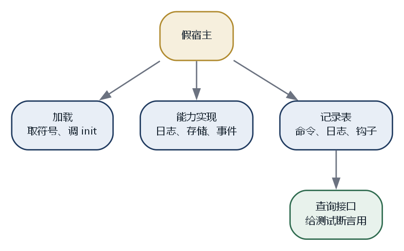

# 第 4 章 假宿主

## 4.1 每次都启动真宿主太慢

插件作者的日常是“改一行，看效果”。

如果每次都要启动完整宿主，这个循环要几十秒。宿主启动慢、加载十几个插件、初始化界面，而作者只想验证“我这条命令注册上了没有”。

假宿主解决这个问题。它是一个只实现契约、不实现真实功能的最小程序。

## 4.2 一个下午四十次重启

改一条命令的参数解析，作者想验证的只是“注册上了没有、名字对不对”。

真宿主启动一次二十多秒。它要加载十四个插件、恢复上次打开的工程、把索引读进内存、把窗口摆回原处。二十秒一次，一上午改四十轮，光等启动就去了十三分钟，再加上切窗口、找工程、重新点开菜单，每个循环接近一分钟。

一天两轮，一个功能做三天，七个小时花在等上面。这个数字不算致命，但它会改变人的行为。有人开始在真宿主里加临时 `printf`，提交时忘了删；有人把调试用的硬编码路径留在源码里，下一个人拉到之后能编译、运行报错，查了半天。更常见的是另一种退化，作者干脆少改几次，攒一批改动一起验证，出问题后不知道是哪一处引起的。

假宿主解决的就是这一段。它把二十秒压到几百毫秒，让“改一行看一次”重新变得便宜。

## 4.3 假宿主提供什么

**加载入口。** 能读动态库、取符号、调用 `plugin_init`。

**能力实现。** 每个能力有一个内存实现。日志打印到屏幕，存储用内存字典，事件总线记录调用。

**调用接口。** 让测试能触发事件、查询注册结果。

**结果检查。** 能返回“注册了几条命令”“有没有报错”。

假宿主不追求和真宿主一模一样。它只覆盖契约里承诺的行为。真宿主的内部实现、界面细节、配置读取，都不属于契约，也不应该在插件的单元测试里依赖。

## 4.4 假宿主的文件与目录

假宿主自己也是一个小项目，目录不用深，但各部分要有边界。

```text
mock/
  include/
    mock_host.h          插件作者的测试只包含这一个
  src/
    mock_host.cpp        加载、卸载、记录表
    cap_log.cpp          日志进 vector
    cap_storage.cpp      内存字典
    cap_events.cpp       事件注册与触发
  tools/
    mock_host_main.cpp   命令行程序，人肉排查用
  tests/
    test_mock_host.cpp   假宿主自己的测试
  CMakeLists.txt         产出静态库和可执行文件
```

静态库给测试链接，可执行文件给人用。两种用法都要，因为人肉排查时没人想为了看一眼注册结果去写一个测试。

```bash
mock_host --load build/libhello.so --list
```

```text
已加载 libhello.so
命令 1 个
  hello       打印一句问候
日志 2 条
  [info] 插件已初始化
  [info] 注册命令 hello
钩子 0 个
```

这份输出比任何日志文件好读。插件作者的第一个问题永远是“我的东西到底注册上了没有”，这张表直接回答。



## 4.5 一个最小的假宿主

```cpp
class MockHost {
public:
    bool load(const std::string& path) {
        handle_ = dlopen(path.c_str(), RTLD_NOW);
        if (!handle_) return false;

        auto init = (int(*)(const PluginApi*))dlsym(handle_, "plugin_init");
        if (!init) return false;

        PluginApi api{};
        api.size = sizeof(PluginApi);
        api.version = PLUGIN_API_VERSION;
        api.register_command = &MockHost::on_command;
        api.on_event = &MockHost::on_event;
        api.log_info = &MockHost::on_log;
        api.register_hook = &MockHost::on_hook;

        return init(&api) == 0;
    }

    const std::vector<PluginCommand>& commands() const { return commands_; }
    const std::vector<std::string>& logs() const { return logs_; }

    void emit(const std::string& type, const std::string& payload) {
        for (auto& l : events_) {
            if (l.type == type) l.fn(type.c_str(), payload.c_str());
        }
    }

private:
    static void on_command(const PluginCommand* cmd) {
        instance().commands_.push_back(*cmd);
    }
    static void on_event(const char* type, EventFn fn) {
        instance().events_.push_back({ type, fn });
    }
    static void on_log(const char* msg) {
        instance().logs_.push_back(msg);
    }
    static int on_hook(const char* name, HookFn fn) {
        instance().hooks_.push_back({ name, fn });
        return 0;
    }

    static MockHost& instance() {
        static MockHost host;
        return host;
    }

    void* handle_ = nullptr;
    std::vector<PluginCommand> commands_;
    std::vector<std::string> logs_;
    struct EventEntry { std::string type; EventFn fn; };
    std::vector<EventEntry> events_;
    struct HookEntry { std::string name; HookFn fn; };
    std::vector<HookEntry> hooks_;
};
```

这个实现有个问题：用单例是为了让静态回调能访问实例，但这样只能同时测一个插件。要测多个插件，需要把实例指针传给回调。

```cpp
static MockHost* g_current = nullptr;

static void on_command(const PluginCommand* cmd) {
    if (g_current) g_current->commands_.push_back(*cmd);
}
```

加载前设置 `g_current = this`，卸载后清空。简单可靠。

## 4.6 能力的内存实现

每个能力一个内存实现，保真度不需要一致，够用就行。

| 能力 | 真宿主 | 假宿主 | 假宿主没有的东西 |
|---|---|---|---|
| 日志 | 写文件、上界面 | 存进 vector | 轮转、编码转换、级别过滤 |
| 存储 | 磁盘、按工程隔离 | 内存字典 | 重启后的恢复 |
| 事件 | 全量总线 | 手动 emit | 真实时序与并发 |
| 文件 | 真实磁盘 | 临时目录里的真文件 | 权限、只读盘、磁盘满 |
| 时钟 | 系统时间 | 可拨的假时钟 | 夏令时、时钟回拨 |
| 渲染 | GPU | 返回固定纹理 | 一切视觉结果 |

时钟值得单独说一下。定时器、超时重试、每隔半小时自动保存，这类逻辑用真时钟测，一个用例要等半小时。假时钟把“现在”变成一个可以设的变量。

```cpp
class FakeClock {
public:
    long long now_ms() const { return now_; }
    void advance(long long ms) { now_ += ms; }
private:
    long long now_ = 1700000000000LL;
};
```

测试里 `advance(30 * 60 * 1000)` 就把半小时拨过去了，定时器在下一轮检查时触发。真的 `sleep` 半小时的测试没人会跑，最后那条路径永远没人测。

## 4.7 把失败也造出来

假宿主更重要的用途是造失败。成功路径在真宿主里点一遍也能过，失败路径谁都懒得造。

```cpp
struct MockOptions {
    int init_result = 0;                      // plugin_init 的返回值
    unsigned api_version = PLUGIN_API_VERSION;
    unsigned api_size = sizeof(PluginApi);     // 调小它模拟旧宿主
    bool fail_register = false;                // 注册接口一律失败
};

bool MockHost::load(const std::string& path, const MockOptions& opt) {
    handle_ = dlopen(path.c_str(), RTLD_NOW);
    if (!handle_) { error_ = "打不开动态库"; return false; }

    auto init = (int(*)(const PluginApi*))dlsym(handle_, "plugin_init");
    if (!init) { error_ = "缺少 plugin_init"; return false; }

    PluginApi api{};
    api.size = opt.api_size;
    api.version = opt.api_version;
    api.log_info = &on_log;
    api.register_command = &on_command;
    api.host_supports = &on_supports;
    register_ok_ = !opt.fail_register;

    int rc = init(&api);
    if (rc != 0) { error_ = "plugin_init 返回 " + std::to_string(rc); return false; }
    return true;
}
```

`api_size` 调小是最有用的一项。把 size 设成只到 `register_command` 的位置，插件就在一个“没有 host_supports 的宿主”里跑。用户升级得慢，这种宿主在真实世界里到处都是，测一次比上线后收十封崩溃报告便宜得多。

三种失败值得固定成用例。

- 宿主缺字段。插件必须走降级分支，而不是读越界内存。
- `plugin_init` 返回非零。宿主要把已经注册的东西撤干净，不能留半条命令。
- 入口符号名写错。错误信息要指出缺的是哪个符号，而不是一句“加载失败”。

第三条经常被忽略，但它是作者最常撞上的。符号名和清单里的入口字段是两处独立的信息，任一处写错，表现都是“插件不该加载”，错误信息是所有排查的起点。

## 4.8 测试怎么写

有了假宿主，测试就变成了普通的断言。

```cpp
void test_command_registered() {
    MockHost host;
    bool ok = host.load("./build/libhello.so");
    assert(ok);
    assert(host.commands().size() == 1);
    assert(host.commands()[0].name == std::string("hello"));
}

void test_event_handled() {
    MockHost host;
    host.load("./build/libhello.so");
    host.emit("file.saved", "path=/a.md");
    assert(!host.logs().empty());
}
```

不需要启动界面，不需要配置文件，几毫秒跑完。

一个容易漏掉的测试是**卸载**。

```cpp
void test_unload_cleans_up() {
    MockHost host;
    host.load("./build/libhello.so");
    assert(host.commands().size() == 1);

    host.unload();
    assert(host.commands().empty());
}
```

很多插件在卸载后仍然持有定时器、事件监听、文件句柄。短时间看不出来，时间长了就是内存泄漏和幽灵行为。

## 4.9 一个不依赖框架的断言宏

C++ 没有自带测试框架，但写一个最小的不难。

```cpp
static int g_failed = 0;

#define CHECK(cond)                                                    \
    do {                                                               \
        if (!(cond)) {                                                 \
            std::printf("FAIL %s:%d  %s\n", __FILE__, __LINE__, #cond); \
            ++g_failed;                                                \
        }                                                              \
    } while (0)
```

`do { ... } while (0)` 把多条语句包成一个整体，展开后可以安全地放在 `if` 后面。

`__FILE__` 和 `__LINE__` 是编译器提供的宏，展开成当前文件名和行号。测试失败时能直接定位。

`#cond` 是字符串化，把宏参数原样变成字符串。`CHECK(a == b)` 失败时打印出来的就是 `a == b`。

主函数最后根据 `g_failed` 返回 0 或 1，CI 靠退出码判断成败。

## 4.10 假宿主自己的 bug

假宿主写错了比插件写错更难查，因为所有人默认它是正确的。

一个真实的例子。假宿主为了省一次拷贝，把注册命令时拿到的 `const char*` 直接存了下来。

```cpp
// 错：存指针
void on_command(const PluginCommand* cmd) {
    name_ = cmd->name;          // 插件传的是局部数组
}
```

插件在 `plugin_init` 里传的是一个局部数组，函数返回后内容就失效了。测试里断言命令名，有时候相等，有时候是乱码，取决于栈上那块内存有没有被别的东西写过。失败很不稳定，重跑一次可能就过了，团队先怀疑插件有未初始化内存，查了两天，最后发现假宿主存了个悬垂指针。

正确写法是立刻拷贝成 `std::string`。这一条在所有记录表里都适用，命令名、帮助文本、日志、事件负载，一个都不能存原指针。

另一个方向的错误是把假宿主做得太全。有人嫌能力不够用，把界面服务、配置服务、网络请求全实现了，插件作者于是在测试里直接调用了界面服务，测试很绿。装进真宿主之后崩，因为真宿主在无界面模式下根本不提供界面服务。假宿主实现得越全，插件对宿主的假设就越多，而这些假设没有任何契约支撑。

## 4.11 假宿主的边界

假宿主不能替代真实宿主。

**只覆盖契约。** 契约里承诺的行为，假宿主都要实现；契约之外的东西，不该在测试里依赖。

**不模拟性能。** 假宿主没有真实的渲染、网络、磁盘，跑得快不代表真实环境也快。

**不模拟错误。** 真实的磁盘会满，网络会断，假宿主不会。涉及这些的路径，要在真实环境里测。

**不替代集成测试。** 假宿主验证“插件逻辑对不对”，集成测试验证“插件和宿主配合对不对”。两个都要有。

## 4.12 假宿主的维护

假宿主是测试基础设施，也要维护。

**跟着契约走。** 契约加一个字段，假宿主也要实现，否则插件作者测不出新功能。

**保持简单。** 假宿主的功能越多，维护成本越高。只实现契约要求的部分。

**能被插件作者改。** 假宿主应该作为源码提供，插件作者遇到没覆盖的场景时能自己加。

**有自己的测试。** 假宿主写错了，插件作者的测试会全部误报。假宿主本身要有一组测试，验证它的行为符合契约。

## 4.13 本地开发循环的三个层次

有了假宿主，插件开发有三个循环层次。

**单元测试。** 只测逻辑，几百毫秒。不需要动态库，直接把源文件编进测试程序。

**假宿主。** 加载动态库，验证注册和事件。几秒钟。

**真实宿主。** 完整流程，分钟级。

三个层次都要有。只有最后一层，开发一个插件要反复启动完整应用。只有前两层，可能漏掉“真实宿主里某个服务没提供”这类问题。

好的工具链会让三个层次都能跑，而不是只有最后一层。`cmake --build` 后跑测试，`mock_host` 加载产物，最后装进宿主人肉点一遍。

下一篇讨论验证与交付，从持续集成和打包开始。
