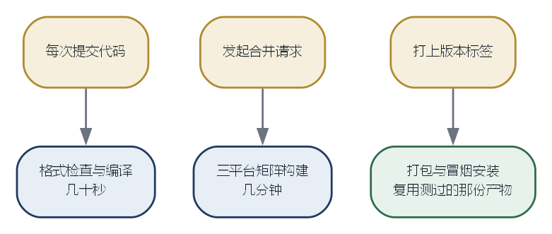

# 第 5 章 持续集成

## 5.1 在我机器上是好的

这句话是工程化最经典的起点。

插件作者的机器上装了某个工具链，编译通过，测试通过。用户装上去，程序崩溃。原因可能是编译器版本不同、标准库实现不同、路径分隔符不同、换行符不同。

持续集成就是把“在别人机器上编译一遍”这件事自动化。每次提交代码，服务器在一台干净的机器上从头构建、跑测试、打包。任何一步失败，作者立刻收到通知。

## 5.2 一次只在 Windows 上崩的发布

五个人维护一个插件，日常在 Linux 上开发，流水线也只配了 Ubuntu。Windows 版由一位同事在自己机器上编，编完手工上传。

有个版本里加了一个“打开上次的工程”功能，用 `std::filesystem::path` 拼用户目录。Linux 上跑了两个月没问题。用户装到 Windows 上，一点按钮就崩，而且只在一部分用户机器上崩。

原因是用户名。路径是 `C:\Users\张三\Documents\...`，窄字符接口把路径按本地代码页转换，碰到表示不了的字符就抛 `filesystem_error`，插件没接住，直接穿到宿主里。插件作者自己的用户名是英文，Visual Studio 里编得过也跑得过。

用户报了三个，两周后才定位，因为崩溃栈里全是标准库的帧，看不出问题在插件。代价是一次回滚、三个紧急补丁、一个下午的排查。把 Windows 加进矩阵多花的是每天几分钟机器时间。

“在我机器上是好的”这句话，真正的前提不是“我的机器干净”，而是“我的机器和用户的机器一样”。流水线的价值就是把这个前提变成事实。

## 5.3 最小的一条流水线

GitHub Actions 的配置放在 `.github/workflows/ci.yml`。

```yaml
name: build

on: [push, pull_request]

jobs:
  linux:
    runs-on: ubuntu-latest
    steps:
      - uses: actions/checkout@v4
      - run: cmake -B build -DCMAKE_BUILD_TYPE=Release
      - run: cmake --build build
      - run: ctest --test-dir build --output-on-failure
```

`on` 指定触发条件：推送代码、发起合并请求。

`runs-on` 指定操作系统。

`steps` 是一串动作：检出代码、配置、构建、测试。

## 5.4 多平台矩阵

插件要跨平台，CI 就要在多平台上跑。

```yaml
strategy:
  matrix:
    os: [ubuntu-latest, windows-latest, macos-latest]

runs-on: ${{ matrix.os }}
```

矩阵会为每个值跑一遍。三个平台并行执行，任何一个失败，整个任务失败。

Windows 和 Linux 的差异最明显：路径分隔符、动态库扩展名、换行符、文件权限。这些问题只有在对应平台上才会暴露。

矩阵还有一种容易被忽略的用法，把编译标准也放进去。同样的代码在 C++17 和 C++20 下的行为不完全一样，某些平台的默认标准又比别的平台旧一档。要不要加这一维，看项目对标准版本的敏感程度，加了就要多付一份机器时间。

## 5.5 缓存

每次 CI 都从零装依赖很慢。缓存能显著缩短时间。

```yaml
- uses: actions/cache@v4
  with:
    path: ~/.cache/cmake
    key: ${{ runner.os }}-cmake-${{ hashFiles('**/CMakeLists.txt') }}
```

`key` 决定什么时候缓存失效。这里用 CMake 配置文件的哈希，配置文件一变，缓存重建。

缓存要小心。缓存污染会导致“本地能过，CI 不过”或者反过来。缓存的 key 要包含足够的信息，确保不会用到过期的内容。

C++ 项目里真正值得缓存的是编译缓存，不是 CMake 自己的配置。ccache 把每个编译单元的产物按内容哈希存起来，头文件没变的部分直接复用。

```yaml
- uses: actions/cache@v4
  with:
    path: ~/.cache/ccache
    key: ${{ runner.os }}-ccache-${{ hashFiles('**/*.cpp', '**/*.h', '**/CMakeLists.txt') }}
```

一个小插件第一次全量构建两分钟，命中缓存后十几秒。三个平台的矩阵里，这份差别直接体现在等待时间上。缓存目录不要和构建目录混在一起，后者每次都要干净。

## 5.6 产物归档

CI 跑完之后，产物要能被下载。

```yaml
- uses: actions/upload-artifact@v4
  with:
    name: plugin-${{ runner.os }}
    path: build/plugins/*.so
```

`path` 支持通配符。Windows 上跑一次，路径要改成 `*.dll`，可以用矩阵变量处理。

归档的产物可以直接拿去测试，也可以作为发布的基础。

归档有两个默认值要改。保留期默认往往只有三个月，而用户手里的旧版本活得比这久得多，出问题要对比旧包的时侯已经找不到了。发布用的产物应该另外存一份到长期的存储里，按版本号命名，不跟着流水线的清理策略走。

另一个默认值是压缩。动态库本身已经很难再压，再包一层 zip 只省几个百分点，但解开需要时间。调试信息单独存的时候，反而应该压得紧一点，它体积大、重复度高。

## 5.7 静态分析与格式检查

编译通过不代表代码没问题。

**静态分析。** Clang-Tidy、Cppcheck 这类工具能在不运行代码的情况下找出一批常见错误：空指针、越界、资源泄漏、未初始化变量。

**格式检查。** clang-format 保证所有人的代码风格一致。风格不统一时，代码审查会浪费在空格和括号上。

两者都可以放进 CI。

```yaml
- run: clang-format --dry-run --Werror src/*.cpp include/*.h
- run: clang-tidy src/*.cpp -- -std=c++17
```

`--Werror` 让警告变成错误。格式不对、分析有问题，流水线直接失败。

这些检查刚开始会报很多，可以先只检查改动过的文件，逐步收紧。

## 5.8 一条完整的流水线与耗时分布

把上面几块拼起来，一条能用的流水线大概长这个样子。

```yaml
name: ci

on:
  push:
    branches: [main]
    tags: ['v*']
  pull_request:
    branches: [main]

concurrency:
  group: ${{ github.workflow }}-${{ github.ref }}
  cancel-in-progress: true

jobs:
  quick:
    runs-on: ubuntu-latest
    steps:
      - uses: actions/checkout@v4
      - run: clang-format --dry-run --Werror src/*.cpp include/*.h
      - run: cmake -B build -DCMAKE_BUILD_TYPE=Debug
      - run: cmake --build build -j
      - run: ctest --test-dir build --output-on-failure -L fast

  matrix:
    needs: quick
    if: github.event_name == 'pull_request' || startsWith(github.ref, 'refs/tags/')
    strategy:
      fail-fast: false
      matrix:
        os: [ubuntu-latest, windows-latest, macos-latest]
    runs-on: ${{ matrix.os }}
    steps:
      - uses: actions/checkout@v4
      - run: cmake -B build -DCMAKE_BUILD_TYPE=Release
      - run: cmake --build build -j
      - run: ctest --test-dir build --output-on-failure
      - uses: actions/upload-artifact@v4
        with:
          name: plugin-${{ matrix.os }}
          path: |
            build/plugins/*.so
            build/plugins/*.dylib
            build/plugins/*.dll
```

三段配置值得单独说。`concurrency` 配了取消，连续推三次代码时，前两次的流水线会被取消，不会三个任务抢同一台机器、把额度烧光。

`needs: quick` 让矩阵等快速检查。格式没过就不必花三个平台的钱，省下的额度不算多，但月底额度紧的时候很有用。

`fail-fast: false` 是反直觉的一项。默认行为是一个平台失败就把其他平台的任务取消，你只能看到一个平台的错。关掉之后能看到全貌，比如 Windows 缺一个头文件、macOS 少一个框架。全貌比节省几分钟重要。

时间分布大致如此。

| 阶段 | 大概耗时 | 什么时候跑 |
|---|---|---|
| 检出与格式检查 | 十几秒 | 每次提交 |
| Debug 构建与快速测试 | 一分钟左右 | 每次提交 |
| Release 构建（三平台，命中缓存） | 两到四分钟 | 合并请求、标签 |
| 全量测试（含假宿主集成） | 一分钟 | 合并请求、标签 |
| 打包与归档 | 半分钟 | 合并请求、标签 |
| 发布 | 十几秒 | 只有标签 |

冷缓存时矩阵要七八分钟，热缓存两三分钟。团队能忍受的上限大概是“开完合并请求，喝杯水回来就有结果”。超过这个量级，人就会开始绕过流水线，直接合。



## 5.9 流水线红了先看什么

先看哪一步，决定了修得快不快。顺序可以固定下来。

**先无脑重跑一次。** 同一个提交两次结果不同，就是环境或并发的问题，不要去找代码的错。

**看失败的用例和这次改动有没有关系。** 一个平台失败、另外两个通过，先怀疑平台差异，不要改逻辑。

**用同一个镜像在本地复现。** 容器里跑一遍，比在自己机器上试省时间，也能排除本机环境的影响。

**看依赖有没有被别处改动。** 上游 action 的版本、包管理器的仓库、编译器镜像都可能在一夜之间变。

**确认它是不是不稳定测试。** 同一提交连跑三次，三次结果不同就是不稳定测试。记一条 issue，别在合并请求里改生产代码去迁就它。

最贵的错误是拿 `sleep` 掩盖不稳定测试。把一个等了五十毫秒就开始断言的用例改成等两秒，九成的失败变成偶发，问题还在那里，只是更难复现了。

每次红了的结论值得用一行记录写下来。两周后回头看，同一类坑会以不同的面目出现两次以上。

## 5.10 几种常见的错误配法

流水线配错的样子很多，有几种特别常见。

**在流水线里改文件并提交回去。** 自动格式化机器人推一个提交，又把流水线重新触发一遍，循环下去，还经常和开发者的本地改动冲突。格式化该在提交前做，或者只在检查阶段报错，把修复交回给人。

**缓存 key 只写操作系统名。** 缓存里存的是编译好的目标文件，而编译器升级后 ABI 可能不同。换了 runner 镜像那天，链接报一堆莫名其妙的符号错，重跑没用，只有清缓存才好，但没人会往这个方向想。key 里至少要有编译器和依赖文件的哈希。

**密钥明文写在配置里。** 仓库一旦公开，或者别人 fork 了你的仓库，这些值就是公开的。该放 secrets，并且要确认来自 fork 的合并请求拿不到它们。

**把流水线当构建机。** 把编译好的产物提交进仓库，再由流水线打包。仓库越来越大，克隆越来越慢，而产物本来每次都能重建。

## 5.11 版本与发布

CI 还可以负责发布。

打标签时自动构建、打包、上传。

```yaml
on:
  push:
    tags:
      - 'v*'

jobs:
  release:
    runs-on: ubuntu-latest
    steps:
      - uses: actions/checkout@v4
      - run: cmake -B build -DCMAKE_BUILD_TYPE=Release
      - run: cmake --build build
      - run: ./scripts/package.sh
      - uses: softprops/action-gh-release@v1
        with:
          files: dist/*.zip
```

`on.push.tags` 表示只在打标签时触发。标签格式是 `v*`，比如 `v1.2.0`。

这样日常提交跑测试，打标签才发版。发版流程固定下来，不容易漏步骤。

发布时要用流水线里测过的那份产物，不要在发布任务里重新构建一次。重新构建出来的包没有经过测试，测过的和发出去的变成了两个东西。哪怕源码一字节未改，编译器版本、依赖版本、构建参数都可能不同。

## 5.12 CI 的成本

CI 不是免费的。

**时间成本。** 每次提交都要等几分钟。提交频繁时，等待时间会累积。

**额度成本。** 公有仓库免费，私有仓库按分钟计费。多平台矩阵会成倍消耗。

**维护成本。** 配置文件会过时，依赖版本会变，构建镜像会更新。

控制成本的几个做法。

**按需触发。** 只对 `main` 分支和合并请求跑完整流程，其他分支只跑快速检查。

**分层。** 快速检查（格式、编译）在每次提交时跑，慢速检查（多平台、集成测试）在合并前跑。

**缓存依赖。** 减少重复下载。

**并行。** 矩阵中的任务并行执行，不是串行。

私有仓库还有一个时有时无的坑，额度。配额按月结算，月底用完之后合并请求排队，表面上像是流水线变慢了。要么把矩阵在月底前收窄，要么把快速检查留在本地预提交里跑，不要所有人都依赖同一个额度池。

## 5.13 什么时候不需要 CI

小项目不一定需要。

**一个人维护。** 自己提交自己发布，CI 的价值有限。

**不发布。** 内部工具、一次性脚本，没有“给别人用”的需求。

**构建很快。** 编译加测试只要几秒，手动跑一遍也不麻烦。

判断标准是：**是否有人在你的机器之外构建这份代码。** 有，CI 值得；没有，可以先不做。

下一章讨论构建产物本身：确定性、体积、调试信息。
