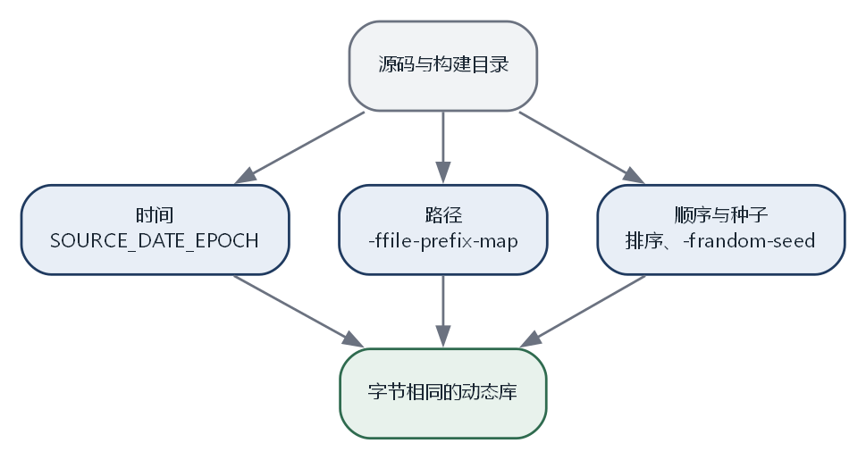

# 第 6 章 构建产物

## 6.1 同一份源码，两个不同的包

同一份源码，在两台机器上编译两次，得到的包可能不一样。

原因很多：编译时间被写进二进制、文件遍历顺序不同、路径字符串被嵌进调试信息、随机化的符号顺序。

对普通程序来说这不是问题。对要做差分更新、缓存、哈希校验的插件系统来说，这是硬伤。

## 6.2 每次更新都要全量下载

有个插件包带资源，八兆左右，装上去的用户十万量级，每周发两次。设计里做了差分更新，服务端按“旧包到新包”算出一份增量，客户端只下那几十万字节。

上线后差分命中率接近零。服务端的缓存键是包的内容哈希，而每次构建出来的包哈希都不一样。同一份源码、同一台机器、同一个人，连编两次得到两个哈希。每个客户端拿到的旧包都是服务端没见过的那一份，差分只能现场算，算不过来就退回全量。

全量下载的账不难算。八兆乘十万是八百吉字节，一周两次，一个月的下行流量在这个量级再乘上八。钱是一方面，更直接的代价是小版本更新要等半分钟，用户干脆不更。

差分更新的前提不是差分算法，是包本身可复现。同一份输入必须得到同一个哈希，服务端才能把“旧包到新包”的差分缓存下来复用。

哈希一直在变还有一个副作用。发布记录里分不清两份包是不是同一份代码，回滚的时候只能靠版本号猜，猜错的代价是用户那边多装一次。

## 6.3 确定性构建

**确定性构建**是指同样的输入，产出字节完全相同的包。

需要控制几个来源。

**时间戳。** 很多编译器会把编译时间写进二进制。可以用 `SOURCE_DATE_EPOCH` 环境变量固定。

```bash
export SOURCE_DATE_EPOCH=1700000000
```

**路径。** 编译时的绝对路径会被写进调试信息。用相对路径，或者开启“路径映射”。

```cmake
target_compile_options(my-plugin PRIVATE -ffile-prefix-map=${CMAKE_SOURCE_DIR}=.)
```

**文件顺序。** 打包时遍历目录的顺序依赖文件系统。打包脚本应该按路径排序。

**随机化。** 链接器的符号顺序、哈希表的种子，都可能随机。GCC 的 `-frandom-seed` 可以固定。

还有几项容易漏。并行编译的程度会影响目标文件里的符号顺序，`-j` 给几不应该影响结果，但某些链接器在多线程下生成的顺序确实不同，把链接这一步固定成单线程最省事。系统区域设置会影响字符串排序和数字格式化，构建脚本里显式设一个固定的 `LC_ALL`。文件权限位会被写进某些包格式，构建时设一个固定的 `umask`。

确定性构建不是必须的。但一旦要做差分更新、内容寻址存储，就必须。



## 6.4 怎么验证确定性

“我开了那个选项，应该是确定的”不能当结论。验证方法很笨，但只用两行命令。

```bash
cmake -B build-a -DCMAKE_BUILD_TYPE=Release && cmake --build build-a
sleep 2
cmake -B build-b -DCMAKE_BUILD_TYPE=Release && cmake --build build-b
sha256sum build-a/libhello.so build-b/libhello.so
```

中间那个 `sleep` 是有意义的。两次构建发生在同一秒时，时间戳恰好一样，问题会被掩盖。隔两秒再编，两个构建目录也不同，时间与路径两类差异才能露出来。

哈希不同时，直接比对字节很难看出问题。把两份二进制里的可打印字符串抽出来对比，往往一眼就能看出。

```bash
diff <(strings -a build-a/libhello.so) <(strings -a build-b/libhello.so) | head
```

输出里出现两行相差两秒的时间、或者两个不同的绝对路径时，原因就找到一半了。剩下的差异按表查。

| 差异长什么样 | 常见来源 |
|---|---|
| 一串日期或时间 | `__DATE__`、`__TIME__`、构建脚本自己写的时间戳 |
| 一长串绝对路径 | 调试信息里的编译目录字段 |
| 符号顺序不同 | 并行链接、遍历哈希表时的顺序 |
| 整段内容都不同 | 打包时没排序，或压缩包里内嵌了时间 |
| 只有包尾不同 | zip 的中央目录记录了文件修改时间 |

最后一类最容易让人放弃，因为解压出来的文件明明一模一样。差异在包的元数据里，不在内容里。打包工具一般都有“固定时间戳”的开关，打开它。

## 6.5 体积

插件的体积影响下载时间和内存占用。

几个常见的膨胀来源。

**静态链接的运行时。** 每个插件都静态链接一份 C++ 运行时，十个插件就十份。

做法是动态链接运行时，或者让宿主提供。

**调试信息。** 带调试信息的动态库可能有几兆，发布时应该剥离。

这个比例值得有个概念。带 `-g` 的 Release 构建，调试信息往往占一半以上的体积。一个两兆的发布包，剥完之后常常只剩几百 KB。

```bash
strip --strip-debug libhello.so
```

Windows 上 `link /DEBUG` 生成 `.pdb`，发布时不带 `.pdb`，只带 `.dll`。

**未使用的代码。** 编译时没有开优化，或者链接时没有丢弃未使用的段。

```cmake
target_compile_options(my-plugin PRIVATE -ffunction-sections -fdata-sections)
target_link_options(my-plugin PRIVATE -Wl,--gc-sections)
```

**重复的依赖。** 插件里打包了一份和宿主相同的库。这种应该改成“由宿主提供”，用 `find_package` 引用。

体积监控要做进 CI。设一个阈值，超过就提醒。

阈值不要写在流水线配置里，放在仓库里的一个文本文件更好，改它要走评审。体积涨了的时候，把新旧两份产物的各段大小打出来对比，能看出是谁胖了。

```bash
size -A build/libhello.so | sort -k2 -n | tail
```

代码段变大通常是模板代码被实例化多了，只读数据变大通常是内嵌的字符串和图标多了，调试段变大则是忘了剥离。三种情况的处理完全不同，先分清哪一种。

## 6.6 调试信息

发布时剥离调试信息，但调试信息本身不能丢。

做法是分开保存：发布包只带动态库，调试信息单独存一份，出问题时按版本号能找到。

Linux 上提取调试信息。

```bash
objcopy --only-keep-debug libhello.so libhello.so.debug
objcopy --strip-debug libhello.so
objcopy --add-gnu-debuglink=libhello.so.debug libhello.so
```

最后一步把调试信息的引用写进动态库。调试器看到引用，自动去找对应的 `.debug` 文件。

Windows 上 `.pdb` 天然是分开的，只要保存好并按版本归档。

调试信息要保留多久，取决于支持策略。至少要保留当前所有在用的版本。

## 6.7 符号可见性

动态库默认导出所有符号。这带来两个问题。

**体积。** 导出的符号表占空间。

**冲突。** 两个插件导出了同名符号，加载时可能互相覆盖。

解决办法是默认隐藏，只导出必须的。

```cpp
// 在接口头文件里
#ifdef _WIN32
#define PLUGIN_EXPORT __declspec(dllexport)
#else
#define PLUGIN_EXPORT __attribute__((visibility("default")))
#endif
```

编译时加 `-fvisibility=hidden`，只有标了 `PLUGIN_EXPORT` 的符号才导出。

```cmake
target_compile_options(my-plugin PRIVATE -fvisibility=hidden)
```

这样动态库的导出表只有三个函数，体积小，也不容易冲突。

“应该只有三个”需要能被验证。Linux 上看动态符号表，Windows 上看导出表，两边各一条命令。

```bash
nm -D --defined-only build/libhello.so | grep " T "
```

```bat
dumpbin /exports build\hello.dll
```

输出里除了 `plugin_init`、`plugin_shutdown`、`plugin_name`，其余都是漏出去的。漏得最多的是模板里写的一个 inline 函数的地址、或者静态库里的某个初始化函数。多一个符号当时不痛，两个插件各自带一份同名实现时才开始互相覆盖，而且谁先加载谁赢，表现得像时好时坏的怪问题。

## 6.8 依赖检查

插件依赖了哪些库，要在构建时检查。

Linux 上用 `ldd`。

```bash
ldd libhello.so
```

Windows 上用 `dumpbin /dependents`。

```bat
dumpbin /dependents hello.dll
```

检查两件事。

**不该有的依赖。** 插件依赖了宿主已经提供的库，会导致两份实例。比如插件自己链接了一份 libstdc++，和宿主的版本不同，跨边界传 `std::string` 就会崩。

**缺失的依赖。** 插件依赖了某个库，但用户机器上没有。这种应该在打包时一起带上，或者在文档里写明。

检查脚本不要只靠眼睛看。`ldd` 的输出交给一份白名单比对，多出来的行就让构建失败。

```bash
ldd build/libhello.so | awk '{print $1}' | sort > actual.txt
diff expected-linux.txt actual.txt
```

白名单里只应该出现宿主提供的库和系统基础库，比如 `libc`、`libm`、`libpthread`、`dl`。冒出 `libstdc++` 就要问一句，宿主是不是也在用它。

## 6.9 一次两份运行时的崩溃

插件为了“独立部署”，静态链接了 C++ 运行时。

```cmake
# 看起来更保险，实际把两份标准库带进了同一个进程
target_link_libraries(my-plugin PRIVATE -static-libstdc++ -static-libgcc)
```

当时的理由很充分。用户的系统五花八门，有的还带着五年前的 `libstdc++`，动态链接上去一启动就报缺符号。静态链接之后，插件自带一份运行时，谁也不用求。

代价在跨边界时出现。接口里传了一个 `std::string`，插件那头用自己那份分配器 `new` 出来，宿主那头用自己那份分配器 `free`。两份分配器各有各的堆，这一 free 就把一块不属于它的内存交了回去。

崩溃栈里全是 `malloc` 和 `free` 的帧，看上去像内存被踩。团队先怀疑越界写入，查了两天没找到线索；最后把导出符号列表拉出来看，两份运行时都在里面。修法只是把接口换成 `const char*`，再去掉静态链接，改完第二天就发了补丁。

这里有两个教训。一是接口只用 C 风格类型，不只为了 ABI 兼容，也为了不让分配器跨边界。二是“看起来更保险”的链接选项，需要有人问一句“那宿主那一份去哪了”。宿主必须用哪一份运行时，应该写在契约里，而不是让每个插件自己决定。

## 6.10 ABI 兼容

插件和宿主之间的边界是 ABI，也就是二进制接口。

ABI 包括：结构体的布局、函数调用的约定、名字修饰的规则、异常的处理方式。

同一份源码，用不同的编译器选项编译，ABI 可能不同。

几个常见的坑。

**标准库版本。** GCC 5 之前和之后的 `std::string` 布局不同。用旧版编译的插件，在新版宿主上读写 `std::string` 会崩。

**`_GLIBCXX_USE_CXX11_ABI`。** 这个宏控制是否使用新的 `std::string` 实现。两边必须一致。

**结构体对齐。** `#pragma pack` 会改变对齐，两边必须一致。

**异常。** 跨动态库抛异常需要两边的运行时兼容。这也是为什么接口层要求“异常不穿边界”。

避免 ABI 问题最有效的办法是：**接口只用 C 风格的类型**。整数、指针、C 字符串、简单结构体。这条规则前面讲过，这里是它的工程理由：只用 C 风格类型，就不会把标准库的 ABI 带过边界。

## 6.11 构建产物的清单

一个发布包应该包含什么。

```text
hello-1.2.0.zip
  plugin.json          清单
  hello.dll            动态库（Linux: hello.so）
  README.md            说明
  LICENSE              许可证
  CHANGELOG.md         变更记录
```

清单里记录：编号、版本、宿主版本范围、入口、权限、文件列表、签名。

文件列表很重要。加载器可以据此检查“包里的文件是不是都在清单里”，防止夹带。

列表不应该手写。打包脚本扫一遍目录，排序后写进清单，顺手把大小和哈希也记上。

```bash
find . -type f ! -name plugin.json | sed 's|^\./||' | sort
```

`sort` 不能省。不排序的列表在两个平台上顺序不同，同一个包在不同机器上会生成两份不完全一样的清单，确定性又从后门漏了。

## 6.12 发版前的检查清单

手动检查不可能每次都想全，列成五条贴在构建脚本里更可靠。

- 两次干净构建的产物哈希一致，不一致就先把原因找出来。
- 动态库的依赖与白名单逐行对得上，没有多也没有少。
- 导出表里只有约定的那几个符号，没有把内部函数露出去。
- 调试信息已剥离，但 `.debug` 或 `.pdb` 已按版本号归档。
- 包里的文件与清单里列的一致，版本号在清单、README、CHANGELOG 三处相同。

第三条和第五条最容易被跳过，因为它们不影响运行。导出表多几个符号，体积大几十 KB，平时看不出来，直到两个插件撞了符号名，或者有人直接调了你的内部函数，把它当成了公开接口。

## 6.13 构建脚本的组织

构建脚本要能被重复执行，不依赖上一次的状态。

几个做法。

**独立的构建目录。** `cmake -B build`，所有中间产物都在 `build` 里，源码目录保持干净。

**清理与重建。** 提供 `clean` 目标，删掉构建目录重新来一遍。

**参数化。** 通过 `-DCMAKE_BUILD_TYPE=Release` 这类参数控制，不要在脚本里写死。

**幂等。** 跑两次和跑一次结果一样。打包脚本尤其要注意，不要往已有的压缩包里追加。

这些做法写成一个小脚本，比一堆散落的命令好维护。

```bash
#!/usr/bin/env bash
set -euo pipefail

export SOURCE_DATE_EPOCH=1700000000
export LC_ALL=C
umask 022

rm -rf build dist
cmake -B build -DCMAKE_BUILD_TYPE=Release
cmake --build build -j
ctest --test-dir build --output-on-failure

mkdir -p dist
cmake --install build --prefix dist
```

这个脚本让流水线和本地用同一份步骤，两边的做法不会悄悄分叉。开头三行环境变量就是在钉住图 6-1 里的那三条输入。`set -euo pipefail` 让任何一步失败都立刻停，不会带着半个构建继续打包。`rm -rf` 放在最前面，是为了让上一次的残留不可能混进来。

下一章讨论签名，确认包的来源和完整性。
