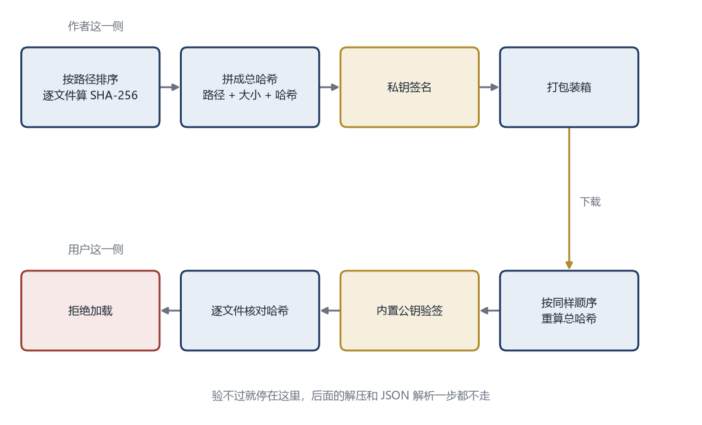
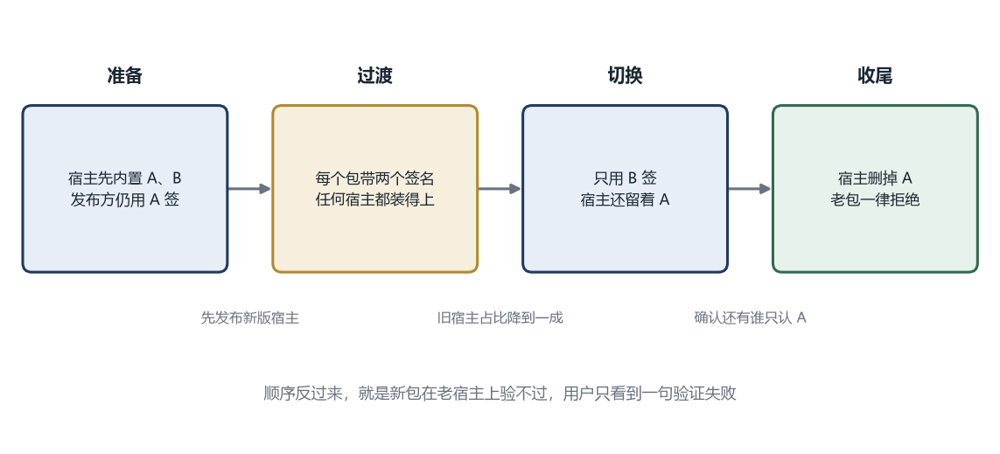

# 第 7 章 签名

## 7.1 哈希只能证明没坏

打包时算一个哈希，下载后再算一遍，一样就说明文件没传坏。

但它证明不了“这个包是谁做的”。攻击者可以改内容，再改哈希，你比对不出来。

**签名**解决这个问题。作者用自己的私钥签，用户用对应的公钥验。

哈希和签名的分工很像快递外包装上的胶带和封条。胶带能看出箱子在路上有没有被拆开过，但任何人都能重新贴一条一模一样的胶带。封条上印着寄件方的印记，撕过就复原不了，收件人看封条就知道这箱东西是不是那个人封的。胶带管运输损坏，封条管身份。插件包里两样都要有，缺一样就有一类问题没法回答。

## 7.2 一对钥匙

密钥对是一次生成、长期使用的。

以 Ed25519 为例。

```bash
openssl genpkey -algorithm ed25519 -out private.pem
openssl pkey -in private.pem -pubout -out public.pem
```

`private.pem` 是私钥，`public.pem` 是公钥。公钥从私钥算出来，反向算不回去。

密钥文件有两种常见封装。PEM 是 Base64 加头尾标记的文本，能直接看，也能贴进配置文件；DER 是二进制，很多密钥管理服务和硬件模块只收这种。私钥那一段 Base64 本身就是秘密，谁拿到都能签。`openssl genpkey -aes256` 可以再用口令包一层，代价是每次签名都要有人输口令。自动化流程里没人坐在那儿输口令，口令最终会被写进环境变量或者脚本，等于没加密，只是把秘密从文件挪到了另一个地方。所以口令保护只适合人工操作的离线签名机。

生成命令里有件事值得留意。上面两行没有指定随机源，OpenSSL 会用系统的熵池。虚拟机上刚装好系统、熵池还没攒够时，`genpkey` 可能卡住十几秒，也可能在极老的版本里拿到质量不好的随机数。生成密钥这件事只在受控的机器上做一次，不要放进每次构建的脚本里。密钥一旦生成就该长期使用，反复生成只会让公钥管理失控。

## 7.3 三种钥匙，三种代价

签名的算法不止一种，选哪个不是口味问题。

| 算法 | 公钥长度 | 签名长度 | 签名开销 | 验签开销 | 常见障碍 |
|---|---|---|---|---|---|
| Ed25519 | 32 字节 | 64 字节 | 很小 | 很小 | 老库不认 |
| ECDSA P-256 | 33 到 65 字节 | 约 70 字节 | 小 | 中等 | 依赖好随机源 |
| RSA-2048 | 约 270 字节 | 256 字节 | 大 | 小 | 参数容易配错 |

Ed25519 用的是确定性签名，同一个私钥签同一段内容，每次得到的签名完全一样，不需要额外取随机数。这一点在冷启动很多的宿主里很实用，验签路径短，几十微秒就能出结果。

ECDSA 每次签名都要一个新鲜的随机数，随机数一旦重复，私钥就能被算出来。历史上家用游戏机的签名实现就栽在这件事上，两个签名共用了同一个随机数，私钥被推导出来，从此任何内容都能被伪造成“官方发布”。用 ECDSA 就要确保随机源可靠，或者干脆换成确定性算法。

RSA 的处境正好相反。签名用的是私钥运算，慢；验签用的是公钥运算，快。用户端只验签，所以用户不觉得慢，难受的是发布方。RSA 还有个现实好处，老系统和各种证书基础设施都认它，一个还在用十年前的加密库的宿主只能验 RSA。如果生态里存在大量老客户端，RSA-2048 是最不会出意外的一种，代价是每个签名 256 字节，清单多了会占点空间。

几个不要做的事。不要自己发明曲线参数，不要用 RSA-1024，不要把“密钥长度”和“安全强度”混着比。选定一种算法后，宿主里同时留一个算法标识字段，将来加第二种算法时才有地方放。

## 7.4 谁拿哪把

**插件作者**拿私钥。只放在自己的机器或密钥管理服务里，不进 Git。

**用户和宿主**拿公钥。内置在宿主程序里，或者随宿主一起发布。

**插件包**里只有签名。签名是几十字节的数据，附在包里。

这里有一条容易被忽视的推论。公钥是公开的，谁都可以有一份，所以公钥本身不需要保密，需要保证的是“这份公钥确实属于那个作者”。反过来说，私钥只有一份，谁多拿了一份，就等于多了一个能冒充作者的人。分发公钥可以随便，分发私钥一次都不行。

## 7.5 签名和加密方向相反

**加密**是“公钥加密、私钥解密”，目的是防止偷看。

**签名**是“私钥签名、公钥验证”，目的是防止冒充。

| | 谁做第一步 | 谁做第二步 | 目的 |
|---|---|---|---|
| 加密 | 发送方用公钥加密 | 接收方用私钥解密 | 防止偷看 |
| 签名 | 作者用私钥签名 | 用户用公钥验证 | 防止冒充 |

插件签名用的是第二种。

两件事经常被同一个人同时需要，于是一起出现。作者要给付费插件加密，让没买的人解不开，同时要签名，让改了包的人装不上。这时候顺序不能乱，先签名再加密。反过来的话，接收方要先解密才能验签，而解密的密钥本身来自不可信的一方，攻击者可以塞一个解不开的包让你在解密阶段就崩掉。先签后加，接收方拿到密文先验签，验不过直接丢，连解密这一步都不进。

## 7.6 签的是哈希

签名不是对整包内容直接运算，而是先算哈希，再对哈希签。

两个理由。包可能几十兆，签名运算比哈希慢得多；签名结果长度固定，对哈希签和对全文签效果一样。

流程。

```text
作者：
  1. 按路径排序，逐个算 SHA-256，拼成总哈希
  2. 用私钥对总哈希签名
  3. 把签名写进 plugin.json 或单独的 SIGNATURE 文件

用户：
  1. 按同样顺序重新算总哈希
  2. 用内置公钥验证
  3. 任何一步不对，拒绝加载
```

签名要覆盖“路径 + 内容”，不能只覆盖内容。否则把 `hello.dll` 改名成 `evil.dll`，内容没变，签名照样通过。



总哈希的拼法值得写死。一个常见做法是按路径排序后，把每个文件的路径、大小、哈希依次写进一段字节流，再对这段字节流算一次 SHA-256。拼接时用一个不会出现在路径里的分隔符，或者干脆先写长度再写内容，避免“路径和哈希连起来正好和另一组相同”这种边界情况。这类问题在安全实现里被利用过不止一次，写的时候多花十分钟，比事后改协议便宜得多。

还有一个实践细节。整包签名对大包来说验一次还行，但用户只想看某个文件为什么会加载失败时，逐文件哈希就派上用场了。清单里每个文件都记了哈希，验签通过之后，宿主可以只重算出错的那个文件，日志里直接写出“tools.dll 哈希不匹配”，而不是一句笼统的“包损坏”。

## 7.7 到底签什么：清单的规范化

签名的对象有两种选法，各有各的麻烦。

签名整个归档文件，实现最简单。打包出来的 zip 就是一个字节序列，对它算哈希再签名，用户下载完对同一个字节序列验签，中间的解析、解压、路径检查都在验签之后做。这条路的问题是，任何重打包都会让字节变化。同一份源码在两台机器上打两次包，压缩级别不同、文件时间戳不同、目录项顺序不同，出来的 zip 就不一样，签名也就对不上。想让这条路稳，打包过程本身必须确定，这属于构建的问题，后面还会讲。

签名一份清单，能绕开重打包带来的不确定性，代价是要把清单的序列化定义到字节级。

```json
{
  "name": "com.example.tools",
  "version": "1.2.0",
  "api": 3,
  "key_id": "ex-2026",
  "files": [
    {"path": "README.md", "size": 1204, "sha256": "0b1f..."},
    {"path": "tools.dll", "size": 812345, "sha256": "9c4a..."}
  ]
}
```

这份清单要满足几个条件，否则两台机器算出来的字节不一样，签名就永远对不上。

- 文件按 UTF-8 字节序排序，不用本地化的排序规则。同一个目录在中英文系统上按“拼音顺序”排出来的结果不同。
- 路径分隔符统一成 `/`，不写开头的 `./`，不带尾部 `/`。
- 大小写保持原样，不做折叠。有的文件系统不区分大小写，清单里却必须区分。
- 文件名的 Unicode 归一化方式固定，统一用 NFC 或者统一不做，不能一半一半。
- JSON 的字段顺序固定，或者用“键排序后序列化”的规则；浮点数换成整数字节数；不放时间戳这类每次都变的值。
- 编码用无 BOM 的 UTF-8，换行统一成 `\n`。

| 签什么 | 好处 | 麻烦 |
|---|---|---|
| 整个归档文件 | 实现最简单，验签在解析之前 | 重打包就失效，要求构建确定 |
| 规范化清单 | 可增量校验，能逐文件报错 | 序列化规则必须写死并测试 |

判断清单有没有做对，有个很直接的办法。在 Windows 和 Linux 上各打一次包，比较两份清单的哈希。不一样就说明还有没固定的东西，签名迟早会在某个平台上翻车。

## 7.8 为什么要签很多次都对

一个常见的疑问：内容每次都不同，公钥凭什么都能验过。

因为公钥验证的不是“签名长什么样”，而是“签名和内容是否满足这对密钥的关系”。

签名是用私钥和内容一起算出来的。内容变，签名也变。但只要用的是同一把私钥，算出来的签名都满足同一个关系。

可以用模具理解。私钥是模具，内容是黏土。压出来的形状由模具和黏土共同决定。公钥是检验机，只检查“这个形状是不是那套模具压的”。

内容不同，形状不同，但都出自同一套模具，检验机都认。内容改一个字节，形状变了，检验机对不上。

## 7.9 一把钥匙签很多次

密钥对不是每次签名时生成的，而是一次生成、长期使用。

作者发布 1.0、1.1、2.0，用的都是同一把私钥。更新时用私钥签新包，宿主用原来那把公钥验证，照样通过。公钥不需要跟着版本变。

只有两种情况要换钥匙：私钥泄露，或者按策略定期轮换。这时宿主里要同时保留新旧两把公钥，或者通过证书链、轮换公告过渡。

## 7.10 密钥轮换怎么过渡

换钥匙有三个触发点。私钥泄露，按事故处理，要按最坏情况收场；按策略定期轮换，比如两年一次，目的是把万一泄露的影响时间窗压短；算法过时，某个算法被宣布不安全，整个生态都得搬。

轮换的难点不在生成新钥匙，在于同时存在两把钥匙的那段时间。老宿主只认识老公钥，新包用新私钥签，老宿主直接拒绝，用户看到的是“插件验证失败”，投诉会涌到发布方这里。

稳妥的顺序是先让宿主认识新钥匙，再让发布方用新钥匙签。分四段走。

| 阶段 | 发布方怎么签 | 宿主内置什么 | 用户看到什么 |
|---|---|---|---|
| 准备 | 仍用 A | A、B | 什么都没变 |
| 过渡 | A、B 双签 | A、B | 什么都没变 |
| 切换 | 只用 B | A、B | 什么都没变 |
| 收尾 | 只用 B | 只留 B | 老宿主上验不过新包 |

准备阶段发一个新版宿主，把 B 公钥加进去，别的都不动。这一步很安全，加一把用不上的公钥不会改变任何现有行为。过渡阶段让每个包同时带 A、B 两个签名，老宿主用 A 验，新宿主用 B 验，任何版本都能装。等旧宿主的使用比例降到可以放弃的水平，切到只用 B 签，最后在某个版本里删掉 A。



收尾那一步要手上有数据。宿主应该在启动时上报自己的版本和内置的 key_id 集合，发布方才知道还有多少设备只认 A。没有这份数据就删老公钥，等于闭着眼睛砍。

泄露的情况没法按部就班。这时候 A 已经不可信，继续双签只是给攻击者留门。做法是立刻用 B 签一版，同时让宿主把 A 标成已泄露，见到 A 的签名一律拒绝，并对装了 A 签名的包发警告。过渡期不再是“都接受”，而是“只接受 B，A 的包提示重新下载”。这会伤到还在用老宿主的用户，但比让攻击者继续冒充要好。

还有一件事容易漏。删掉老公钥之后，用老钥匙签的历史版本仍然在网上。用户如果先装了老版本再自动更新，更新链路会把老包当成有效来源。所以撤回名单或者版本下限要和轮换一起发布出去。

## 7.11 验签发生在哪几个时刻

验签不是一个动作，是三个时刻的三次动作，每次挡的东西不一样。

| 时机 | 验什么 | 开销量级 | 挡什么 |
|---|---|---|---|
| 安装 | 整包签名 | 一次，几十到几百毫秒 | 传输损坏、伪造包 |
| 加载 | 清单签名加关键文件哈希 | 每次启动，几到几十毫秒 | 装完之后被替换 |
| 更新 | 新包签名加版本下限 | 一次 | 降级、伪造更新 |

只在安装时验，省事，但装完之后插件目录是可以被写的。任何能写那个目录的程序都能塞一个改过的 dll 进去，下次启动照常加载。所以加载时至少要验清单的签名，再抽查几个关键文件的哈希。

只在加载时验也不行。加载时如果要算全包哈希，几十兆的插件会让启动时间多出几百毫秒，用户能明确感觉到变慢。合理的分工是安装和更新时做全量，加载时做增量，把每个文件的哈希缓存下来，用修改时间加大小做快速判断，只有这两个变了才重算。

顺序比次数更重要。必须先把整段字节验签通过，再交给解析器。

原因很直接，解析器本身就是攻击面。JSON 解析、zip 解压、图片解码这些库都出过漏洞，构造得刁钻的输入可以在解析阶段就造成越界或者执行代码。如果流程是“先解压看看里面有什么，再去验签”，恶意包根本不需要通过验签就能攻击你。正确的顺序是读到字节，验签，只有通过的那一份才允许进入后面的任何解析代码。

这条规则在代码里表现为一个很窄的入口。所有安装路径都调同一个函数，这个函数只接受“已经验签通过的包”这个类型，类型只能由验签函数产出。想绕过它就得改类型定义，评审时一眼能看出来。

## 7.12 签名保证什么，不保证什么

只要用同一把私钥签名，任何内容都能验过。

作者签一个正常插件，验证通过；签一个偷偷删用户文件的插件，验证也通过。

- **保证来源**：包确实由持有私钥的人发布。
- **保证完整性**：发布之后没有被改过。
- **不保证内容安全**：发布者是否善意、代码有没有漏洞、权限是否合理。

所以签名之外还需要审核、权限、行为监控、撤回。签名解决“是不是他”，不解决“他会不会干坏事”。

## 7.13 降级与重放：签名挡不住的两类攻击

签名证明“这个包是作者发的”，不证明“这个包是作者现在想让你装的”。

攻击者不需要伪造签名也能害人。他把去年那个带已知漏洞的 1.0 包原样拿出来，推给用户就行。签名是真的，哈希是对的，验签一路通过，用户顺利装上一个能被远程控制的老版本。这类攻击叫重放，效果是降级。

防护要落在版本上，不能落在签名上。

- 清单里写单调递增的版本号，并且版本号被签名覆盖。
- 宿主记住装过的最高版本，见到更低的版本直接拒绝。这份记录要放在用户改不动的地方，放在插件自己的目录里等于没放。
- 服务端返回的“当前最新版本”元数据本身也要签名。否则攻击者只要改更新检查的响应，就能把所有人引到老版本镜像。

回滚和降级要区分开。回滚是发布方主动的、有时限的决定，需要签名的回滚指令作为依据。降级是任何人不该能发起的行为。宿主见到回滚指令才允许装低版本，见到普通包只允许装不低于当前的版本。

第二类攻击是搬家。攻击者手里有 A 插件的合法包，也有 B 插件的合法包，把 A 的清单和 B 的文件拼在一起，指望验签只看签名不看内容。这要求验签之后还要做一致性核对，清单里的 name、version、key_id 要和包的实际内容对得上，每个文件的哈希要对得上。只验“签名有效”不够，要验“这份签名对应的正是这份内容”。

## 7.14 亲手试一次

```bash
echo "hello plugin" > plugin.zip
openssl pkeyutl -sign -inkey private.pem -rawin -in plugin.zip -out plugin.sig
openssl pkeyutl -verify -inkey public.pem -pubin -rawin -in plugin.zip -sigfile plugin.sig
```

输出 `Signature Verified Successfully` 表示通过。

改一个字节再验证。

```bash
echo "hello plugiN" > plugin.zip
openssl pkeyutl -verify -inkey public.pem -pubin -rawin -in plugin.zip -sigfile plugin.sig
```

输出 `Signature Verification Failure`。

换一把公钥验证也会失败。这说明签名绑定的是这一对钥匙。

不同 OpenSSL 版本的参数可能略有差异，用 `openssl pkeyutl -help` 查看本机写法。

手动做一遍的意义在于看清一件事。上面这几行命令里，没有任何一步是“把私钥交给对方”。作者只交出了签名和公钥，验签成功不意味着对方得到了签名的能力。这条性质是整个插件信任模型能成立的原因，也是为什么公钥可以随宿主公开发布。

## 7.15 公钥怎么到用户手里

公钥必须可信，否则攻击者换掉公钥，用自己的私钥签名，验证照样通过。

三种做法。

**内置在宿主里。** 宿主安装包带一份或一组公钥，插件包只带签名。最常见，也最稳妥。

**证书链。** 公钥由受信任的机构签发，宿主验证证书链。适合多作者、需要动态授权的大型生态。

**首次信任。** 第一次安装时记录公钥，之后只认这一把。实现简单，但第一次可能是错的。

一条底线：**不能从插件包里读公钥来验插件自己**。那样攻击者把公钥和签名一起换掉，验证永远通过。

## 7.16 一次“验签永远通过”的事故

某内部插件平台的内测版加了一个功能，为了让不同团队都能发插件，把发布者的公钥放进了 plugin.json。理由听起来很顺，加一个新团队不用等宿主发版，填个公钥就能用。

签名实现本身挑不出毛病，用的是 Ed25519，覆盖了路径和内容，代码评审时大家都在看算法对不对。问题出在信任根的位置，宿主验签时从包里读公钥，再用这把公钥验这个包的签名。攻击者改一行 JSON 换成自己的公钥，用自己的私钥签一遍，验签当然通过。

这个洞活了三个月，直到有人在群里发了一个能自动打开摄像头的插件，附言“这也能装”。事后看，这个错误有几个特征。

- 它不违反任何签名算法规则，只审算法审不出来。
- 它带来的便利是真实的，推动它的人并不坏心眼。
- 它的危害取决于“谁能写这个文件”，而这个问题在开发机上永远看不出来。

修复只花了一小时，把公钥挪回宿主内置，包里只留 key_id。真正花时间的是排查存量，确认没有别的入口也在读包里的公钥。最后加了一条 CI 检查，打包产物里出现公钥字段名就报警。

同类错误有几种变体。把首次信任的公钥存在插件目录里，攻击者能写那个目录就等于能换钥。把公钥放在服务端返回的配置里，而配置接口没有鉴权，等于把信任根交给了任何人。判断标准只有一条，信任根必须来自被验证对象之外，并且放在被验证对象改不到的地方。

## 7.17 私钥怎么保管

私钥泄露，等于别人可以冒用你的名义发布插件。

- 不进 Git，不写进构建脚本的明文变量
- CI 里用密钥管理服务，或者至少加密的 secret
- 文件权限收紧，只有构建账号能读
- 发现泄露，立刻换密钥，发布撤回通知，让宿主拒绝旧公钥签的包

公钥可以随便公开，私钥不行。

有一条经常被忽略的泄漏路径是历史记录。私钥曾经被提交过一次，后来删掉了文件，但 Git 历史还在，克隆过仓库的人手里都有一份。删文件不等于删历史，遇到这种情况只能换钥匙，别指望清理仓库能追回来。

## 7.18 签名服务长什么样

私钥放在构建机上，等于把发布权的门槛降到“能进这台机器”。

三种落地形态，安全性和便利性此消彼长。

| 形态 | 私钥在哪 | 便利程度 | 主要风险 |
|---|---|---|---|
| 离线签名机 | 一台不联网的机器 | 低，要人工拷包 | 包拷错、机器丢失 |
| 密钥管理服务 | 硬件模块里，只有签名接口 | 中，要接 SDK | 接口鉴权配错 |
| 签名代理 | 硬件模块加一层策略 | 高，CI 直连 | 策略写得太宽 |

离线签名机适合发布频率低、安全要求高的场景。构建机产出待签包，人用 U 盘拷到那台机器，签完拷回来。麻烦在于人成了链条的一环，也在于那台机器本身要防丢、防坏、防人顺手插个别的 U 盘。

密钥管理服务把私钥关进硬件，签名请求发过去，返回签名，私钥永远不出来。这条路的前提是服务支持你用的算法，不少云厂商的 KMS 只支持 RSA 和少数几条曲线，想用 Ed25519 得先确认。

签名代理是在 KMS 外面再包一层策略。CI 拿着短期令牌来请求签名，代理先校验这个请求从哪来，是不是某个仓库的某个 tag 触发的，待签产物的哈希是不是刚刚那次构建产生的，全都对得上才去调 KMS。这样即使 CI 被攻破，攻击者也只能签他本来就有权签的那个包，没法随手签一个钓鱼插件发布出去。

策略的松紧是这里唯一需要判断的东西。策略写得宽，比如任何有令牌的请求都能签，等于把 KMS 退化成一台普通签名机。判断标准是，一个攻击者拿到 CI 令牌之后能签出什么。如果答案是“能签出任意内容”，这层代理就没有价值。

## 7.19 多作者

每个作者生成自己的一对钥匙，宿主内置一组公钥，每个带编号。

插件清单里写 `key_id`，宿主按编号找对应的公钥验证。

```json
{
  "publisher": {
    "name": "Example Team",
    "key_id": "ex-2026"
  }
}
```

这样不同作者共用一个宿主，各自用自己的私钥签名。宿主不需要为每个作者改代码，只加公钥。

多作者带来的新问题是撤销。某个团队离职、某个外包合作结束，那把公钥要能单独作废，不能影响其他作者。所以 key_id 之外还要有一份撤销名单，名单本身也要签名，并且随宿主版本一起发布。名单只在宿主发版时更新，就意味着撤销有延迟，这个延迟要在规则里写清楚，比如“发现滥用后七十二小时内发布撤销版本”。

## 7.20 一张判断清单

上线之前过一遍这七条，每条都能用“是”或“不是”回答。

1. 信任根是否全部在宿主侧，插件包内不出现任何公钥或者信任配置。
2. 签名是否覆盖了路径，把两个文件互换名字之后验签会不会仍然通过。
3. 清单的序列化是否确定，两个平台打同一个目录是否得到同一串字节。
4. 宿主是否拒绝安装比已装版本更旧的包，除非收到签名的回滚指令。
5. 验签是否严格在解析之前，恶意包有没有机会在验签前进入解压或 JSON 解析。
6. 轮换期是否双钥并存，是否按先发宿主、再换签名的顺序推进。
7. 私钥能否从任何一台构建机的磁盘、环境变量或者 CI 日志里读到。

第 7 条最容易出意外。有人把私钥 base64 之后贴进 CI 的变量里，以为变量是加密的，但打印环境变量的调试日志会把整串打出来。搜索一下 CI 历史日志里有没有那段 base64，比看配置文件有用。

## 7.21 什么时候不需要签名

公开的模组生态里，作者分散、匿名，加载器没有内置一批公钥，让每个作者生成密钥再让用户导入，不现实。

这类生态靠另外三样。

- **上传时扫描**，检查明显的恶意代码
- **哈希锁定**，记录每个版本的哈希，防止传输损坏和 CDN 劫持
- **社区声誉**，下载量、评论、开源仓库

作者签名适合有明确发布方的场景：商业插件、企业内部分发、付费插件、需要区分官方和第三方的宿主。

判断标准。

1. 作者是谁，能不能提前知道？
2. 插件能做什么，宿主能不能限制？
3. 出问题谁负责，能不能撤回？

三个都有肯定答案，签名值得做；否则平台审核加哈希校验更实际。

下一章讲打包、分发、灰度与回滚。
