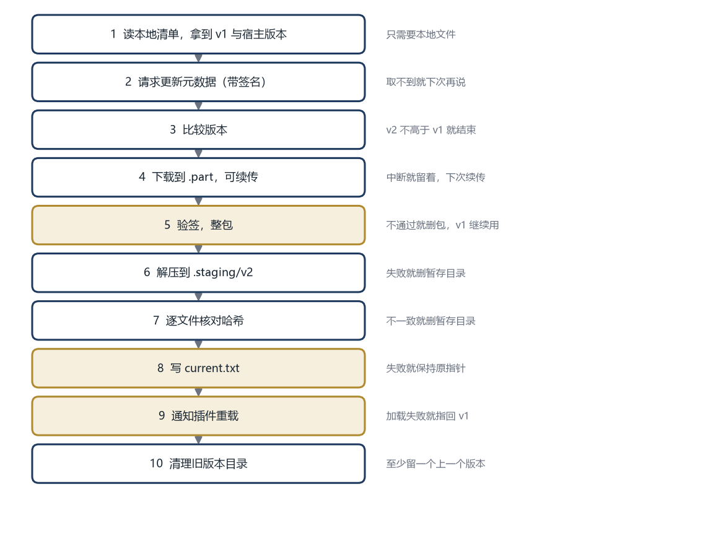
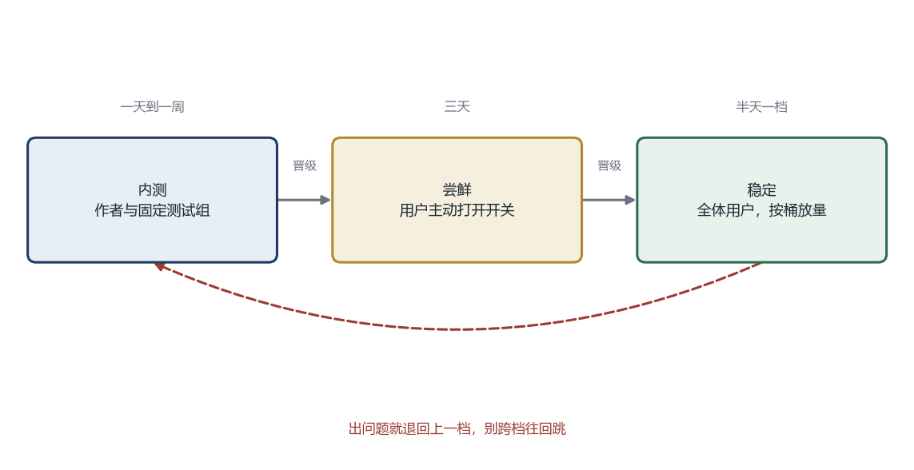

# 第 8 章 分发与更新

## 8.1 一个包从哪来

插件到用户手里，通常有三条路。

**随宿主内置。** 打包在安装程序里，用户装宿主时一起装上。最可控，但更新要跟着宿主走。

**从市场下载。** 宿主内置一个插件商店，用户搜索、安装、更新。适合公开生态。

**本地文件安装。** 用户自己下载一个压缩包，拖进宿主。适合开发和内部分发。

三条路径应该共用同一套安装逻辑，只是包的来源不同。不要为市场写一套、为本地写另一套，否则行为会漂移，安全漏洞也容易只修一边。

共用逻辑之外，还要把“信任等级”分开标。内置包的信任来自安装程序的签名，用户装宿主时就等于一次性认可了这批插件。市场包的信任来自平台审核加发布者签名，平台替用户看过一遍。本地包最弱，它可能来自聊天群里别人转发的压缩包，来源不可追溯。同一套安装代码，本地来源那一支应该多弹一次确认，把包的发布者和签名状态直接摊给用户看，而不是和市场安装一样点两下就装完。

## 8.2 安装的步骤

一次安装要做这些事。

```text
1. 读取包，检查清单
2. 校验签名
3. 检查宿主版本范围
4. 检查依赖
5. 检查权限，展示给用户
6. 解压到临时目录
7. 校验解压后的文件
8. 原子移动到目标目录
9. 登记到插件列表
```

每一步都可能失败，失败时要清理。特别是第 6 步之后，临时目录里已经有文件，失败要删掉。

每一步留下的痕迹不一样，清理方式也就不一样。

| 步骤 | 失败时留下什么 | 怎么收场 |
|---|---|---|
| 清单、签名、版本、依赖 | 什么都没有 | 直接返回错误，用户看到原因 |
| 解压到临时目录 | 半个目录 | 删掉整个临时目录 |
| 校验解压结果 | 半个目录 | 删掉，并在日志里写清哪个文件不对 |
| 原子移动 | 目标目录可能已经建了一半 | 记下目录名，下次启动扫描时清理 |
| 登记插件列表 | 目录在，列表里没有 | 启动时对账补登记 |

最后一行值得单独说。登记失败会造成“装上了但宿主不知道”，用户重启后插件不见了，目录里却躺着一份文件。靠启动时对账能自愈，扫一遍插件根目录，发现目录存在而列表里没有就补登记，发现列表里有而目录不存在就标记成损坏。这类对账逻辑看着像补丁，实际上省掉了大量客服工单。

## 8.3 路径穿越

压缩包里可能带 `../../system/xxx` 这样的路径。解压时如果不检查，会把文件写到插件目录外面。

```cpp
bool safe_extract(const fs::path& root, const fs::path& entry, fs::path& out) {
    auto target = fs::weakly_canonical(root / entry);
    auto base = fs::weakly_canonical(root);

    auto t = target.string();
    auto b = base.string();
    if (t.rfind(b, 0) != 0) return false;

    out = target;
    return true;
}
```

`weakly_canonical` 把 `..` 和符号链接处理掉，得到规范路径。然后检查目标是否在根目录下。

不做这个检查的后果很严重。攻击者做一个包，解压时覆盖系统文件或者宿主的可执行文件。

这段前缀比较还不够。假设根目录是 `C:/plugins/hello`，而包里的条目最终解析到 `C:/plugins/hello2/x`，字符串前缀检查会通过，可那是另一个插件的目录。正确做法是比较路径分量，或者在比较前补一个分隔符，确认 `C:/plugins/hello/` 是目标的前缀。写完这段代码，测试用例里至少要有一个“相邻同名目录”的样本。

Windows 上还有一批坑。`CON`、`NUL`、`COM1` 这些设备名不能当文件名用，`aux.txt` 在某些路径下会被当成设备。文件名以点或者空格结尾时，系统会悄悄截掉，于是清单里的名字和磁盘上的名字对不上。归档条目里带冒号的 `file.txt:evil.exe` 会被写成 NTFS 备用数据流，资源管理器里看起来只是一个文本文件。

这些情况没有必要逐个修补。解压时只接受白名单字符，遇到不合规的条目直接拒绝整个包，比事后猜测干净得多。恶意包本来就不该有第二次机会。

## 8.4 解压时那些不显眼的坑

路径穿越是最出名的一个，但不是唯一一个。真正让安装流程变得难写的是下面这一组细节。

**临时目录必须在同一卷上。** 原子切换靠的是重命名，重命名只在同一个文件系统内是原子操作。临时目录建在系统盘、插件目录在数据盘时，重命名会退化成“拷贝加删除”，中途断电就留下半个版本。稳妥的做法是把暂存目录建在插件根目录下面，比如 `plugins/.staging/1.1.0`，切换时只是在同一棵树里改名。

**解压之前先算空间。** 清单里有每个文件的大小，加起来就知道大概需要多少空间，再留一点余量。不预检的后果是解压到九成时磁盘满，留下半个目录和一堆语焉不详的错误，用户重启也没好，因为残留目录还在。

**压缩炸弹。** 一个几百 KB 的压缩包可以解出几十 GB。限制要写在解压器里，文件数上限、单文件大小上限、解压总大小上限，三个都要有。只限总大小不够，几百万个小文件能把文件系统拖垮，删都删不干净。

**符号链接和硬链接。** 包里带一个指向 `/etc` 或者宿主可执行文件的链接，后续加载时顺着链接读写，等于绕过了整个解压目录的隔离。绝大多数插件不需要链接，直接拒绝这类条目最简单。

**大小写冲突。** 包里同时有 `Readme.md` 和 `README.md`，在区分大小写的文件系统上是两个文件，在 Windows 上是同一个，后写的覆盖前写的，清单里的哈希必然对不上。打包时就该拒绝这种包，而不是等解压后报一个“哈希不匹配”。

**长路径。** Windows 的路径长度限制在嵌套很深的包里会撞上，报错信息往往只有一个失败码。安装前把目标路径拼出来量一下长度，超了就明确告诉用户装到更短的目录里。

| 风险 | 用户看到的现象 | 处理方式 |
|---|---|---|
| 跨卷重命名 | 更新后插件目录为空 | 暂存目录建在插件根下 |
| 磁盘满 | 装到一半失败，重启无效 | 预检空间，失败删残留 |
| 压缩炸弹 | 磁盘瞬间写满 | 限制文件数、单文件、总量 |
| 符号链接 | 加载了目录外的文件 | 拒绝链接条目 |
| 大小写冲突 | 哈希不匹配 | 打包阶段就拒绝 |
| 长路径 | 解压报错，提示含糊 | 前置检查路径长度 |

## 8.5 安装的状态

插件的状态应该明确，不能靠几个布尔变量拼。

```text
未安装 → 已安装未启用 → 启用中 → 运行中
                            ↓
                         停用中 → 已安装未启用
运行中 → 卸载中 → 未安装
任意状态 → 出错
```

每个操作只能从特定状态出发。比如“运行中不能直接卸载，必须先停用”。

状态机写成代码。

```cpp
enum class PluginState {
    NotInstalled, Installed, Enabling, Running, Disabling, Uninstalling, Error
};

bool can_uninstall(PluginState s) {
    return s == PluginState::Installed || s == PluginState::Error;
}
```

状态转换要记日志。出问题时能看出是卡在哪个状态。

还有一条纪律，状态转换要落盘。只在内存里维护状态，宿主被强杀之后重启，磁盘上可能是“目录在、列表在、状态是运行中”，可实际上什么都没加载。启动时不要相信上次存的状态，把它当成“未知”，重新走一遍探测。

## 8.6 下载器要处理的几件事

安装逻辑之外，下载这一段自己就有一堆细节。

**断点续传。** 用 HTTP 的 Range 请求从断点继续，文件先写成 `.part`。后缀的意义是让“未完成”这件事对文件系统可见，下次启动能扫出来删掉。续传拼出来的文件可能已经错了，所以整包的哈希校验不能省，它是最后一道闸。

```bash
curl -L -C - --retry 3 --retry-delay 2 \
     -o tools-1.1.0.zip.part \
     https://cdn.example.com/tools-1.1.0.zip
mv tools-1.1.0.zip.part tools-1.1.0.zip
```

**两类超时分开设。** 连接超时管“服务器在不在”，读超时管“服务器还活着但不给数据”。只设一个总超时，会出现大包在慢速网络上永远下不完的情况。

**只对幂等请求重试。** 下载是 GET，重试安全。上传和“登记已安装版本”这类请求重试要小心，重复提交可能造成两条记录。

**并发和限速。** 用户装了三十个插件，同时检查更新会瞬间打满带宽，整个宿主都卡。限制同时下载的数量，比如三个，剩下的排队。

**代理。** 企业网络里直连大概率失败，错误信息要能说清楚是代理没配还是服务器拒绝。这一条不影响功能，但影响一半的工单。

**写完再改名。** 下载过程中目标文件名不该出现，否则用户看到一个半截的包，或者被杀毒软件扫到一半的文件。

**顺序固定。** 先比哈希，再验签。哈希不匹配就没必要跑签名运算，签名不通过就没必要解压。

## 8.7 更新的粒度

**整包替换。** 下载新包，校验，解压到临时目录，切换，删旧版本。简单可靠，代价是每次都要传完整内容。

**增量更新。** 只传差异。两种做法。

**二进制差分。** 比较新旧包的字节，生成补丁。压缩率高，但对构建环境敏感，包稍有不同补丁就失效。

**内容寻址。** 按内容哈希给文件命名，客户端先问服务端“我有哪些块”，服务端只返回缺少的块。适合文件多、变化小的场景。

无论哪种，最终都要做到“新旧版本瞬间切换，失败不影响当前版本”。

差分有三个前提，缺一个就不划算。

客户端手上要有旧包，或者能按需把旧版本拉下来，否则算不出补丁的基础。补丁要在服务端离线生成并且缓存，不能等用户来请求时现算，现算的延迟比直接下整包还长。补丁本身也要签名，否则攻击者改一个补丁字节就能绕过整包签名，前面所有的验签工作白做。

还有一个组合增长的问题。每个新旧版本对都要一份补丁，版本一多，补丁数量是平方级的。实际做法是只给最近几个版本做补丁，更老的版本直接下整包，用户跨越多个版本升级时也走整包。

## 8.8 原子切换

版本目录加一个指针文件。

```text
plugins/
  hello/
    1.0.0/
    1.1.0/
    current.txt
```

`current.txt` 里写当前使用的版本号。

切换时，先把新版本完整解压好，再改 `current.txt`。改一个几字节的文本文件很快，失败概率很低。

更稳妥的做法是先写一个临时文件，再重命名覆盖。重命名在同一磁盘内是原子操作。

```cpp
void switch_version(const fs::path& dir, const std::string& version) {
    fs::path tmp = dir / "current.tmp";
    {
        std::ofstream out(tmp);
        out << version;
    }
    fs::rename(tmp, dir / "current.txt");
}
```

回滚就是把 `current.txt` 改回旧版本号。旧目录还在，立刻生效。

`ofstream` 出作用域时会把缓冲刷到内核，但没有落到磁盘。断电之后 `current.txt` 可能变成零字节，或者只剩半行版本号。发布前的加固是在关闭文件之后对文件描述符做一次 fsync，再重命名，最后对目录本身也 fsync 一次。这几行的收益只在断电时体现，代价是每次切换多几毫秒，值得。

读指针的时候也要防御。版本号指向一个不存在的目录，说明有人手动删过东西或者切换被打断，这时不要报错退出，退到最近一个可用版本的目录，写一条警告，让宿主还能启动。

## 8.9 一次更新的完整时序

把上面这些拼起来，一次更新是这样走的。

```text
1. 读本地清单，拿到当前版本 v1 和宿主版本
2. 请求更新元数据（元数据本身带签名），拿到 v2 的地址与哈希
3. 比较版本，v2 不高于 v1 就结束
4. 下载到 .part，支持续传，算哈希
5. 验签，整包
6. 解压到 .staging/v2，检查空间、文件数、路径
7. 逐文件核对哈希
8. 写 current.txt（临时文件加重命名）
9. 通知插件重载
10. 清理旧版本目录，保留上一个
```



失败点分布在这十步里，处理方式各不相同。

| 失败位置 | 当前版本还能用吗 | 该做什么 |
|---|---|---|
| 第 2 步，元数据取不到 | 能 | 静默重试，下次启动再说 |
| 第 4 步，下载中断 | 能 | 留 `.part`，下次续传 |
| 第 5 步，验签失败 | 能 | 删包，记警告，不要重试同一个地址 |
| 第 6 步，解压失败 | 能 | 删暂存目录 |
| 第 7 步，哈希不符 | 能 | 删暂存目录，上报是哪次下载出的问题 |
| 第 8 步，写指针失败 | 能 | 保持原指针，下次重来 |
| 第 9 步，重载失败 | 文件已经是新的 | 指回 v1 再重载一次 |
| 第 10 步，清理失败 | 能 | 无所谓，下次启动再清 |

第 9 步是最容易漏的一步。文件切换成功，指针也写好了，看上去一切正常，可新版本一加载就崩。这时候如果只把错误报给用户，用户看到的是插件消失，而磁盘上其实还躺着一个能用的旧版本。指针回退加上一次重载，能把这类问题变成“更新没成功”，用户的感受完全不同。

第 10 步的清理要有节制。至少留一个上一个版本，回滚才有东西可退。清理失败的残留并不危险，下次启动扫描时统一删掉就行，不要为了清理再引入一条失败路径。

## 8.10 热更新的边界

**可以热更**：业务逻辑、界面布局、资源文件、配置。

**很难热更**：已注册的命令、已订阅的事件、正在执行的长任务、持有的系统资源。

**不能热更**：契约变更、内核变更、数据格式的不兼容变化。

一个实用的分级。

- 资源文件变化，直接替换并通知重绘
- 插件代码变化，先停用再启用，重新走一遍初始化
- 契约或内核变化，提示用户重启

热更新要考虑状态。插件停用前可能有未保存的数据。宿主应该在停用前发一个 `before_unload` 事件，给插件保存的机会，超时后强制停用。

停用还有一个容易忽略的副作用，正在执行的长任务。用户点了一个“导出全部”，导出要跑两分钟，这时自动更新把插件停掉，导出就断在半路。宿主应该知道每个插件还有多少在途任务，有任务时把更新推迟到任务结束，或者明确告诉用户“有一个操作正在进行，二十分钟后再更新”。强行停用的代价不是崩溃，是用户的数据丢了一半。

## 8.11 灰度

新版本不一定比旧版本好。上线之后发现问题，要能快速退回。

**灰度**是先把新版本发给一小部分用户，观察一段时间再扩大。

分组方式。

**按用户编号哈希。** 同一批用户始终看到同一个版本，体验稳定。

**按平台。** 先在 Windows 上发，观察一周，再发其他平台。

**按渠道。** 内测用户先拿到，然后是公开渠道。

**用户主动选择。** 提供一个“尝鲜版”开关，愿意的人自己开。

灰度期间要重点看崩溃率、加载失败率、性能指标。不能只看下载量。

按用户哈希分桶的写法要注意两点。

```cpp
uint32_t bucket_of(const std::string& user_id, const std::string& plugin) {
    std::string key = user_id + "/" + plugin;
    uint32_t h = 2166136261u;
    for (unsigned char c : key) {
        h ^= c;
        h *= 16777619u;
    }
    return h % 100;
}
```

第一，键里带上插件名。只用用户编号分桶，一批用户会同时尝鲜所有插件，一旦某个版本有问题，他们踩到的是一串问题，你没法判断是哪一个引起的。第二，哈希算完之后不要再改算法或者加盐，改了就等于重新洗牌，同一批用户突然换了版本，观测数据会断。

## 8.12 灰度比例怎么定

比例不是拍脑袋定的，它由三个量决定，能承受的受害者数量、能看见异常的样本量、观察窗口的长度。

先看基线。崩溃率平时是多少，加载失败率平时是多少，这两个数要在灰度之前就拿到，否则新版本出了 3% 的崩溃也说不清是变差了还是本来就这样。基线的取法是看上一版本同口径的周数据，不要拿一次发布会的数据对比。

再看小比例的意义。5% 的作用不是“发现问题的概率”，是“控制影响面”。真有问题，5% 的人里出现几十个受害者，投诉和指标足够让你看见；如果按统计显著性去算，在小产品上 5% 的人数根本不够，看不出任何东西。

放量的判据要提前写死，不能等到看完数据再定标准。

| 日活量级 | 首档比例 | 首档人数 | 观察窗口 |
|---|---|---|---|
| 几百 | 不设首档，走内测通道 | 十几人 | 三到五天 |
| 几千 | 5% | 百来人 | 一天 |
| 几万以上 | 5% | 上千 | 半天到一天 |

日活只有几百时，灰度其实没有统计意义，这时候该用的是“内测用户加长观察”，让愿意的人先升，看到真实使用中的问题。硬套 5% 只会得到一个既看不出问题、又拖慢发布的流程。

观察窗口不能只看几小时。有些问题只在隔天第一次启动时出现，比如缓存过期、定时任务、跨时区的时间计算、订阅到期。窗口至少覆盖一个完整的日常使用周期，早上开机、白天用、晚上关。

| 通道 | 谁能进 | 常见观察窗口 | 出问题怎么办 |
|---|---|---|---|
| 内测 | 作者与固定测试组 | 一天到一周 | 直接换包，不必回滚 |
| 尝鲜 | 主动打开开关的用户 | 三天 | 关掉开关停止扩散 |
| 稳定 | 全体，按桶放量 | 半天一档 | 把桶收回去 |



放量的档位不要设太细。5%、25%、100% 三档已经够用，设成 1%、2%、5%、10% 会让每一档的样本都不够看，流程变长，收益为零。

紧急修复可以跳档。安全漏洞要立刻修，这时候直接从 25% 开始，但观察窗口不能省，哪怕缩短到几小时。跳过观察等于把灰度变成了赌运气。

## 8.13 通道与版本下限

用户能拿到哪个版本，取决于他在哪个通道，以及宿主允许他升到什么程度。

三个通道够用。稳定通道给绝大多数人，尝鲜通道给愿意折腾的人，内测通道给作者自己和测试组。通道是用户的属性，不是包的属性，同一个包可以同时在三个通道里以不同节奏推进。

企业用户往往要求锁版本。他们做过内部测试，不想某天早上插件自己变了。宿主应该允许“固定版本”，同时明确告诉他们固定之后不再收安全更新，让他们自己权衡。锁版本的用户不在灰度统计里，算比例时要把他们排除，否则分母虚高。

有些版本要强制更新。安全修复属于这一类，尤其是能被远程利用的漏洞。强制更新要有配套动作，客户端拒绝加载旧版本，界面上给一个不能关的提示，说明为什么必须升、升不了怎么办。

清单里还应该有一个最低宿主版本字段。插件用了新接口，老宿主加载会崩，与其让它在运行时崩，不如在安装前就拒绝，并提示用户升级宿主。这个字段和“支持哪些宿主版本”是一回事，只是写在插件这一侧。

跨多个大版本的升级要单独处理。从 1.0 直接跳到 4.0，中间三次数据格式变化可能没人测过。做法是限制最大跳跃，只允许从最近两三个版本升上来，更老的版本先升到一个中间版本，再往前走一步。用户会觉得要多点一次“更新”，但这比升完之后配置全丢好。

## 8.14 回滚

回滚的前提是旧版本还在。

更新时不要立刻删旧目录，至少保留一个上一个版本。

回滚还要考虑数据。新版本可能已经写入了新格式的配置或缓存，旧版本读不懂。

两种解法。

**向前兼容。** 新版本写的数据，旧版本也能读。这要求格式设计时考虑向后兼容。

**备份。** 更新前把关键数据复制一份，回滚时一起恢复。

回滚的速度很重要。一次回滚如果需要用户手动删目录、重新下载，实际耗时是几十分钟并且依赖网络，这期间问题还在扩散。做得好的回滚是本地操作，改一个指针文件，几毫秒生效，不依赖服务端。

## 8.15 回滚时的数据

文件回滚容易，数据回滚难。

新版本第一次启动时很可能已经把配置迁移成新格式，缓存重建了一遍，索引换了结构。这时候把代码退回旧版本，旧版本面对一份读不懂的数据，表现可能比崩溃更糟，它可能读到默认值然后把这些默认值写回去，用户的设置就真的丢了。

三种策略，按可用性排序。

**只增不删。** 新版本只添加字段，不删除也不重命名，旧版本遇到不认识的字段原样保留。这是最实用的一条，代价是格式会慢慢变脏。写配置时最忌讳“读出来解析成结构体，再序列化写回去”，那样未知字段会被丢掉。改成在原始 JSON 上做局部修改，未知字段就能带着走。

```cpp
// 读配置时不要做“解析成结构体再整体写回”，
// 而是在原始 JSON 上改自己认识的键，其余原样保留。
Json patch_config(const Json& old, const std::string& key, const Json& value) {
    Json next = old;          // 未知字段跟着一起走
    next[key] = value;
    return next;
}
```

**版本化数据目录。** 每个大版本用自己的数据目录，回滚时旧版本读自己的老目录，互不干扰。缺点是用户看到“设置变回去了”，而且两份数据同时存在，磁盘占用翻倍。

**可逆迁移。** 每个迁移函数配一个反向函数。听起来最干净，实际最难写对，尤其是涉及数据合并或者去重的时候，反向操作根本不存在。只适合字段改名这类简单迁移。

| 策略 | 回滚后用户体验 | 实现成本 | 适用场景 |
|---|---|---|---|
| 只增不删 | 设置都在 | 低，但要纪律 | 配置、注释、扩展字段 |
| 版本化目录 | 设置回到旧版本状态 | 中 | 缓存、索引、可重建数据 |
| 可逆迁移 | 完全恢复 | 高 | 简单的字段改名 |
| 更新前备份 | 完全恢复 | 低，占磁盘 | 小体积关键数据 |

这四种可以叠加。配置走只增不删，缓存走版本化目录，关键数据在更新前复制一份。多层保护听起来冗余，实际每一次回滚事故都能归到某一层没做。

## 8.16 撤回

发现恶意版本或者严重 bug 时，要能快速撤回。

服务端标记撤回，客户端在下次检查更新时禁用或者降级。

撤回信息本身也要签名，防止被伪造。否则攻击者可以伪造一个“撤回通知”，让所有用户的插件失效。

撤回要有时间窗口。已经装上的插件不可能立刻全部下线，要给出一个过渡期，让用户有时间换替代方案。

撤回要在三个地方同时生效。更新服务不再下发这个版本，客户端把已装的这个版本在下次启动时禁用，市场页面下架并说明原因。只做第一件，用户手里那份会一直留着，而且他会以为是自己的问题。

## 8.17 卸载与残留

卸载看起来简单，把目录删掉就行，实际要区分三类文件。

程序文件属于安装包，卸载时删。用户数据是用户自己的东西，默认保留，并在卸载界面给一个“同时删除我的设置”的勾选。共享缓存是多个插件共用的运行时或者资源，按引用计数删，最后一个用户走的时候才清理。

全删的代价是用户重装之后配置全丢，这种事发生一次就够让人不再用你的插件。全留的代价是磁盘越来越脏，用户换了三台机器同步过来的残留目录里什么都有，下次安装还可能读到过期状态。

共享依赖不要各装一份。两个插件都带同一个运行时，各装一份的结果是版本冲突时互相覆盖，最后一个装的赢。要么把运行时提到宿主层面统一提供，要么按内容哈希分目录存放，谁都不覆盖谁。

## 8.18 一次回滚不了的事故

某次版本更新加了新功能，包体积从 8MB 涨到 30MB。为了省用户磁盘，更新流程里加了一步“切换成功后立刻删掉旧版本目录”。这个改动在评审时被当成优化通过了，理由是旧版本反正不会再用。

上线六小时后，新版本在某个显卡驱动组合上启动即崩。回滚方案本来是改 `current.txt` 指回旧版本，运维打开插件目录，发现旧目录已经没了。

接下来是一连串被动。要让用户回到旧版，只能让他们重新下载旧包，而旧包的下载地址在更新服务上，更新服务此刻正被大量“启动失败后重试”的请求打着。带宽被打满，下载成功率掉到很低。最后是手工把一个旧包放到静态文件服务器上，在社交渠道发链接，让用户手动替换。

从发现问题到用户恢复，中间隔了大半天。复盘时列出的问题都很朴素。

- 删除旧版本的时机错了。清理应该延后，比如成功运行若干次之后，或者干脆只在空间不足时清。
- 回滚路径依赖了正被压垮的服务。回滚必须能离线完成，本地的旧版本是最可靠的仓库。
- 没有演练过回滚。“改指针就行”这句话在文档里躺了两年，没人真正执行过一次。

这三条对应三个动作。清理延后到“新版本连续成功启动三次之后”，保留的版本从两个减到一个也不迟；回滚脚本写成本地操作，不碰网络；每季度拿一个测试环境里的真实安装做一次回滚演练，记录耗时。

## 8.19 分发的成本

分发不是把文件传到服务器就结束。

**带宽。** 每次更新都要传，用户多了就是持续成本。

**存储。** 每个版本都要保存，支持回滚和差分。

**审核。** 插件越多，人工审核越难，需要自动化。

**客服。** 用户遇到问题会来找你，即使问题出在插件作者那里。

**兼容性矩阵。** 宿主版本乘插件版本，组合数量快速膨胀。

这些成本要提前算。一个只有十个插件的内部系统，不需要建市场；一个有上千插件的公开生态，这些成本都是必需的。

带宽成本有个容易忽略的部分，重试和续传。用户网络差的时候，一次更新可能传三遍才成功，实际带宽消耗是理论值的几倍。存储成本也有类似的地方，为了差分和回滚，同一份内容会以多个形态存在，整包、补丁、旧版本目录各占一份。

## 8.20 一张判断清单

上线之前过一遍这七条。

1. 三条来源是否共用同一套安装逻辑，信任等级是否在界面上分开标了。
2. 暂存目录是否与插件目录同卷，切换是否真的一次重命名完成。
3. 解压是否限制了文件数、单文件大小、总大小，是否拒绝符号链接和设备名。
4. 切换是否走临时文件加重命名，写完之后是否 fsync。
5. 是否保留至少一个旧版本，回滚能否在完全断网时完成。
6. 灰度的放量判据是否在看数据之前就写死，观察窗口是否覆盖一个完整使用周期。
7. 卸载是否区分了程序文件、用户数据、共享缓存。

第 5 条值得每周拿一台机器试一次。把网线拔掉，执行回滚，看它能不能在三十秒内恢复。做不到就说明回滚是纸面上的。

下一章讨论可观测性，让问题能被定位。
