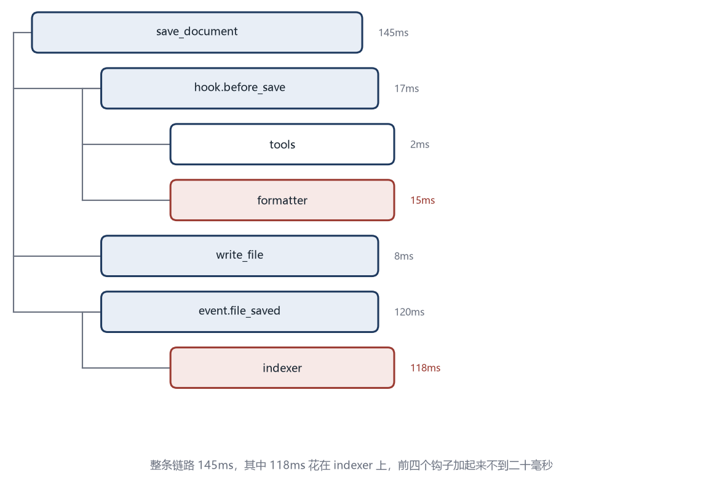
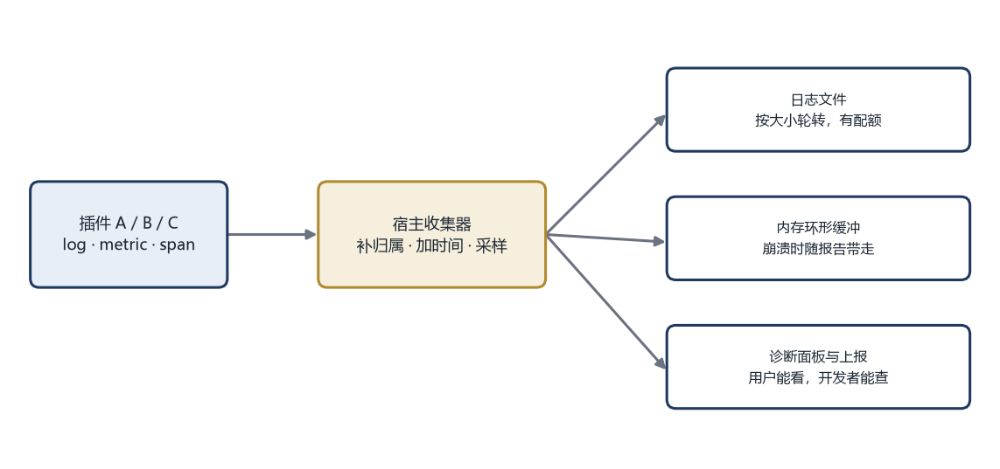

# 第 9 章 可观测性

## 9.1 这是谁的问题

插件系统出问题时，最难回答的问题是“谁的错”。

用户说“保存不了”。可能的原因有十几个：宿主没写权限、插件 A 的钩子返回了 false、插件 B 卡住了、插件 C 抛了异常被吞掉、磁盘满了、文件被别的程序占用。

没有可观测性，只能靠猜。

**可观测性**是指从外部输出推断内部发生了什么的能力。医生看不到你的胃，但能通过体温、血液指标、疼痛位置判断。

插件系统比单机程序更难观测，因为出问题的地方经常在别人的代码里。宿主能控制自己的日志格式，控制不了插件作者写什么。一个下载量很高的插件可能把异常全部吞掉，日志里干干净净，用户只说“有时候没反应”。这种情况没有一套统一的采集机制，排查就只能靠复现，而复现依赖用户的机器、插件组合、操作顺序，往往复现不出来。

## 9.2 三样东西

**日志。** 发生了什么，按时间顺序记录。

**指标。** 现在的状态，用数字表示。

**追踪。** 一次操作经过了哪些环节。

三样各解决不同的问题。日志回答“什么时候发生了什么”，指标回答“现在正常吗”，追踪回答“这次为什么慢/为什么失败”。

三样东西的成本差别很大，这一点常被忽略。一条日志几十字节到几百字节，写多了会占满磁盘；一个指标只是几个计数器，几乎不占空间，但维度设计错了会膨胀成几千条时间序列；一个追踪要串起几十个环节，采集和存储都比前两者重。所以它们的默认开关状态通常不同，日志默认只记 warn 以上，指标全量常开，追踪按采样率。

## 9.3 日志

插件系统的日志有几条要求。

**带归属。** 每条日志标明是哪个插件输出的。没有归属，日志就是一团乱麻。

**带级别。** debug、info、warn、error。用户默认只看 warn 以上，开发者可以调到 debug。

**带时间。** 精确到毫秒，方便和别的日志对照。

**可过滤。** 能按插件、按级别、按时间范围过滤。

**分开存。** 宿主自己的日志和插件的日志分开文件，但能在一个界面里合并查看。

实现上，日志接口由宿主提供，插件通过 `api->log_info` 写。

```cpp
void host_log(int level, const char* message) {
    std::string line = format("%s [%s] %s\n",
                              timestamp(),
                              current_plugin_.c_str(),
                              message);
    write_to_file(line);
    if (level >= WARN) notify_ui(line);
}
```

插件不能直接写文件，否则格式不统一，也无法按插件过滤。

`current_plugin_` 这个变量在宿主里要有明确的生命周期。调用插件函数之前设成插件名，返回之后清掉。如果插件在自己的线程里异步打日志，宿主线程的上下文已经不在了，这时 `current_plugin_` 是空的，日志就会变成无主日志。解法是把插件名做成插件句柄的一部分，日志接口是每个插件各自一份的函数表，而不是全局函数。

## 9.4 结构化日志

上面那种拼字符串的写法能让人看，机器看着难受。用正则去解析 `2026-11-27 09:12:41 [tools] 保存失败` 这种行，格式一改就全崩，而且没法可靠地按字段聚合。

结构化日志把一条日志写成一个对象，一行一个 JSON。

```json
{"ts":"2026-11-27T09:12:41.238Z","level":"warn","plugin":"com.example.tools","event":"hook.slow","trace":"a7f3","hook":"before_save","ms":120}
```

字段要定死，字段表本身就是协议。

| 字段 | 必填 | 说明 |
|---|---|---|
| `ts` | 是 | ISO 8601，带毫秒和时区 |
| `level` | 是 | debug、info、warn、error |
| `plugin` | 是 | 插件标识，宿主自己的日志写 `host` |
| `event` | 是 | 稳定的事件名，用点分小写 |
| `trace` | 否 | 追踪编号，有就带上 |
| `msg` | 否 | 给人看的说明 |

关键在 `event` 和 `msg` 的分工。`event` 是给机器用的稳定标识，`hook.slow`、`plugin.load.failed` 这种；`msg` 是给人看的，中文英文随便写，随时可以改。把两者混在一个字符串里，文案一改，按日志配的告警规则全部失效，而这种失效不会有任何报错。

结构化之后，很多以前要写代码的功能变成查询。按插件统计 warn 数量、找出某个 event 最近一小时的出现频次、把同一 trace 的行排在一起，都是一条过滤条件。

## 9.5 日志的写入路径与开销

日志写在哪里，决定它什么时候会丢。

同步写文件，每次调用要走一次系统调用，几微秒到几十微秒。单条日志不算什么，但插件如果在一帧里打了几十条，或者在一次滚动里每条记录都打一条，累起来就是肉眼可见的卡顿。更糟的是同步写还可能触发磁盘刷盘，那一下是毫秒级的抖动。

常见的折中是分级处理。

```cpp
void log_write(Level lv, const std::string& line) {
    if (lv >= Level::Error) {
        append_and_flush(lv, line);      // 错误同步落盘，宁可慢一点
    } else {
        queue_.push(lv, line);           // 其余交给后台线程
        if (queue_.size() > kMaxQueued) {
            queue_.drop_oldest();        // 忙不过来就丢最老的
        }
    }
}
```

错误同步写，是因为崩溃之前最需要的那几条日志恰恰是来不及落盘的。普通日志走队列，是因为它们的价值在于“事后看趋势”，丢几条不影响判断。

内存里还要留一份环形缓冲。它保存最近几百条日志，不落盘也不清理，专门等崩溃的时候用。崩溃报告里的“崩溃前几十行”就是从这里取的。没有这个缓冲，进程一崩，队列里的内容跟着没了，恰好丢掉的正是最关键的那段。

还要防一件事，日志本身把磁盘写满。日志总量要有上限，超过就删最老的；单个文件按大小或者按天切分；写入失败不能影响主流程。写日志的函数里如果抛异常，处理异常的代码又去写日志，就会递归到栈溢出。这条路径上所有的错误只能吞掉，最多在界面上显示一条“日志不可写”。

## 9.6 指标

几个基本指标能覆盖大多数问题。

**加载时间。** 从发出加载请求到插件可用的时间。

**激活成功率。** 加载成功的比例。持续下降说明有新问题。

**调用次数。** 每个插件的方法被调用了多少次。

**错误率。** 调用失败的比例。

**平均耗时。** 每个方法的平均执行时间。

**内存占用。** 每个插件占多少内存。

指标不需要很细。这几个能回答“哪个插件有问题”。

指标的采集要注意开销。每次调用都记一次时间，本身就是开销。高频调用可以采样，比如每百次记一次。

## 9.7 指标的类型与聚合

指标有三种类型，用错了会得出错误结论。

**计数器**只增不减，记录“发生了多少次”。调用次数、错误次数、崩溃次数都是这一类。计数器本身没有意义，有意义的是它在时间窗口内的增量，所以采集端要能把它转成速率。

**瞬时值**可上可下，记录“现在是多少”。内存占用、在线插件数、队列长度。这类值只在采集那一刻有效，取平均会掩盖尖峰，更适合取最大值或者分位数。

**直方图**记录分布的形态，用来算分位数。耗时指标必须用这个，不能只存平均值。

平均值是这里最容易踩的坑。九次调用 10 毫秒，一次 900 毫秒，平均 99 毫秒，看上去还行。可实际上有一成的用户在等将近一秒，他们的感受和“平均”毫无关系。看 p95 和 p99 才能看到这批人。

```cpp
struct LatencyHistogram {
    static constexpr int kBuckets = 12;
    uint64_t buckets[kBuckets]{};   // 1、2、4、8 …… 512 毫秒，逐桶翻倍
    uint64_t count = 0;

    void observe(double ms) {
        int i = 0;
        while (i < kBuckets - 1 && ms > (1 << i)) ++i;
        ++buckets[i];
        ++count;
    }
};
```

固定桶的好处是内存恒定，一个直方图几十字节，每个插件每个方法一个也不心疼。精度靠桶的密度，桶太稀就分不清 200 毫秒和 400 毫秒，做容量判断够用，做单次问题定位不够，后者要靠追踪。

还有两个统计学上的坑。分位数不能求平均，两个插件各自的 p99 加起来除以二没有任何意义；要合并就得合并底层的直方图再算。只统计成功的调用会让错误率永远是零，失败的那部分才是要看的，采集点必须包住失败路径。

## 9.8 追踪

一次用户操作可能经过界面、宿主、多个插件。

给这次操作分配一个编号，沿途传递，最后能把整条链路串起来。

```text
trace_id = a7f3

界面：用户点了保存        [a7f3]
宿主：开始保存流程        [a7f3]
插件A：钩子 before_save   [a7f3] 耗时 2ms
插件B：钩子 before_save   [a7f3] 耗时 15ms  ← 慢
宿主：写文件              [a7f3] 耗时 8ms
插件C：事件 file.saved    [a7f3] 耗时 120ms ← 很慢
宿主：保存完成            [a7f3] 总耗时 145ms
```

有了 trace_id，日志能按一次操作聚合，一眼看出哪一步慢。

跨进程时，trace_id 放在消息头里。

```cpp
struct Message {
    std::string trace_id;
    std::string method;
    std::string params;
};
```

接收方拿到之后，把它放进自己这一侧的日志上下文。

## 9.9 追踪怎么落地

追踪的最小单位是 span，一个 span 表示“某个环节从开始到结束”。

一次保存的追踪里，根 span 是 `save_document`，它下面挂着保存前的钩子、写文件、保存后的事件三段。钩子这一段自己又分出工具调用和格式化两层，事件这一段展开到索引器。图上能一眼看出时间花在哪一层。

每个 span 记 trace 编号、自己的 span 编号、父 span 编号、名字、起止时间、状态。有了父子关系，一次操作就变成一棵树，耗时长的分支自然浮出来。只有 trace 编号没有父子关系也不够用，平铺的列表里看不出谁调用了谁。



实现上有三处容易出问题。

跨线程的上下文。宿主用线程池执行插件调用，span 是在调用线程里创建的，进了工作线程就丢了。要么把上下文作为参数一路传下去，要么用线程局部变量在任务提交和开始执行时各做一次切换。异步任务丢失上下文是最常见的追踪断链原因，表现出来的现象是日志里有 trace 编号，但链路断成两截。

跨进程的上下文。插件跑在独立进程时，编号要放进消息头。消息头本身要能兼容旧版本插件，所以字段要可选，没有就新开一条链。

采样。全量采集在高频调用下撑不住，每秒几万次调用乘以几个 span，光是开销就能拖垮插件。常见的策略是正常请求按很低的比例采，失败和超过阈值的请求全留。后者要求先把整条链暂存在内存里，等结束再决定要不要上报，代价是内存。

开销要给个数。创建一个 span 是几十字节内存加一次时间读取，微秒量级；一条十几个 span 的链路在毫秒以下。真正贵的不是 span 本身，是序列化和上报，所以两者都要走后台。

## 9.10 三者怎么配合

三种工具不是三选一，是分工。

| 要回答的问题 | 先看哪个 | 再看哪个 |
|---|---|---|
| 现在正常吗 | 指标 | 不用看别的 |
| 什么时候开始不正常的 | 指标趋势 | 日志里找同时刻的异常 |
| 哪一步慢 | 追踪 | 指标看影响面 |
| 这次为什么失败 | 追踪加日志 | 崩溃报告 |
| 谁的错 | 日志归属加追踪 | 错误归属规则 |
| 只出现过一次的问题 | 日志 | 崩溃报告 |



顺序本身有讲究。指标先告诉你“有事”，追踪告诉你“哪一段”，日志告诉你“具体发生了什么”。反过来做，先翻日志，会被海量无关信息埋掉。

这三样也不要指望能回答所有问题。“用户说他保存不了，但他那台机器上没有错误日志”这类情况，往往说明问题出在用户的操作路径或者环境上，而不是代码里。这种情况需要的是能复现的最小环境，不是更多的日志。

## 9.11 错误归属

有了日志和追踪，还要有一套规则判断“谁的错”。

**插件进程内的异常。** 归插件。

**宿主调用插件超时。** 归插件。

**宿主自己抛出的参数校验错误。** 归宿主。

**网络错误。** 看是谁发起的请求。插件发起的归插件，宿主发起的归宿主。

**配置错误。** 归配置的提供者。用户改的配置错了，归用户；插件默认配置错了，归插件。

规则要写进文档，避免互相推诿。

规则之外还要有机制。归属不能只写在文档里，要能自动落到数据上，否则每次争论都要人去翻日志。可行的做法是给每次调用打上发起方标记，插件调用进入宿主时，宿主在上下文里记下调用者；宿主自己的内部调用记 `host`。这样聚合之后，“错误发生在宿主代码里但由插件触发”和“宿主自己出错”能分开统计，讨论问题时不用猜。

归属的用途不只是分责任，还有分动作。归插件的错误可以让宿主采取隔离、降级、禁用；归宿主的错误只能靠发版修，宿主能做的是把影响限制在一个功能里，别拖垮整个应用。

## 9.12 诊断面板

宿主应该有一个地方，让用户和开发者看到插件状态。

面板至少包含：

- 已安装插件列表
- 每个插件的版本和状态
- 最近一次错误
- 资源占用
- 加载耗时
- 注册的命令、事件、钩子

开发者模式还可以看更细的日志和追踪。

这个面板不只是给开发者用的。普通用户遇到问题时，能在这里看到“某个插件反复崩溃”，比看一个空白界面有用得多。

面板还应该提供“禁用并重启”的按钮，让用户能自救。

设计面板时有两件事值得多想一步。第一是错误要带上时间，只有一句“加载失败”没法判断是刚才还是上周。第二是给一个“复制诊断信息”的按钮，把版本、插件列表、最近错误拼成一段文本放进剪贴板，用户发到群里比让他截图有用得多。这个按钮的成本是几十行代码，能省掉大量来回询问。

## 9.13 崩溃报告

插件崩溃时，宿主应该记录现场。

**崩溃时间。** 精确到毫秒。

**崩溃位置。** 如果拿到了堆栈，记录完整的调用链。

**当时的状态。** 正在执行什么命令、处理什么事件、由谁触发。

**最近的日志。** 崩溃前几十行。

**环境信息。** 宿主版本、插件版本、操作系统、内存占用。

这些信息打包成一个报告，用户可以选择发送给开发者。

崩溃报告要注意隐私。不要包含用户的内容、路径、账号。只包含定位问题必需的信息。

崩溃报告的及时性也有讲究。崩溃的那一刻，进程状态还能读，堆栈还完整，这时候采集最准。等到下次启动再补采集，能拿到的只剩磁盘上的痕迹，栈早就没了。所以崩溃处理要做在崩溃发生的那一侧，用一个独立的小进程或者信号处理器把现场写出去，而不是等宿主重启之后去猜。

## 9.14 脱敏与隐私

日志里最容易混进来的三类东西，文件路径、用户内容、身份信息。

路径里带用户名，`C:\Users\alice\Documents\项目\合同.docx` 这一条就把用户名和文件名都泄了。日志里应该只留相对路径或者通配后的路径，把用户目录换成 `%USERPROFILE%`。

用户内容更容易被无意记录。插件处理文档时把正文写进 debug 日志，排查时很方便，上传之后就变成了数据事故。剪贴板内容、搜索关键词、输入法候选，都属于同一类。

身份信息包括账号、邮箱、设备标识、IP。

做法上，白名单优先于黑名单。写日志时只记录已知字段，而不是“记录全部再过滤敏感词”。黑名单永远漏，正则脱敏也经常漏变体，`user@example.com` 能匹配，`user(at)example.com` 就漏了，中间夹个零宽字符更漏。

需要关联同一用户的多条日志时，用哈希代替原值。同一个账号每次哈希出同一个值，能聚合，但反推不出账号。哈希要加盐，否则常见邮箱能被彩虹表打回来。

上报之前让用户知道。第一次开启诊断上报时给一句说明，告诉用户会发什么、不会发什么，再给一个“仅保存在本地”的选项。这一步看起来是负担，实际减少了后面被质疑时的解释成本。

## 9.15 可观测性的成本

可观测性本身有成本。

**性能。** 日志、指标、追踪都要时间。高频路径上要采样或者关掉。

**存储。** 日志会占很多空间。需要轮转和清理。

**隐私。** 日志里可能包含用户数据，需要脱敏。

**复杂度。** 加一套可观测性系统，本身就是要维护的东西。

控制成本的做法。

**分层。** 默认只记 warn 和 error，需要排查时临时开到 debug。

**采样。** 高频操作只记一部分。

**轮转。** 日志按大小或时间切分，保留最近若干份。

**开关。** 可观测性功能可以整体关掉，给性能敏感的用户。

成本里还有一项很少被算进去，人的成本。指标多了要有人看，告警多了要有人处理，看板和查询要有人维护。一个没人看的看板比没有看板更糟，因为它给人“我们在监控”的错觉。指标和告警的数量应该由“出了问题谁会去看”来决定，没人会看的就不要建。

## 9.16 从可观测性到故障恢复

可观测性是故障恢复的前提。

不知道哪里出错，就没法自动恢复。

有了日志和指标，才能做这些。

**熔断。** 某个插件连续失败，自动切断它的调用。

**降级。** 插件不可用时，回退到内置实现。

**重启。** 插件进程崩溃，自动重启。

**告警。** 错误率超过阈值，通知开发者。

这些机制属于稳定性设计，本书不展开。这里只需要记住：所有自动恢复的前提是“能判断出出问题了”。

判断的门槛要设得保守。自动熔断误伤一次，用户会觉得插件时好时坏；阈值设得太松，等于没有。可行的做法是先用指标观察一段时间，等知道了正常波动范围再开自动动作，并且给自动动作留一条人工覆盖的开关。

## 9.17 一次日志把磁盘写满的事故

某个用户反馈“设置保存不了”。宿主不崩，插件都在，就是点保存没反应，重启也一样。

第一轮排查走的是权限方向。装到别的目录，正常；换一个账号，正常。第二轮怀疑插件冲突，让用户禁用全部插件，问题还在。第三轮才发现 C 盘只剩几十兆。

日志是怎么把磁盘写满的。两周前这位用户遇到一次插件加载失败，客服让他打开 debug 日志。debug 打开之后，某个插件在每次界面重绘时打一条日志，一次滚动能打几百条。日志按天切分，每个文件有大小上限，但没有总量上限，30 个插件各写各的目录，两周下来堆了几十 GB。

三个问题叠在一起才出事。没有总量上限，没有按插件配额，debug 级别在用户机器上打开之后没人负责关。第三个问题最要命，因为它是流程问题，不是代码问题。

修复做了四件事。日志总量有硬上限，超过就删最老的目录；每个插件的日志有配额，写超了就丢弃并记一条“该插件日志已截断”；debug 级别带过期时间，打开时选时长，到点自动恢复；保存失败时把“磁盘空间不足”明确写进界面提示，而不是只写“保存失败”。

最后一条看起来最不起眼，收益最大。这场事故里用户和客服都被“保存不了”这四个字带偏了两周，如果第一次失败就提示磁盘满，五分钟就能定位。

## 9.18 一张判断清单

照着这七条过一遍，能挡掉大部分“查不出来”的困境。

1. 每条日志是否带插件归属和稳定的事件名，文案改动是否会打断告警规则。
2. 错误级别日志是否同步落盘，进程崩溃时是否会丢掉最关键的几十行。
3. 日志是否有总量上限和按插件配额，debug 级别是否有自动过期。
4. 耗时指标是否用直方图，是否看 p95 而不是只看平均值。
5. 失败路径是否也在统计口径内，错误率有没有因为只统计成功而恒为零。
6. 追踪是否跨线程、跨进程传得下去，异步任务里有没有断链。
7. 日志里有没有用户路径、用户内容、身份信息，脱敏用的是白名单还是黑名单。

第 6 条最容易被漏掉，因为它在开发时完全正常。开发时插件调用都是同步的，一上线换成线程池，链路就断了，而断链不会报错，只会让你看不到那一段。

下一章把前面这些工具串成一条流水线，从一条命令走到用户手里。
