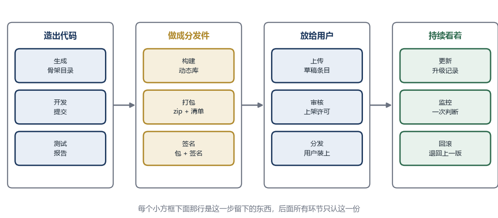
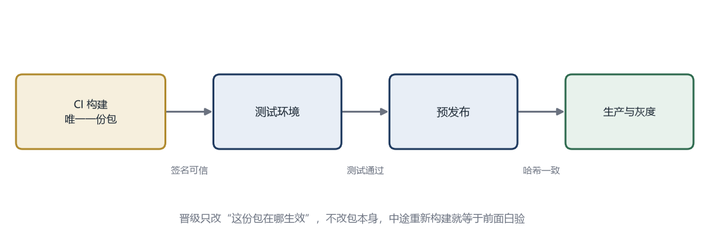

# 第 10 章 从一条命令到用户手里

## 10.1 完整流程

把前面九章的工具串起来，一个插件的生命周期是这样。

```text
生成 → 开发 → 测试 → 构建 → 打包 → 签名 → 上传 → 审核 → 分发 → 更新 → 监控
```

每一步都有工具，也都有检查。

| 步骤 | 用什么 | 产出 |
|---|---|---|
| 生成 | 生成器 + 模板 | 能编译的骨架 |
| 开发 | 编辑器和假宿主 | 业务代码 |
| 测试 | 断言宏 + CI | 测试报告 |
| 构建 | CMake + 确定性选项 | 动态库 |
| 打包 | 打包脚本 | zip + 清单 |
| 签名 | 私钥 + OpenSSL | 签名 |
| 上传 | 上传工具 | 市场条目 |
| 审核 | 自动扫描 + 人工 | 上架许可 |
| 分发 | CDN + 客户端 | 用户装上 |
| 更新 | 差分包 + 灰度 | 用户升级 |
| 监控 | 日志 + 指标 + 追踪 | 问题定位 |



## 10.2 流水线的阶段边界

这张表把“一步一步走”画得很顺，实际运行时最容易出问题的地方在两个阶段之间，而不是阶段内部。

每个阶段要能回答四个问题，输入是什么、输出是什么、失败之后留下什么、能不能单独重跑。

| 阶段 | 输入 | 输出 | 失败之后 | 能否重跑 |
|---|---|---|---|---|
| 生成 | 模板参数 | 能编译的骨架 | 可能留下半个目录 | 可以，换个目录 |
| 开发 | 源码 | 提交 | 无 | 无 |
| 测试 | 提交 | 测试报告 | 挡住合并 | 可以 |
| 构建 | 提交 | 动态库 | 无 | 可以，但要确定 |
| 打包 | 动态库加清单 | zip | 无 | 可以 |
| 签名 | zip | zip 加签名 | 发布中止 | 可以，签同一份字节 |
| 上传 | 包 | 市场条目草稿 | 无 | 可以，覆盖同一草稿 |
| 审核 | 草稿 | 上架许可 | 不上架 | 改完重新提交 |
| 分发 | 上架版本 | 用户装上 | 灰度停下 | 可以回滚 |
| 更新 | 新版本 | 用户升级 | 同分发 | 同分发 |
| 监控 | 指标与日志 | 一个判断 | 没法判断 | 无 |

表里最值得盯住的是“输出”这一列。每个输出都是一份可以被哈希标识的制品，后面所有环节都引用同一个哈希，不重新构建，也不重新打包。

这条规则听起来只是流程洁癖，实际解决的是一个很现实的问题。开发在本地打了包自己测过，觉得没问题，发布时 CI 重新构建一次，编译器版本、依赖版本、编译选项可能都不一样。线上跑的和测过的不是同一个东西，出问题时的所有讨论都建立在错误前提上。

构建一次，之后一路传下去。谁想“顺手重新构建一下”，都要先回答为什么上一份不能用了。

## 10.3 生成

一条命令。

```bash
new-plugin com.example.tools --template command --with-example
```

生成后自动编译、测试、冒烟加载。三项都过，作者拿到一个确实能跑的组件。

生成器的价值不在省下写样板代码的时间，在于把当前推荐的做法固定下来。目录结构、构建选项、清单格式、日志接口的用法，都写进模板里，作者不需要知道为什么，照着写就是对的。等推荐做法变了，改模板，新生成的插件自动跟上。

## 10.4 开发

作者的日常是“改一行，看效果”。

三个循环层次。

```bash
cmake --build build && ctest --test-dir build   # 单元测试，几百毫秒
mock_host build/plugins/tools.so                # 假宿主，几秒
cp build/plugins/tools.so ~/.host/plugins/      # 真实宿主，手动验证
```

假宿主在这一步的价值最大。它让“注册了几条命令”“事件处理有没有跑”这些问题能在几秒内验证。

三个层次的差别在于反馈延迟。单元测试几百毫秒，作者愿意每改一行就跑一次；假宿主几秒，改完一个功能跑一次；真实宿主需要重启和手动点几下，一天跑几次。作者会本能地选择最快的那个层次，所以如果一个项目只有真实宿主可测，实际结果就是大家都不测。

## 10.5 测试

CI 在每次提交时跑。

```text
格式检查 → 编译 → 单元测试 → 集成测试 → 打包
```

任何一步失败，整条流水线停。作者在合并前就能发现问题。

矩阵覆盖多个平台和多个宿主版本。

矩阵要控制规模。三个平台乘四个宿主版本就是十二个组合，每个组合跑一遍集成测试，时间会涨到无法接受。实际做法是分层，单元测试在所有组合上跑（它很快），集成测试只在关键组合上跑，比如每个平台的最低和最高宿主版本。剩下的组合靠发布前的抽样验证。

## 10.6 构建

确定性构建。

```bash
export SOURCE_DATE_EPOCH=1700000000
cmake -B build -DCMAKE_BUILD_TYPE=Release \
      -DCMAKE_CXX_FLAGS="-ffile-prefix-map=$PWD=."
cmake --build build
```

产物要检查：体积、依赖、导出符号。

```bash
strip --strip-debug build/plugins/tools.so
ldd build/plugins/tools.so
nm -D --defined-only build/plugins/tools.so
```

## 10.7 确定性构建怎么验证

“确定性构建”不是把 `SOURCE_DATE_EPOCH` 设上就完事了，它需要被验证。

验证方法很朴素，同一份源码构建两次，比较产物的哈希。

```bash
cmake --build build --target package
sha256sum dist/tools-1.0.0.zip
rm -rf build dist
cmake -B build -DCMAKE_BUILD_TYPE=Release && cmake --build build --target package
sha256sum dist/tools-1.0.0.zip
```

两行哈希一样才算通过。不一样的时候，通常从这五个方向找原因。

| 差异来源 | 典型现象 | 处理 |
|---|---|---|
| 时间戳 | 只有几个字节不同 | 归档时用固定时间，编译时设 `SOURCE_DATE_EPOCH` |
| 绝对路径 | 调试信息里带本机目录 | `-ffile-prefix-map` 映射成相对路径 |
| 文件顺序 | 归档条目次序不同 | 打包时按路径排序 |
| 并行顺序 | 链接或打包结果随机 | 固定并行度，或让打包不依赖遍历顺序 |
| 环境差异 | 换台机器就不同 | 固定编译器版本、locale、时区 |

这五条里，locale 最容易被忽略。同一个目录在不同语言环境下按“本地排序规则”排出来的顺序不一样，打包脚本如果直接遍历目录并按文件名排序，产物就会随机器变。排序要用字节序，不要用平台的默认排序。

确定性构建还有一个隐性收益，缓存。构建结果可复现，才能安全地复用上一次的编译产物。不确定的构建每次都得重来，CI 时间会成倍增长。

## 10.8 打包

```bash
python pack.py build/plugins/tools dist/tools-1.0.0.zip
```

打包脚本做三件事：按路径排序、固定时间戳、生成校验清单。

产物结构。

```text
tools-1.0.0.zip
  plugin.json
  tools.so
  README.md
  LICENSE
  SHA256SUMS.txt
```

## 10.9 签名

```bash
openssl pkeyutl -sign -inkey private.pem -rawin \
    -in dist/tools-1.0.0.zip -out dist/tools-1.0.0.sig
```

签名文件随包一起上传。私钥绝不进仓库。

签名之后，包就变成不可变的了。任何再动一下的念头都要打消，包括“顺手改一下 README 里的错字”。改了就得重新打包、重新签名、重新走一遍审核，这看起来麻烦，但它挡住了更麻烦的事，同一版本号对应两份不同内容。

如果确实要在发布前补东西，正确做法是把版本号升上去，而不是覆盖已经在流程里的那一份。

## 10.10 上传与审核

上传时自动检查。

- 清单格式和字段完整性
- 签名有效性
- 声明的权限和实际调用的 API 是否匹配
- 依赖是否可解析
- 是否有明显的恶意模式（写系统目录、连接可疑域名）

自动检查通过之后，小生态可以人工看一遍，大生态只能抽样加举报。

“声明的权限和实际调用的 API 是否匹配”这一条最值得花力气做好。它要的是静态扫描导出符号和导入表，看插件调了哪些宿主接口，再和清单里声明的权限对照。不一致就拒绝，不要给“先上架再补声明”的机会。这一条能挡住大部分越权尝试，因为越权插件必须真的调用那些接口才能越权。

## 10.11 分发

客户端检查更新的流程。

```text
1. 向服务端查询当前版本的最新版
2. 比对本地版本
3. 有更新时下载差分包或完整包
4. 校验签名
5. 解压到临时目录
6. 原子切换
7. 通知插件重新加载
```

每一步都可能失败，失败时要保留当前版本。

## 10.12 更新与灰度

新版本先发给 5% 的用户。

观察 24 小时，看三件事：崩溃率、加载失败率、用户投诉。

没有异常，扩大到 25%，再扩大到 100%。

有异常，立刻回滚，把 `current.txt` 改回旧版本。

## 10.13 失败处理与重试

流水线的长度决定了失败是常态。一次发布要经过十几个阶段，每个阶段都可能因为网络、磁盘、凭据过期、上游服务抽风而失败。

处理失败的第一条规则是停下来。脚本开头写 `set -euo pipefail`，任何一步非零退出就中止，别让后面的阶段踩着半个产物继续跑。

```bash
set -euo pipefail
```

三个开关各管一件事。`-e` 让命令失败即退出，`-u` 让引用未定义变量时报错，`-o pipefail` 让管道里任何一段失败都算整条失败。第三项最容易被忽略，`./build.sh | tee log.txt` 这种写法在没有 `pipefail` 时永远返回成功，因为 `tee` 成功了。

第二条规则是每个阶段都能单独重跑。这意味着阶段之间只靠磁盘上的制品传递，不靠内存里的状态；也意味着重跑要幂等，跑一次和跑三次的结果一样。上传覆盖同一个草稿是幂等的，每次新建一个条目就不是。

第三条规则是记录走到了哪一步。CI 里当前阶段的状态是隐式的，失败重跑时很难知道从哪继续。写一个小的状态文件，或者用 CI 提供的阶段标记，把“构建通过”“签名完成”“已上传”这些事实落下来，重跑时先读一遍，跳过已经完成的阶段。

| 失败位置 | 常见原因 | 处理 |
|---|---|---|
| 构建 | 编译器或依赖变了 | 修完重跑，从构建开始 |
| 打包 | 磁盘满、路径太长 | 清理后重跑 |
| 签名 | 凭据过期、签名服务不可达 | 修凭据后重跑，签同一份字节 |
| 上传 | 网络中断、配额满 | 重试，覆盖同一草稿 |
| 打标签 | 标签已存在 | 确认是否重发同一版本，是就跳过 |

最后一行藏着一条纪律，标签已存在说明这个版本号被用过。这时候要先判断是“上次发布只差打标签这一步”还是“这个版本号已经发出去了”。前者可以补，后者必须换号。分不清的时候按后者处理，宁可多一个版本号，也不要出现两个不同的包共用一个版本号。

## 10.14 制品晋级

同一个制品从测试环境走到生产，中间不该再被构建一次。

用环境来区分，而不是用构建来区分。流水线产出唯一一份带哈希的包，先部署到测试环境，验证通过后把同一份包晋级到预发布，再晋级到生产。每次晋级只改“这份包在哪里生效”，不改包本身。



晋级关卡要验的东西不多，但每一条都不能省。

- 这份包的签名是否由可信的 key_id 签的
- 这份包在上一关是否真的通过了测试（看记录，不看口头确认）
- 这份包的哈希和测试时那份是否一致

第三条最容易被跳过。晋级时如果重新下载或者重新打包，哈希就变了，前面所有验证都白做。正确做法是按哈希取包，存储层按内容寻址，取回来的东西天然是同一份。

## 10.15 版本号与标签的纪律

版本号看起来是最不需要思考的东西，实际是最容易出错的地方。

权威来源只能有一个。清单文件里的版本号是权威，构建脚本、tag、市场条目上的版本都从它派生。三处各写一遍的后果是某次改动只改了两处，用户装上的包版本号是 1.2.0，市场里显示 1.3.0。

已发布的版本号永不复用。哪怕那个版本上线一小时就撤回了，也不能把同样的号再发一次，因为用户手里已经有一份叫这个名字的东西，两份不同内容的同名版本会让所有统计和排查失效。

标签打在产出这份包的提交上，不要“先发再打标签”。顺序反了的时候，中间如果有人往分支上推了提交，标签指向的就不是构建时的那份源码。

比较版本要按语义化规则，不能拿字符串比。

```cpp
struct Version { int major, minor, patch; };

bool version_less(const Version& a, const Version& b) {
    if (a.major != b.major) return a.major < b.major;
    if (a.minor != b.minor) return a.minor < b.minor;
    return a.patch < b.patch;
}
```

字符串比较会把 `1.10.0` 判成小于 `1.9.0`，因为字符 `1` 小于 `9`。这个错误在版本号还是一位数的时候完全看不出来，等到第十个小版本才爆发，而那时候已经有一批用户装不上更新。

预发布版本也要能排序。`1.2.0-beta.1` 小于 `1.2.0`，`1.2.0-rc.1` 大于 `1.2.0-beta.2`。排序规则要写进宿主的比较函数里，不能指望“发布时别搞错顺序”。

## 10.16 监控

上线之后要持续看。

**每日指标。** 新增安装、更新、卸载、崩溃数。

**每周趋势。** 崩溃率有没有上升，哪个版本问题最多。

**告警。** 崩溃率超过阈值、某个插件连续失败、某个版本大量回滚，都要通知。

## 10.17 紧急修复通道

正常流程走完要几天，安全漏洞等不了。

紧急通道不是“跳过流程”，是“换一条更短的路”。可跳过的部分和不可跳过的部分要写清楚。

| 环节 | 正常流程 | 紧急通道 |
|---|---|---|
| 自动扫描 | 全套 | 全套，一项不减 |
| 人工审核 | 完整评审 | 一人复核 |
| 灰度 | 5% 起步，三档 | 直接从 25% 起步 |
| 观察窗口 | 半天一档 | 保留，可以缩短 |
| 回归测试 | 全矩阵 | 关键组合加漏洞相关用例 |

自动扫描一项都不能减，因为紧急修复最容易夹带问题。人工审核压缩到一人，但不能没有，那个人要看的是“这个改动是否只修了这一个问题”。

紧急修复事后要回合主分支。这件事经常被忘，后果是下一个正常版本把漏洞又带回来。可以在发布记录里加一栏“是否需要回合”，不填不能关闭。

紧急通道用得多，说明正常流程有问题。偶尔一次是正常的，一个月五次就该看流程本身了。

## 10.18 一条命令跑完全部

理论上可以把这些都做成一条命令。

```bash
./release.sh 1.2.0
```

它依次执行：清理、构建、测试、打包、签名、上传、打标签、推送。

实际项目中，`release.sh` 要慎用。一条命令做完所有事，出问题时不好中断，也不好回滚。

更稳妥的做法是分成几步，每步都能单独重跑。

```bash
./build.sh          # 构建 + 测试
./package.sh 1.2.0  # 打包 + 签名
./upload.sh 1.2.0   # 上传
```

每步的产物都在磁盘上，可以检查、可以重来。

## 10.19 一次“本地构建”发出去的事故

某团队要赶一场演示，时间只剩两小时。CI 那天在排队，负责人就在自己机器上执行了打包脚本，手工把包传到了市场后台，备注写“临时版本，稍后补正式发布”。

演示很顺利，功能都对。两周后用户反馈某个按钮点了没反应，只在部分机器上出现。开发者拉源码、看代码、跑测试，全都正常，因为线上那个包里有一段只存在于某人本地工作区的修改，那段代码从没提交过。查了两天才确认这一点，方法是对比线上包的哈希和 CI 产物的哈希，发现对不上，再去问那台机器上还剩什么。

事故之后加了三道闸。

- 所有能进入市场的包必须由 CI 从 tag 构建，构建环境里注入一个只有 CI 才有的凭据变量，本机没有这个变量就打不出可上传的包。
- 上传工具会回声一遍包的构建来源，包括提交哈希和构建机标识，让上传的人看到自己要传的是什么。
- 本机打包允许，但产物名带 `-local` 后缀，上传工具直接拒绝。

三道闸里最有效的是第一道。文档里写“不要在本机打包”两年，没人违反过？这次就是。工具拒绝，才真的拒绝。

## 10.20 流程的成本

这条流水线不便宜。

**时间。** 从提交到用户手里，可能要几天（审核）。紧急修复要有快速通道。

**人力。** 审核、客服、发布管理，都需要人。

**工具。** CI、CDN、签名服务、监控，都有费用。

**认知。** 新加入的人要学会整套流程。

规模小的项目可以砍掉很多。只有几个内部插件时，一条 `cmake --build` 加手动复制就够了。

流水线的复杂度应该和插件数量、用户规模匹配。三个插件不需要灰度，一千个插件必须有。

## 10.21 一张判断清单

发布之前过一遍这七条。

1. 每个阶段的产物是否落盘并按哈希标识，后面所有环节是否引用同一份哈希。
2. 同一份源码构建两次，产物的哈希是否一致；不一致的地方是否已经定位到原因。
3. 已发布的版本号是否永不复用，版本号的权威来源是不是只有一处。
4. 每个阶段能否单独重跑，重跑是否幂等。
5. 失败时是否停下来，而不是带着半个产物继续往下走。
6. 紧急通道跳过了哪些环节，哪些环节一项没减。
7. 上传工具是否只接受 CI 产物，本机打包的包是否有明显区分。

第 2 条是整条流水线的地基。它不成立，后面所有的“我验过了”都没有意义，因为你验的那份和用户手上的那份可能不是同一个东西。

下一章讨论维护，以及什么时候该停下来。
