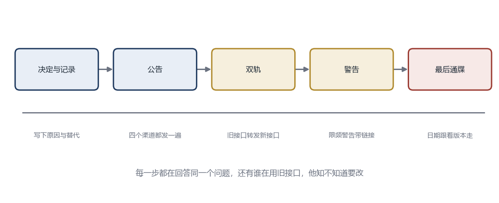
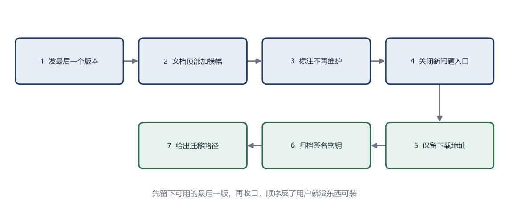

# 第 11 章 维护与停止

## 11.1 发布只是开始

一个插件发出去之后，真正的维护才开始。

用户会装在不同版本的宿主上，会用到没测过的组合，会遇到作者没想到的场景。日志会涨，配置会乱，接口会过时，依赖会有漏洞。

这一章讨论发布之后的事，以及什么时候该停下来。

## 11.2 版本兼容矩阵

插件支持哪些宿主版本，要维护一张矩阵。

```text
              宿主 3.0   3.1   3.2   4.0
插件 1.0      ✓          ✓     ✓     ✗
插件 1.1      ✓          ✓     ✓     ✗
插件 2.0      ✗          ✓     ✓     ✓
```

矩阵不需要覆盖每个补丁版本。契约版本遵循语义化，次版本增加功能但保持兼容，选几个关键点测试就够。

矩阵要写进文档，用户装之前能查。装了不兼容的组合，宿主应该拒绝并提示。

矩阵的行列最好用契约版本，而不是产品版本号。宿主的 4.0 可能只是换了界面，契约还停在 3；也可能只是修了三个 bug，契约却升到了 4。插件真正依赖的是契约，不是产品号。用契约版本做行列，矩阵才稳定，界面改版时不用动它。

## 11.3 兼容矩阵怎么维护

矩阵一旦写成文档里的表格，就会开始腐烂。发版时忘了更新，半年后没人敢信。

让它活下来的办法是把它变成 CI 的配置，而不是文档。

```yaml
# 矩阵就是这份配置，跑出来的结果才是文档里的那张表
matrix:
  api: ["3.2", "3.4", "4.0"]
  platform: ["windows", "linux"]
  exclude:
    - api: "4.0"
      platform: "linux"
```

CI 里每个组合拉一个对应契约版本的假宿主，跑同一套冒烟用例，包括加载插件、注册命令、调用一条命令、卸载。冒烟用例要小，几秒能跑完，才有资格在每个提交上跑。

职责要分清。宿主团队负责“这个版本支持哪些契约”，决定删除时间；插件作者负责“我的插件支持哪些契约”，写在清单里。两边在 CI 里对账，插件声明的范围超出宿主实际支持的，构建时就报错。

淘汰要同步。宿主删掉对 3.0 的支持时，矩阵要同步少一行，文档、清单检查、下载页的提示一起改。这三处不一致的后果是用户看到“支持 3.0”，装上却加载失败。

## 11.4 弃用

接口一定会变。问题是怎样让变化可控。

**先加后删。** 新字段先以可选形式加入，旧字段保留一段时间。等插件都迁移完，再删旧字段。

**提供适配层。** 旧接口的调用转成新接口的实现。适配层放在宿主里，插件不用改。

**标记弃用。** 弃用的接口在文档里标出，运行时打一条警告，告诉作者哪个版本会移除。

**给出迁移指南。** 说明改了什么、为什么改、旧代码怎么改、新代码长什么样。

弃用期要多长，取决于生态规模。插件少，一个版本就够；插件多、作者分散，可能需要一年以上。

## 11.5 弃用的完整流程

弃用不是“在文档里画一条删除线”，它有七个步骤，少一步就会在某处漏掉一批人。

第一步是写下决定。为什么弃用、替代方案是什么、打算什么时候删。写成一页纸放在仓库里，比散在聊天记录里可靠。半年后有人问“这个接口为什么还在”，这一页能直接回答。

第二步是公告。发版说明里写，文档里标，诊断面板里给提示，给活跃作者单独发一封邮件。四种渠道覆盖的人群不一样，只发一种总会有人没看到。

第三步是双轨。新接口上线，旧接口内部转成对新接口的调用，行为保持一致。这一步的验收标准是“用旧接口的插件行为和以前完全一样”，不是“能跑”。

第四步是运行时警告。插件调到旧接口时打一条 warn，带上替代接口的名字和一个文档链接。警告要限频，同一个插件同一个接口一小时最多一条，否则日志会被刷满，用户会去找客服投诉“插件一直报警告”。

第五步是看迁移率。指标里加一个维度，统计还有多少调用来自旧接口，按插件聚合。这份数据是后面所有决定的依据，没有它，删除就只能靠猜。

第六步是最后通牒。定一个具体日期，写进文档、写进警告文案、写进发版说明。日期要跟着宿主版本一起发布，让作者知道“升级到某个宿主版本就没了”。

第七步才是删除。删除也要分两步，先让旧接口返回明确错误，再删掉代码。

| 阶段 | 大致时长 | 判据 |
|---|---|---|
| 决定与记录 | 立即 | 决策记录进了仓库 |
| 公告 | 一个版本周期 | 四个渠道都发了 |
| 双轨 | 一个大版本 | 新接口可用，旧接口转发 |
| 警告 | 两三个月 | 警告覆盖率上来了 |
| 删除 | 文档里写的日期 | 旧接口调用量降到很低 |



删除时先返回错误再删代码，这一步很多人觉得多余。它的价值在于错误信息。直接删掉函数，插件加载时会报一个“找不到符号”，用户看到的是“插件加载失败”，作者看到的是链接错误，两边都不知道发生了什么。先返回一个“此接口已在宿主 4.0 移除，请改用 xxx”的错误，用户知道找作者，作者知道改什么。这个空壳留一个大版本，成本很低。

## 11.6 适配层怎么写、什么时候删

适配层是把旧调用翻译成新实现的薄薄一层。

```cpp
// 旧接口保留在宿主里，内部直接转给新实现，不掺业务逻辑
extern "C" int plugin_save_v1(const char* path) {
    return plugin_save_v2(path, SaveFlags::None);
}
```

写法上有四条纪律。

只做翻译，不做业务。适配层里一旦长出判断、缓存、兼容补丁，它就会变成第二个实现，两边的行为开始分叉，最后没人说得清哪个才是对的。

每个函数上标注删除版本。`// deprecated since api 3.4, removed in 5.0` 这种注释要写在函数上方，删的时候能一次找全。

测试必须覆盖适配层。只测新接口，适配层就永远不会被执行，坏了也没人知道。冒烟用例里要留一条走旧接口的，直到它被删除。

行为差异要写进文档。新接口可能修了旧接口的一个怪行为，比如返回值从 -1 变成抛异常。这类差异不写下来，作者迁移过去之后会遇到“以前能用的用法现在不行了”。

删除的时机由两个条件同时满足决定，旧接口调用量降到可以忽略，并且宿主支持的最低契约版本已经高于引入替代接口的版本。只满足第一个就删，那些还没升级宿主的用户会在某次升级后突然发现插件坏了。

## 11.7 依赖漏洞

插件的依赖里可能藏着有漏洞的库。

定期审计。

```bash
# 如果用了 vcpkg
vcpkg export --dry-run

# 或者查 CVE 数据库
./scripts/audit_deps.sh
```

发现高危漏洞，要能快速发布修复版本。这要求发布流程足够快，不能每次都走完整审核。

## 11.8 漏洞响应流程

审计跑出结果只是开始，从“知道有漏洞”到“用户装上修复版本”中间有一串动作。

前提是有一份依赖清单。每个发布版本都记下自己用了哪些库、哪个版本、是静态链接还是动态链接。

```bash
ldd build/plugins/tools.so      # 动态链接的直接依赖
vcpkg list                      # 构建时锁定的依赖树
```

静态链接时 `ldd` 看不出来，依赖被编进了产物，只能靠构建时记录的清单。这份清单（业内叫 SBOM）应该和安装包一起存档，出 CVE 的时候能当天回答“哪些已发布版本受影响”。

接下来的动作按顺序是评估、修复、发布、告知。

评估要看漏洞是不是真的可达。库里有个解析图片的函数有溢出，而你的插件从来没解析过图片，风险就低得多，不必半夜爬起来发版。反过来，漏洞在被高频调用的路径上，就得当紧急事件处理。

修复通常是升级依赖，然后跑一遍回归。升级可能带来行为变化，尤其是跨次版本，所以回归用例要覆盖用到这个库的主要功能。

发布走紧急通道，跳过部分审核但不跳过扫描，灰度从更高比例起步但保留观察窗口。

告知要说清四件事，影响哪些版本、漏洞的严重程度、修复在哪个版本、暂时升不了级有什么缓解办法。最后一条经常被漏，而它恰恰是企业用户最需要的。

| 环节 | 产出 | 常见失误 |
|---|---|---|
| 依赖清单 | 每个版本的 SBOM | 静态链接的库没记录 |
| 订阅 | CVE 与上游公告的通知 | 只订了一个来源 |
| 评估 | 是否可达、影响面多大 | 一律按最高危处理，疲于奔命 |
| 修复与回归 | 升级后的包 | 升级了依赖但没跑回归 |
| 发布 | 修复版本 | 走完整审核，拖了三天 |
| 告知 | 影响范围与缓解办法 | 只说“已修复” |

## 11.9 用户反馈

用户反馈是发现问题的主要来源。

几个做法。

**内置反馈入口。** 用户在插件面板里能直接提问题，附带版本、日志、崩溃报告。

**分类。** 崩溃、功能异常、性能问题、使用疑问，分开处理。

**回应。** 即使用户的问题没法解决，也要回一句“收到了”。没有回应的反馈，用户下次就不提了。

**归档。** 处理过的问题记录下来，形成常见问题清单。

## 11.10 生态治理

插件多了之后，需要规则。

**命名规范。** 防止重名和混淆。

**审核标准。** 什么能做，什么不能做。权限申请的合理性，行为的可接受范围。

**撤回机制。** 发现恶意插件时的处理流程。

**举报入口。** 用户发现问题的渠道。

**争议处理。** 两个插件冲突时谁的责任，作者之间互相指责时怎么处理。

这些不是代码，但决定了生态能不能健康发展。

## 11.11 停止维护

维护有终点。产品被替代、团队被拆、方向变了，插件会走到不再维护的那天。怎么收尾，决定用户最后怎么记住它。

公告要回答五个问题。最后支持到哪一天，最后一个是哪个版本，之后还修不修安全问题，迁移到哪里去，旧版本还能不能下载。

收尾有一份顺序，顺着做不容易漏。

1. 发最后一个版本。把已知的小毛病修完，依赖锁死到一个确认可用的组合，文档和代码对齐。
2. 文档顶部加一条横幅，说明当前状态和最后支持日期。横幅要放在最上面，别埋在页脚。
3. 市场页面标成不再维护，但不隐藏。隐藏等于让老用户没法重装，也没法回滚。
4. 关闭新的问题入口，保留历史记录和搜索。已经写下的讨论是后来人的资料。
5. 保留下载地址。只要还有人可能装它，地址就该在。
6. 处理密钥。不再发版本就把私钥归档到离线介质；还要发最后一个修复版本，就先留着，发完再归档。
7. 给出迁移路径。替代品是什么，数据怎么带过去，有没有转换工具。



有一种中间状态值得考虑，只修安全问题。它比彻底停止更容易执行，因为工作量小，也更容易被用户接受。界线要在公告里写清楚，只修能被利用的漏洞，不接功能请求，不加新平台。界限模糊的后果是用户继续提需求，每一次拒绝都在消耗信任，而被明确告知“已经停了”反而更容易被理解。

三件事不要做。静默下架，用户重装不了、回滚不了，也不知道发生了什么；删掉仓库，后来的人无法接手，出了问题无法追溯；删文档，知识跟着消失，下一个做同类东西的人要从头踩一遍。

## 11.12 交接与知识留存

维护者会换人，代码会换团队。交接做得差的标志是新人第一周就问“这个怎么发布的”。

README 里至少要写清三步，怎么构建、怎么测试、怎么发布。这三步要能一条条照着做，不带“问一下老王”这种前置条件。

决策记录比代码注释更值钱。为什么用这个格式、为什么这个接口不能改、为什么放弃了某个方案，这些问题的答案通常只存在某个人的记忆里。写成一页页短记录，每次做决定时补一条，成本很低。

凭据要有一张清单。签名私钥在哪、市场的发布令牌谁持有、CI 的密钥怎么轮换、域名和存储桶归谁。清单本身不放密码，只写“在哪里、谁负责”。

检验交接质量的办法很直接，让一个没接触过这个项目的人，只按文档从零构建一次并发布到一个测试环境。他卡住的每一处都是文档缺口。

## 11.13 一次“悄悄删掉旧接口”的事故

宿主 4.0 发布时删掉了一个早期接口。依据是内部统计显示这个接口的调用量已经归零，删掉能少维护一份代码。

上线当天社区炸了。几十个第三方插件加载失败，用户的界面上一片空白，错误提示只有一句“插件加载失败”。

统计为什么会是零。因为那个统计只覆盖了宿主自带的官方插件，第三方插件的调用数据从来没有接进来。团队看到的“零调用”是真的，只是样本里根本没有第三方。

第二个问题让事故更严重。删除是直接删，没有过渡版本。如果先让接口返回一个明确的错误，用户至少能看到“此插件使用了已移除的接口，请联系作者”，而不是对着空白界面猜。这个信息差把一次可控的兼容性事故变成了一场信任危机。

事后做了四件事。第三方插件的调用数据接入统计；删除接口必须走完整的弃用流程，包括两个版本的运行时警告；旧接口取消后至少留一个版本返回明确错误；发版说明里单列一节“移除的接口”。

第二件事后来救过一次。5.0 移除另一个接口时，诊断面板提前两个版本就在提示，作者陆续改完了，真正删除那天几乎没有反馈。

## 11.14 什么时候停下来

工程化不是越多越好。

**插件数量稳定。** 一直是那几个，没有增长，说明不需要继续投入。

**用户规模稳定。** 一直是那几百人，故障影响可控。

**团队规模稳定。** 只有两三个人维护，没有精力做生态。

**产品方向稳定。** 不再加新功能，只修 bug。

这几种情况下，现有的工具链够用，继续加只会增加维护成本。

判断标准：**现在的工具能不能支撑未来一年的需求。** 能，就停；不能，只补最缺的那一块。

停下来也包括停止对旧版本的维护。同时维护三个大版本，等于三份测试矩阵、三份依赖审计、三份发版工作。支持窗口要提前写清楚，比如只维护最近两个大版本，更老的只保证还能下载。窗口写清楚了，用户会自己安排升级节奏；没写清楚，就会有人一直在最老的版本上提问题。

## 11.15 一张判断清单

1. 兼容矩阵是由 CI 跑出来的，还是文档里手工维护的一张表。
2. 每个弃用项是否有决定记录、公告日期、运行时警告和观测数据。
3. 旧接口删除之前，是否至少有一个版本返回明确错误并给出替代方案。
4. 每个发布版本是否留有依赖清单，CVE 出来当天能否查出影响范围。
5. 停止维护的公告是否写明最后支持日期与迁移路径。
6. 下架时下载地址、文档、历史问题是否都保留着。
7. 交接材料里是否包含构建、测试、发布三步，以及一张凭据清单。

第 6 条最容易被当成洁癖。它的实际收益在两年后，某个用户要重装一个老环境，发现安装包还在，问题才没有变成“你们的东西装不上了”。

## 11.16 一个收尾

“先让它能跑”“扩展不是目的，能撑住才是”，走到交付这一步，还可以补一句：**能被别人用起来，才算做完。**

一个只有自己会用的系统，界面再漂亮、架构再精致，价值也有限。一个能让别人写插件、装插件、用插件的系统，即使结构简单，也已经是一个产品。

工程化的每一项，最后都指向同一件事：降低别人使用和参与的门槛。

模板降低写插件的门槛，假宿主降低调试的门槛，签名降低信任的门槛，文档降低理解的门槛。

如果某一项工具没有降低任何门槛，只是增加了流程，那它大概不该存在。

本书到这里结束。
