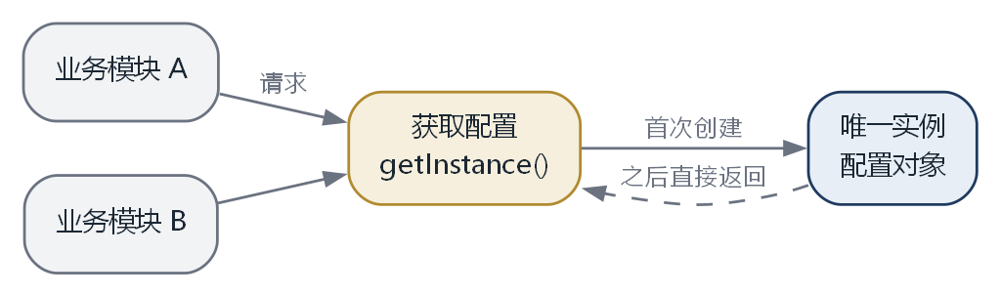

# 第 1 章 单例：全局只能有一份

## 1.1 一个配置对象

后台服务启动时要读一份配置文件，解析成结构体，校验几个必填项，然后供各个模块使用。

最初的写法很自然。哪个模块要用配置，就在哪里读一次文件、解析一次。数据库模块读一次，日志模块读一次，任务调度模块再读一次。

三个模块，读三次文件。文件不大，启动时多花几毫秒，没人注意。

问题在运行中冒出来。运维改了配置文件，想热加载。数据库模块重新读了，日志模块还在用旧的，两个模块看到的路由规则不一致，请求被分到了错误的库。

还有一种情况。配置里有一个连接池大小的参数，三个模块各自解析，各自建了一个池。原本设计是全局共用一个池，结果变成了三个，连接数直接超限。

## 1.2 直接写会怎样

最直接的修法是加一个全局变量。

```cpp
Config g_config;   // 全局对象

void init_config() {
    g_config = load_and_parse("app.conf");
}
```

所有模块都读 `g_config`，问题看似解决了。但新的问题接着来。

**初始化顺序。** 全局对象在 `main` 之前构造。如果某个模块的全局对象在构造时就要用 `g_config`，而此时 `init_config` 还没调用，拿到的是空配置。

**谁都能改。** `g_config` 是全局可写的，任何一处代码都能改它。某天一个模块为了临时调试改了一个字段，忘了改回来，线上就出了怪事。

**测试没法替换。** 单元测试想用一份测试配置，只能去改全局变量，测试之间互相污染。

**多份实例仍然可能出现。** 有人觉得全局变量不优雅，自己又写了一个 `ConfigManager`，内部 `new` 了一个配置对象。于是系统里有了两份。

## 1.3 单例的三个角色

单例模式要解决的是“保证一个类只有一个实例，并提供一个全局访问点”。

它包含三个角色。

**单例类本身。** 它知道自己只能有一份，所以把构造函数藏起来，不让外部随便创建。

**唯一的实例。** 它作为单例类的一个静态成员存在，生命周期与程序相同。

**访问入口。** 一个静态函数，外部通过它拿到那唯一的一份。第一次调用时创建，之后直接返回。

用结构描述大概是这样。

```text
class Config
  private static instance : Config
  private constructor()
  public static getInstance() : Config
  public get(key) : string
  public reload() : void
```

构造函数是私有的，外部写 `new Config()` 会编译失败。想用配置，只能走 `getInstance()`。



## 1.4 协作过程

第一次有模块调用 `getInstance()` 时，单例内部检查实例是否为空。为空就创建，把实例存进静态成员，然后返回。之后的调用直接返回已经存好的那一份。

整个过程只有一次创建，所有调用方拿到的是同一个对象。

这一步看起来简单，但在多线程环境里要小心。两个线程同时第一次调用，可能都看到实例为空，都去创建，结果出现两份。

常见的处理有两种。

一种是在函数第一次执行时初始化静态局部变量。C++11 之后，标准保证这种初始化是线程安全的，多个线程同时到达也只会初始化一次。

另一种是加锁。进入函数先加锁，检查实例，创建，解锁。简单但每次调用都要加锁，开销略大。可以在锁外先检查一次，为空再加锁检查一次，这就是常说的双重检查。

单例内部还要处理“配置能不能改”的问题。如果配置是只读的，单例初始化之后不再变化，用起来很安全。如果配置支持热加载，就要考虑：重载时是替换整个对象，还是原地修改字段？前者会让已经持有旧引用的模块看不到新值，后者要考虑并发读写。

一个比较稳妥的做法是把配置设计成不可变对象。重载时构造一份新的，整体替换单例内部持有的引用。读取方每次通过 `getInstance()` 拿最新的，不在局部缓存旧引用。

## 1.5 单例的边界

单例经常被滥用，因为它用起来太方便。

**单例不是全局变量的替代品。** 如果一份数据本来就该由某个模块管理，只是别的模块偶尔要读，那应该通过参数或者接口传进去，不该做成单例。单例适合那些确实全局唯一、且生命周期与程序一致的东西：配置、日志器、主事件循环、设备上下文。

**单例持有可变状态会变成隐性耦合。** 一个单例里有十几个可写字段，任何模块都能改，排查问题时根本不知道是谁改的。这种单例实际上是“带名字的全局变量”，比裸全局变量更危险，因为它看起来像是经过设计的。

**单例让测试变难。** 测试要替换单例，只能改静态成员，测试之间容易互相影响。可以在单例里留一个“替换实例”的入口，只在测试构建里开放。更好的做法是让使用方依赖一个接口，单例只是这个接口的一个实现，测试时换成假实现。

**单例在多实例场景下不成立。** 一个进程里只有一个配置，但如果一个进程要同时服务两个租户，每个租户一份配置，单例就不适用了。这时候需要的是“按名字取实例”的注册表，每个名字一份，而不是全局唯一。

## 1.6 与相关模式的区别

**单例和工厂。** 工厂解决“创建哪一个”，单例解决“只能有一个”。两者可以叠加：一个工厂本身是单例，它创建出来的产品不是。

**单例和外观。** 外观是把一组子系统包成一个简单接口，它经常被实现成单例，但这不是必须的。外观的核心是简化接口，不是保证唯一。

**单例和享元。** 享元也强调共享，但它共享的是“内部状态相同的一组对象”，可能有多个，按 key 区分。单例只有一个。

## 1.7 一个判断标准

要不要用单例，问三个问题。

第一，这个对象在程序里是不是真的只能有一份？如果有两份会导致资源冲突或者状态不一致，那就有必要。

第二，它的生命周期是不是和程序一样长？如果只是某个请求期间需要，用完就该销毁，那不该是单例。

第三，调用方是不是遍布整个程序，而且没法通过参数传递？如果只有两三个模块用，直接传参更清楚。

三个都是“是”，单例合适。有一个是“否”，就该再想想。

单例的价值不在于“全局可访问”，而在于“创建一次、处处一致”。如果只是为了省事而全局可访问，那用依赖注入或者显式传参会更好。
