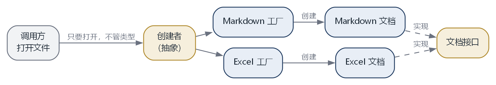

# 第 2 章 工厂方法：把选类型的决定挪走

## 2.1 打开文件的那段代码

一个文档编辑器要打开不同格式的文件。Markdown 有 Markdown 解析器，Word 有 Word 解析器，PDF 有 PDF 解析器。

最初的实现很直白。

```text
open(path):
    ext = extension(path)
    if ext == "md":    parser = new MarkdownParser()
    else if ext == "docx": parser = new DocxParser()
    else if ext == "pdf":  parser = new PdfParser()
    else: throw 不支持
    return parser.parse(read(path))
```

这段代码能用。加一种格式，改一个 `else if`，五分钟搞定。

问题出现在编辑器变大之后。

**打开文件的地方不止一处。** 主界面的“打开”按钮、最近文件列表、拖放、命令行参数、自动恢复，五个入口都有类似的格式判断。加一种格式，要改五处，漏一处就出 bug。

**调用方被迫认识所有解析器。** 这段代码所在的文件里，必须包含五个解析器的头文件。任何一个解析器的接口变动，这个文件都要重新编译。

**测试没法只测打开逻辑。** 想验证“打开一个损坏文件时的提示”，得先构造一个真的文件，因为这个函数直接依赖具体的解析器。

## 2.2 把创建和使用分开

问题的根源是“决定用哪个类”和“使用这个类”写在了同一个地方。

工厂方法把这件决定挪走。调用方不再写 `if`，而是让一个专门的创建者来决定。

它包含四个角色。

**产品接口。** 所有解析器共同遵守的接口，比如“接收一段内容，返回文档结构”。调用方只认识这个接口。

**具体产品。** Markdown 解析器、Word 解析器、PDF 解析器，各自实现产品接口。

**创建者。** 一个抽象的创建者，声明一个创建产品的方法，返回产品接口，但自己不知道具体创建哪个。

**具体创建者。** 每个具体产品配一个具体创建者，它实现创建方法，返回自己的产品。

用结构描述。

```text
interface Parser
  parse(content) : Document

class MarkdownParser implements Parser
class DocxParser implements Parser

abstract class ParserFactory
  abstract create() : Parser
  open(path) : Document
    parser = create()
    return parser.parse(read(path))

class MarkdownFactory extends ParserFactory
  create() : Parser { return new MarkdownParser() }
```

注意 `open` 这个方法写在抽象创建者里，它调用 `create()` 拿到解析器，再执行解析。这个方法对所有工厂都一样，不需要每个子类重写。



## 2.3 协作过程

调用方从“自己判断格式”变成“拿到一个工厂”。

```text
factory = 根据扩展名选择一个具体工厂
doc = factory.open(path)
```

具体是哪个工厂，可以在启动时注册到一张表里：扩展名映射到工厂。选择工厂的逻辑集中在一个地方，加格式只需要注册一行。

调用链是这样。

1. 调用方拿到 `ParserFactory`，它不知道背后是哪个子类。
2. 调用 `open`，进入抽象创建者的通用逻辑。
3. 通用逻辑调用 `create`，此时才动态分派到具体创建者。
4. 具体创建者返回一个具体产品。
5. 通用逻辑用产品接口调用 `parse`。

调用方全程只认识 `Parser` 和 `ParserFactory` 两个抽象。

## 2.4 三种工厂的层次

工厂这个词被用得很泛，实际有三种不同的东西。

**简单工厂。** 一个函数，根据参数返回不同的产品。它把所有判断集中在一处，但没有“创建者”这个角色，加产品要改这个函数。

```text
create_parser(ext) : Parser
    if ext == "md": return new MarkdownParser()
    ...
```

简单工厂不是 GoF 的二十三种之一，但很常用。产品少、判断逻辑稳定时，它比工厂方法更省事。

**工厂方法。** 每个产品配一个创建者，创建者实现同一个抽象方法。加产品只需要加一个具体创建者和一个具体产品，不用改已有代码。代价是类的数量翻倍。

**抽象工厂。** 一个创建者负责创建一族产品，下一章讲。

判断用哪个：只有一个产品维度，产品种类会增长，用工厂方法；产品种类稳定但实现会换，简单工厂就够；有多个产品维度需要配套，用抽象工厂。

## 2.5 工厂方法解决的是什么

回到最初的五个入口。改成工厂方法之后，每个入口都只写“拿工厂、调 open”，不再有格式判断。加一种格式，写一个新的解析器和一个新的工厂，注册到映射表里，五个入口一行都不用改。

这就是开闭原则在创建上的体现：对扩展开放，对修改关闭。

但要清楚它没有解决什么。它没有让解析器本身变简单，也没有解决解析器之间的依赖。它只做了一件事：把“选哪个类”和“用这个类”分开。

## 2.6 什么时候不该用

**产品只有一个。** 现在只有 Markdown 解析器，未来也不会有第二个，那直接 `new` 就好。工厂方法多出来的抽象层没有收益。

**创建逻辑不会变。** 如果产品类型在编译时就确定，永远只有一个，工厂方法只是多一层间接。

**产品接口不稳定。** 接口每周都改，所有具体产品都要跟着改，工厂也挡不住。这时候该先稳定接口。

**调用方本来就知道具体类型。** 如果某个入口明确只处理 Markdown，它直接 `new MarkdownParser()` 更清楚，绕一层工厂反而让人困惑。

## 2.7 一个容易混淆的地方

有人把“工厂方法”理解成“任何返回对象的函数”。这不准确。

判断是不是工厂方法，看两点。

第一，有没有一个抽象的创建者，声明了创建方法但不实现。如果创建逻辑只是一个静态函数，那是简单工厂。

第二，产品是不是通过接口使用。如果返回的是具体类型，调用方仍然依赖具体类，那只是把 `new` 挪了个位置，没有解耦。

真正的工厂方法，让调用方在编译时只依赖抽象，具体类型在运行时才确定。

## 2.8 与其他模式的关系

**工厂方法和模板方法。** 工厂方法的创建者里，`open` 方法其实就是一个模板方法：它定义了流程，把其中一步留给子类。两者经常一起出现。

**工厂方法和策略。** 策略是运行时换算法，工厂是运行时换产品。策略的对象通常由工厂创建。

**工厂方法和单例。** 具体创建者经常被实现成单例，因为创建者本身通常无状态，没必要创建多份。

**工厂方法和原型。** 如果产品的构造过程很复杂，工厂可以改为克隆一个已经配置好的原型，而不是从头构造。这是下一章和第五章的内容。
