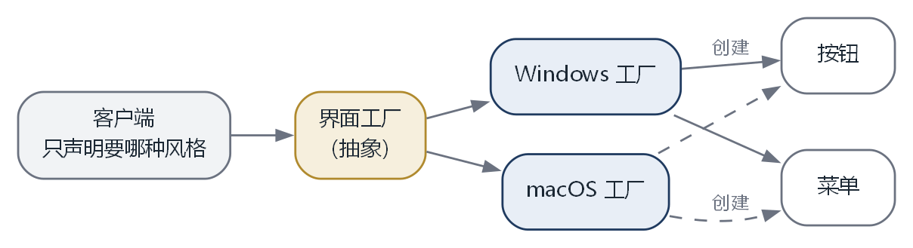

# 第 3 章 抽象工厂：成套的东西一起换

## 3.1 跨平台界面

一个桌面应用要同时支持 Windows 和 macOS。

界面上有三类控件：按钮、菜单、输入框。两套系统的控件外观和行为都不同，Windows 上是圆角矩形，macOS 上是另一种样式。

最初的实现是按控件分别判断。

```text
create_button():
    if platform == "windows": return new WinButton()
    else: return new MacButton()

create_menu():
    if platform == "windows": return new WinMenu()
    else: return new MacMenu()
```

每个控件都写一遍判断。能跑，但有两个隐患。

**混搭。** 某次改动在按钮里用错了分支，界面上出现了 Windows 按钮配 macOS 菜单。功能还能用，但看起来非常怪，用户会以为程序坏了。

**加平台成本高。** 要支持 Linux，每一处控件判断都要加一个分支，漏一处就混搭。

## 3.2 把一族产品绑在一起

抽象工厂的思路是：不单独创建每个控件，而是让一个工厂负责整族控件。

它包含四个角色。

**抽象产品。** 每个产品维度一个接口，比如按钮接口、菜单接口、输入框接口。

**具体产品。** Windows 按钮、macOS 按钮，分别实现按钮接口。

**抽象工厂。** 声明一组创建方法，每个方法对应一个产品维度，返回对应的抽象产品。

**具体工厂。** Windows 工厂实现所有创建方法，返回 Windows 的一族产品；macOS 工厂同理。

用结构描述。

```text
interface Button
interface Menu
interface TextBox

class WinButton implements Button
class WinMenu implements Menu
class WinTextBox implements TextBox

interface UIFactory
  create_button() : Button
  create_menu() : Menu
  create_textbox() : TextBox

class WinFactory implements UIFactory
class MacFactory implements UIFactory
```

应用启动时根据平台选一个具体工厂，之后所有控件都从这个工厂创建。



## 3.3 协作过程

1. 启动阶段读取平台信息，决定用 `WinFactory` 还是 `MacFactory`。
2. 把选定的工厂交给界面构建代码。
3. 界面构建代码调用 `create_button`、`create_menu`、`create_textbox`。
4. 每次调用返回的产品都来自同一个具体工厂，天然成套。
5. 界面代码只认识抽象产品接口，不关心具体样式。

关键在于第 4 步。因为所有创建方法都在同一个工厂里，只要工厂选对了，产品就不会混。这也是抽象工厂和“三个独立的工厂方法”的区别：后者无法保证产品来自同一族。

## 3.4 产品族与产品等级

理解抽象工厂，要分清两个概念。

**产品等级**是同一类产品的不同实现。按钮是一个产品等级，Windows 按钮和 macOS 按钮是它的两个具体产品。

**产品族**是同一套环境下的多个产品。Windows 按钮、Windows 菜单、Windows 输入框构成一个产品族。

抽象工厂保证的是“产品族一致”，不保证“产品等级容易扩展”。

这一点很关键。加一个新的产品族，也就是支持一个新平台，只需要写一个新的具体工厂和一套具体产品，已有代码不用改。这是它的强项。

但加一个新的产品等级，也就是界面要多一种控件，比如加一个下拉框，就要改抽象工厂接口，所有具体工厂都要实现新方法。这是它的弱项。

所以抽象工厂适合“产品族会变，产品种类稳定”的场景。界面控件就是典型例子：平台会增减，但按钮、菜单、输入框这些基本种类不会天天变。

## 3.5 用配置选工厂

具体工厂不该写死在业务代码里。

常见做法是配置驱动。配置文件里写 `ui.theme = "dark"`，启动时根据这个值选择工厂。也可以在运行时切换主题，只要把当前工厂换掉，界面重建一次。

切换工厂时要注意：已经创建出来的控件不会自动变。它们还是旧工厂的产品。所以切换必须是“重建界面”，不能只换工厂引用。

## 3.6 什么时候不该用

**只有一类产品。** 如果界面只有按钮，没有其他控件，那用工厂方法就够了，抽象工厂多出来的接口没有意义。

**产品种类经常增加。** 每加一种控件就要改所有工厂，维护成本会很高。这时候可以考虑把控件拆成独立的工厂方法，或者用注册表按名字创建。

**产品之间没有配套要求。** 如果按钮和菜单可以自由混搭，不需要成套，那就不该用抽象工厂来限制。

**只有一套实现。** 现在只有 Windows 一套，未来也不会有第二套，直接 `new` 更简单。

## 3.7 与工厂方法的区别

这是最容易混的一对。

**工厂方法**解决“一个产品，用哪个实现”。一个创建者对应一个产品。

**抽象工厂**解决“一族产品，用哪套实现”。一个创建者对应多个产品。

从代码上看，工厂方法通常是一个抽象方法，抽象工厂是一组抽象方法。

从变化方向看，工厂方法适合产品种类增长，抽象工厂适合产品族增长。

两者可以叠加。抽象工厂内部的每个创建方法，都可以用工厂方法来实现。但在实际项目里，这样会让类爆炸，通常只在产品族很多、每个产品又很复杂时才这么做。

## 3.8 一个常见的变体

抽象工厂不一定非要写成接口加实现类。在动态语言或者配置驱动的系统里，它经常表现为“一组创建函数的集合”。

```text
win_factory = {
    button:  () => new WinButton(),
    menu:    () => new WinMenu(),
    textbox: () => new WinTextBox()
}
```

使用时按名字取函数调用。这仍然是抽象工厂，因为它保证了“同一套工厂产出同一族产品”。区别只是没有显式的接口声明。

## 3.9 一个判断标准

要不要用抽象工厂，问三个问题。

第一，有没有多个产品维度，而且它们需要配套使用？有，才考虑。

第二，产品族会不会增加？会，抽象工厂有优势。

第三，产品种类会不会经常增加？会，抽象工厂会成为负担。

前两个是“是”、第三个是“否”，抽象工厂合适。否则优先考虑工厂方法，或者更简单的注册表。
