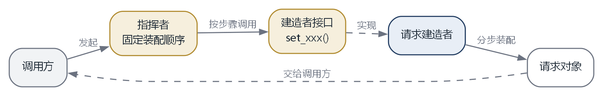

# 第 4 章 建造者：分步装配一个复杂对象

## 4.1 一个参数很多的请求

项目里要发各种 HTTP 请求。最开始只有 GET，两个参数：地址和回调。

后来要支持 POST，加请求体。要支持自定义头，加一个头字段。要支持超时，加超时秒数。要支持重试，加重试次数和退避策略。要支持认证，加令牌。要支持代理，加代理地址。

构造函数变成了这样。

```text
HttpRequest(url, method, body, headers, timeout, retries, backoff, token, proxy, ...)
```

调用方每次都要填十几个参数，大部分用不上，只能传空值。参数顺序记不住，传错一个类型相同的位置，编译器不报错，运行时行为诡异。

有人改成 setter。

```text
req = new HttpRequest()
req.set_url("...")
req.set_method("POST")
req.set_body("...")
req.send()
```

这样好读一些，但带来新问题。

**没法保证完整性。** 忘了设 URL 也能 `send`，报错发生在运行时，而且错误信息往往离真正的疏漏很远。

**没法保证互斥。** 设置了代理又设置了直连标志，两个都生效还是后者覆盖前者，取决于内部实现顺序。

**对象是可变的。** 请求发出去之后，另一个线程改了同一个对象的头，日志里记录的和实际发出去的可能不一致。

## 4.2 把装配过程和产品分开

建造者模式把“怎么一步步装配”和“最终得到什么”分开。

它包含四个角色。

**产品。** 最终要得到的对象，通常是复杂的、由多个部分组成。

**建造者接口。** 声明一组设置方法，每个方法负责装配产品的一部分，返回建造者本身，方便链式调用。再声明一个 `build` 方法，返回最终产品。

**具体建造者。** 实现设置方法，内部持有一个正在装配的产品，`build` 时做校验并返回。

**指挥者。** 可选。如果装配步骤是固定的，可以把步骤抽到一个指挥者里，调用方只需要说“给我一个默认配置的请求”，指挥者按顺序调用建造者。

用结构描述。

```text
class HttpRequest
  url, method, headers, body, timeout, retries
  // 构造后不可变

class RequestBuilder
  set_url(url) : RequestBuilder
  set_method(m) : RequestBuilder
  add_header(k, v) : RequestBuilder
  set_body(b) : RequestBuilder
  set_timeout(ms) : RequestBuilder
  set_retry(n, backoff) : RequestBuilder
  build() : HttpRequest
```



## 4.3 协作过程

调用方这样用。

```text
req = new RequestBuilder()
    .set_url("https://api.example.com/orders")
    .set_method("POST")
    .add_header("Content-Type", "application/json")
    .set_body(payload)
    .set_timeout(3000)
    .build()
```

每一步都返回建造者本身，所以可以连成一条链。最后 `build` 做三件事。

第一，校验必填项。URL 为空就抛错，错误信息直接说“缺少 URL”，不用等到发送时才发现。

第二，处理互斥项。代理和直连只能选一个，`build` 里检查，冲突就报错。

第三，生成不可变的产品。把建造者内部的值复制到产品对象，产品对外只读。之后建造者再改，不影响已经生成的产品。

`build` 之后，建造者可以复用，也可以丢弃。复用时要记得清空上一次的值，否则会出现“上一个请求的头带到了下一个请求”这种诡异问题。更稳妥的做法是每次 `build` 之后建造者就作废。

## 4.4 指挥者的作用

如果一组装配步骤经常重复，可以抽一个指挥者。

```text
class RequestDirector
  build_json_post(url, payload) : HttpRequest
    return new RequestBuilder()
        .set_url(url)
        .set_method("POST")
        .add_header("Content-Type", "application/json")
        .set_body(payload)
        .build()

  build_retry_get(url) : HttpRequest
    ...
```

调用方需要“一个标准的 JSON POST”时，直接调指挥者，不用重复写五步。

指挥者不是必须的。只有装配步骤稳定、且被多处复用时，它才有价值。如果每个请求的装配方式都不一样，加了指挥者反而多一层。

## 4.5 用配置驱动建造

建造者还适合从配置构造对象。

配置文件里有一段 JSON，描述一个任务：类型、输入、输出、并发数、超时。程序读到之后，用一个建造者按字段装配任务对象。

这样做的好处是，配置里出现未知字段时可以报警，必填字段缺失时可以报错，默认值可以集中处理。而不是读到什么就塞进一个字典，等到执行时才发现某个字段是空。

## 4.6 一个 RPC 客户端的建造者

真实的建造者通常不是为了七八个参数，而是为了十几个参数里藏着三组约束。

一个内部 RPC 客户端，构造请求有十四个可选项，超时、重试次数、退避曲线、幂等键、trace 标识、压缩开关、序列化格式、连接池名、灰度标签、认证令牌、代理地址、截止时间、是否跟随重定向、日志采样率。全公司四十多个调用点，最初每个调用点自己拼一个结构体，出错的方式五花八门。最典型的一次是某个调用点同时设了代理和直连，内部按优先级选了直连，排查时看到配置里写着代理，查了整整一天。

改成建造者之后，约束集中到了 `build()` 里。

```cpp
class RequestBuilder {
public:
    RequestBuilder& url(std::string v)    { url_ = std::move(v); return *this; }
    RequestBuilder& method(std::string v) { method_ = std::move(v); return *this; }

    RequestBuilder& header(std::string k, std::string v) {
        headers_.emplace_back(std::move(k), std::move(v));
        return *this;
    }

    RequestBuilder& body(std::string v)   { body_ = std::move(v); return *this; }
    RequestBuilder& timeout(std::chrono::milliseconds v) { timeout_ = v; return *this; }

    RequestBuilder& retry(int n, std::chrono::milliseconds backoff) {
        retries_ = n;
        backoff_ = backoff;
        return *this;
    }

    RequestBuilder& proxy(std::string v) { proxy_ = std::move(v); direct_ = false; return *this; }
    RequestBuilder& direct()             { direct_ = true; proxy_.reset(); return *this; }

    // 只允许在右值上调用，编译期阻止“build 完再改再 build”
    HttpRequest build() && {
        if (url_.empty())     throw std::invalid_argument("url is required");
        if (method_.empty())  throw std::invalid_argument("method is required");
        if (proxy_ && direct_) throw std::invalid_argument("proxy and direct are exclusive");
        if (timeout_ <= 0ms)  throw std::invalid_argument("timeout must be positive");
        if (retries_ > 0 && backoff_ <= 0ms)
            throw std::invalid_argument("retry needs a positive backoff");
        return HttpRequest(std::move(*this));
    }

private:
    friend class HttpRequest;
    std::string url_, method_, body_;
    std::vector<std::pair<std::string, std::string>> headers_;
    std::optional<std::string> proxy_;
    bool direct_ = false;
    std::chrono::milliseconds timeout_{3000};
    std::chrono::milliseconds backoff_{0};
    int retries_ = 0;
};
```

产品那边把构造函数设成私有，只让建造者进来，成员全是 `const`。

```cpp
class HttpRequest {
public:
    const std::string& url() const { return url_; }
    // ...
private:
    friend class RequestBuilder;
    explicit HttpRequest(RequestBuilder&& b)
        : url_(std::move(b.url_)), method_(std::move(b.method_)),
          headers_(std::move(b.headers_)), body_(std::move(b.body_)),
          timeout_(b.timeout_), retries_(b.retries_), proxy_(std::move(b.proxy_)) {}

    const std::string url_;
    const std::string method_;
    const std::vector<std::pair<std::string, std::string>> headers_;
    const std::string body_;
    const std::chrono::milliseconds timeout_;
    const int retries_;
    const std::optional<std::string> proxy_;
};
```

注意 `proxy()` 和 `direct()` 两个方法互相清除对方的字段。这样“先设代理再设直连”不会变成一个必错的组合，而是后设的赢。只有那种两个都设、语义上无法自动决定的冲突，才留到 `build()` 报错。这个取舍在 4.7 会展开。

改完之后的效果是四十多个调用点全走同一条路，参数校验只有一份。原先平均每两个月出现一次“请求缺 URL”或者“超时是 0”的低级错误，之后一年没有再出现。

## 4.7 实现要点：链式调用与校验时机

**返回引用，不要返回值。** `RequestBuilder&` 让链式调用不产生临时副本，也不会有切片问题。返回 `RequestBuilder&&` 是很常见的错误写法，它看起来更“现代”，实际上会让 `auto b = RequestBuilder().url(x)` 这种代码变成悬垂引用，因为 `b` 绑定到了一个已经销毁的临时对象上。

**`build()` 用 `&&` 限定，可以少一类 bug。** 上面代码里的 `HttpRequest build() &&` 意味着只有右值能调用，`builder.build()` 之后这个对象就被标记为“已消费”。想复用就会编译失败，这是最省事的复用防护。如果团队还在用 C++11 之前的编译器，退而求其次的做法是在 `build()` 末尾清空所有字段。

**校验分三层，顺序有讲究。** 先查必填，再查互斥，最后查范围。必填缺失是最严重的错误，先报它；互斥和范围的错误信息要带上具体的字段名和当前值，比如 `timeout must be positive, got 0ms`。错误信息写成这样，运维在日志里看到就知道该改哪一行配置。

**能在 setter 里消解的冲突，不要留到 `build()`。** 代理和直连是典型例子。两者互斥但没有对错，后设置的覆盖前面的更符合直觉，也更宽容。硬要在 `build()` 报错，会让“从默认配置出发逐步覆盖”这种写法变得难用，因为你得先显式清掉代理才能设直连。

**产品要真的不可变。** 只把构造函数设成私有还不够，如果产品暴露了 `std::vector& headers()` 这样的非 const 引用，外部照样能改。要暴露就暴露 const 引用或者拷贝。这一条听起来是细节，但它决定了“请求发出去之后日志里记的和实际发出去的不一致”这类问题还会不会发生。

**建造者不要碰 I/O。** 见过把 `build()` 写成“构造请求并发送”的实现，因为“反正都要发”。这会让建造者无法用于构造测试数据，也无法在发之前做统一的审计。建造者和执行者分开，是这个模式最基本的分工。

**继承式的建造者会丢返回类型。** 如果 `JsonRequestBuilder` 继承 `RequestBuilder`，那么 `builder.url(...)` 返回的是 `RequestBuilder&`，后面就调不到 `set_json_body()` 了。解决办法是用奇异递归模板模式，让基类的设置方法返回派生类引用。代码能写，但可读性下降明显，实际项目里更常见的做法是组合，让派生建造者持有一个基础建造者，或者干脆只用一个建造者加一个可选的 body 类型枚举。

**别把建造者当成配置容器。** 建造者适合“构造一次、立刻使用”的场景。如果发现自己在把建造者存进成员变量、跨请求复用、甚至序列化它，说明要的东西其实是一个参数对象，该换成带默认值的结构体。

## 4.8 六十个建造者

建造者用起来顺手，团队很容易把它变成规范。有个项目就这么干了，编码规范里写了一条“所有对象的创建都通过建造者完成，避免构造函数参数歧义”。

半年后项目里有六十个 `XxxBuilder`，其中四十五个只有一两个设置方法。最夸张的一个是这样的。

```cpp
class UserBuilder {
public:
    UserBuilder& name(std::string v) { name_ = std::move(v); return *this; }
    User build() { return User(name_); }
};
```

调用方写 `UserBuilder().name("tom").build()`，比 `User("tom")` 长了三倍，读代码时还要多跳一个文件去看建造者里到底设置了多少东西。更麻烦的是有人忘了调 `build()`，直接把建造者传给了需要 `User` 的函数，编译不过，然后花时间找原因。测试里也到处是 `new UserBuilder()`，断言之前先写三行装配。

后来的处理是定一条更细的规则，只有满足下面任一条才允许写建造者，构造参数超过四个，或者存在必填项与可选项的区分，或者存在互斥项需要在创建时校验。其余一律用构造函数或者聚合初始化。按这条规则清掉了四十五个建造者，删掉大约三千行样板代码，评审里也拦住了一批新的。

值得记下来的是当时那个“避免构造函数参数歧义”的理由。它确实是个真问题，`Point(10, 20)` 和 `Point(20, 10)` 编译器分不出来。但这个问题有更轻的解法，C++20 的指定初始化器就能解决。

```cpp
struct Point { int x; int y; };
Point p{ .x = 10, .y = 20 };      // 字段名写在调用处
```

所以建造者的适用面比想象中窄。它真正不可替代的地方是“分步装配加集中校验”，而不是“让调用看起来有名字”。

## 4.9 什么时候不该用

**参数少于四个。** 直接构造函数更清楚。建造者要多写一个类、一组方法，收益不够。

**产品是可变的，且允许逐步设置。** 如果对象本来就是可变的，setter 就能用，不需要建造者。

**需要保证原子性。** 建造者分步设置，中间状态是不完整的。如果多线程要共享这个正在装配的对象，会出问题。正确做法是每个线程用自己的建造者，`build` 之后再把不可变产品共享出去。

**产品结构经常变。** 加一个字段就要加一个设置方法，建造者会越来越长。如果字段变化非常频繁，可以考虑用通用的键值配置加校验，而不是为每个字段写一个方法。

## 4.10 与工厂的区别

**工厂**关注“创建哪一个类型”，一次调用返回产品，产品内部怎么装配不是重点。

**建造者**关注“怎样一步步装配”，产品类型通常只有一个，重点是装配过程和校验。

一个具体的对比。打开文件时用工厂，因为要决定用哪个解析器。构造一个 HTTP 请求时用建造者，因为类型确定，但要填很多可选项。

## 4.11 与模板方法的关系

指挥者按固定步骤调用建造者，这个结构其实就是模板方法：步骤在指挥者里定好，每一步的具体实现由建造者提供。

区别在于，模板方法通常用继承，子类重写步骤；建造者用组合，指挥者持有一个建造者对象。组合比继承灵活，可以在运行时换建造者。

## 4.12 四种参数传递方式的对照

参数一多，可选写法就有四种，它们的差别不在语法，在于“什么错误能在编译期被发现”。

| 写法 | 必填项保证 | 互斥与范围校验 | 产品可变性 | 调用处可读性 |
| --- | --- | --- | --- | --- |
| 构造函数 | 编译期，缺参数编不过 | 只能写在构造里，异常或断言 | 可以做成不可变 | 位置参数，多了就难读 |
| setter | 无保证，容易漏 | 分散在各 setter，容易漏 | 可变 | 字段名清晰，但要读多行 |
| 参数结构体加指定初始化 | 编译期，缺字段用默认值 | 需要额外的 `validate()` | 可以做成不可变 | 字段名加值，最紧凑 |
| 建造者 | `build()` 时检查 | 集中在一处，最容易维护 | 通常不可变 | 链式，顺序自由 |

四个都能用的时候，优先选最轻的那个。参数结构体加指定初始化能覆盖大部分“参数多”的场景，只有当你需要“分步装配、并且在中间步骤之间有顺序语义”时，建造者才显出优势。比如生成一份文档，必须先设纸张再设页边距，页边距会根据纸张调整，这种步骤依赖用建造者表达最自然，用结构体就得在 `validate()` 里重放一遍顺序。

## 4.13 一个判断标准

要不要用建造者，看三个信号。

第一，构造函数参数超过四个，而且大部分是可选的。有，就该考虑。

第二，对象有必填项、可选项、互斥项，需要在创建时校验。有，建造者比 setter 更合适。

第三，希望产品创建后不可变。有，建造者能在 `build` 时冻结产品。

三个都不满足，直接构造函数或者普通 setter 就够了。
