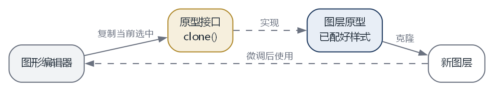
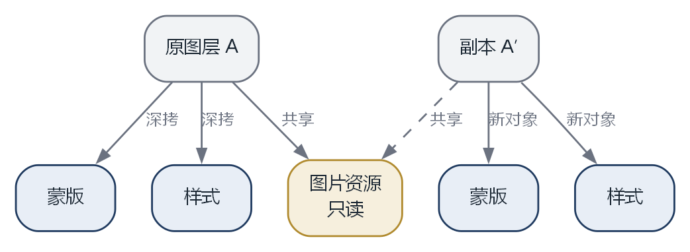

# 第 5 章 原型：复制一个已经配好的对象

## 5.1 复制一个图层

图形编辑器里，用户选中一个图层，按 Ctrl+D 复制一份。

一个图层对象里有不少东西。位置、大小、旋转角度、透明度、混合模式、图层样式（阴影、描边、发光）、蒙版、关联的图片资源、一组调整参数。

最初实现复制，是在菜单处理函数里逐字段赋值。

```text
copy_layer(src):
    dst = new Layer()
    dst.x = src.x
    dst.y = src.y
    dst.width = src.width
    ...
    dst.style = src.style
    dst.mask = src.mask
    dst.image = src.image
    return dst
```

二十行赋值，看起来清楚。但每次图层加一个字段，这里就要加一行。有一次加了“文字沿路径排列”的参数，复制功能忘了同步，复制出来的图层文字位置全错。用户反馈“复制会丢格式”，排查了两天才发现是这里漏了一行。

还有更深的问题。`style` 是一个嵌套对象，直接赋值等于两个图层共享同一个样式对象。用户改了副本的阴影颜色，原图层的阴影也变了。

## 5.2 让对象自己负责复制

原型模式的核心是：不外部逐字段复制，而是让对象自己提供一个“克隆自己”的方法。

它包含四个角色。

**原型接口。** 声明一个克隆方法，返回同类型的副本。

**具体原型。** 实现克隆方法，知道自己有哪些字段，负责正确复制，包括嵌套对象和资源引用。

**客户端。** 调用克隆方法得到副本，再修改差异部分。

**原型注册表。** 可选。把一组预设对象按名字存起来，需要时按名字克隆。适合“从模板新建”的场景。

用结构描述。

```text
interface Cloneable
  clone() : Cloneable

class Layer implements Cloneable
  clone() : Layer
    copy = new Layer()
    copy.x = x
    copy.y = y
    copy.style = style.clone()     // 嵌套对象也克隆
    copy.mask = mask.clone()
    copy.image = image             // 资源引用，共享
    return copy
```

## 5.3 深拷贝与浅拷贝

原型模式最容易出问题的地方，是克隆的深度。

**浅拷贝**只复制对象本身的字段。字段如果是基本类型，复制值；如果是指针或引用，复制的是地址。结果是两个对象共享同一份嵌套数据。

**深拷贝**递归复制所有嵌套对象。副本和原对象完全独立。

哪些该深拷，哪些该共享，要看业务语义。

图层的位置、大小、样式、蒙版，应该深拷，因为用户期望改副本不影响原图层。

图片资源通常共享，因为一张几十兆的图片复制一份既浪费内存，也不需要。用户改的是图层对图片的引用，不是图片本身。

字体、笔刷这类只读资源也共享。共享的前提是它们不可变，任何一方都改不了。

判断标准是：这个嵌套对象会不会被某一方修改。会，就深拷；不会，就共享。



## 5.4 协作过程

1. 用户选中图层，触发复制。
2. 客户端调用该图层的 `clone`。
3. 图层内部创建新对象，逐字段复制，嵌套对象按语义深拷或共享。
4. 客户端拿到副本，给它一个新名字，位置偏移几个像素，避免和原图层完全重叠。
5. 副本加入图层列表，界面刷新。

整个过程客户端不知道图层内部有哪些字段。以后图层加字段，只要 `clone` 里同步加一行，复制功能自动正确。

第 1 节里那个“复制丢格式”的 bug，在这种结构下不会发生，因为字段清单只有一处。

## 5.5 原型注册表

有一类需求是“从模板新建”。

用户可能保存了几种常用的图层组合：标题样式、正文样式、图注样式。新建时选一个模板，得到一份配置好的副本。

做法是把模板对象按名字存在一张表里，用户选择时按名字克隆。

```text
registry = {
    "title":   标题模板,
    "body":    正文模板,
    "caption": 图注模板
}

new_layer = registry["title"].clone()
```

注册表里的模板对象永远不被直接使用，只用来克隆。这样模板不会被意外修改。

这和服务注册表有点像，区别是原型注册表存的是“可以克隆的对象”，服务注册表存的是“可以直接调用的实现”。

## 5.6 图层克隆的完整写法

图层的复制功能上线一年后，出过一次比较严重的故障。组图层里嵌套了五个子图层，复制整个组之后，副本和原件共享了同一批子图层对象。用户删掉副本里的一层，原件里对应的一层也消失了，稿子直接坏掉。这属于“共享了不该共享的东西”，而当时那二十行逐字段赋值里，写的是 `dst.children = src.children`。

问题不在那一行写错，而在“复制逻辑散落在外面”这件事本身。改成虚函数之后，每个类只对自己负责。

```cpp
class Layer {
public:
    virtual ~Layer() = default;
    virtual std::unique_ptr<Layer> clone() const = 0;

    const LayerId& id() const { return id_; }
    void assign_new_id() { id_ = LayerId::next(); }

protected:
    Layer() = default;
    Layer(const Layer& other)          // 拷贝构造只做字段复制
        : transform_(other.transform_),
          blend_(other.blend_),
          opacity_(other.opacity_),
          image_(other.image_),          // 只读资源，共享
          mask_(other.mask_ ? other.mask_->clone() : nullptr),
          style_(clone_style(other.style_))
        // id_ 有意不初始化，新对象由插入文档时分配身份
    {}

    LayerId      id_;
    Transform    transform_;
    BlendMode    blend_;
    float        opacity_ = 1.0f;
    std::shared_ptr<const ImageResource> image_;   // 共享，const
    std::unique_ptr<Mask>                mask_;    // 可变，深拷
    std::shared_ptr<Style>               style_;   // 可变，见下
};

class GroupLayer : public Layer {
public:
    std::unique_ptr<Layer> clone() const override {
        auto copy = std::make_unique<GroupLayer>(*this);   // 走拷贝构造
        copy->children_.clear();
        for (const auto& child : children_) {
            copy->children_.push_back(child->clone());     // 逐个子层克隆
        }
        return copy;
    }
private:
    std::vector<std::unique_ptr<Layer>> children_;
};
```

这段代码里有三个决定值得逐个说。

第一，`clone()` 的实现复用拷贝构造。字段清单只有一份，加字段时改拷贝构造就够了，不用到处找复制代码。代价是拷贝构造必须写全，这一点在 5.7 会展开。

第二，`image_` 用 `std::shared_ptr<const ImageResource>`。`const` 不是装饰，它是编译器帮忙守的规矩。资源一旦共享出去就改不了，想改只能换一个新的指针。这比在注释里写“请勿修改”可靠得多。

第三，`style_` 用的是可变的 `shared_ptr<Style>`，但拷贝时显式克隆了一份。

```cpp
static std::shared_ptr<Style> clone_style(const std::shared_ptr<Style>& s) {
    return s ? std::make_shared<Style>(*s) : nullptr;
}
```

为什么不直接也改成 `shared_ptr<const Style>` 呢。因为样式在界面上是高频修改的对象，用户拖一下阴影半径就变一次。每次改都换一个新对象，会产生大量短命分配。实际做法是保留可变指针，在克隆边界上显式复制一次。这里的判断依据是“可变但需要独立”，这样的字段就得在 clone 里出现。



图上标得很清楚。副本的蒙版和样式都是新建的，改它们不影响原件。图片资源是共享的，两个图层指向同一份纹理，改的是“引用哪张图”这件事，而不是图本身。组图层的子节点各自克隆，所以副本里的子层和原件里的子层是两个对象。

## 5.7 实现要点：身份字段与循环引用

**每个对象都有一个不该被复制的字段。** 图层的唯一 id、创建时间、锁定状态、当前是否被选中，这些描述的是“这个对象在这个会话里的身份”，不是它的内容。克隆出来的是一个新对象，这些字段要重置。遗漏的后果不轻，两个图层有同一个 id，撤销栈、协作同步、缓存索引全都会错乱。

处理办法是把重置逻辑集中到一个地方，`clone()` 返回之前统一调 `reset_identity()`，不要在十几个子类的 clone 里各写一遍。有的实现让 `clone()` 直接返回“内容完整但 id 为空”的对象，由调用方在插入文档时分配 id，这样更安全，因为忘记分配 id 会立刻在插入时暴露。

**拷贝构造要一次写全，别分三次补。** 加了字段忘记加到拷贝构造，是这类代码最常见的 bug。C++ 的规则是，如果你手写了拷贝构造，编译器就不再生成默认版本。所以每加一个字段，都要回头看拷贝构造。写全五个特殊成员函数（析构、拷贝构造、拷贝赋值、移动构造、移动赋值），或者干脆全用默认加 `= default`，只在真正需要特殊处理的那个上动手，能让这类错误少很多。

**深拷贝遇到环会死循环。** 组图层如果允许被放进自己的子树，克隆时的递归就没有终点。两道防线。结构上禁止成环，`add_child` 时沿父链向上检查，发现自己在祖先里就拒绝。实现上再保一层，`clone` 带一张“原对象到副本”的映射表，遇到已经克隆过的对象直接返回已有副本。第二道防线顺便解决了“同一对象被两处引用”的问题，克隆出来的图里保持同样的共享关系，而不是变成两棵独立的子树。

```cpp
std::unique_ptr<Layer> clone_with_memo(
        const Layer& src, std::unordered_map<const Layer*, Layer*>& memo) {
    auto it = memo.find(&src);
    if (it != memo.end()) return nullptr;   // 已克隆，调用方自行接线
    auto copy = src.clone_shallow();
    memo.emplace(&src, copy.get());
    for (const auto& child : src.children())
        if (auto c = clone_with_memo(*child, memo)) copy->adopt(std::move(c));
    return copy;
}
```

这段代码省略了接线细节，重点是 memo 的存在。写成完整版本时，返回的应该是“已有副本的指针”而不是空指针，调用方据此建立链接。

**不可复制的资源要显式声明。** 文件句柄、网络连接、GPU 上下文、互斥锁，这些不能简单拷贝。克隆时要么共享（加引用计数），要么重新创建（记住新的连接参数）。默认深拷会得到两个对象抢一个句柄，症状是随机失败，而且失败位置离复制点很远。

**模板对象必须冻结。** 原型注册表里的模板是最容易被误改的东西。某次“从模板新建”之后，代码顺手在新图层上调了个 `set_font`，但注册表返回的如果是模板本身的指针，模板就被改了，之后所有新建都带着上一次的改动。解决办法是注册表只存不可变对象，或者只存“工厂函数”，每次调用时现场构造一份再返回。

**性能量级要有数。** 一个带蒙版和样式的图层，克隆一次大约几十微秒，主要开销在几个嵌套对象的分配上。复制五百个图层是十几毫秒，用户感知不到。但如果图层里有几百万元素的矢量路径，克隆会变成几百毫秒，这时候该考虑写时复制，让副本先共享路径数据，真正修改时再分裂。

## 5.8 二十处手写深拷贝

有一个工程文件格式的读写模块，里面有二十处手写的 `copy_xxx()` 函数，负责在“内存模型”和“序列化模型”之间搬数据，顺便实现复制功能。每个函数都是三四十行赋值。

某次发版之后，客户反馈“复制页面会丢批注”。查下来是 `copy_page()` 里漏了 `annotation` 字段。补上那一行只花了两分钟，但团队意识到这不是第一次，两年前漏过一次“页面背景色”，一年前漏过一次“图层混合模式”。

于是处理方式从“补一行”变成“根治”，把所有手写复制换成 `clone()` 接口，并且加了一条属性测试。做法是给每个结构生成一个所有字段都填了非默认值的对象，克隆之后逐字段比对，再随意修改副本的一个字段，验证原件的对应字段没变。

```text
for 每个结构类型 T:
    a = random_filled<T>()          // 所有字段都非默认值
    b = a.clone()
    assert equal(a, b)              // 克隆完整
    b.some_field = other_value
    assert a.some_field != other_value     // 副本独立
```

第一条断言抓“漏字段”，第二条抓“该深拷的地方共享了”。两条都是自动生成的，加字段时不用改测试。这种测试写起来比业务测试便宜得多，收益却很直接，因为这类 bug 的特点就是“字段一多必然漏”。

顺带一个发现。改完之后那二十个 `copy_xxx()` 里，有七个其实从来没有被调用过，是历史遗留。删掉它们省下的不只是代码行数，还有每次加字段时的心理负担。

## 5.9 什么时候不该用

**对象很简单。** 只有三五个基本字段，直接构造更清楚。克隆方法要多写一份字段清单，还要维护深拷逻辑。

**对象持有不可复制的资源。** 打开的文件句柄、网络连接、GPU 上下文，这些不能简单复制。克隆时要明确是共享还是重新创建，不能默认深拷。

**存在循环引用。** 对象图里有环，递归深拷会无限循环。需要额外的访问记录，或者改用序列化再反序列化。

**对象构造依赖外部上下文。** 如果构造时需要文档、渲染器、配置这些外部对象，克隆也要处理这些引用。克隆出来的副本该指向同一个上下文还是新的，要明确。

## 5.10 与工厂的区别

**工厂**从零开始创建对象，调用方告诉工厂要什么，工厂负责构造。

**原型**从一个已有的对象复制，调用方拿到的是和原对象同配置的副本。

工厂适合“类型多、构造逻辑集中”的场景。原型适合“对象配置复杂、复制比重新构造更省事”的场景。

两者可以结合。工厂内部可以持有一个原型，每次创建时克隆它，而不是重新走一遍复杂构造。这在对象初始化很贵的时候很常见。

## 5.11 与备忘录的区别

**原型**是为了得到一个可独立修改的副本。

**备忘录**是为了保存某个时刻的状态，之后能恢复回去。

原型克隆出来的对象会继续参与业务，备忘录保存的对象通常只读，只用于恢复。实现上两者都涉及复制，但目的不同。

## 5.12 四种复制方式的对照

同样是“得到一个和原来一样的对象”，做法有四种，风险点完全不同。

| 写法 | 支持多态 | 漏字段风险 | 性能 | 适合的场景 |
| --- | --- | --- | --- | --- |
| 外部逐字段赋值 | 不支持，要按具体类型分派 | 高，字段一多必漏 | 中，可能有多次分配 | 字段极少，且只复制一次 |
| 拷贝构造 | 不支持，切片 | 中，靠人工维护特殊成员函数 | 高 | 值语义的小对象 |
| 虚函数 clone | 支持 | 低，清单只有一处 | 中 | 有继承层次、需要运行时复制 |
| 序列化再反序列化 | 支持 | 最低，跟着序列化定义走 | 低，有编码解码开销 | 需要跨进程或跨版本复制 |

第一条“支持多态”往往是决定性的。手里只有一个基类指针，要复制出正确类型的副本，除了 `clone` 就只能用类型枚举加分派，后者等于把维护负担搬回调用方。

第四条在跨进程、跨版本复制时是唯一选择，因为它同时也解决了“字段增删的兼容”和“指针不能跨进程”两个问题。代价是慢，通常比 clone 慢一到两个数量级，所以只在真正的边界上使用。

## 5.13 一个判断标准

要不要用原型，看三点。

第一，对象的构造过程复杂，或者需要外部上下文，复制比重新构造更简单。

第二，对象有很多字段，外部逐字段复制容易漏。

第三，需要“从模板新建”这种能力。

三点有一个成立，就值得考虑。如果对象只有几个字段，而且构造不需要上下文，直接构造更好，克隆方法反而增加维护点。
