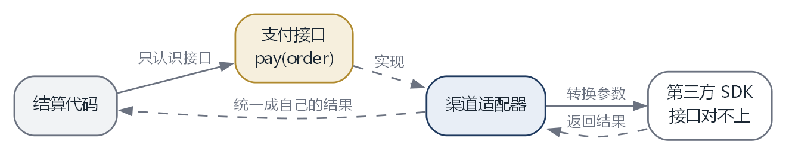

# 第 6 章 适配器：让两套接口对上

## 6.1 换一个支付渠道

电商系统最初只接了一家支付渠道。下单时调用它的 SDK，传订单号、金额、回调地址，拿到支付链接。

代码里到处是这样的调用。

```text
result = OldPaySdk.pay(order_id, amount, notify_url)
```

半年后要接第二家。新渠道的接口完全不一样：参数是一个请求对象，返回值是一个包含二维码和过期时间的结构，回调是异步通知。

如果直接改业务代码，会变成这样。

```text
if channel == "old":
    result = OldPaySdk.pay(order_id, amount, notify_url)
    link = result.url
else if channel == "new":
    req = NewPayRequest(order_id, amount, notify_url)
    resp = NewPayClient.create(req)
    link = resp.qr_code_url
```

问题很快出现。

**每加一个渠道，所有调用点都要改。** 下单、退款、查询、对账，四个地方都有类似判断。

**业务代码知道了两套 SDK 的细节。** 参数怎么拼、返回值怎么取，全散落在业务里。

**测试没法脱离真实 SDK。** 想测“支付链接为空时怎么处理”，得先构造一个真实的响应。

## 6.2 中间加一层转换

适配器模式的思路是：定义一个业务自己想要的接口，再写一个适配器，把业务接口的调用翻译成 SDK 的调用。

它包含三个角色。

**目标接口。** 业务代码期望的接口。比如“传订单信息，返回支付链接”，参数和返回值都是业务自己的类型。

**被适配者。** 已有的、接口不匹配的类，通常来自第三方 SDK。

**适配器。** 实现目标接口，内部持有一个被适配者，把每次调用转换成对被适配者的调用。

用结构描述。

```text
interface PaymentGateway
  create_payment(order) : PaymentLink
  refund(order_id, amount) : RefundResult
  query(order_id) : PaymentStatus

class OldPayAdapter implements PaymentGateway
  private sdk : OldPaySdk
  create_payment(order) : PaymentLink
    result = sdk.pay(order.id, order.amount, order.notify_url)
    return new PaymentLink(result.url, result.expire_at)

class NewPayAdapter implements PaymentGateway
  private client : NewPayClient
  create_payment(order) : PaymentLink
    req = new NewPayRequest(...)
    resp = client.create(req)
    return new PaymentLink(resp.qr_code_url, resp.expire_at)
```



## 6.3 协作过程

1. 业务代码调用 `gateway.create_payment(order)`。
2. 它不知道 `gateway` 背后是哪一家，只认识 `PaymentGateway` 接口。
3. 适配器收到调用，把业务对象转换成 SDK 需要的参数。
4. 适配器调用 SDK。
5. SDK 返回它自己的结构，适配器把它转换成业务对象。
6. 业务代码拿到统一的 `PaymentLink`。

整个过程里，业务代码只依赖 `PaymentGateway`，不依赖任何 SDK。

选择哪个适配器在启动时完成。配置里写“使用新渠道”，就构造 `NewPayAdapter`。业务代码一行都不改。

## 6.4 适配器要做多少转换

适配器的核心工作是转换，但转换到什么程度，有讲究。

**只做参数和返回值的翻译。** 这是最薄的适配器，也是最推荐的。SDK 有什么能力，就暴露什么能力，只是换一种说法。

**顺带处理差异。** 两家的语义不完全一样。比如旧渠道的金额单位是元，新渠道是分；旧渠道的退款是同步返回，新渠道是异步通知。适配器要把这些差异抹平，让业务看到一致的行为。

**不要替 SDK 补功能。** 如果新渠道不支持部分退款，适配器不该自己模拟一个。这会让业务误以为所有渠道能力一致，出问题时很难查。正确的做法是在接口里明确“可能不支持”，让业务自己处理。

第二条和第三条的边界容易模糊。一个判断标准是：这个差异是“表示方式不同”还是“能力不同”。表示方式不同，适配器抹平；能力不同，暴露出来。

## 6.5 对象适配与类适配

C++ 里适配器有两种写法。

**对象适配。** 适配器持有一个被适配者的指针，通过组合调用。这是最常用的方式，因为它不要求被适配者是可继承的，也能适配多个对象。

**类适配。** 适配器同时继承目标接口和被适配者，通过多继承把两者合在一起。这种方式代码更短，但要求被适配者的方法可以被继承，而且 C++ 的多继承会带来一些复杂性。

绝大多数情况下用对象适配。类适配只在被适配者是自己的代码、且方法签名刚好能对接时才有优势。

## 6.6 双向适配

有时候两套系统要互相调用。A 系统要用 B 的能力，B 系统也要用 A 的能力。

可以写两个适配器，也可以写一个双向适配器：它同时实现两边的接口，内部持有对方的引用。调用哪一边，就转发到另一边。

双向适配器在集成两个已有系统时有用，但维护成本高，因为它同时承担两个方向的转换。能用单向适配器解决，就不要做双向。

## 6.7 什么时候不该用

**接口可以直接改。** 如果被适配者是自己团队的代码，改接口比加适配器更简单。适配器是为了隔离“不能改的东西”，不是为了绕开重构。

**只有一个调用点。** 如果整个系统只有一处调用这个 SDK，直接在里面转换就行，不必单独写一个类。

**转换逻辑很重。** 如果适配器里要补大量业务逻辑，说明两边的模型差异太大，适配器会变成一个隐藏的业务层。这时候该重新设计接口，而不是硬适配。

**适配层会长期存在但没人维护。** 适配器是“临时桥”，如果它变成永久结构，就要按正式模块来维护，写测试、写文档。不能因为它是“临时的”就不管。

## 6.8 与外观、装饰器、代理的区别

这四个模式都涉及“包一层”，容易混。

**适配器**改变接口。调用方期望 A，被适配者提供 B，适配器把 B 翻译成 A。

**外观**简化接口。多个子系统各有各的接口，外观提供一个更简单的入口，但不改变子系统的接口。

**装饰器**增强接口。接口不变，在调用前后加行为，可以层层叠加。

**代理**控制接口。接口不变，代理决定要不要转发、什么时候转发、转发给谁。

一个记忆方法：适配器是“翻译”，外观是“总开关”，装饰器是“加料”，代理是“门卫”。

## 6.9 一个判断标准

要不要用适配器，看两点。

第一，被适配者的接口是不是不能改？第三方 SDK、遗留系统、跨团队模块，通常不能改。能改就别适配。

第二，调用点是不是不止一个？只有一个调用点，直接转换更省事；多个调用点，适配器能把转换逻辑收在一处。

两点都成立，适配器合适。
