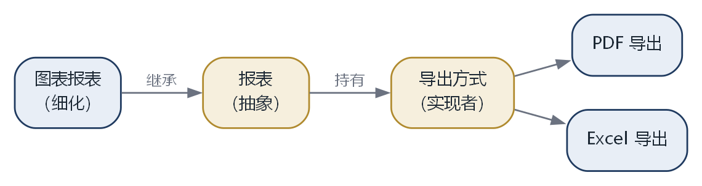

# 第 7 章 桥接：两个维度各自变化

## 7.1 报表要导出到哪

一个数据平台要导出报表，支持两种格式：PDF 和 Excel。

最初的实现是继承。

```text
class PdfReport { ... }
class ExcelReport { ... }
```

后来数据来源也多了。有从 MySQL 查的，有从远程 API 拉的，还有从本地文件读的。于是按“格式 × 来源”组合。

```text
class PdfMysqlReport
class PdfApiReport
class PdfFileReport
class ExcelMysqlReport
class ExcelApiReport
class ExcelFileReport
```

六种。再加一种格式，比如 CSV，就要再加三个类。再加一种数据来源，每个格式都要加一个。

两个维度各自增长，类的数量是两者相乘。这就是继承带来的组合爆炸。

更麻烦的是，PDF 和 Excel 的导出逻辑里，有一部分是“取数、算合计、排版”，这部分和来源无关，但被复制到了每个子类里。改一处合计规则，要改六个地方。

## 7.2 把两个维度拆开

桥接模式的思路是：把“报表”和“数据来源”拆成两条独立的继承线，用组合连接。

它包含四个角色。

**实现接口。** 描述数据来源能做什么，比如“给出所有行”“给出列定义”。

**具体实现。** MySQL 来源、API 来源、文件来源，各自实现。

**抽象。** 描述报表能做什么，比如“导出到文件”。它内部持有一个实现接口的引用，把取数的工作委托出去。

**扩展抽象。** 在抽象的基础上扩展，比如“带图表的报表”“带分页的报表”。

用结构描述。

```text
interface DataSource
  rows() : RowSet
  columns() : ColumnList

class MysqlSource implements DataSource
class ApiSource implements DataSource
class FileSource implements DataSource

abstract class Report
  protected source : DataSource
  constructor(source)
  abstract render(rows) : bytes
  export(path)
    rows = source.rows()
    write(path, render(rows))

class PdfReport extends Report
class ExcelReport extends Report
```



## 7.3 协作过程

1. 启动时根据配置选一个数据源，构造具体实现。
2. 根据用户选择的格式，构造对应的报表对象，把数据源传进去。
3. 用户点导出，调用 `report.export(path)`。
4. 报表对象向数据源要数据。
5. 数据源返回行集。
6. 报表对象按自己的格式渲染并写文件。

关键在于第 3 到第 5 步：报表不知道数据从哪来，数据源不知道数据要变成什么格式。两边各自独立演化。

加一种格式，只需要加一个 `Report` 的子类。加一种数据源，只需要加一个 `DataSource` 的实现。类数量从相乘变成相加。

## 7.4 抽象和实现各指什么

桥接里的“抽象”和“实现”是两个容易误解的词。

**抽象**不是“抽象类”的意思，而是“面向用户的那一侧”。用户看到的是“导出 PDF 报表”，这是抽象层。

**实现**也不是“具体代码”，而是“抽象层依赖的能力提供者”。这里是数据来源。

所以桥接的本质是：把“用户看到的东西”和“支撑它的机制”分成两条线，中间用组合连接。

判断是否用桥接，看有没有两个维度都在变化。只有一个维度变化，用继承就够了。

## 7.5 与策略的区别

桥接和策略都是“持有一个接口，把工作委托出去”，结构很像。区别在意图。

**策略**是为了在运行时切换算法。上下文对象本身不变，换的是它使用的算法。

**桥接**是为了让两个维度独立演化。抽象和实现是两条平行的继承线，各自可以扩展。

一个具体的区别：策略通常在运行时按需替换，桥接通常在构造时确定，之后不变。

从代码上看，两者的类图几乎一样。判断靠的是设计意图：如果这个引用会频繁换，是策略；如果它是结构的一部分、两条线都要扩展，是桥接。

## 7.6 桥接的代价

桥接不是没有成本。

**多了一层间接。** 调用 `report.export` 之后，还要经过一次委托才到数据源。调试时多跳一层。

**概念更抽象。** 团队新人看到 `Report` 持有 `DataSource`，要花时间理解为什么这么分。如果只有一个格式、一个数据源，这种分层会显得多余。

**需要提前判断变化方向。** 桥接假设两个维度都会增长。如果实际上只有一个维度增长，另一条线永远只有一个实现，那这层拆分就是浪费。

## 7.7 什么时候不该用

**只有一个维度会变。** 格式会增加，但数据来源永远只有 MySQL。这时候用继承做格式，数据访问写死，更简单。

**两个维度耦合很紧。** 某些格式只能用某些数据源，比如“实时看板”只能用流式数据。这种强绑定下，硬拆开反而要处理很多非法组合。

**变化频率很低。** 三年才加一种格式，继承带来的类数量增长可以接受，不值得为此重构。

## 7.8 一个实际的好处

桥接有一个容易被忽略的好处：测试。

拆开之后，报表的渲染逻辑可以脱离真实数据源测试。用一个返回固定行集的假数据源，就能验证 PDF 的分页、合计、表头是否正确。不需要连数据库，也不需要造真实数据。

反过来，数据源也可以单独测试，不用管报表格式。

这是“两个维度独立”带来的直接收益，比“减少类的数量”更实在。

## 7.9 一个判断标准

要不要用桥接，问三个问题。

第一，有没有两个以上相互独立的维度？比如格式和数据来源、界面主题和平台、消息类型和传输协议。

第二，这些维度是不是都会增长？只有一个会增长，用继承更简单。

第三，拆开之后，两边的测试是不是能独立进行？能，说明拆分方向是对的。

三个都是“是”，桥接合适。
