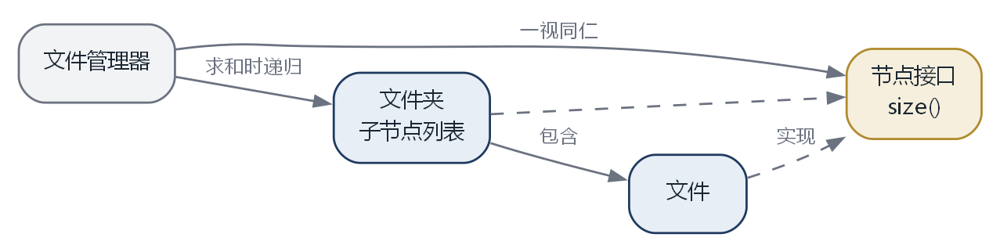
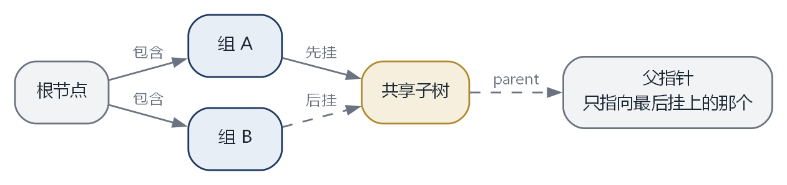

# 第 8 章 组合：把树当成一个整体

## 8.1 文件管理器

一个文件管理器要显示目录树。

树里有两种节点：文件夹和文件。文件夹里可以有文件，也可以有子文件夹，子文件夹里还能有更深的内容。

最初实现区分对待。

```text
class FileNode
  name, size

class FolderNode
  name, children

function total_size(node):
    if node is FileNode:
        return node.size
    else:
        sum = 0
        for child in node.children:
            if child is FileNode: sum += child.size
            else: sum += total_size(child)
        return sum

function render(node, indent):
    if node is FileNode:
        draw_file(node, indent)
    else:
        draw_folder(node, indent)
        for child in node.children:
            if child is FileNode: draw_file(child, indent + 1)
            else: render(child, indent + 1)
```

这个写法在两层结构时没问题。一旦要在文件夹上做“重命名”“删除”“搜索”，每个操作都要写两套逻辑，一套处理文件，一套处理文件夹。而且嵌套层数一变，递归的写法就要跟着变。

更糟的是，如果以后加“快捷方式”，它指向一个文件或文件夹，行为又不一样，所有 `if` 都要再加一个分支。

## 8.2 统一成一个接口

组合模式的思路是：让文件和文件夹实现同一个接口，调用方对所有节点一视同仁。

它包含三个角色。

**组件接口。** 声明所有节点共有的操作，比如“显示自己”“统计大小”“查找”。

**叶子。** 没有子节点的节点，比如文件。它实现接口，但子节点相关的操作通常是空实现或者抛错。

**容器。** 有子节点的节点，比如文件夹。它也实现接口，内部维护一个子节点列表，各种操作会递归委托给子节点。

用结构描述。

```text
interface Node
  name() : string
  size() : number
  render(indent) : void
  find(keyword) : List<Node>

class FileNode implements Node
  size() { return file_size }
  render(indent) { draw_file(this, indent) }
  find(keyword) { ... }

class FolderNode implements Node
  children : List<Node>
  size()
    total = 0
    for child in children: total += child.size()
    return total
  render(indent)
    draw_folder(this, indent)
    for child in children: child.render(indent + 1)
```



## 8.3 协作过程

调用方拿到根节点，对它调用 `render(0)`。

根节点是文件夹，它先画自己，然后对每个子节点调用 `render(1)`。子节点可能是文件，也可能是文件夹。是文件就画文件；是文件夹就继续递归。

调用方不需要知道树有几层，也不需要区分节点类型。整个树对外表现为一个对象。

`size()` 也是一样。调用方只调一次，内部逐层累加。加一个“统计文件数量”的操作，只需要在接口里加一个方法，叶子和容器各自实现，调用方照旧一行。

这就是组合模式的核心价值：**把递归结构藏在接口后面，让调用方按单个对象的方式使用整棵树。**

## 8.4 透明式与安全式

组合模式有两种实现风格。

**透明式。** 组件接口里包含所有操作，包括“添加子节点”“删除子节点”。叶子上也实现这些方法，但调用时抛错或者忽略。

好处是调用方完全不用区分类型，任何节点都可以调用任何方法。坏处是叶子上调用 `add_child` 会在运行时失败，编译期发现不了。

**安全式。** 组件接口只包含共有操作，`add_child` 只声明在容器上。调用方要加子节点时，必须先确认是容器。

好处是类型安全，编译期就能挡住错误。坏处是调用方有时需要类型判断。

选哪种，看使用场景。树的构建过程通常集中在少数几处，用安全式更稳；树的使用过程遍布各处，用透明式更方便。

## 8.5 场景图里的一棵树

文件管理器里的树是只读的，节点不多，也没有“反向查找父节点”的需求。真正把组合模式用到极限的是图形编辑器的场景图，那里每个操作都要逐帧跑，而且节点之间除了父子关系还需要向上回溯。

一个 2D 编辑器的场景图有十万级节点，每帧要做两件事，按顺序绘制可见节点，以及处理鼠标命中之后的冒泡。后者是加父指针的直接原因。用户点中的永远是最上层的叶子，但高亮时要高亮整个组，禁用时要沿组链向上检查权限，这些都需要从子节点找到父节点。

```cpp
class Node {
public:
    virtual ~Node() = default;
    virtual void draw(RenderContext& ctx) const = 0;
    virtual bool hit_test(Point p) const = 0;

    void add_child(std::unique_ptr<Node> child) {
        child->parent_ = this;
        children_.push_back(std::move(child));
    }

    Node* parent() const { return parent_; }

    Matrix world_transform() const {
        return parent_ ? parent_->world_transform() * local_ : local_;
    }

protected:
    Node* parent_ = nullptr;                        // 不拥有，裸指针
    std::vector<std::unique_ptr<Node>> children_;    // 拥有
    Matrix local_;
};

class GroupNode : public Node {
public:
    void draw(RenderContext& ctx) const override {
        ctx.push_transform(local_);
        for (const auto& c : children_) c->draw(ctx);
        ctx.pop_transform();
    }

    bool hit_test(Point p) const override {
        for (auto it = children_.rbegin(); it != children_.rend(); ++it)
            if ((*it)->hit_test(p)) return true;
        return false;
    }
};
```

这段代码里有三个选择值得解释。

第一，所有权是单向的。父节点用 `unique_ptr` 拥有子节点，子节点只持有一个裸的父指针。如果反过来用 `shared_ptr` 指父节点，就会形成循环引用，整棵树都释放不掉，关掉文档之后内存不会降。

第二，`hit_test` 倒序遍历。绘制是从下往上，命中检测要从上往下，后画的那个在最上面，必须优先被选中。这个顺序细节用继承组合的写法时也容易漏，但在组合结构里只写一次，所有容器都自动正确。

第三，`world_transform` 每帧沿父链递归。十万节点每帧都这样算会很贵，所以真实实现里会缓存世界矩阵，并在父链变化时失效。这就引出了 8.6 里要讲的缓存问题。



## 8.6 实现要点：父指针、共享与删除

**父指针和所有权方向必须固定。** 上面那种“父拥有子、子裸指针指向父”的组合是最不容易出错的。反过来也有人在子节点用 `weak_ptr` 指父，效果一样但多一次引用计数开销。唯一不能做的是两边都用 `shared_ptr`。

**移动节点时要维护父指针。** `remove_child` 里必须把 `child->parent_` 置空，否则这个节点被移走之后，`world_transform` 还会往原来那棵树上找，算出错误的位置。这类错误的表现很怪，节点看着在那儿，但点不中，因为命中检测用的是另一套坐标。

**遍历中删除会让迭代器失效。** 这是组合树里最高频的崩溃。

```cpp
// 错误写法，erase 之后 it 失效
for (auto it = children_.begin(); it != children_.end(); ++it)
    if ((*it)->is_expired()) children_.erase(it);
```

正确的写法是三种之一，先收集再统一删除，用倒序索引，或者用 `std::remove_if` 配合 erase。选哪种取决于删除时要不要做额外清理，比如上面说的父指针置空。

**共享子树会同时打破计数和父子关系。** 如果同一个节点被挂到两个父节点下，遍历时它会被访问两次，`size()` 会重复累加，父指针只能指向最后挂上去的那个。图 8-2 画的就是这个情形。这不是实现 bug，而是结构本身不自洽。

有两种处理方向。一是禁止共享，`add_child` 时沿父链向上检查，发现自己是自己的祖先就拒绝，同时要求一个节点只有一个父。二是允许共享但放弃父指针，把所有“向上”的需求改成“遍历时把上下文带下去”，比如绘制时传矩阵，命中时传祖先列表。后者能表达图结构，但组合模式“整棵树是一个对象”的简化就没有了。绝大多数编辑器选第一条，需要复用的东西（比如同一个图标、同一段路径）复用它的数据，而不是复用节点本身。

**缓存要向上失效。** 容器层通常会缓存 `size()` 或者包围盒。子节点变化时，缓存必须一路向上标记失效，直到根节点。漏掉这一步的症状很典型，删掉一个文件，父目录的大小不变，刷新一下又对了。实现上可以让每个节点持有一个 `parent_`，`invalidate()` 里递归调 `parent_->invalidate()`，恰好用上父指针。

**深度会撞上栈。** 十万节点的树如果是一条链，递归遍历会爆栈。目录树一般不会这么深，但表达式树和语法树在某些生成代码的场景下会。稳妥的做法是提供一个显式栈的迭代遍历作为备用路径。

**透明式的空实现要选一种明确的语义。** 叶子的 `add_child` 是抛异常还是静默忽略，会影响调用方的写法。如果树主要由代码批量构建，静默忽略能让通用代码更短；如果树是用户操作构建的，抛异常能立刻暴露逻辑错误。选一个，写在接口注释里，不要留给下一个人猜。

**并发要单独设计。** 渲染线程读、逻辑线程改，这是编辑器的常态。组合树的问题在于一次遍历时间很长，锁住整棵树会卡住渲染。常见做法是双缓冲，逻辑线程改一棵，渲染线程读另一棵，每帧交换；或者把修改命令排队，在渲染线程的空隙里统一应用。

## 8.7 组合与递归的边界

组合模式天然带递归，递归要注意三件事。

**深度。** 目录树可能有几千层，递归太深会栈溢出。可以改成显式栈的迭代遍历。

**循环。** 如果允许一个节点被加到自己的子树里，遍历会无限循环。添加子节点时应该检查，或者在遍历时记录已访问的节点。

**性能。** 每次 `size()` 都递归整棵树，树大了会很慢。可以在容器里缓存计算结果，子节点变化时标记失效。

这三条不是组合模式独有的，但凡是用递归结构的地方都要考虑。

## 8.8 把配置也做成树

组合模式看起来太自然，以至于有人会把它套到所有分层的概念上。配置系统是最常见的一次误用。

一个项目的配置模块用组合建模，`ConfigNode` 有三种子类，值节点、组节点、引用节点。组里可以放组，引用节点指向另一棵子树，用来做“多环境继承”。这个设计在纸面上很漂亮，能表达任意嵌套的配置。

上线一年后出了三个问题。

第一个是查询代价。取一个配置项要递归找，`a.b.c.d` 这样的路径要逐层查子节点，每次几百纳秒到几微秒。配置读取在热路径上被调用，累计起来不可忽略。改成扁平哈希表之后，一次查找几十纳秒。

第二个是合并。多环境继承要做“深度合并”，两份配置树按路径逐层递归合并，组节点要对键求并集，值节点要覆盖。写了三百行递归合并代码，边界情况包括空组、类型不一致、引用节点指向自己。这段代码成了整个模块里 bug 最多的部分。

第三个是环。引用节点指向另一棵子树，没有人禁止它指向自己所在的子树。某次配置写错，加载时直接卡死，没有栈溢出报错，就是 CPU 跑满不返回。

后来改成扁平的键值表，键用点号分层，`db.pool.size`，需要树形展示的时候在界面层临时组装。合并变成两个 `map` 的按键覆盖，环在结构上不可能出现。三百行递归合并代码变成二十行。

这里的教训是组合模式的适用条件。“操作要对整棵树生效”才是它擅长的事，配置的主要操作是“按键取一个值”，那是映射结构擅长的事。分层的键名足够表达层级，不需要真的建一棵树。判断清单上的第一条，也就是“数据是不是天然的树，而且需要对整棵树做同一种操作”，正好可以用来挡住这类误用。

## 8.9 什么时候不该用

**结构是扁平的。** 如果只有一层列表，没有嵌套，组合模式多出来的接口没有意义。

**叶子和容器的行为差异很大。** 如果文件能做的事和文件夹能做的事几乎没有交集，硬塞进一个接口会得到一堆空实现。这种情况下分开两个接口更清楚。

**需要严格区分类型。** 某些业务逻辑必须知道当前节点是文件还是文件夹，比如“文件夹不能直接打开编辑”。透明式会让这种判断变得隐晦。

**树的规模很小且固定。** 三层结构、十几个节点，用两个类加几个 `if` 更直白。

## 8.10 叶子与容器的方法对照表

把同一个接口在各个节点类型上的实现摊开看，就能看出哪些方法是递归点，哪些是空实现。

| 方法 | 叶子（文件） | 容器（文件夹） | 备注 |
| --- | --- | --- | --- |
| `size()` | 返回自身大小 | 累加子节点 | 递归点，可缓存 |
| `render(indent)` | 画自己 | 画自己再遍历子节点 | 递归点，缩进参数向下传 |
| `find(keyword)` | 匹配自己 | 匹配自己再汇总子节点 | 递归点，注意去重 |
| `add_child` | 抛错或忽略 | 加入列表并设父指针 | 透明式与安全式的分界 |
| `parent()` | 有 | 有 | 需要向上操作时才加 |
| `accept(visitor)` | 交给访问者 | 交给访问者再转发给子节点 | 操作多到接口撑不住时的出口 |

最后一行提的是一个现实问题。每加一种操作就要改接口、改叶子、改容器，操作多起来之后接口会膨胀。这时候可以把新操作挪到访问者里，接口只留一个 `accept`，代价是每次加节点类型又要改所有访问者。选择哪一边取决于“操作多还是节点类型多”，两者不可兼得。

## 8.11 与装饰器的区别

两者都让“单个对象”和“组合对象”看起来一样，但目的不同。

**组合**是把多个子对象组织成树，整体对外表现为一个对象。子对象是内容，不是包装。

**装饰器**是把一个对象包起来，加上额外行为。被包装的对象只有一个，包装层可以叠加。

从结构上看，组合的容器有多个子节点，装饰器只有一个被包装对象。这是最直接的区别。

## 8.12 一个常见的应用

除了文件树，组合模式还常见于这些地方。

**界面控件树。** 窗口包含面板，面板包含按钮和输入框。布局、绘制、事件分发都按树递归处理。

**组织架构。** 部门包含子部门和员工，统计人数、计算预算都按树累加。

**表达式树。** 一个表达式由子表达式组成，求值、打印、优化都递归处理。第十五章的解释器模式会用到这个结构。

**权限树。** 一个目录的权限继承自父目录，判断某个路径是否可访问时逐层向上查。

这些场景的共同点是：数据本身是树形的，操作需要对整棵树生效。组合模式把“树形”这件事藏进接口，调用方只需要面对一个节点。

## 8.13 一个判断标准

要不要用组合，看两点。

第一，数据是不是树形结构，而且层数不固定？是，组合合适。

第二，调用方是不是经常需要对整棵树做同一种操作，而不关心层级？是，组合能省掉大量类型判断。

如果树是固定的两层，或者每种节点的操作完全不同，就不必用组合。
