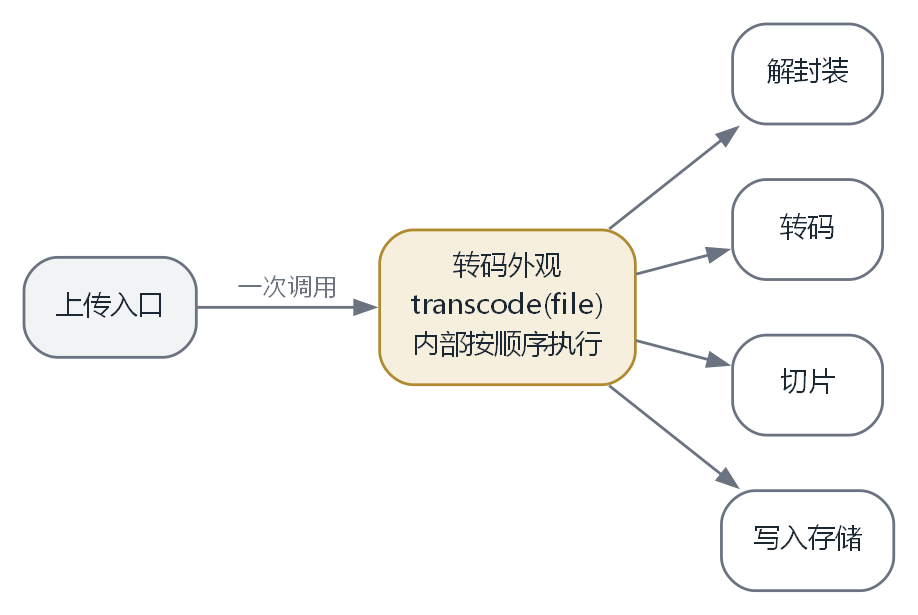

# 第 10 章 外观：给一组子系统一个入口

## 10.1 一次视频转码

系统要支持把上传的视频转成统一格式。

转码不是一个函数能完成的。它要经过几个步骤。

**解封装。** 从容器格式里取出视频流和音频流。MP4、MKV、AVI 的封装方式不同。

**解码。** 把压缩的视频流还原成帧。H.264、H.265、VP9 的解码器不同。

**缩放。** 把画面统一到目标分辨率。可能还要补边或者裁剪。

**编码。** 按目标码率和编码器重新压缩。

**封装。** 把编码后的流写进目标容器，音频可能还要重新混流。

每一步都有专门的库，每个库有自己的初始化参数、错误码、资源释放方式。

最初的业务代码直接调这些库。

```text
demuxer = Demuxer.open(input)
if demuxer.video_codec == "h264": decoder = H264Decoder()
else if demuxer.video_codec == "hevc": decoder = HevcDecoder()
...
scaler = Scaler(demuxer.width, demuxer.height, target_w, target_h)
encoder = Encoder(target_bitrate)
muxer = Muxer(output)

for packet in demuxer:
    frames = decoder.decode(packet)
    for frame in frames:
        scaled = scaler.scale(frame)
        encoded = encoder.encode(scaled)
        muxer.write(encoded)
```

这段代码出现在三个地方：上传接口、批量转码任务、定时清理任务。三处的实现略有差异，因为不同的人写的。

问题很快出现。

**参数散落。** 码率、分辨率、编码器预设，每个调用点自己设，改一次默认值要改三处。

**错误处理不一致。** 有的调用点解码失败就退出，有的跳过坏帧继续，用户看到的行为不一样。

**库升级影响所有调用点。** 编码库换了 API，三处都要改。

## 10.2 一个入口包住整组步骤

外观模式的思路是：提供一个简单的接口，把这个接口背后的多个子系统、调用顺序、参数默认值都包起来。

它包含两个角色。

**子系统。** 一组各自负责一件事的类，它们之间可能有依赖，调用顺序有要求。

**外观。** 一个类，对外暴露少数几个简单方法，内部负责调用子系统、编排顺序、转换错误。

用结构描述。

```text
class Transcoder
  transcode(input, output, preset) : Result
    demuxer = open_demuxer(input)
    decoder = pick_decoder(demuxer)
    scaler = make_scaler(preset)
    encoder = make_encoder(preset)
    muxer = open_muxer(output)
    loop:
        frames = decoder.decode(...)
        for f in frames:
            muxer.write(encoder.encode(scaler.scale(f)))
    return Result.ok(duration, size)
```

业务代码变成一行。

```text
result = transcoder.transcode(input, output, Preset.Web720p)
```



## 10.3 协作过程

1. 业务代码调用 `transcode`，只传输入、输出和预设。
2. 外观根据预设决定分辨率、码率、编码器。
3. 外观按顺序打开解封装器、选择解码器、创建缩放器和编码器、打开封装器。
4. 外观驱动整个循环，把每一步的输出交给下一步。
5. 任何一步失败，外观负责关闭已经打开的资源，返回统一的错误。
6. 成功时返回时长、文件大小这类业务关心的结果。

业务代码不知道内部有几个库，也不需要知道先解码还是先缩放。

## 10.4 失败时的收尾

多步流程里成功路径只有一条，失败路径有七八条。外观真正的价值，往往在后半部分。

解封装器打开成功，解码器初始化失败，解封装器必须关掉。编码器建好了，写到一半磁盘满了，封装器要删掉半成品文件，否则用户会拿到一个能下载但播不了的视频，还得等客服来解释。这些收尾如果留给调用方，三个调用点就会写出三种漏法。

错误也得翻译。底层库给的是 `AVERROR_INVALIDDATA` 这类码，业务方需要的是“文件损坏，请重新上传”和一句能直接展示给用户的话。翻译放在外观里，调用方就不用认识底层库的错误体系。翻译表里没覆盖到的码统一归到“转码失败”，把原始码带在结果对象里，排查时还能查。

还有一类失败值得单独处理。已经完成的步骤不该重来。批量转码里一个文件解封装成功但编码失败，重试时应该从编码开始，而不是从解码重新来一遍。这要求外观把中间结果落盘，或者把流程拆成可续跑的阶段。做不到就先别承诺断点续传，老老实实整体重试，别把一个半成品状态藏在内存里。

## 10.5 外观不封死子系统

外观是“方便入口”，不是“唯一入口”。

如果某个高级用户需要自定义编码参数，外观应该提供另一个方法，允许传入更细的配置。甚至可以暴露子系统，让调用方绕过外观。

一个常见的做法是分层。

```text
transcode(input, output, preset)           // 最常用，全部默认
transcode_with(input, output, options)     // 允许覆盖部分参数
```

第一层调第二层，第二层才是真正编排的地方。这样常用场景简单，特殊场景也有出口。

如果外观把所有子系统都藏死，遇到特殊需求时只能改外观，外观会越来越臃肿。

## 10.6 一个 C++ 入口

把资源用 RAII 管起来，外观函数就只剩编排。

```cpp
class Transcoder {
public:
    explicit Transcoder(Options defaults) : defaults_(std::move(defaults)) {}

    Result transcode(const std::string& in, const std::string& out,
                     const std::string& preset) {
        Options opt = defaults_.apply(preset);   // 预设加默认值，全章只此一处
        Demuxer demux(in);                       // 构造失败直接抛
        Decoder dec = make_decoder(demux.video_codec());
        Scaler scale(demux.width(), demux.height(), opt.width, opt.height);
        Encoder enc(opt.bitrate, opt.codec);
        Muxer mux(out + ".part");                // 先写临时文件
        try {
            for (const Packet& p : demux) {
                for (const Frame& f : dec.decode(p)) {
                    mux.write(enc.encode(scale.scale(f)));
                }
            }
            mux.finish();
        } catch (...) {
            mux.abort();                             // 删临时文件，关句柄
            throw translate(std::current_exception());
        }
        std::filesystem::rename(out + ".part", out);
        return Result{demux.duration(), mux.bytes()};
    }

private:
    Options defaults_;
};
```

几个细节值得说。

临时文件加后缀再改名，是让“写了一半”和“写完了”在文件系统上可区分。进程被 kill 时，残留的 `.part` 文件可以按规则清掉，正常文件不受影响。直接写目标文件看起来省一步，代价是失败后留下一个坏文件，而下载链接已经发出去了。

`translate` 是一张映射表，通常写成 `std::map<int, Error>` 或者一个 switch。它把库的错误换成业务错误，顺便把上下文带上，哪个文件、哪个阶段，都写进错误信息。

`Options::apply` 是默认值的唯一来源。以前码率散在三个调用点，调一次默认值要改三处，现在只在这里出现一次。

## 10.7 外观容易变成上帝类

外观最开始的代码通常很短，只是一串调用。用着用着，各种“顺便处理一下”的需求都会加进来。

- 转码前检查文件大小
- 转码后生成缩略图
- 失败时发通知
- 统计转码耗时
- 根据用户等级选择不同的预设

半年之后，外观变成一千行，所有业务逻辑都在里面。它不再是“简化入口”，而是“什么都管”。

避免的办法是给外观划边界。外观只做三件事：编排顺序、填默认参数、统一错误。业务规则应该放在外观外面，或者放在子系统的上层。

判断标准是：如果一段逻辑换个调用方就不需要了，它不该在外观里。

## 10.8 一个什么都管的外观

有个团队的外观类半年前是八十行，后来长到一千二百行。过程很平滑，每次只加一小段。

按用户等级选预设，加一段。转码完生成三张缩略图，加一段。失败时给上传者发站内信，加一段。统计每个用户的转码时长，加一段。运营要求 VIP 优先排队，于是外观里又多了个内存队列。

每一段单独看都合理。合起来的问题是，外观知道了用户等级、通知渠道、队列策略、计费规则，而这些跟“把视频转成另一种格式”没有关系。改通知文案要动外观，改队列策略也要动外观，任何一次改动都可能碰坏转码主流程。更麻烦的是测试，想测转码本身，得先把通知和队列都搭起来。

后来分了三层。

第一层还是外观，只留 `transcode(in, out, preset)` 和编排。第二层是策略对象，按用户等级给出预设和优先级。第三层是钩子，`on_success`、`on_failure` 在编排结束时被调用，通知、缩略图、计费都挂在钩子上。

迁移不是重写。先把新加的逻辑从外观挪到钩子，跑一周看有没有漏；再把预设选择挪到策略对象；最后外观剩四十行。中间态是外观里既有旧代码也有钩子调用，不太整齐，但每周都有可上线的版本。如果一开始就停下来重构两周，业务等不起，重构也大概率半途而废。

## 10.9 什么时候不该用

**只有一个子系统。** 如果转码只用一个库，直接调那个库就行，加外观只是多一层。

**调用方需要精细控制。** 如果每个调用方都要指定不同的参数组合，外观的默认值反而碍事。这时候提供一个配置对象更合适。

**子系统还在剧烈变化。** 外观的接口是照着当前子系统设计的。子系统每个月都改，外观要跟着改，调用方也要跟着改。

**性能敏感。** 外观内部的编排可能引入额外的数据复制。热路径上要评估。

## 10.10 与中介者的区别

两者都是“在中间协调”，容易混。

**外观**是单向的。调用方通过外观使用子系统，子系统不知道外观的存在。外观的目的是简化调用。

**中介者**是双向的。多个对象通过中介者互相通信，每个对象都知道中介者，但不知道彼此。中介者的目的是减少对象之间的直接依赖。

一个记忆方法：外观是“前台”，你找前台办事，前台替你跑腿；中介者是“交换机”，大家都连到交换机上，互相通信。

## 10.11 与适配器的区别

**适配器**改变接口，让不匹配的两边能对接。它通常只包一个对象。

**外观**简化接口，把一组对象的复杂调用收成一个入口。它通常包多个对象。

适配器关心“接口对不对得上”，外观关心“调用方会不会用得太麻烦”。

## 10.12 一个判断标准

要不要用外观，看三点。

第一，有没有一组子系统，调用顺序和参数配置比较复杂？有，外观能显著降低使用成本。

第二，是不是有多个调用点重复同样的编排？是，外观能把重复收在一处。

第三，子系统会不会经常变？如果会，外观要跟着变，收益可能抵不过维护成本。

前两个是“是”、第三个是“否”，外观合适。

写完之后，对着这张表再看一遍。

| 看哪里 | 合格的信号 | 不合格的信号 |
|---|---|---|
| 方法名 | `transcode`、`export_report` | `open_demux_then_decode` |
| 参数 | 预设、目标格式这类业务概念 | 解封装器、编码器这类库对象 |
| 返回 | 一个结果对象，带成败与产物 | 五个 out 参数 |
| 方法体 | 编排、默认值、错误翻译 | `if user.level > 3` 这类业务判断 |
| 测试 | 一个方法一句断言 | 测它得先把通知系统搭起来 |

四条都落在左列，外观就是称职的。有一条滑到右边，先别加功能，先把它挪出去。
