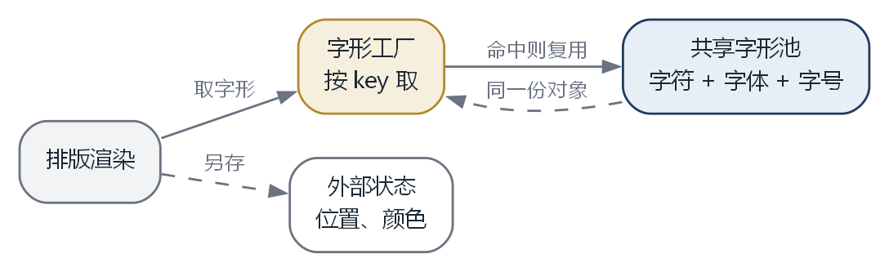
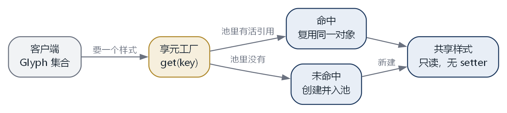

# 第 11 章 享元：共享不变的部分

## 11.1 一百万个字符

一个文本编辑器要支持富文本。每个字符可以有自己的字体、字号、颜色、粗体、斜体、下划线。

最直接的表示方式是每个字符一个对象。

```text
class Char
  ch        : char
  font      : Font
  size      : int
  color     : Color
  bold      : bool
  italic    : bool
```

一份十万字的文档，就是十万个对象。每个对象带上字体名、字号、颜色值，光这些属性就占几十字节。十万个对象，几兆内存。一百万字，几十兆。

而且大部分字符的格式是重复的。正文大部分是“宋体、五号、黑色、不加粗”，可能占九成以上。为每个字符都存一份一模一样的格式，纯属浪费。

## 11.2 把状态分成两份

享元模式的思路是：把对象的状态分成“内部状态”和“外部状态”。

**内部状态**是可以共享的、不随使用场景变化的部分。比如字符的字体、字号、颜色、粗斜体。

**外部状态**是每个使用场景独有的、不能共享的部分。比如字符在文档中的位置。

内部状态相同的字符，共享同一个格式对象。每个字符只存自己的字符值和格式对象的引用。

它包含四个角色。

**享元接口。** 声明一个操作，接收外部状态作为参数。

**具体享元。** 持有内部状态，操作时把外部状态和内部状态结合起来。

**享元工厂。** 按内部状态作为 key 缓存享元对象。相同的 key 返回同一个对象。

**客户端。** 持有外部状态，使用时从工厂取享元，把外部状态传进去。

用结构描述。

```text
class CharStyle          // 享元
  font, size, color, bold, italic
  draw(ch, x, y)

class StyleFactory
  cache : Map<string, CharStyle>
  get(font, size, color, bold, italic) : CharStyle
    key = join(font, size, color, bold, italic)
    if cache.has(key): return cache[key]
    style = new CharStyle(...)
    cache[key] = style
    return style

class Glyph
  ch     : char
  style  : CharStyle
  x, y   : int
```



## 11.3 协作过程

1. 排版时，编辑器读到一段文字和它的格式。
2. 向工厂要一个格式对象，工厂按属性组合算 key，有就返回已有的，没有就新建一个存起来。
3. 每个字符创建一个轻量的 `Glyph`，只存字符值、格式引用和位置。
4. 绘制时遍历 `Glyph`，调用 `style.draw(ch, x, y)`。

十万字文档里，如果只有二十种格式组合，内存里只有二十个 `CharStyle` 对象，十万个 `Glyph`。相比十万个完整对象，内存降了一个数量级。

## 11.4 内部状态必须不可变

享元的共享前提是内部状态不会被修改。

如果某个字符要改成红色，不能去改共享的 `CharStyle`，那会把所有用这个格式的字符一起改红。正确做法是向工厂要一个新的格式对象，把这个字符的引用换掉。

所以享元对象应该是只读的。创建之后不提供修改方法，所有字段在构造时确定。

这条约束很重要。一旦有人给享元加了 setter，共享就变成了隐性耦合，改一处影响一片。

## 11.5 外部状态怎么划

判断一个字段放里面还是外面，标准只有一个，同一种取值会不会被大量对象共用。

字体、字号、颜色、粗斜体，它们是有限枚举的组合，几十种取值盖住整份文档，放里面。位置、偏移、是否被选中、属于哪条批注，每个字符都不一样，放外面。

有三种情况容易划错。

**看着会变，但取值很少。** 比如“语言”，中文正文、英文摘要，整篇只有两种。虽然理论上可变，但它属于文本片段的属性，放里面更划算。判据不是“可变不可变”，而是“取值的基数有多大”。

**只在短时间内稳定。** 比如段落的“批注作者”，一篇文章里可能只有一个。放外面，每个字符都要存一个指针；放里面，批注一改就要把所有字符的格式对象换掉。这时看改动频率，一秒钟改十次就不合适。

**跨对象的引用。** 字符不持有“所属表格”这个对象，只存行列号。行列号是外部状态，因为每个字符都不同，而且它描述的是位置，不是外观。

划完做一次验算，把“享元总大小”加上“每个使用点的外部状态大小”，和“每个对象独立带全部字段”比一比。省不到三成，说明划分不对，或者共享率不够，这时候应该先回头看看数据。

## 11.6 池的回收与并发取用

池里的对象什么时候能删，取决于还有没有人拿着它。

用裸指针加一张 `std::map` 是最省事的写法，也最容易出事。删早了，调用方手里的指针悬空；不删，池就成了只涨不落的内存。C++ 里合适的做法是池存 `std::weak_ptr`，客户端拿 `shared_ptr`，最后一个使用者释放时对象自动消失，池里的弱引用下次取用时顺手清掉。

```cpp
std::shared_ptr<const CharStyle> StylePool::get(const StyleKey& k) {
    std::lock_guard<std::mutex> lk(mu_);
    auto it = pool_.find(k);
    if (it != pool_.end()) {
        if (auto sp = it->second.lock()) return sp;   // 还活着，复用
        pool_.erase(it);                              // 没人用了，清掉条目
    }
    auto sp = std::make_shared<const CharStyle>(k);
    pool_.emplace(k, sp);
    return sp;
}
```

这里从头到尾持锁，创建也在锁里。享元创建只是填几十字节，锁竞争不多，这样写最不容易错。如果创建真的贵，比如要读字体文件，可以改成锁外创建再回锁重查，代价是偶尔建出两个一样的对象，只保留先入池的那个。

两个细节。返回类型是 `shared_ptr<const CharStyle>`，`const` 把“不许改”变成编译期约束，比写在注释里可靠。持锁时不要调外部代码，日志回调、自定义比较函数只要有一个回头再调 `get`，就会自己锁自己，`std::mutex` 不可重入，这类死锁通常要到压测才暴露。



## 11.7 一个 C++ 的样式池

把 key 做成结构体并给它一个稳定的哈希，比拼字符串省事，也不容易漏字段。

```cpp
struct StyleKey {
    std::string font;
    int size;
    uint32_t color;   // 0xRRGGBB
    bool bold, italic;
    bool operator==(const StyleKey& o) const {
        return size == o.size && color == o.color && bold == o.bold &&
               italic == o.italic && font == o.font;
    }
};

struct StyleKeyHash {
    size_t operator()(const StyleKey& k) const {
        size_t h = std::hash<std::string>{}(k.font);
        h = h * 131 + static_cast<size_t>(k.size);
        h = h * 131 + k.color;
        h = h * 131 + (k.bold ? 1 : 0) + (k.italic ? 2 : 0);
        return h;
    }
};
```

拼字符串做 key 有个隐患，分隔符一旦出现在字体名里就会撞 key。结构体加 `==` 没有这个问题。

`Glyph` 更简单，字符值、样式指针、坐标，三样东西加起来二十几字节。一份十万字的文档，格式如果集中在二十种组合上，内存里就只有二十个 `CharStyle` 和十万个 `Glyph`，总量在两三兆，比每个字符独立携带格式小一个数量级。

命中率值得记一个计数。长期低于七成，说明 key 划得太细，可能是把外部状态混进内部状态了。

## 11.8 工厂的缓存策略

享元工厂的缓存不是无限的。

格式组合的数量通常有限，字体几种、字号几种、颜色几种，乘起来几十到几百。缓存全部保留没问题。

但如果 key 是连续值，比如坐标、时间戳，缓存会无限增长。这种数据不适合做享元。

几个处理方式。

**设上限。** 缓存超过一定数量，按最近最少使用淘汰。但被淘汰的享元如果还有客户端引用，不能直接销毁，要等引用释放。

**只缓存离散值。** 格式、类型、状态这类离散的 key 才缓存。连续值不进缓存。

**用固定枚举。** 如果格式种类在编译时就确定，可以预先创建所有享元，工厂只做查表，不需要动态创建。

## 11.9 享元与缓存、单例的区别

这三个概念经常被混。

**单例**保证一个类只有一个实例，全局唯一。

**缓存**是为了加速访问，存的是计算结果，可能过期，可能被淘汰。

**享元**是为了节省内存，共享的是对象本身，对象在客户端使用期间必须一直有效。

一个具体的区别：缓存里的对象可以被删掉，下次重新算；享元被删掉，正在使用它的客户端就悬空了。

## 11.10 一个共享过头的样式池

有个编辑器为了省内存，把“光标位置”也放进了样式对象，理由是同一行通常只有一个光标。上线后出现怪现象，移动光标时整行高亮，删掉一个字符后高亮跳到别的段落。

原因很直接。样式对象被几十个字符共享，改它的光标字段等于一次改了几十个。开发时只测了一个字符的显示，自然看不出问题。

收拾的办法是把光标从样式里拿掉，放进独立的 `CursorState`，渲染时在最后一步叠加。改动花了半天，代价却是之前两周里所有“高亮位置莫名其妙”的工单。

同一类错误还有几种长相。把“是否被选中”放进享元，选中一个词会让全篇同格式的词都变蓝。把“是否有拼写错误”放进享元，改一个词会让所有同格式的词都出波浪线。把“上次绘制时间”放进享元当缓存标记，多线程下互相覆盖。

判据回到一句话，凡是每个使用点都可能不同的字段，一律放外面。拿不准时问自己，A 字符改了这个字段，B 字符该不该跟着变。该变就放里面，不该变就必须放外面。

## 11.11 什么时候不该用

**对象数量不多。** 只有几千个对象，省下来的内存可以忽略，增加的一层间接反而让代码更绕。

**内部状态组合非常多。** 如果每个对象的格式都不一样，享元工厂会变成一个大缓存，命中率很低，还不如直接创建。

**对象是可变的。** 享元要求内部状态不可变。如果业务上需要频繁修改，共享会带来麻烦。

**外部状态很复杂。** 享元把外部状态推给客户端，客户端要自己管理。如果外部状态本身很复杂，客户端的负担会加重。

## 11.12 一个常见的应用

除了文本格式，享元还常见于这些地方。

**地图瓦片。** 同一张瓦片可能在不同位置重复出现，共享瓦片图像，位置作为外部状态。

**游戏里的粒子。** 同一种粒子共享纹理和材质，每个粒子只存位置、速度、生命周期。

**图标。** 同一套图标在界面上出现很多次，共享图标资源，位置和大小作为外部状态。

**字符串常量。** 很多语言在编译期就把相同的字符串字面量合并成一份，这也是一种享元。

**连接池。** 数据库连接被多个请求共享，连接本身是享元，请求是外部状态。不过连接池还要处理借用和归还，比纯享元复杂。

## 11.13 一个判断标准

要不要用享元，看三点。

第一，对象数量是不是很大？几万以上，才值得优化。

第二，对象里是不是有很大一部分状态是重复的？重复比例越高，收益越大。

第三，重复的那部分能不能做成不可变？不能，就不适合共享。

三点都成立，享元合适。否则先考虑别的优化，比如换更紧凑的数据结构、减少对象创建。

动手之前，先在纸上写两列。左列是所有使用点都一样的字段，右列是每个使用点都可能不同的字段。写不出左列，说明还没看清数据结构；右列超过三四个字段，说明它更像一份普通对象，共享的收益撑不起这份复杂。

再补两个自检。key 的字段是不是都进了 `==` 和哈希，少一个就会串色。共享对象的返回类型上有没有 `const`，没有就等着有人顺手改一笔。
