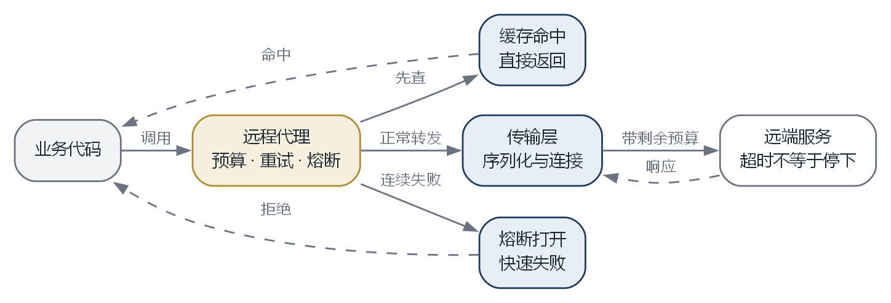

# 第 12 章 代理：在真实对象前面站一个替身

## 12.1 一打开相册就卡住

一个图片管理应用，打开相册时要显示几百张照片的缩略图。

最初的实现很简单：每个格子创建一个 `Image` 对象，构造时把原图读进内存，缩放到缩略图大小，再显示。

问题是原图很大。一张四千万像素的照片，解码后一百多兆。三十张同时加载，内存直接爆掉，界面卡住十几秒。

更麻烦的是，用户可能只看了前三张就滑走了。后面二十七张的解码完全浪费。

## 12.2 先用一个占位的东西顶上

代理模式的思路是：给真实对象配一个替身，替身实现同一个接口，先返回一个轻量的占位结果，等真正需要时再去创建或加载真实对象。

它包含三个角色。

**主题接口。** 描述真实对象能做什么，比如“绘制自己”“获取尺寸”。

**真实主题。** 真正干活的类，创建或加载的成本很高。

**代理。** 实现主题接口，内部持有一个真实主题的引用（可能还没创建），在合适的时机创建并转发调用。

用结构描述。

```text
interface Picture
  draw(rect) : void
  width() : int
  height() : int

class RealPicture implements Picture
  constructor(path)
    image = decode(path)         // 很慢，占内存
  draw(rect) { draw_image(image, rect) }

class LazyPicture implements Picture
  path, real
  ensure()
    if real == null: real = new RealPicture(path)
  draw(rect)
    ensure()
    real.draw(rect)
```


## 12.3 协作过程

1. 相册打开时，为每张照片创建一个 `LazyPicture`，只记住路径，不读图。
2. 界面布局需要尺寸时，代理可以先返回一个预设的占位尺寸，或者读文件头拿到宽高，不解码全部像素。
3. 用户滚动到某个格子，界面调用 `draw`。
4. 代理发现真实对象还没创建，创建它，然后转发绘制。
5. 之后的绘制直接转发，不再重复创建。

结果是：只加载用户真正看到的几张，内存和启动时间都降下来。

## 12.4 四种常见的代理

代理的形态很多，按目的分有四类。

**虚代理。** 延迟创建昂贵的对象。上面的图片就是这一类。

**远程代理。** 本地对象代表一个远程服务。调用本地方法时，代理把参数打包发到远端，等结果回来再返回。调用方感觉像在调本地对象，实际上跨了网络。

**保护代理。** 在转发前检查权限。比如一个文件对象的代理，读之前检查当前用户有没有读权限，没有就拒绝，不惊动真实对象。

**智能引用。** 在访问前后做额外的事。比如引用计数，每次访问加一，释放时减一，减到零就销毁真实对象。C++ 的智能指针就是这一类。

还有一类叫写时复制代理。多个调用方共享同一个真实对象，直到有人要写，才复制一份出来。字符串和内存页的实现里常见。

## 12.5 代理与真实对象的接口必须一致

代理能替换真实对象，前提是两者实现同一个接口。

这带来一个约束：接口里不能出现只有真实对象才有的方法。否则代理没法实现，或者只能抛“不支持”。

如果确实有些操作代理做不了，比如远程代理不支持“获取本地文件句柄”，那这个操作就不该放在主题接口里。它应该属于另一个接口，由真实对象单独提供。

## 12.6 代理的失败模式

代理多了一层，失败的可能也多了。

**远程代理的网络问题。** 超时、断线、重试、幂等，这些都要在代理里处理。调用方以为在调本地方法，实际上可能等了三秒才失败。

**保护代理的权限判断。** 权限判断本身可能出错。判断太严，正常操作被拒；判断太松，等于没有保护。

**虚代理的并发。** 两个线程同时第一次调用 `draw`，可能都看到真实对象为空，都去创建。需要加锁，或者用“只创建一次”的初始化机制。

**智能引用的循环引用。** 两个对象互相持有智能指针，引用计数永远不归零，内存泄漏。

这些问题不是代理模式本身的缺陷，而是“多一层”必然带来的复杂度。用代理之前要想清楚，这一层带来的收益是否值得。

## 12.7 一个懒加载代理的写法

懒加载代理看着简单，并发下最容易出双份。两个线程同时滚到同一张图，都看到真实对象为空，都去解码，内存瞬间翻倍。

```cpp
class LazyPicture : public Picture {
public:
    explicit LazyPicture(std::string path) : path_(std::move(path)) {}
    void draw(const Rect& r) override { ensure()->draw(r); }
    int width() const override { return header_size().first; }

private:
    std::shared_ptr<RealPicture> ensure() {
        std::shared_ptr<RealPicture> sp = real_.lock();
        if (sp) return sp;                       // 无锁快路径
        std::lock_guard<std::mutex> lk(mu_);
        sp = real_.lock();
        if (sp) return sp;                       // 锁内再查一次
        sp = std::make_shared<RealPicture>(path_);
        real_ = sp;
        return sp;
    }

    mutable std::mutex mu_;
    std::weak_ptr<RealPicture> real_;
    std::string path_;
};
```

两道检查是必须的，第一道让绝大多数调用不必抢锁，第二道把“两个人同时发现没加载”的情况收住。用 `weak_ptr` 而不是 `shared_ptr` 保存，界面层释放这张图之后，代理能退回未加载状态，下次重新加载；代价是可能反复加载，需要外层再配一个 LRU 缓存。

`width` 不触发解码，只读文件头。JPEG、PNG 的宽高在前几十字节里，读一次就够。这是虚代理常用的小手法，布局阶段不付解码代价。

## 12.8 缓存代理与失效

缓存代理是虚代理的表亲，它不延迟创建，它避免重复访问。三件事必须一起想清楚。

**缓存键。** 键要覆盖所有影响结果的输入，路径、查询串、身份、语言、客户端版本，缺一个就会串号或者返回旧格式。

**过期。** TTL 最省事，但价格、库存这类数据，五分钟的旧值就可能造成客诉。更好的做法是带版本号，写操作把版本加一，读时版本不对就算未命中。TTL 做上限，两者叠加。

**击穿。** 缓存刚过期，一百个请求同时未命中，全部打到后端。常见解法是让第一个请求去取，其余等同一个结果，也就是 single-flight。

```cpp
std::shared_ptr<const Item> CachedRepo::get(const std::string& key) {
    if (auto v = cache_.get(key)) return v;          // 命中就走
    std::shared_ptr<Fetch> p;
    {
        std::lock_guard<std::mutex> lk(mu_);
        auto& slot = inflight_[key];
        if (!slot) slot = std::make_shared<Fetch>();
        p = slot;
    }
    if (p->try_own()) {                              // 我是第一个，去回源
        auto v = std::make_shared<const Item>(load(key));
        cache_.put(key, v);
        p->set(v);
        std::lock_guard<std::mutex> lk(mu_);
        inflight_.erase(key);
        return v;
    }
    return p->wait();                                // 其余等同一份结果
}
```

真实实现里用 `std::future` 的共享状态或者 `std::call_once` 更稳，要传达的只有一件事，同一时刻同一个键只有一次回源。

失效还有一条容易忘，写操作要失效的是所有读过这份数据的缓存，而不是同一个 URL 那一条。列表页和详情页读的是同一张表，只失效详情页，列表页还会显示旧价格。做法是按资源类型打标签，写操作按标签清。

## 12.9 远程代理的超时

远程代理让本地调用看起来像本地方法，这句话最危险的地方在于，本地方法失败是立刻的，远程调用失败要等。

超时必须由调用方给定，并且逐层往下分。代理拿到一个八百毫秒的总预算，自己留一百毫秒做序列化和重试判断，剩下的交给下游，下游的代理再分一部分。没有预算传递，每层都设三秒，四次嵌套就是十二秒，用户早就关了页面。

超时还有一层语义要说清，本地超时只代表我不等了，不代表远端停了。一个超时的下单请求，服务端可能两百毫秒后才真正处理完。所以带副作用的远程调用照样需要幂等键，代理重试时复用同一个键。

剩下的三件事属于同一类，熔断、重试、降级都应该在代理里做，而不是散在调用方。熔断器记连续失败次数，超过阈值就快速失败一段时间，避开雪崩。重试只对幂等且可重试的错误生效。降级返回一个默认值或者缓存里的旧值，前提是业务能接受。



## 12.10 一个越做越大的代理

有个团队的远程服务代理从两百行涨到九百行。最开始它只做序列化和超时，后来加了重试、缓存、限流、降级、链路埋点，最后还加了按机房就近路由。

问题在测试和排查上暴露。一个请求慢了，无法判断是网络慢、重试拖的、限流排队，还是走了降级分支。想单独关掉某个能力，得改代码。

后来把它拆成一条链，路由、限流、缓存、重试、超时各自一层，每层可独立开关，日志里带上层的名字。代理本身退回两百行，只做序列化和连接管理。这个改动没引入新框架，就是把原来的 `if` 分支按条件拆成对象。拆完的第一个好处是压测，可以只打开限流层，看它在什么并发下开始拒绝。

## 12.11 什么时候不该用

**真实对象很轻。** 创建一个对象只要几微秒，加代理反而更慢。

**调用方需要知道真实类型。** 如果业务逻辑依赖真实对象的具体类型，代理会挡住类型判断。这时候要么暴露真实对象，要么重新设计接口。

**代理逻辑会越来越复杂。** 代理最开始只做延迟加载，后来加了缓存、重试、限流、降级。这时候它已经不是一个“替身”，而是一个业务层。应该把它拆出去。

**性能敏感的热路径。** 每次调用多一次转发，高频调用时会累积成可观的成本。

## 12.12 与装饰器的区别

两者结构几乎一样，区别在目的。

**装饰器**是为了增强功能。每一层都加一点能力，层层叠加，调用方通常知道自己在用哪些增强。

**代理**是为了控制访问。通常只有一层，决定要不要转发、什么时候转发。调用方往往不知道自己在跟代理打交道。

一个具体的区别：装饰器一般都会把调用转发给真实对象；代理可能不转发，比如权限不足时直接拒绝，或者图片还没加载时先画占位。

## 12.13 与适配器的区别

**适配器**改变接口，让不匹配的两边能对接。

**代理**不改变接口，代理和真实对象的接口完全一样。

适配器是“翻译”，代理是“替身”。

## 12.14 一个判断标准

要不要用代理，看三点。

第一，真实对象的创建或访问成本是不是很高？高，虚代理或远程代理有价值。

第二，是不是需要在访问前后做统一的控制？比如权限、计数、缓存。是，代理能把控制收在一处。

第三，调用方能不能接受“多一层”的不确定性？比如远程代理可能超时。不能，就要重新考虑。

三点都成立，代理合适。

真正的分界线不在代码行数，而在出问题时能不能立刻说是哪一层的错。一个代理如果让排查的人必须先把它读完才能定位，那它已经超出了替身的职责。

另外还有三件事，平时看不出来，出事时全在这里。主题接口里有没有只有真实对象才做得到的方法，有就说明接口划错了。真实对象的创建和释放是不是成对，尤其是异常路径。缓存和超时的失败分支有没有单独测过，这两条路径平时不跑，出事就是大事。
