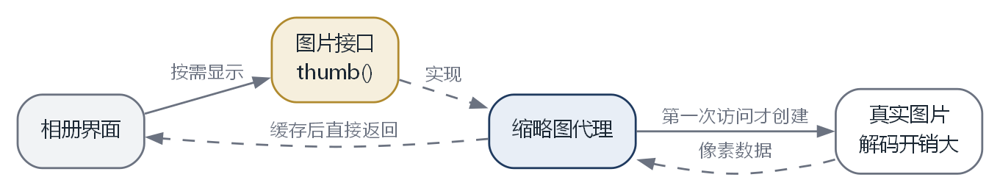

# 第 12 章 代理：在真实对象前面站一个替身

## 12.1 一打开相册就卡住

一个图片管理应用，打开相册时要显示几百张照片的缩略图。

最初的实现很简单：每个格子创建一个 `Image` 对象，构造时把原图读进内存，缩放到缩略图大小，再显示。

问题是原图很大。一张四千万像素的照片，解码后一百多兆。三十张同时加载，内存直接爆掉，界面卡住十几秒。

更麻烦的是，用户可能只看了前三张就滑走了。后面二十七张的解码完全浪费。

## 12.2 先用一个占位的东西顶上

代理模式的思路是：给真实对象配一个替身，替身实现同一个接口，先返回一个轻量的占位结果，等真正需要时再去创建或加载真实对象。

它包含三个角色。

**主题接口。** 描述真实对象能做什么，比如“绘制自己”“获取尺寸”。

**真实主题。** 真正干活的类，创建或加载的成本很高。

**代理。** 实现主题接口，内部持有一个真实主题的引用（可能还没创建），在合适的时机创建并转发调用。

用结构描述。

```text
interface Picture
  draw(rect) : void
  width() : int
  height() : int

class RealPicture implements Picture
  constructor(path)
    image = decode(path)         // 很慢，占内存
  draw(rect) { draw_image(image, rect) }

class LazyPicture implements Picture
  path, real
  ensure()
    if real == null: real = new RealPicture(path)
  draw(rect)
    ensure()
    real.draw(rect)
```



## 12.3 协作过程

1. 相册打开时，为每张照片创建一个 `LazyPicture`，只记住路径，不读图。
2. 界面布局需要尺寸时，代理可以先返回一个预设的占位尺寸，或者读文件头拿到宽高，不解码全部像素。
3. 用户滚动到某个格子，界面调用 `draw`。
4. 代理发现真实对象还没创建，创建它，然后转发绘制。
5. 之后的绘制直接转发，不再重复创建。

结果是：只加载用户真正看到的几张，内存和启动时间都降下来。

## 12.4 四种常见的代理

代理的形态很多，按目的分有四类。

**虚代理。** 延迟创建昂贵的对象。上面的图片就是这一类。

**远程代理。** 本地对象代表一个远程服务。调用本地方法时，代理把参数打包发到远端，等结果回来再返回。调用方感觉像在调本地对象，实际上跨了网络。

**保护代理。** 在转发前检查权限。比如一个文件对象的代理，读之前检查当前用户有没有读权限，没有就拒绝，不惊动真实对象。

**智能引用。** 在访问前后做额外的事。比如引用计数，每次访问加一，释放时减一，减到零就销毁真实对象。C++ 的智能指针就是这一类。

还有一类叫写时复制代理。多个调用方共享同一个真实对象，直到有人要写，才复制一份出来。字符串和内存页的实现里常见。

## 12.5 代理与真实对象的接口必须一致

代理能替换真实对象，前提是两者实现同一个接口。

这带来一个约束：接口里不能出现只有真实对象才有的方法。否则代理没法实现，或者只能抛“不支持”。

如果确实有些操作代理做不了，比如远程代理不支持“获取本地文件句柄”，那这个操作就不该放在主题接口里。它应该属于另一个接口，由真实对象单独提供。

## 12.6 代理的失败模式

代理多了一层，失败的可能也多了。

**远程代理的网络问题。** 超时、断线、重试、幂等，这些都要在代理里处理。调用方以为在调本地方法，实际上可能等了三秒才失败。

**保护代理的权限判断。** 权限判断本身可能出错。判断太严，正常操作被拒；判断太松，等于没有保护。

**虚代理的并发。** 两个线程同时第一次调用 `draw`，可能都看到真实对象为空，都去创建。需要加锁，或者用“只创建一次”的初始化机制。

**智能引用的循环引用。** 两个对象互相持有智能指针，引用计数永远不归零，内存泄漏。

这些问题不是代理模式本身的缺陷，而是“多一层”必然带来的复杂度。用代理之前要想清楚，这一层带来的收益是否值得。

## 12.7 什么时候不该用

**真实对象很轻。** 创建一个对象只要几微秒，加代理反而更慢。

**调用方需要知道真实类型。** 如果业务逻辑依赖真实对象的具体类型，代理会挡住类型判断。这时候要么暴露真实对象，要么重新设计接口。

**代理逻辑会越来越复杂。** 代理最开始只做延迟加载，后来加了缓存、重试、限流、降级。这时候它已经不是一个“替身”，而是一个业务层。应该把它拆出去。

**性能敏感的热路径。** 每次调用多一次转发，高频调用时会累积成可观的成本。

## 12.8 与装饰器的区别

两者结构几乎一样，区别在目的。

**装饰器**是为了增强功能。每一层都加一点能力，层层叠加，调用方通常知道自己在用哪些增强。

**代理**是为了控制访问。通常只有一层，决定要不要转发、什么时候转发。调用方往往不知道自己在跟代理打交道。

一个具体的区别：装饰器一般都会把调用转发给真实对象；代理可能不转发，比如权限不足时直接拒绝，或者图片还没加载时先画占位。

## 12.9 与适配器的区别

**适配器**改变接口，让不匹配的两边能对接。

**代理**不改变接口，代理和真实对象的接口完全一样。

适配器是“翻译”，代理是“替身”。

## 12.10 一个判断标准

要不要用代理，看三点。

第一，真实对象的创建或访问成本是不是很高？高，虚代理或远程代理有价值。

第二，是不是需要在访问前后做统一的控制？比如权限、计数、缓存。是，代理能把控制收在一处。

第三，调用方能不能接受“多一层”的不确定性？比如远程代理可能超时。不能，就要重新考虑。

三点都成立，代理合适。
