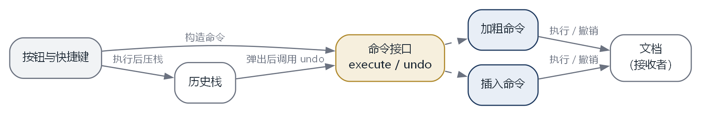

# 第 14 章 命令：把一次操作变成对象

## 14.1 撤销按钮

一个编辑器要做撤销和重做。

最初实现时，所有操作都直接改文档。

```text
apply_bold(start, end):
    doc.set_style(start, end, BOLD)

apply_insert(pos, text):
    doc.insert(pos, text)
```

编辑器能用了，但用户很快提出：按 Ctrl+Z 要能撤回上一步。

直接改文档的写法撤不回来。撤回需要知道“上一步做了什么、参数是什么、怎么恢复到之前”。这些东西在调用完之后就丢了。

有人想了个办法：每次操作前，把整个文档复制一份存起来。

一份一百页的文档，每按一次键就复制一次，内存很快爆掉。

## 14.2 把请求封装成对象

命令模式的思路是：把一次操作封装成一个对象，对象里记住“做什么”和“怎么做”，并提供“执行”和“撤销”两个方法。

它包含四个角色。

**命令接口。** 声明 `execute` 和 `undo` 两个方法。

**具体命令。** 持有一个接收者（真正干活的对象）和执行时需要的参数，实现执行和撤销。

**接收者。** 真正执行操作的对象，比如文档、文件、设备。

**调用者。** 触发命令的对象，比如按钮、快捷键、菜单项。它只认识命令接口，不知道命令具体做什么。

用结构描述。

```text
interface Command
  execute() : void
  undo() : void

class InsertTextCommand implements Command
  doc, pos, text
  execute() { doc.insert(pos, text) }
  undo()    { doc.remove(pos, text.length) }

class BoldCommand implements Command
  doc, start, end, prev_style
  execute()
    prev_style = doc.style_at(start)
    doc.set_style(start, end, BOLD)
  undo()
    doc.set_style(start, end, prev_style)

class CommandHistory
  undo_stack, redo_stack
  push(cmd) { cmd.execute(); undo_stack.push(cmd); redo_stack.clear() }
  undo()    { cmd = undo_stack.pop(); cmd.undo(); redo_stack.push(cmd) }
  redo()    { cmd = redo_stack.pop(); cmd.execute(); undo_stack.push(cmd) }
```



## 14.3 协作过程

1. 用户点“加粗”，界面构造一个 `BoldCommand`，带上文档、选区、当前样式。
2. 界面把命令交给调用者（历史管理器）。
3. 调用者调用 `execute`，命令转给文档执行。
4. 调用者把命令压进撤销栈。
5. 用户按 Ctrl+Z，调用者从撤销栈弹出命令，调用 `undo`。
6. 命令用记住的旧样式恢复。
7. 用户按 Ctrl+Y，调用者从重做栈弹出，再执行一次。

界面代码只负责“造命令”，不知道命令怎么执行。编辑器内核只负责“改文档”，不知道是谁触发的。

## 14.4 命令要记住什么

撤销能不能做对，取决于命令记住了什么。

**插入命令**要记住位置和插入的内容。撤销时在这两个位置删掉对应长度。

**删除命令**要记住被删的内容和位置。撤销时插回去。

**格式命令**要记住被改区域的旧格式。如果选区里格式不一致，要把每个片段的旧格式都记下来，不能只记一个。

**移动命令**要记住原位置和新位置。

有些操作很难撤销。比如“合并两个文档”，撤销要恢复到合并前的两个文档，需要保存两份副本。这类操作通常标记为“不可撤销”，或者在执行前做一次快照。

判断标准是：撤销所需的信息能不能用较小的代价保存。能，就做成命令；不能，就用快照。

## 14.5 命令的另外两种用法

命令模式不只用于撤销。

**任务队列。** 把命令放进队列，由工作线程逐个执行。命令对象可以序列化，存到磁盘，重启后继续执行。批量处理、后台任务常用这种方式。

**宏录制。** 把用户的一系列操作记录成命令列表，之后一次性重放。命令对象本身就是“操作记录”，天然适合。

**网络请求。** 把一次远程调用封装成命令，可以重试、可以排队、可以记录审计日志。

这几种用法的共同点是：需要把“操作”从“立即执行”中解耦出来，先存起来，之后再执行或者反向执行。

## 14.6 命令与接收者的关系

命令不应该自己干活，它应该把活交给接收者。

```text
class BoldCommand
  doc : Document      // 接收者
  execute() { doc.set_style(...) }
```

如果命令自己直接操作文件、直接改全局变量，那它就变成了“带 undo 的函数”，耦合很重。接收者可以是文档、画布、设备、远程服务，命令只负责“记住参数、调用接收者、记住怎么撤销”。

这样做还有一个好处：同一个接收者可以配多种命令，命令也可以复用到不同的接收者上。

## 14.7 什么时候不该用

**操作不需要撤销、排队、记录。** 一个一次性的计算，封装成命令只是多一层。

**操作非常简单。** 一个设置字段的操作，直接调 setter 就行，命令对象比操作本身还长。

**状态太大，无法有效保存。** 撤销需要保存大量状态，内存吃不消。这时候该用快照或者增量日志，而不是逐条命令。

**命令之间强依赖。** 后一个命令依赖前一个命令的中间结果，撤销时要按严格顺序，还要处理依赖失效。这种情况更适合事务或者快照。

## 14.8 与策略的区别

**策略**封装的是“怎么做”，同一个任务换一种算法。

**命令**封装的是“做什么”，一次具体的请求，可以排队、记录、撤销。

从接口上看，策略通常只有一个执行方法，命令通常有执行和撤销两个。策略不保存调用的上下文，命令要保存。

## 14.9 与备忘录的区别

**命令**记录“操作”，通过反向执行来撤销。

**备忘录**记录“状态”，通过整体恢复来撤销。

命令节省内存，但要求每个操作都能反向；备忘录实现简单，但占内存。

实际系统经常混用。普通编辑用命令，复杂操作（比如批量替换）用备忘录做一次快照。

## 14.10 一个判断标准

要不要用命令，看三点。

第一，操作需要撤销或者重做？需要，命令是标准解法。

第二，操作需要排队、延迟执行、跨进程执行？需要，命令能把它变成数据。

第三，每个操作能不能用较小的代价反向执行？能，命令合适；不能，考虑快照。

三点有一个成立，就值得考虑命令模式。
