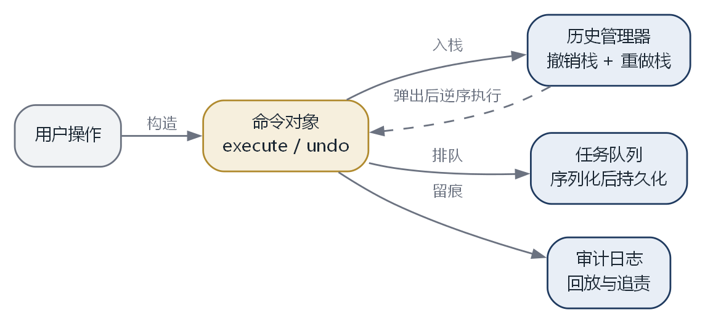

# 第 14 章 命令：把一次操作变成对象

## 14.1 撤销按钮

一个编辑器要做撤销和重做。

最初实现时，所有操作都直接改文档。

```text
apply_bold(start, end):
    doc.set_style(start, end, BOLD)

apply_insert(pos, text):
    doc.insert(pos, text)
```

编辑器能用了，但用户很快提出：按 Ctrl+Z 要能撤回上一步。

直接改文档的写法撤不回来。撤回需要知道“上一步做了什么、参数是什么、怎么恢复到之前”。这些东西在调用完之后就丢了。

有人想了个办法：每次操作前，把整个文档复制一份存起来。

一份一百页的文档，每按一次键就复制一次，内存很快爆掉。

## 14.2 把请求封装成对象

命令模式的思路是：把一次操作封装成一个对象，对象里记住“做什么”和“怎么做”，并提供“执行”和“撤销”两个方法。

它包含四个角色。

**命令接口。** 声明 `execute` 和 `undo` 两个方法。

**具体命令。** 持有一个接收者（真正干活的对象）和执行时需要的参数，实现执行和撤销。

**接收者。** 真正执行操作的对象，比如文档、文件、设备。

**调用者。** 触发命令的对象，比如按钮、快捷键、菜单项。它只认识命令接口，不知道命令具体做什么。

用结构描述。

```text
interface Command
  execute() : void
  undo() : void

class InsertTextCommand implements Command
  doc, pos, text
  execute() { doc.insert(pos, text) }
  undo()    { doc.remove(pos, text.length) }

class BoldCommand implements Command
  doc, start, end, prev_style
  execute()
    prev_style = doc.style_at(start)
    doc.set_style(start, end, BOLD)
  undo()
    doc.set_style(start, end, prev_style)

class CommandHistory
  undo_stack, redo_stack
  push(cmd) { cmd.execute(); undo_stack.push(cmd); redo_stack.clear() }
  undo()    { cmd = undo_stack.pop(); cmd.undo(); redo_stack.push(cmd) }
  redo()    { cmd = redo_stack.pop(); cmd.execute(); undo_stack.push(cmd) }
```


## 14.3 协作过程

1. 用户点“加粗”，界面构造一个 `BoldCommand`，带上文档、选区、当前样式。
2. 界面把命令交给调用者（历史管理器）。
3. 调用者调用 `execute`，命令转给文档执行。
4. 调用者把命令压进撤销栈。
5. 用户按 Ctrl+Z，调用者从撤销栈弹出命令，调用 `undo`。
6. 命令用记住的旧样式恢复。
7. 用户按 Ctrl+Y，调用者从重做栈弹出，再执行一次。

界面代码只负责“造命令”，不知道命令怎么执行。编辑器内核只负责“改文档”，不知道是谁触发的。

## 14.4 命令要记住什么

撤销能不能做对，取决于命令记住了什么。

**插入命令**要记住位置和插入的内容。撤销时在这两个位置删掉对应长度。

**删除命令**要记住被删的内容和位置。撤销时插回去。

**格式命令**要记住被改区域的旧格式。如果选区里格式不一致，要把每个片段的旧格式都记下来，不能只记一个。

**移动命令**要记住原位置和新位置。

有些操作很难撤销。比如“合并两个文档”，撤销要恢复到合并前的两个文档，需要保存两份副本。这类操作通常标记为“不可撤销”，或者在执行前做一次快照。

判断标准是：撤销所需的信息能不能用较小的代价保存。能，就做成命令；不能，就用快照。

## 14.5 命令的另外两种用法

命令模式不只用于撤销。

**任务队列。** 把命令放进队列，由工作线程逐个执行。命令对象可以序列化，存到磁盘，重启后继续执行。批量处理、后台任务常用这种方式。

**宏录制。** 把用户的一系列操作记录成命令列表，之后一次性重放。命令对象本身就是“操作记录”，天然适合。

**网络请求。** 把一次远程调用封装成命令，可以重试、可以排队、可以记录审计日志。



这几种用法的共同点是：需要把“操作”从“立即执行”中解耦出来，先存起来，之后再执行或者反向执行。

## 14.6 命令与接收者的关系

命令不应该自己干活，它应该把活交给接收者。

```text
class BoldCommand
  doc : Document      // 接收者
  execute() { doc.set_style(...) }
```

如果命令自己直接操作文件、直接改全局变量，那它就变成了“带 undo 的函数”，耦合很重。接收者可以是文档、画布、设备、远程服务，命令只负责“记住参数、调用接收者、记住怎么撤销”。

这样做还有一个好处：同一个接收者可以配多种命令，命令也可以复用到不同的接收者上。

## 14.7 撤销的边界

撤销最难的地方从来不是怎么反向执行，而是一次撤销该退多少。

用户在输入框里连打十个字，撤销该退一个字还是十个字。这类连续的同质操作用合并处理，命令提供 `merge_with`，新命令能合进上一条时就不入栈。合并的边界通常是光标移动、切换格式、停顿超过半秒。

选中三千个字符加粗，命令里存了三千份旧样式。一次还好，连续五次就是一万五千份。合并能解决一部分，剩下的靠紧凑表示，比如只存变化区间的起点和旧值序列。

跨对象的操作需要一个宏命令。把一组命令打包成一个对象，`execute` 依次执行，`undo` 逆序撤销。移动单元格这种“改一个地方连带改三个地方”的操作，只有宏命令能整体撤。

栈要设上限，一百步是常见值。上限到了就丢掉最老的一条，同时释放它的资源。不设上限，一个开了三天的客户端会慢慢把内存吃光。

还有一个细节，执行新命令时要清空重做栈。不清空的话，用户撤销到第三步后做了新操作，重做栈里那两条命令的上下文已经不存在，再重做就会错乱。

## 14.8 一个 C++ 的撤销栈

```cpp
class Command {
public:
    virtual ~Command() = default;
    virtual void execute() = 0;
    virtual void undo() = 0;
    virtual bool merge_with(const Command&) { return false; }  // 默认不合并
    virtual std::string label() const = 0;                     // 菜单显示“撤销 加粗”
};

class History {
public:
    explicit History(std::size_t limit = 100) : limit_(limit) {}

    void commit(std::unique_ptr<Command> cmd) {
        redo_.clear();                      // 新操作让重做失效，先清再合并
        if (!undo_.empty() && undo_.back()->merge_with(*cmd)) return;
        cmd->execute();
        undo_.push_back(std::move(cmd));
        if (undo_.size() > limit_) undo_.pop_front();
    }

    bool undo() {
        if (undo_.empty()) return false;
        undo_.back()->undo();
        redo_.push_back(std::move(undo_.back()));
        undo_.pop_back();
        return true;
    }

    bool redo() {
        if (redo_.empty()) return false;
        redo_.back()->execute();
        undo_.push_back(std::move(redo_.back()));
        redo_.pop_back();
        return true;
    }

private:
    std::deque<std::unique_ptr<Command>> undo_, redo_;
    std::size_t limit_;
};
```

用 `std::deque` 而不是 `vector`，因为要从头部弹最老的命令。`vector` 的 `erase(begin())` 要搬动所有元素，一百条虽不多，语义上也别扭。

`redo_` 的清空要放在合并之前。放在后面的话，撤销之后接着打字，字会被合并进上一条命令，重做栈却没清，接下来按重做会执行一条和当前状态无关的命令。合并成功的命令不执行，这一点也不能反，否则字符会插两遍。

```cpp
bool InsertTextCommand::merge_with(const Command& other) {
    const auto* o = dynamic_cast<const InsertTextCommand*>(&other);
    if (!o || o->doc_ != doc_ || o->pos_ != pos_ + static_cast<int>(text_.size())) {
        return false;
    }
    text_ += o->text_;     // 合并后一次撤销退回整段
    return true;
}
```

`dynamic_cast` 在这里可以接受，合并频率不高，类型判断必须准确。想避开它就往接口上加一个类型标签，代价是多一个字段。

## 14.9 把命令存下来

命令能序列化，就能跨进程用。任务队列、审计回放、离线编辑都靠这个能力。难点不在写 JSON，而在重放时的上下文已经不是当初那个。

一条“把 120 号位置改成粗体”的命令，重放到一份被别人改过的文档上，120 号位置可能指向另一个字符。两条路，一是命令里带校验信息，比如期望的字符内容或者文档版本号，对不上就放弃；二是只在“同一份状态的确定性重放”场景里用，比如操作日志，每条都基于前一条的结果。

序列化还得考虑版本。命令字段会随需求增加，旧 JSON 在新代码里读出来，缺字段要有默认值或者明确的迁移。做法是给每条命令加 `version`，读取时按版本走不同分支。

```json
{"type": "insert_text", "version": 2, "pos": 120, "text": "山", "author": "u17"}
```

类型字段负责分派，版本字段负责兼容，两个都不能省。光看 JSON 的字段名猜类型，改一次代码就会让老数据读不出来。

## 14.10 一次撤销错乱的排查

有个绘图工具的用户反馈，撤销之后图形位置会跳。复现步骤很怪，画三个矩形，移动第二个，再撤销两次，第一个矩形会跑到画布外。

排查发现，移动命令在构造时没记原位置，`undo` 里用的是“当前位置减位移”。

```cpp
void undo() { shape->move_by(-dx, -dy); }   // 问题在这里
```

单步撤销看不出问题。连续撤销时，如果两步之间图形被别的命令动过，减回去的位置就不对了。修法是把旧位置记下来，`undo` 直接赋值。

```cpp
void undo() { shape->move_to(old_pos_); }   // 不依赖当前状态
```

教训是，撤销必须基于当时记下的状态，不能基于现在的状态做逆运算。逆运算只在所有操作严格可逆、且没有别的命令插队时才成立，实际系统里这两条都保证不了。

同类问题还有格式命令只记一个旧样式，选区里格式不一致时，撤销会把整段刷成同一个样式。修法是把选区按片段切开，每段记自己的旧样式。道理早就写在“命令要记住什么”里，踩的时候往往还是想不到。

## 14.11 什么时候不该用

**操作不需要撤销、排队、记录。** 一个一次性的计算，封装成命令只是多一层。

**操作非常简单。** 一个设置字段的操作，直接调 setter 就行，命令对象比操作本身还长。

**状态太大，无法有效保存。** 撤销需要保存大量状态，内存吃不消。这时候该用快照或者增量日志，而不是逐条命令。

**命令之间强依赖。** 后一个命令依赖前一个命令的中间结果，撤销时要按严格顺序，还要处理依赖失效。这种情况更适合事务或者快照。

## 14.12 与策略的区别

**策略**封装的是“怎么做”，同一个任务换一种算法。

**命令**封装的是“做什么”，一次具体的请求，可以排队、记录、撤销。

从接口上看，策略通常只有一个执行方法，命令通常有执行和撤销两个。策略不保存调用的上下文，命令要保存。

## 14.13 与备忘录的区别

**命令**记录“操作”，通过反向执行来撤销。

**备忘录**记录“状态”，通过整体恢复来撤销。

命令节省内存，但要求每个操作都能反向；备忘录实现简单，但占内存。

实际系统经常混用。普通编辑用命令，复杂操作（比如批量替换）用备忘录做一次快照。

## 14.14 一个判断标准

要不要用命令，看三点。

第一，操作需要撤销或者重做？需要，命令是标准解法。

第二，操作需要排队、延迟执行、跨进程执行？需要，命令能把它变成数据。

第三，每个操作能不能用较小的代价反向执行？能，命令合适；不能，考虑快照。

三点有一个成立，就值得考虑命令模式。

命令模式能不能立住，看三件事。撤销需要的信息存不存得下，命令能不能只靠自身信息反向执行，命令对象能不能被序列化成可重放的记录。三点里含糊两点，就先别引入命令，用快照或者事务顶着，比一个半吊子的 `undo` 安全。

还有两个工程上的约定，早点定下来省事。连续同类操作允许合并，否则撤销栈会被单次按键塞满。无法可靠反向的操作显式标记成不可撤销，界面上把撤销按钮置灰，别让用户按下去之后发现没反应。
