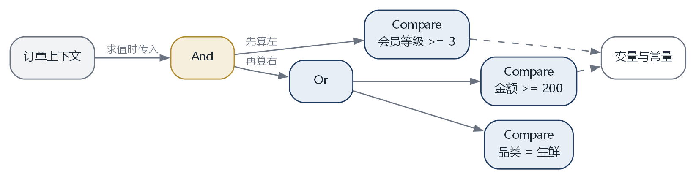

# 第 15 章 解释器：给一套小语言求值

## 15.1 促销规则

电商系统要配促销规则，运营希望自己能改，不必每次找开发。

最初的规则写死在代码里。

```text
if 会员等级 >= 3 and 订单金额 >= 200:
    discount = 订单金额 * 0.9
```

后来规则越来越多。满减、第二件半价、指定品类打折、新用户首单立减、跨店满三百减四十。每次改规则都要发一次版本，运营等三天。

产品提出：能不能让运营在后台填规则，系统直接按填的内容算。

于是运营填了这么一条。

```text
会员等级 >= 3 and (订单金额 >= 200 or 品类 = "生鲜")
```

这句话系统得能读懂。它已经不是一段配置，而是一套小语言：有变量、有比较、有与或非、有括号。

## 15.2 如果直接写解析函数

最直接的做法，是写一个函数，从左到右扫字符串。

```text
func evaluate(text, order):
    tokens = split_by_space(text)
    ...
```

写着写着问题就来了。

**优先级。** `a and b or c` 到底先算哪个。括号一层套一层时，怎么知道算到哪该回退。

**长度。** 每加一种语法，这个函数就多一层嵌套判断。加了函数调用、取反、区间比较之后，函数变成八百行。

**复用。** 同一套规则要在“下单时算折扣”“预览时算折扣”“对账时复算折扣”三处用。函数里混着解析和计算，想只复用其中一半做不到。

## 15.3 用对象表示语法

解释器模式的思路是：把句子里的每种成分表示成一个对象，整句话变成一棵树，求值就是让根节点递归地算下去。

它包含四个角色。

**抽象表达式。** 声明一个“解释”方法，接收一个上下文（这里是订单），返回结果。

**终结符表达式。** 语法里不能再拆的最小单位，比如变量、常量。

**非终结符表达式。** 由子表达式组成的成分，比如与、或、比较。它持有若干子表达式，在解释时先让子表达式算，再合并。

**上下文。** 求值时需要的环境数据，这里是订单本身。

用结构描述。

```text
interface Expr
  eval(ctx) : Value

class Number implements Expr
  v
  eval(ctx) { return v }

class Variable implements Expr
  name
  eval(ctx) { return ctx.lookup(name) }

class And implements Expr
  left, right
  eval(ctx) { return left.eval(ctx) and right.eval(ctx) }

class Or implements Expr
  left, right
  eval(ctx) { return left.eval(ctx) or right.eval(ctx) }

class Compare implements Expr
  op, left, right
  eval(ctx)
    a = left.eval(ctx); b = right.eval(ctx)
    switch op: "="  -> a == b
               ">=" -> a >= b
               "<"  -> a < b
```

一条规则变成这样一棵树。

```text
              And
            /     \
    Compare       Or
   /      \      /   \
等级    >= 3   Compare  Compare
              /    \    /     \
          金额  >=200 品类  =生鲜
```



## 15.4 求值过程

1. 运营保存规则，系统把文本解析成上面那棵树，存进数据库。
2. 用户下单，系统取出这棵树，把订单包成上下文。
3. 调用根节点的 `eval`。
4. `And` 先算左边：`Compare` 取出订单的会员等级，和 3 比较，返回真或假。
5. `And` 再算右边：`Or` 先算金额是否满 200，不满足再算品类是否生鲜。
6. `Or` 把两个结果合并，返回给 `And`。
7. `And` 合并，返回最终结果。

求值过程就是一次深度优先遍历。每个节点只知道自己这一层该怎么算，不知道上层拿结果干什么。

## 15.5 解析和求值要分开

解释器模式常被误读成“把字符串解析和求值写在一起”。真正可用的实现，解析和求值是两件事。

**解析**把文本变成树。这一步和业务无关，只关心语法。它产出的是一棵 `Expr` 树。

**求值**让树在某个上下文里算出一个值。这一步和语法无关，只关心语义。

分开的好处是：树可以缓存，同一条规则只解析一次；也可以序列化，存成 JSON 下次直接还原；还可以换求值方式，比如统计这棵树引用了哪些字段，用于校验规则合法性。

如果解析和求值揉在一起，每次求值都要重新扫一遍字符串，规则一多就是灾难。

## 15.6 节点该有多少种

不是每个语法成分都需要一个类。

**只出现一次的语法，** 可以直接在父节点里内联处理，不必单独建类。

**行为完全相同的成分，** 可以合并。比如“大于”“小于”“等于”都是比较，用一个 `Compare` 类加一个操作符字段就够了，不必写三个类。

**将来会频繁新增的语法，** 才值得为它建独立类。因为新增一个类不动已有代码，这正是这套结构存在的理由。

判断标准和前面几章一样：变化真的发生了，而且还会继续发生，才值得为它留一个扩展位。

## 15.7 组合模式在这里的作用

解释器模式的树结构，本身就是组合模式：叶子和容器实现同一个接口，调用方对着根节点操作，不关心它下面有多少层。

区别在于职责。组合模式关心“整体和部分怎么一视同仁地处理”，解释器模式关心“这棵树代表一句什么话，怎么算出一个结果”。

所以解释器模式通常是组合模式的一次具体应用，不是并列的两个模式。

## 15.8 什么时候不该用它

**语法会变得很大。** 一旦需要函数定义、循环、类型推断，手写的解释器会迅速失控。这时候该用现成的解析器生成器，或者直接嵌入一门成熟的脚本引擎。

**规则数量很少，结构固定。** 三条写死的规则，用几个 if 更清楚。树是为变化准备的，不变化就不需要。

**性能敏感。** 每个节点一次虚调用，深树上的开销明显。规则的求值频率很高时，通常的做法是先把树编译成一段字节码或者一个闭包，之后重复执行，而不是每次都遍历树。

**规则需要强类型检查。** 自制的解释器往往没有类型系统，写错一个字段名要等到运行时才发现。规则复杂到需要校验时，应该定义 schema，而不是只靠一棵树。

## 15.9 与策略的区别

**策略**是在几个已知算法之间选一个，选择发生在代码里或者配置里。

**解释器**是让用户在运行时写出新逻辑，逻辑的结构事先不可知。

策略解决“换一种算法”，解释器解决“让用户自己拼算法”。

## 15.10 一个判断标准

要不要用解释器，看三点。

第一，需要让非开发人员在运行时表达逻辑？需要，这是它最主要的场景。

第二，这套语言的语法是小的、封闭的、自己完全掌握的？是，手写解释器可控；不是，用现成引擎。

第三，语法会持续增加新成分？会，每个成分一个类，加类不改老代码；不会，用一两个函数解析更省事。

如果第一点不成立，后面两点通常也不用看了。规则写死在代码里，往往比维护一套小语言更划算。
