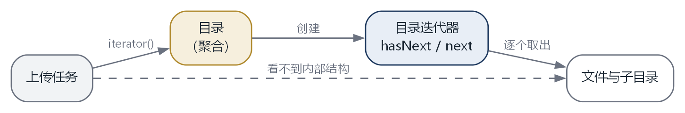

# 第 16 章 迭代器：不暴露内部结构，逐个访问集合里的元素

## 16.1 遍历一个目录树

一个文件同步工具要遍历本地目录，把每个文件上传到服务器。

目录是树状的：文件夹里有文件，也有子文件夹。代码里用两种结构表示。

```text
class File   { name, size, content }
class Folder { name, children : list }
```

最初的上传函数这么写。

```text
func upload_all(folder):
    for child in folder.children:
        if child is Folder:
            upload_all(child)      // 递归
        else:
            upload(child)
```

能跑。但很快要加“跳过隐藏文件”“只上传修改过的”“按大小排序”“显示进度百分比”。每一个都是在递归外面再包一层，四个需求叠起来，函数开始分叉。

真正的问题是：调用方直接操作了 `children` 这个内部结构。它知道文件夹有 `children`，知道元素有两种类型，知道自己要写递归。换一种存储方式，比如把目录索引放进数据库，所有遍历代码都要重写。

## 16.2 把“怎么走”交出去

迭代器模式的思路是：把“逐个取出元素”这件事抽成独立对象，调用方只管问“还有下一个吗”“下一个是什么”，不关心数据放在哪、怎么走。

它包含四个角色。

**迭代器接口。** 声明三个动作：还有没有下一个、取下一个、必要时重置。

**具体迭代器。** 记住当前走到哪，知道底层结构长什么样，负责推进。

**聚合接口。** 声明一个“创建迭代器”的方法。

**具体聚合。** 真正的数据容器，比如目录、列表、树、结果集。它返回一个能遍历自己的迭代器。

用结构描述。

```text
interface Iterator
  has_next() : bool
  next()     : Element

interface Aggregate
  iterator() : Iterator

class Folder implements Aggregate
  children
  iterator() { return new FolderIterator(children) }

class FolderIterator implements Iterator
  stack     // 记录走到的位置，包括每一层的下标
  has_next()
  next()
    // 取出下一个节点，遇到子文件夹时把它的子节点压进栈
```



## 16.3 协作过程

1. 上传函数不写递归，改为向目录要一个迭代器。
2. 只要 `has_next` 为真，就调用 `next` 取下一个。
3. 取到的是文件就上传，取到的是文件夹就由迭代器内部继续往下走。
4. 调用方从头到尾只见过“迭代器”和“节点”，没见过 `children`。

调用方代码变成了这样。

```text
func upload_all(folder):
    it = folder.iterator()
    while it.has_next():
        node = it.next()
        if node is File: upload(node)
```

递归从调用方转移到了迭代器内部。调用方得到的是一个扁平的流，不需要知道树有几层。

## 16.4 遍历策略可以换

同一份数据，不同场景要不同的走法。

**深度优先。** 先走到底，再回来走兄弟。适合“先处理叶子，再处理目录本身”。

**广度优先。** 一层一层走。适合“先显示前两层，剩下的懒加载”。

**按名字排序。** 适合给用户展示。

**只走某一类。** 比如只走大于 1 MB 的文件。

如果把遍历写在调用方，每换一种走法就要改一遍调用代码。用迭代器，只需要换一个具体迭代器。

```text
folder.iterator()            // 默认深度优先
folder.sorted_iterator()     // 按名字排序
folder.filter_iterator(f)    // 只看满足条件的
```

聚合本身完全不用改。这是迭代器最重要的价值：**把访问顺序从数据结构里解耦出来**。

## 16.5 遍历时改动集合

这是迭代器最容易出事的地方。

用户一边遍历列表，一边删除元素，很容易漏掉元素或者越界。原因是迭代器记住了“当前下标”，删除一个元素之后，后面的元素整体前移，下标就对不上了。

常见的三种处理。

**不允许改。** 遍历期间修改直接抛错。Java 的集合就是这么做的，用版本号检测。

**改成快照。** 遍历开始时复制一份元素引用，之后修改原集合不影响遍历。代价是多一份内存，且看到的是开始时的状态。

**迭代器负责删除。** 把删除操作交给迭代器，它自己维护下标。

选哪种取决于语义。需要“删掉所有满足条件的元素”，第三种最合适；需要“边遍历边看最新数据”，第二种不合适；需要严格一致，第一种最安全。

同样的道理也适用于树：遍历子树时把父目录删掉，迭代器手里的节点会失效。这类问题不是模式能解决的，要靠约定或者所有权管理。

## 16.6 外部迭代与内部迭代

上面讲的是外部迭代：调用方控制节奏，一次问一个。

还有一种内部迭代：把“要做什么”交给集合，集合自己决定怎么走。

```text
folder.for_each(func(node) { upload(node) })
```

内部迭代的优点是调用方代码更短，遍历方式可以完全由集合决定，也更容易并行。

缺点是控制力弱。想中途停下来（比如传到第 100 个就取消），想同时遍历两个集合做配对，内部迭代就不方便了。带中断语义的内部迭代器，参数会变得复杂。

经验上：简单的一次性处理用内部迭代，需要精细控制或者组合多个数据源时用外部迭代。

## 16.7 迭代器与生成器

很多语言提供“生成器”（`yield`），写法比手写迭代器省事得多。

```text
func walk(node):
    yield node
    for child in node.children:
        yield from walk(child)
```

编译器会把这段函数变成一个状态机，自动记住走到哪。效果和手写迭代器一样，但代码短很多，也不容易写错下标。

如果语言支持生成器，优先用它。手写迭代器主要用在两种场合：需要精确控制内存和调用时机；或者语言没有生成器。

## 16.8 一个显式栈的目录迭代器

递归改迭代，关键是自己维护一个栈，栈里每一层记“这个文件夹走到第几个子节点”。

```cpp
class FolderIterator : public Iterator {
public:
    explicit FolderIterator(const Folder* root) { stack_.push_back({root, 0}); }
    bool has_next() override { return advance(); }

    const Node& next() override {
        if (!advance()) throw std::out_of_range("no more nodes");
        Frame& top = stack_.back();
        const Node* n = top.folder->children[top.index++];
        if (n->is_folder()) stack_.push_back({static_cast<const Folder*>(n), 0});
        return *n;
    }

private:
    struct Frame { const Folder* folder; std::size_t index; };

    bool advance() {
        while (!stack_.empty()) {
            if (stack_.back().index < stack_.back().folder->children.size()) return true;
            stack_.pop_back();                        // 这一层走完了，退回去
        }
        return false;
    }

    std::vector<Frame> stack_;
};
```

`advance` 负责把走完的层弹掉，`has_next` 和 `next` 都调它，两边的判断就不会错位。`next` 取完元素后，如果它是文件夹，立刻压栈，下一次推进就走进子节点。

栈的深度就是目录深度，一般不超过几十层，内存开销可以忽略不计。比起递归，显式栈的好处是可以在任意时刻停下、保存、之后接着走。断点续传式的遍历要的就是这个能力。

## 16.9 失效检测

调用方拿着迭代器，另一处代码删掉了当前所在的目录，后续 `next` 读的就是已释放的内存。C++ 里没法彻底防住，但可以加一个便宜的检查。

集合维护一个版本号，结构性修改都加一，迭代器创建时拷一份，推进前比一下。不相等就在调试版里断言，在发布版里把迭代器标记成失效，`has_next` 一直返回假。

```cpp
bool FolderIterator::advance() {
    if (alive_ && root_->version != version_) alive_ = false;
    assert(alive_ && "集合在遍历期间被修改");
    ...
}
```

版本号只能抓到结构修改，抓不到元素内容变了。内容变化算不算失效，看使用场景，扫描文件时大小变了就该重新读，展示列表时标题变了却没影响。所以版本号按需给，不必给每个字段都加一个。

## 16.10 在循环里删掉元素

老代码里常见这么一段。

```cpp
for (auto it = files.begin(); it != files.end(); ++it) {
    if (it->expired()) files.erase(it);   // it 已失效，++it 是未定义行为
}
```

删第一个元素时能跑，删到中间就崩，因为 `erase` 让 `it` 失效，再 `++it` 就是踩野指针。“有时候能跑”是内存恰好没被覆盖。

第一种修法，遍历时收集要删的下标，循环结束后从后往前删。

```cpp
std::vector<std::size_t> dead;
for (std::size_t i = 0; i < files.size(); ++i) {
    if (files[i].expired()) dead.push_back(i);
}
for (auto it = dead.rbegin(); it != dead.rend(); ++it) files.erase(files.begin() + *it);
```

第二种是 erase-remove 惯用法，一趟扫描一趟搬移，比逐个 erase 快，适合 vector 这类连续存储。

```cpp
files.erase(std::remove_if(files.begin(), files.end(),
                           [](const File& f) { return f.expired(); }),
            files.end());
```

第三种是把删除交给迭代器，容器提供 `erase_current`，内部自己修正下标。写法最舒服，但要求容器配合，第三方容器往往没有。

三种改法各有位置。删除量少、下标稳定，第一种最直白；大批删除、连续存储，第二种效率最好；自研容器要对外提供安全的删除接口，第三种最贴合使用者的心智。

## 16.11 什么时候不该用它

**只有一个固定结构，只遍历一次。** 写一个 for 循环就够了，多一个类只是负担。

**数据量极小。** 三个元素的数组，迭代器对象的开销比遍历本身还大。

**调用方需要随机访问。** 迭代器是顺序的，要按下标取值、要二分查找，直接用数组或者列表接口。

**遍历逻辑本身就是业务核心。** 比如编译器遍历语法树时要同时维护作用域栈，这些状态和业务强相关，硬塞进迭代器会让迭代器变成第二个业务模块。

## 16.12 与组合模式的关系

组合模式负责“把树搭起来”，迭代器负责“把树走一遍”。

树结构一旦建立，遍历就成了最常见的操作。两者一起用，调用方既能一视同仁地处理单个节点和整棵树，又能用统一的方式访问每个节点。

很多框架里这两个模式是绑在一起提供的：树结构自带一个深度优先迭代器，调用方不需要自己写递归。

## 16.13 一个判断标准

要不要用迭代器，看三点。

第一，调用方不应该知道内部结构？是，把遍历封装起来，暴露内部结构就等于把实现钉死。

第二，同一种数据需要多种遍历方式？是，每种走法一个迭代器，聚合不用改。

第三，遍历过程中集合会变化？会，先把修改规则定清楚，用版本号或者快照，不要让调用方自己猜。

如果只有一个结构、一种走法、不会变化，一个循环就是最好的迭代器。

反过来看也成立。如果一个容器只有一种遍历方式，而且调用方本来就该知道内部结构，比如一个二维数组，把遍历藏起来只会让代码多绕一层。迭代器的价值来自两件事，结构要藏，走法要变，缺一件收益都很小。

落地时盯住三处。取出元素的逻辑只写一份，`has_next` 与 `next` 共用它。集合的结构修改用版本号暴露出来，失效后的行为写进文档。遍历中删除只允许一种写法，团队里有第二种就迟早出事。
