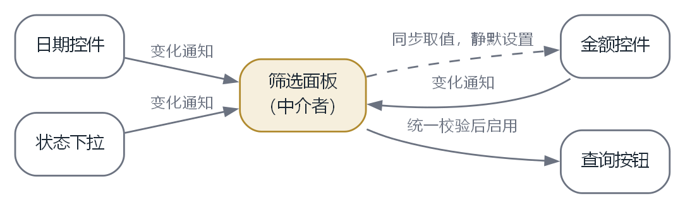
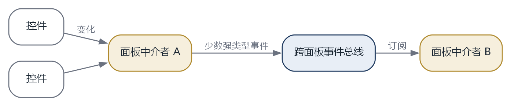

# 第 17 章 中介者：多个对象互相通信，改由中间人转发

## 17.1 一个筛选面板

一个后台管理系统有个订单筛选面板。

面板上有六样东西：下单时间起、下单时间止、金额下限、金额上限、状态下拉框、查询按钮。

最初每个控件自己管自己的逻辑。

```text
class DateStartPicker
  on_change(v):
     if v > date_end.value: date_end.value = v
     query_button.set_enabled(check_all_valid())

class AmountMaxInput
  on_change(v):
     if v < amount_min.value: amount_min.value = v
     query_button.set_enabled(check_all_valid())

class StatusSelect
  on_change(v):
     if v == "已取消": refund_hint.show()
     query_button.set_enabled(check_all_valid())
```

每个控件都直接调了别的控件。六样东西互相都知道对方存在。

## 17.2 六样东西的麻烦

抽象地数一下：六个控件两两通信，最坏情况有十五对关系。

实际会出的问题很具体。

**加一个控件要改一圈。** 加一个“只看大额订单”的复选框，要改日期、金额、状态、按钮四个地方。

**逻辑重复。** 每个控件都写了一遍“检查全部合法”，条件一变要改六处。

**顺序依赖。** 改日期会自动改金额，改金额又会回写日期，触发链一旦形成环，界面开始抖动。

**没法单独测试。** 想测“金额区间非法时按钮禁用”，得把六个控件全构造出来。

## 17.3 让大家只认识一个人

中介者模式的思路是：把控件之间的通信收进一个中介对象，控件只跟中介说话，不跟彼此说话。

它包含三个角色。

**中介者接口。** 声明“某个同事发生了变化，请处理”。

**具体中介者。** 知道所有同事，负责在它们之间转发、校验、联动。

**同事类。** 每个界面控件。它持有中介者的引用，变化时通知中介者；它也提供方法供中介者回调。

用结构描述。

```text
interface Mediator
  notify(sender, event, data)

class FilterPanel implements Mediator
  date_start, date_end, amount_min, amount_max
  status_select, query_button
  notify(sender, event, data)
    if sender is DateStartPicker and event == "change":
        if data > date_end.value: date_end.set_silently(data)
        validate()
    if sender is AmountMaxInput and event == "change":
        if data < amount_min.value: amount_min.set_silently(data)
        validate()
    if sender is StatusSelect and event == "change":
        refund_hint.set_visible(data == "已取消")
        validate()
  validate()
    query_button.set_enabled(
        amount_min.value <= amount_max.value and
        date_start.value <= date_end.value)

class DateStartPicker   // 同事
  mediator
  on_change(v) { mediator.notify(this, "change", v) }
```

关系从十五变成六：每个控件只认识中介者。



## 17.4 协作过程

1. 用户改了“金额上限”，输入框调用 `mediator.notify(this, "change", 500)`。
2. 中介者发现新值小于下限，调用“金额下限”的 `set_silently` 把它同步到 500。
3. `set_silently` 不触发 `on_change`，避免了回环。
4. 中介者调用 `validate`，检查全部规则，决定查询按钮是禁用还是可用。

注意第 3 步。**中介者要能区分“用户改的”和“程序改的”**，否则两个控件会互相触发，无限循环。这是实现中介者时最常见的坑。常见做法是给同事类提供两个入口：一个会通知中介者，一个静默设置。

## 17.5 通知回环与静默设置

“中介者改控件不能再次触发通知”这句话说起来容易，落地时有三处容易漏。

第一处，静默设置只跳过通知，不能跳过界面刷新。有的实现图省事，`set_silently` 改完内部字段直接返回，屏幕上显示的还是旧值。用户看到两个输入框的值对不上，刷新一下又“正常”了。正确做法是拆成两步，先改数据、再刷显示，只省掉发通知那一句。

```cpp
class AmountMaxInput : public Colleague {
public:
    void on_user_edit(int v) override {      // 用户输入的入口
        value_ = clamp(v, 0, 999999);
        refresh_text();
        panel_->notify(this, Event::Change); // 只有这里发通知
    }
    void set_silently(int v) override {      // 中介者用的入口
        if (v == value_) return;
        value_ = v;
        refresh_text();                      // 照刷，只是不发通知
    }
private:
    int value_ = 0;
};
```

第二处，中介者自己可能被重入。日期控件去改金额，金额控件在刷新时顺手把“格式化后的文本”回写了一次，这一次回写如果走的是公开的输入入口，回环就出现了。防御办法是给中介者一个分发标志位，正在分发时收到的新通知先记下来，本轮结束再补一次。

```cpp
void FilterPanel::notify(Colleague* sender, Event e) {
    if (dispatching_) { pending_ = true; return; }
    dispatching_ = true;
    handle(sender, e);          // 改别的控件、跑校验，都在这里
    dispatching_ = false;
    if (pending_) { pending_ = false; notify(sender, e); }
}
```

标志位不是可有可无的保险。哪怕眼前没有回环，半年后有人给某个控件加一句“值变了就同步单位”，回环就回来了。有标志位，最坏情况是多重跑一次校验；没有，就是界面卡死、栈溢出、用户只能杀进程。

第三处，静默设置之后，中介者自己缓存的值要一起更新。不少面板为了少读几次控件，会在中介者里记住“上一次合法的区间”。只更新控件、忘了更新缓存，下一次比较用的就是过期数据。症状是“改三次有一次不联动”，靠复现很难，靠读代码也很容易漏。规矩很简单，中介者要用的值一律从控件现读，别另存副本。

## 17.6 中介者会变胖

中介者的代价很直接：所有联动逻辑都堆到它身上。

控件从六个加到二十个，中介者的 `notify` 里会有二十个分支。它成了“什么都知道”的上帝对象，改一个联动要想清楚影响哪些分支。

几种控制方式。

**按功能分组。** 一个面板一个中介者，不要做一个全局的中介者管所有界面。

**把规则表驱动。** 联动规则写成数据，比如“当 A 变化时，若满足条件 C，则设置 B 为 X”，中介者只负责解释这张表，不写二十个 if。

**下沉到模型层。** 有些“联动”其实是业务规则，比如“状态为已取消时不能填退款金额”。这类规则应该放在订单模型里，界面中介者只负责把模型的状态映射到控件上。

中介者管的是“通信路径”，不是“业务规则”。分不清这两者，中介者一定会膨胀。

## 17.7 把联动规则做成表

控件上到二十个以后，`handle` 里的分支开始互相干扰。这时把“哪条规则、什么条件、改谁”写成数据，中介者就退化成一个小解释器。

```cpp
struct Link {
    Colleague* when;
    Event      event;
    Colleague* target;
    bool (*guard)(const FilterPanel&);
    int  (*compute)(const FilterPanel&);
    int  order;                 // 同一事件上的多条规则按此排序
};

const Link kLinks[] = {
    { amount_max_, Event::Change, amount_min_, nullptr,
      [](const FilterPanel& p){ return p.amount_max_->value(); }, 10 },
    { date_start_, Event::Change, date_end_, nullptr,
      [](const FilterPanel& p){ return p.date_start_->value(); }, 10 },
    { status_,     Event::Change, refund_hint_,
      [](const FilterPanel& p){ return p.status_->value() == kCancelled; },
      [](const FilterPanel&){ return 1; }, 20 },
};
```

`handle` 只剩十几行，匹配 sender 和事件，按 `order` 排序，逐条判断 guard、执行 compute、静默写到 target，最后统一跑一次校验。

表驱动治的是“分支多”，不是“规则乱”。二十条规则塞进一个 if 链会互相干扰，挪进一张表并不会自动变清楚；真正把纠缠解开的是两个字段，`order` 让执行顺序显式，`guard` 让生效条件显式。改一条规则时只看它自己那一行，不用顺着 if 往上读。

代价也要说清楚。表里的 lambda 捕获面板指针，生命周期必须比表长；规则写错不会在编译期报错，只能在运行时表现成“某条不生效”。所以规则表要配一个启动自检，用人工构造的样本面板逐条跑一遍，确认每条规则都能被命中，做不到就别急着表驱动。

## 17.8 一个全局中介者

有个项目把中介者做成了全局单例，所有界面的联动都往它身上挂。第一年很顺，任何界面要跟别的界面通信，调一句 `AppMediator::instance().notify(id, event)` 就完事。

第二年开始出问题。

`notify` 长到六百行，参数是一个字符串 id 加一个字符串事件名。两个团队同时在改这个函数，合并冲突每周都有。有一次改价格输入，另一个界面的同名控件复用了同一个 id，结果在筛选页改价格，把库存页的数量也改了。复现条件是先开两个页面、再切回筛选页，测试没人这么点，上线三天才发现。

收拾的办法不是把 `notify` 拆成十个函数，而是承认“全局”这个前提本身就错了。

每个面板一个中介者，面板内的联动它全权负责，别的面板一概不知情。跨面板的通信压缩到极少数几件事上，走一条应用级事件总线，事件是强类型的结构体，不再是字符串。改完之后面板中介者平均八十行，两个团队各改各的，冲突基本消失。

分界线值得记住。同一屏内的联动是中介者的职责，跨屏的联动是消息的职责。把两者混在一个对象里，中介者迟早长成全系统的上帝对象。



## 17.9 与观察者的区别

两者都涉及“一个变化通知别人”，容易混。

**观察者**是广播：主题不知道订阅者是谁，也不知道有几个，只管发出去。订阅者之间互不认识。

**中介者**是定向转发：中介者认识每一个同事，知道谁该收到什么，并且可以改写、拦截、合并这些消息。

用一句话区分：观察者是“我说了，谁听是你们的事”；中介者是“我告诉你，你再去告诉他”。

实际系统里两者经常一起用。中介者内部用观察者收集事件，再按规则分发。

## 17.10 与外观的区别

**外观**是单向的：调用方通过一个简单入口调用一组子系统，子系统不知道外观存在。

**中介者**是双向的：同事会主动通知中介者，中介者也会回调同事。子系统（同事）知道中介者的存在。

外观是“简化调用”，中介者是“集中通信”。

## 17.11 四种通信方式的对照

| 方式 | 调用方知道谁 | 被调用方知道谁 | 能否拦截改写 | 适合的规模 |
|---|---|---|---|---|
| 直接互相调用 | 全部对方 | 全部对方 | 不能 | 两三个对象 |
| 观察者 | 只知道主题 | 知道主题 | 不能，只转发 | 一对多广播 |
| 中介者 | 只知道中介者 | 只知道中介者 | 能，可校验可合并 | 多对多、有联动规则 |
| 外观 | 只知道外观 | 不知道外观存在 | 能，但不回调 | 单向简化调用 |

四行看下来，选择的依据不是“耦合越低越好”，而是“谁需要知道谁”。观察者让主题彻底不认识订阅者，代价是它不能对通知做任何加工；中介者保留一个认识所有人的中心，换来的是拦截和改写的能力。

## 17.12 什么时候不该用它

**只有两三个对象。** 两个对象的通信，直接互相调用最清楚，中间加一层只是多绕一步。

**通信关系稳定简单。** 一进一出、没有联动，中介者是多余的。

**逻辑本身就不该集中在界面。** 如果联动规则本质是业务规则，放进中介者等于把业务逻辑埋进界面层，将来换个界面就得重写。

**需要极致性能。** 每次变化都走一次中介者分发，高频事件（比如拖动滑块的每一帧）会成为瓶颈。这类场景通常是“先攒一攒，停下来再统一处理”。

## 17.13 一个判断标准

要不要用中介者，看两点。

第一，对象之间的通信已经形成网，改一个要牵动一片？是，把通信收进一个中介者，能显著降低耦合。

第二，通信关系本身比较稳定，只是数量多？稳，中介者的分支不会天天改；不稳，先想清楚是规则在变还是结构在变，规则在变就表驱动，结构在变才值得引入中介者。

一句话：中介者治的是“关系太多”，不是“逻辑太多”。
