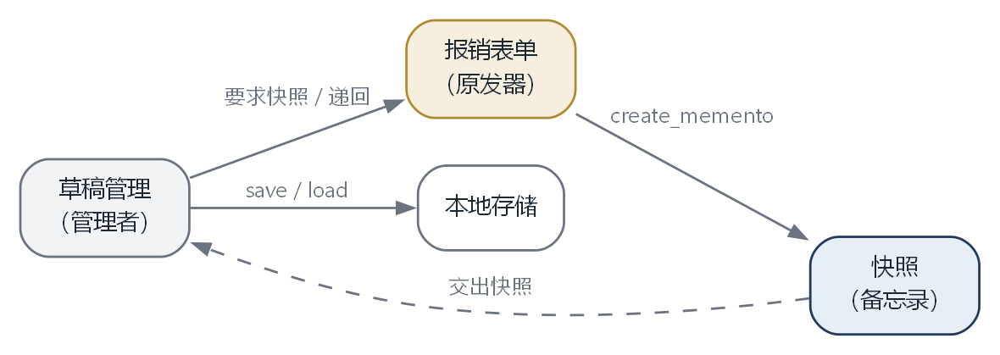
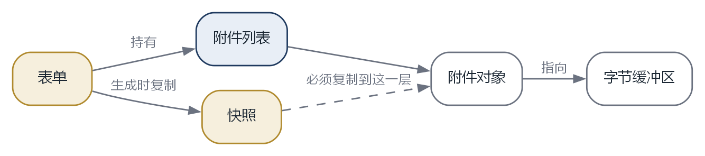

# 第 18 章 备忘录：保存某个时刻的状态，之后能恢复

## 18.1 一份填了半小时的表单

一个报销单填写页面，有二十多个字段：金额、事由、成本中心、发票号、行程明细、审批人。

用户填了一大半，手滑点了“重置”，全没了。投诉之后，产品要求加“保存草稿”。

第一版实现很直接：把每个字段的当前值存进一个对象。

```text
class FormSnapshot
  amount, reason, cost_center
  invoice_no, trip_items, approver
  // 二十多个字段

func save_draft(form):
    snap = new FormSnapshot()
    snap.amount = form.amount
    snap.reason = form.reason
    // 二十多行赋值
    storage.save(snap)
```

三个月后，表单加了一个“附件列表”字段，忘了加进快照。用户恢复草稿，附件全丢。

问题不在于哪一行写错了，而在于：**保存快照这件事，需要知道表单的全部内部结构**。表单每改一次，快照就得跟一次，总有一次会漏。

## 18.2 让对象自己交出一份状态

备忘录模式的思路是：谁的状态，谁最清楚。让对象自己生成一份“能还原自己”的快照，外部只负责保存和递回去，不关心快照里有什么。

它包含三个角色。

**原发器。** 需要保存状态的对象，这里是表单。它提供两个方法：生成快照，从快照恢复。

**备忘录。** 快照本身。它对原发器是透明的（原发器能读写全部内容），对外部是不透明的（外部只能存、递、丢，不能看也不能改）。

**管理者。** 负责保管快照，决定什么时候存、存几份、什么时候丢。它不碰快照的内容。

用结构描述。

```text
class Form                       // 原发器
  fields, attachments, dirty_flag
  create_memento() : Memento
    return new Memento(copy_of(fields), copy_of(attachments), dirty_flag)
  restore(m : Memento)
    fields      = m.fields
    attachments = m.attachments
    dirty_flag  = m.dirty_flag

class Memento                    // 备忘录（对外只读）
  private fields, attachments, dirty_flag

class DraftManager               // 管理者
  slot : Memento
  save(form)    { slot = form.create_memento(); storage.put(slot) }
  restore(form) { form.restore(storage.get()) }
  clear()       { storage.remove() }
```

关键是 `create_memento` 在表单内部。新增字段时，编译器会提醒你“快照里还没有这个字段”，而不是等上线后被用户发现。



## 18.3 协作过程

1. 用户点“保存草稿”，界面调用 `DraftManager.save(form)`。
2. 管理者让表单自己生成快照，把快照存进存储。
3. 管理者不知道快照里有什么，也不做任何加工。
4. 用户下次打开页面，管理者取出快照，交给表单的 `restore`。
5. 表单把快照内容填回自己的字段，界面刷新。

整条链路里，只有表单知道快照的结构。管理者换成本地文件、数据库、远端接口，都不影响表单。

## 18.4 深拷贝还是浅拷贝

这是备忘录最容易出问题的地方。

表单里有一个“行程明细”列表，元素是对象。如果快照只复制了列表的引用，那么用户之后修改列表元素，快照里的内容也跟着变，恢复就恢复不到原始状态。

原则很简单：**快照里的每一个可变对象，都要复制到底**。

但深拷贝有代价。一个大文档、一张图像、一个几十万元素的列表，全量复制一次的内存和耗时都很可观。

几种折中。

**写时复制。** 快照和当前对象共享同一份数据，谁要修改谁先复制。适合“快照多、修改少”的场景。

**只存变化。** 快照只记录和上一版的差异。适合“频繁保存、内容大体不变”的场景，代价是恢复时需要按顺序重放。

**存不可变对象。** 如果内部数据结构本身不可变，快照只需要持有引用，天然安全。这是最省事的做法，前提是能把可变部分改造成不可变。

选择依据是数据规模和修改频率。全量复制在数据小的时候最简单可靠，别为了省内存写出难懂的增量逻辑。

## 18.5 深拷贝的边界在哪

“每个可变对象都复制到底”仍然太含糊，边界到底画在哪一层，用一段代码说清。

```cpp
struct Attachment {
    std::string            name;
    std::vector<std::byte> data;    // 值语义，拷贝时递归到底
};

class Form {
public:
    Memento create_memento() const {
        Memento m;
        m.fields_      = fields_;        // 字符串、数字，值语义
        m.attachments_ = attachments_;   // vector<Attachment>，逐个拷贝
        return m;
    }
private:
    std::map<std::string, std::string> fields_;
    std::vector<Attachment>            attachments_;
};
```

这段代码没写一行复制逻辑，边界却已经画对了，原因是成员都是值类型，容器的拷贝构造会一路拷到最底层。真正需要警惕的是指针和智能指针。

```cpp
std::vector<std::shared_ptr<Attachment>> attachments_;   // 拷贝只加引用计数
```

用户保存草稿后继续改图，快照里的图跟着变，恢复出来是“改了一半的样子”。这类 bug 的迷惑性在于首次测试往往是通过的，它只在“保存后接着编辑”这个顺序下才出现。若确实需要共享，前提是被共享的对象之后不再改变，要么字段全 const，要么只存不可变的字节流。

还有一个方向常被忽略，**恢复时的复制**。

```cpp
void Form::restore(const Memento& m) {
    fields_      = m.fields_;          // 从快照拷出
    attachments_ = m.attachments_;     // 不能直接指向快照内部的数据
}
```

如果 `restore` 把当前状态指到快照内部，接下来的每一次编辑都在改快照。这份快照还在撤销历史里，历史就脏了。一条自检办法很便宜，同一份快照恢复两次，结果必须完全一样；第二次不一样，说明中间有人改过它。



## 18.6 存几份

管理者决定保留几份快照。

**只留一份。** 自动保存草稿，用最新的覆盖旧的。实现最简单。

**留固定几份。** 比如最近五次，形成一个环形缓冲。用户误操作时可以多退几步。

**按时间留。** 每分钟一份，保留最近一小时。

**不限份数。** 完整的撤销历史。这已经不是简单的备忘录，而是编辑器的操作日志，通常要配合命令模式（见第 14 章）。

份数越多，内存和存储压力越大。真实系统里通常分两层：内存里留少量最近快照，磁盘上留少量关键节点，其余丢弃。

## 18.7 份数、字节与一个常见的坏习惯

“留几份”和“占多少内存”是两件事。一份带两张压缩图的报销单，快照在两百 KB 量级；留二十份就是四 MB，一个用户开三个标签页就是十二 MB，几百个在线用户能把进程撜到几个 GB。按字节限额比按份数限更可控。

```cpp
class UndoStack {
public:
    explicit UndoStack(std::size_t limit_bytes) : limit_(limit_bytes) {}
    void push(Memento m) {
        bytes_ += m.byte_size();
        items_.push_back(std::move(m));
        while (bytes_ > limit_ && items_.size() > 1) {   // 至少留一份
            bytes_ -= items_.front().byte_size();
            items_.pop_front();
        }
    }
private:
    std::size_t          limit_;
    std::size_t          bytes_ = 0;
    std::deque<Memento>  items_;
};
```

按字节限的代价是“能撤销几步”变得不确定，这一点要在产品上先说清楚，否则用户会认为撤销坏了。

还有一个循环缓冲常见的坑。若 `push` 每次传进来的都是同一个可变对象（而不是值或者不可变快照），五份快照其实是同一个状态的五个引用，用户连按五次撤销每次都回到同一个地方。所以快照一旦放进栈就不能再被修改，要么按值存，要么入栈后冻结。

| 保留策略 | 内存 | 可撤销步数 | 实现成本 | 适合的场景 |
|---|---|---|---|---|
| 只留一份 | 最小 | 一步 | 极低 | 自动保存草稿 |
| 固定份数，环形覆盖 | 与份数线性 | 固定 | 低 | 编辑器日常撤销 |
| 按字节限额 | 可预估 | 不确定 | 低 | 多用户在线系统 |
| 限额加关键节点 | 可预估 | 关键节点不限 | 中 | 有审批、有里程碑的业务 |
| 全量历史 | 最大 | 无限 | 高 | 需要审计或回溯 |

## 18.8 与命令的区别

两者都能实现撤销，思路相反。

**命令**记录“做了什么”，撤销靠反向执行。

**备忘录**记录“是什么状态”，撤销靠整体恢复。

命令省内存，但要求每个操作都能反向，而且反向逻辑容易写错。备忘录实现简单、一定正确，但占内存。

实际系统经常混用：日常的每一次编辑用命令，代价小的操作反向执行；遇到批量替换、格式重排这类复杂操作，先做一份备忘录快照，撤销时整体回滚。

## 18.9 与序列化的区别

序列化是把对象变成字节流，用于存储或传输。备忘录是“从对象生成一个能还原它的东西”。

两者经常重合：快照就是序列化后的对象。但备忘录的语义更窄——它不要求跨进程、跨版本可读，也不要求格式稳定。它只是“这一刻的状态”。

如果把快照存到磁盘、跨版本读回，就要考虑格式兼容：老版本存的快照，新版本能不能读。这时候序列化格式的版本管理就成了主要问题，备忘录模式本身不解决它。

## 18.10 四种记住过去的办法

| | 存什么 | 撤销靠什么 | 内存 | 一旦写错 |
|---|---|---|---|---|
| 备忘录 | 某一刻的完整状态 | 整体恢复 | 大 | 基本不会错 |
| 命令 | 每次操作的参数 | 反向执行 | 小 | 反向逻辑容易漏写 |
| 事件溯源 | 全部事件序列 | 重放 | 取决于事件数 | 早期事件不可修改 |
| 序列化快照 | 对象的字节流 | 反序列化 | 大 | 跨版本格式不兼容 |

四个选项不是互斥的。常见的组合是事件溯源做主干，定期存一份序列化快照作为检查点，撤销最近几步用命令。

## 18.11 一份被公开的快照

有个项目的 `Memento` 是个 struct，字段全 public，定义在共享头文件里。开始只是为了方便调试时打印，后来三个模块直接读它的字段，一个报表模块甚至把快照里的金额“顺手”改成折后价用来展示。

问题在一个月后出现。用户恢复草稿，金额比原来少了两百元，而且只在“保存、看报表、再恢复”这个顺序下复现。查了两天才定位到那行赋值，它改的是快照本体，不是拷贝。

收拾分三步。把 `Memento` 改成 class，字段私有，只对原发器开放；对外只暴露元数据，创建时间、字段数量、占用字节，用于列表展示；报表模块改成从原发器读当前值，不再碰快照。再加上前文那条双重恢复的断言测试，这类问题以后会在测试阶段就被拦住。

封装不是为了好看。备忘录的不透明性是对外的一种约束，一旦破例，后面每新增一个模块就多一个修改快照的机会。

## 18.12 什么时候不该用它

**状态很大，保存频率很高。** 每次操作都全量快照，内存和时间都不划算。这时候该用命令、增量日志或者写时复制。

**状态对外必须可见。** 有些场景需要外部检查快照内容，比如审计、比对、迁移。备忘录刻意对外不透明，硬要暴露就失去了封装的意义，不如直接用数据传输对象。

**只有一个固定状态要存。** 比如“上次打开的标签页”，存一个字段就够了，不需要三个角色。

**状态分散在多个对象里。** 单对象的备忘录只管自己。跨对象的整体快照要由上层协调，否则每个对象各存一份，恢复时容易出现半新半旧的状态。

## 18.13 一个判断标准

要不要用备忘录，看三点。

第一，需要“回到之前的某个时刻”，而且这个时刻的状态不容易反向推导？需要，备忘录是标准解法。

第二，状态由对象自己生成最可靠？是，把生成逻辑放进原发器，避免外部逐字段抄写。

第三，全量复制的代价可以接受？可以，直接存；不可以，先考虑写时复制或者增量。

判断的核心是那句老话：能用较小的代价保存快照，就保存；不能，就别硬上，先想办法把状态变小。
